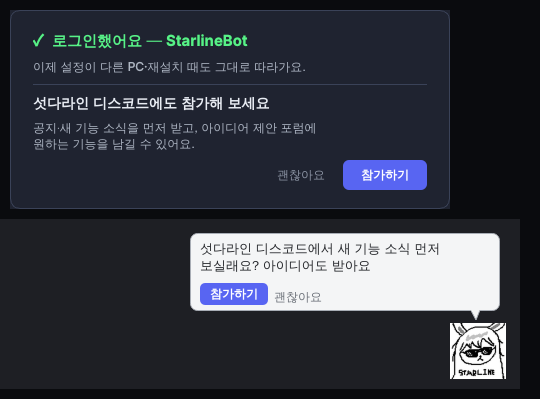
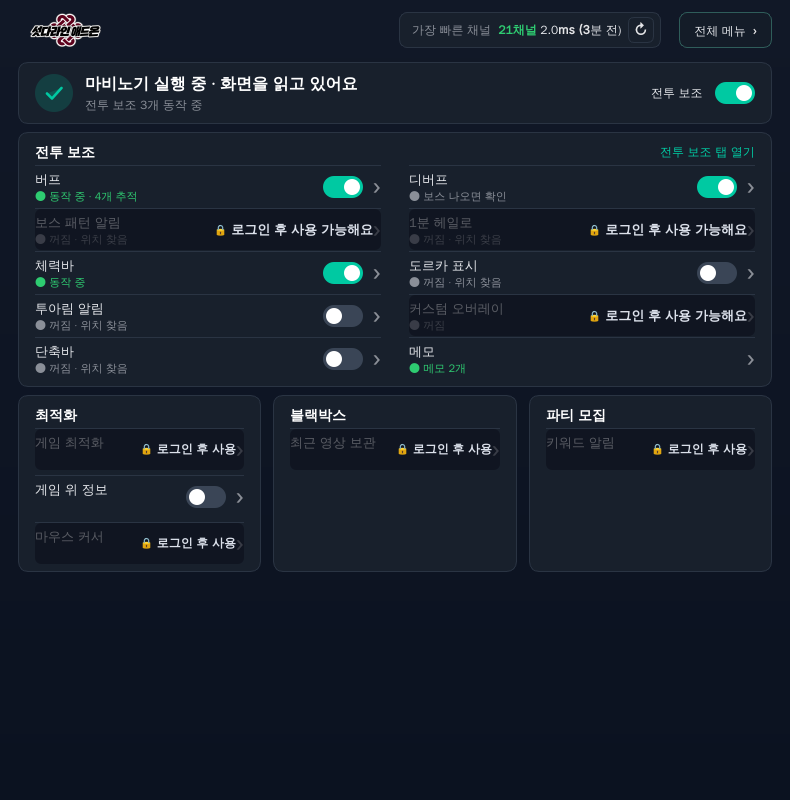
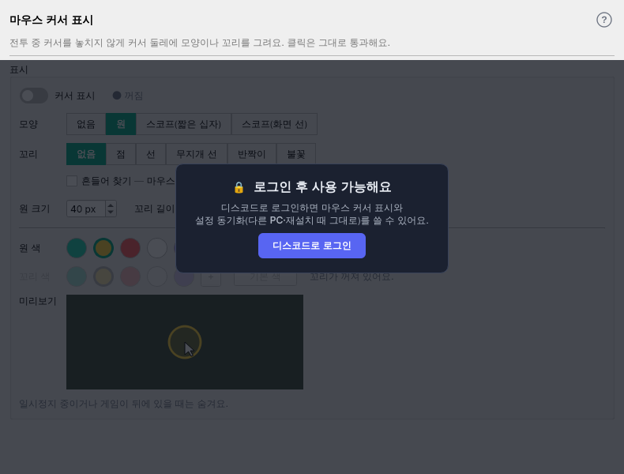
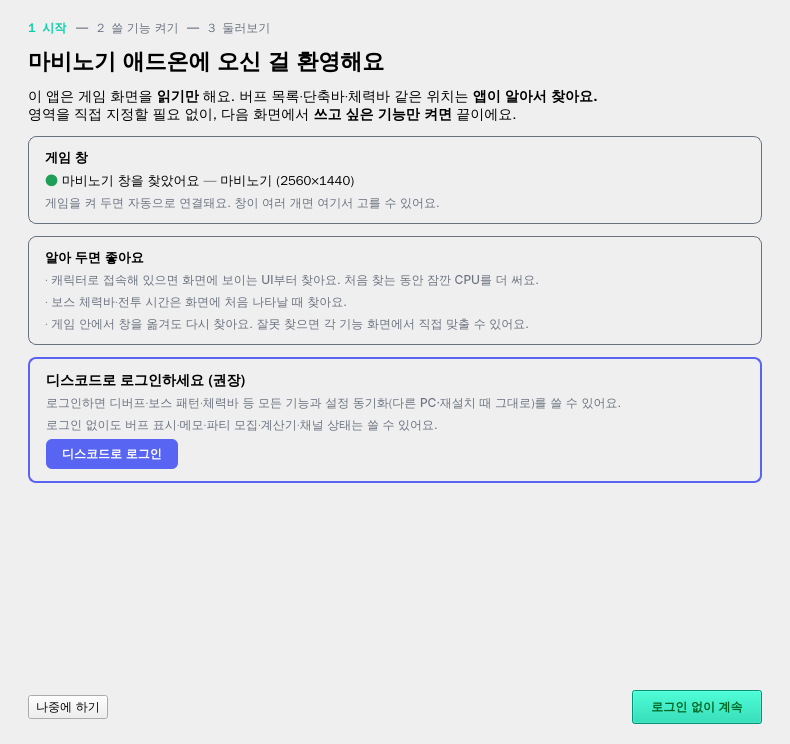

# 사용자 계정 관리 — 로그인·설정 동기화 (확정)

- 작성: 2026-11-07 초안 → **2026-11-11 확정(사용자 결정 11-09~11)**. 상태: **1단계 — 서버 준비 완료(addon_server 4a4c5de), 앱 0.46.0 구현(11-11)**. 규격은 3.4.1.
- 사용자 목적: ① 설정을 사람이 직접 관리하지 않고 **동기화** ② **누가 어떤 기능을 쓰는지**는 동기화된 설정으로 보기 ③ 쓰지 않았으면 하는 사용자 **차단**(동기화 이후).
- [기능 공개 정책 7절](feature-release-stage-review.md#7-사용-기능-전체-공개-2026-10-28-사용자-결정--16절의-로그인제작자-제한에-우선)(10-28 사용 기능 전체 공개)은 **2단계부터** 이 문서 4절로 대체된다. 1단계에서는 공개 범위가 지금과 같다.

## 1. 지금 (코드 확인, 2026-11-07)
| 항목 | 지금 | 문제 |
| --- | --- | --- |
| 로그인 | `discord_auth.py` Implicit Grant(scope `identify`), 앱이 `/users/@me` 직접 조회, `http://localhost:53123/callback` | 서버가 없어 로그인 기록이 어디에도 없음 |
| 로그인 상태 | `config.json`의 `discordUser {id, name}` | **파일에 제작자 ID를 적으면 제작자 기능이 열림**(`feature_access.is_creator()`) |
| 설정 옮기기 | 파일 내보내기·가져오기(`config.export_bundle`/`import_bundle`), 디스코드 DM 백업 릴레이 | 사람이 직접 해야 함 |
| 권한 확인 | `is_creator()`·`load_discord_user()` 호출 27곳 | 등급 판정을 한 곳(`feature_access`)으로 모아야 함 |

## 2. 결정 요약
| 주제 | 결정 |
| --- | --- |
| 비로그인 | ~~서버와 통신하지 않는다~~ → **설정 올리기만(사용 현황 보기용, 3.4.3 — 11-23)**, 동기화·차단 대상 아님 |
| 설정 동기화 | **디스코드 로그인해야만**. 1단계의 핵심 |
| 사용량 보기 | 따로 모으지 않음 — **동기화된 설정**의 기능 사용 값으로 본다(봇 명령) |
| 동기화 범위 | 오버레이 위치는 **해상도가 같을 때만** 적용. **DM 백업·파일 내보내기·가져오기는 그대로**(사용 편의) |
| 서버 | **A안: 디스코드 봇이 도는 GCP VM(무료 e2-micro)에 같이**, DB는 **SQLite**(별도 DB 서버 없음) |
| 주소 | **`https://starline-bot.duckdns.org`**(DuckDNS 무료, VM 136.119.121.58 연결 확인 11-11) |
| 서버 코드 | **discord_bot 저장소 안의 `addon_server/` 폴더**(사용자 결정 11-11 — 새 저장소 만들지 않음), VM `~/project/discord_bot/addon_server`, 봇과 **별도 프로세스(systemd 서비스)** |
| 차단 | **동기화 이후**(2단계) |
| 비로그인 기능 제한 | **2단계**(4절 목록) |
| 단계 | 1단계 = 로그인 + 설정 동기화 / 2단계 = 기능 나누기 + 첫 사용 로그인 카드 + 기존 사용자 안내 + 차단·테스터 |

- VM 여유(11-10 확인): 전체 952MB 중 쓸 수 있는 메모리 약 495MB, 스왑 1GB 설정 완료. 추가분(API + Caddy) 약 70~120MB.
- 서버 코드를 앱 저장소에 두지 않는 이유: VM에 앱 저장소(테스트 자료 포함 .git 약 900MB)를 받을 필요가 없다. discord_bot 저장소에 두면 봇 명령과 같은 DB 접근 코드를 함께 쓰고, VM에서 `git pull` 한 번으로 둘 다 받는다(재시작은 각각).

## 3. 1단계 — 로그인 + 설정 동기화

### 3.1 구조
```
앱(PC) ──HTTPS──> starline-bot.duckdns.org ─ Caddy(443, 인증서 자동) ─> 서버 API(127.0.0.1:8000, ~/project/discord_bot/addon_server)
                                                                          ├─ SQLite: 사용자·동기화 기록
                                                                          └─ data/settings/<디스코드ID>.zip
디스코드 봇(~/project/discord_bot, 같은 저장소) ──같은 SQLite 읽기──> /애드온 사용자 (1단계는 읽기만, 선택)
```

### 3.2 로그인 흐름 (비밀값은 서버에만)
1. 앱: 설정 › 계정 `디스코드로 로그인` → 로컬 대기(`localhost:53123`, 지금과 같음) → 브라우저로 `https://starline-bot.duckdns.org/auth/start?state=<무작위>&port=53123`.
2. 서버: 디스코드 인증 화면으로(Authorization Code, client secret은 서버만) → 디스코드가 서버 `/auth/callback`으로 코드 전달 → 서버가 코드 교환·사용자 확인 → 사용자 기록 → **서명한 앱 토큰** 발급.
3. 서버 → 브라우저 → `http://localhost:53123/callback?token=…&state=…`(앱이 state 확인) → 앱이 **내장 공개 키로 서명 확인** 후 저장. 브라우저에는 지금의 '로그인 완료' 카드.
- 앱 토큰: 서명(Ed25519 제안)된 `{디스코드 ID, 이름, 등급(user/creator), 발급·만료(30일)}`. 앱은 공개 키만 갖는다 → config.json을 고쳐 로그인·제작자 흉내 불가.
- 갱신: 앱 시작할 때 + 켜진 동안 하루 1번 `/me`로 새 토큰. 서버가 꺼져 있으면 **마지막 확인 뒤 7일**까지 그대로(제안), 넘으면 비로그인으로.
- 로그아웃: 앱이 토큰을 지우고 서버에 한 번 알림(봇에 `로그아웃 · 날짜`).
- `feature_access.is_creator()`는 **토큰의 등급**으로 판정(1단계부터 — 제작자 흉내 차단). 27곳의 호출은 `feature_access`의 등급 함수로 모은다(동작 변화 없음).
- 디스코드 개발자 포털: Redirect에 `https://starline-bot.duckdns.org/auth/callback` 추가, client secret 발급(서버 `.env`에만). 지금의 `localhost` Redirect는 새 흐름 확인 뒤 정리.

### 3.3 설정 동기화
| 언제 | 동작 |
| --- | --- |
| 설정이 바뀌면 | 30초 뒤 한 번(연달아 바꾸면 마지막 것만) + 앱을 끌 때 한 번 올림. 작업 스레드, 조용히 |
| 새 PC·재설치(이 PC에 동기화 기록 없음) + 서버에 설정 있음 | `서버에 저장된 설정이 있어요 (마지막 저장: 11월 9일 · <PC 이름>). 불러올까요?` → `불러오기` / `이 PC 설정 쓰기` |
| 두 PC 번갈아 | 시작 때 서버 것이 더 새것이면 받아 옴. 이 PC에도 안 올린 변경이 있으면(둘 다 바뀜) 위와 같은 물음 |

- 내용물: `config.export_bundle` 묶음(설정 + 직접 집은 아이콘 등) 그대로. 상한 2MB(제안). 받을 때는 `import_bundle`의 검사 그대로.
- **빼는 값**(PC마다 다름): 지금 `_SECRET_KEYS`·`_MACHINE_KEYS`에 더해 **설치 ID, 로그인 정보·토큰, 자동 찾기 지난 자리, 마지막으로 본 버전(릴리즈 노트)**, 동기화 기록 자체. 등록한 게임 창(gameExe — 실행파일 이름이라 PC마다 같음)은 따라온다(0.46.0). 받은 값이 없거나 게임이 아닌 이름(브라우저·탐색기·메신저·앱 자신)이면 이 PC 값 유지.
- **오버레이 위치**: 올릴 때 화면 해상도를 함께 적고, 받을 때 **해상도가 같을 때만** 위치를 적용(다르면 이 PC 위치 유지).
- 충돌: 서버가 버전 번호(rev)를 매기고, 올릴 때 '내가 받은 rev'를 함께 보냄 → 다르면 서버가 거절(409) → 앱이 위 물음.
- 화면(설정 › 계정): `디스코드로 로그인`/`로그아웃`, `☑ 설정 동기화`(로그인하면 기본 켬), 회색 한 줄 `마지막 동기화: 3분 전`. DM 백업·파일 내보내기·가져오기 버튼은 그대로.
- 비로그인: 지금과 똑같음(통신 없음).

### 3.4 서버 API (최소)
| 경로 | 하는 일 |
| --- | --- |
| `GET /auth/start` · `GET /auth/callback` | 로그인 흐름(3.2) |
| `GET /me` | 토큰 확인·새 토큰·(2단계) 차단 여부. 마지막 접속 시각 기록 |
| `POST /auth/logout` | 로그아웃 기록 |
| `GET /settings` | rev·저장 시각·PC 이름·크기 |
| `GET /settings/blob` | 설정 묶음 받기 |
| `PUT /settings` | 올리기(`If-Match: rev`, 2MB 상한, ZIP 형식 확인) → 새 rev |
| `GET /health` | 살아 있는지(운영 확인용) |
- 요청 수 제한(사용자당 분당 수십 회), 묶음 크기·형식 확인, 토큰 서명·만료 확인.
- SQLite(WAL): `users(discord_id, name, created, last_seen, logged_out, tier, status)`, `settings(discord_id, rev, updated, device, resolution, size, features)` — `features`는 받은 설정에서 기능 사용 값만 읽어 둔 것(봇 보기용).
- 비밀값: `~/project/discord_bot/addon_server/.env`(권한 600, git 제외 — 봇의 .env와 분리) — 디스코드 client secret, 서명 비밀 키. 공개 키는 앱 코드에 넣는다.

### 3.4.1 앱 ↔ 서버 규격(서버 discord_bot/addon_server 커밋 4a4c5de, 상세는 그 저장소 addon_server/README.md 1절) — 앱 0.46.0이 이대로 구현
- **로그인**: 브라우저 `GET /auth/start?state=<8~128자 [A-Za-z0-9_-]>&port=53123` → 항상 `http://localhost:<port>/callback`으로 돌아옴:
  성공 `?token=…&state=…` / 취소 `?error=access_denied` / 실패 `?error=login_failed` / 차단(2단계) `?error=blocked`(모두 `&state=`). 앱은 state를 반드시 확인. 요청은 10분 안·1회만.
- **토큰**: JWT, `alg=EdDSA`(Ed25519), header `kid="k1"`, 클레임 `iss="starline-bot"`, `aud="mabinogi-addon"`, `sub`(디스코드 ID), `name`, `tier`("user"|"creator", 서버가 CREATOR_IDS로 /me마다 정함), `iat`, `exp`(+30일).
  앱 확인: 서명(`header.payload`) + alg + iss + aud + exp — 앱은 순수 파이썬 Ed25519(`ed25519.py`)로 확인(의존성 추가 없음).
- **공개 키(앱 내장)**: raw base64 `wpSDRfPaiTpyr1+SXsJq8ZNKc7evZYmFHGujnapR18Y=` → `account.PUBLIC_KEY_HEX`(hex), `PUBLIC_KEY_IS_TEST = False`.
- **공통 오류**(헤더 `Authorization: Bearer <토큰>`): 401(토큰 없음·틀림·만료·서버에 없는 사용자 → 앱은 비로그인), 403(차단·2단계 → 비로그인), 429(분당 60회 초과 → 다음에 다시). 연결 실패·5xx는 앱이 7일 유예.
- `GET /me` → `{id, name, tier, status, token, expiresAt}` — 앱은 `token`만 받아 서명 확인 후 교체.  `POST /auth/logout` → 204.
- `GET /settings` → `{exists:false, rev:0}` 또는 `{exists:true, rev, updated(UTC ISO8601 'Z'), device, resolution, size}` — 앱은 날짜를 현지 시각으로 표시.
- `GET /settings/blob` → ZIP(헤더 `X-Settings-Rev`), 없으면 404.
- `PUT /settings?device=<PC 이름 64자>&resolution=<2560x1440>`, 헤더 `If-Match: <마지막 rev, 처음 0>`, 본문 ZIP → `{rev, updated, size}`(앱이 rev 저장).
  `409 {detail, rev}` = 둘 다 바뀜 → 앱이 `GET /settings`를 한 번 더 읽어 '마지막 저장: 날짜 · PC'와 함께 물음, '이 PC 설정 쓰기'면 응답 rev로 다시 PUT. 428·400·413(2MB 초과 등)·422(형식·비밀값 키).
- **묶음**: export_bundle 형식(`config.json` + `userdata/…`, 앱은 `sync.json`도 넣음 — 서버는 모르는 이름 무시). 압축 2MB·config.json 1MB·풀어서 64MB·4096개, 절대경로·`..`·역슬래시 금지, 비밀값 키 있으면 422.
  빼는 값(3.3)은 서버가 검사하지 않음 → 앱이 뺀다. 봇 '켠 기능'은 `{"<기능>": {"enabled": bool}}`·최상위 `…Enabled` 불값만 읽음(앱 설정 모양 그대로).
  → **3.4.2로 바꿈**(이 방식은 스위치 없는 기능을 못 봄).

### 3.4.2 사용 기능 보고 `featureUsage` (사용자 결정 2026-11-18, B안 — 개발 대기)
**문제(코드 확인 11-18)**: 봇은 설정의 `enabled`만 봐서 실제 사용과 다르다.
- 버프·디버프·보스 패턴 알림·1분 헤일로는 **켜고 끄는 값이 없다**(홈 `COMBAT_ROWS` 스위치 없음 — 자동 찾기·영역이 있으면 동작). 보스 탭은 `bossPattern.enabled`를 쓰지 않는다(`_save`는 표시 옵션만).
  → 실제로 써도 봇에 안 나옴. 제작자에게만 `buffTracker`·`bossPattern`이 보이는 건 옛 버전이 남긴 값.
- `autofindV2.enabled`는 0.45.0 이후 앱이 읽지 않는 옛 값(자동 찾기는 모두 항상 켬) → 봇에 제작자만 '켬'으로 보임.

**정한 방식**: 무엇이 실제로 돌았는지는 앱이 안다 → **앱이 기능별 '마지막으로 실제 동작한 날'을 설정에 적고, 봇은 그것만 읽는다.**
- 앱 설정 최상위 `featureUsage: {"<키>": "YYYY-MM-DD"}`(현지 날짜). 동기화 대상(빼는 값 아님), 내보내기에는 넣어도 됨(가져오기 때는 이 PC 값 유지 — `_ACCOUNT_KEYS`처럼 다루지 말 것, 단순 덮어쓰기 금지만).
- 날짜 갱신: 그날 처음 조건을 만족할 때 한 번만 저장(같은 날 다시 쓰지 않음 — 동기화 30초 모으기를 매번 깨우지 않게). 게임이 실행 중이고 전투 보조 일시정지가 아닐 때만.
- 키와 '동작' 기준(홈 화면 키와 같은 이름):

| 키 | 동작으로 보는 때 |
| --- | --- |
| `buff` | 버프 목록에서 버프 1개 이상 인식 |
| `debuff` | 디버프 오버레이가 보스 판정으로 표시됨 |
| `boss` | 보스 패턴 알림이 보스 이름을 식별함 |
| `halo` | 1분 헤일로 전투 시간 판독 성공 |
| `tuarim` · `dorcha` · `stat_bars` · `skillbar` · `custom` | 스위치 켬 + 그 오버레이가 표시됨 |
| `cooldown` · `boss_bar` | 켬 + 표시됨(제작자 기능 포함) |
| `fps` | 게임 위 정보 표시 켬 + 표시됨 |
| `opt` | 최적화 '적용 중' 상태 |
| `cursor` | 커서 효과 켬 |
| `blackbox` | 녹화 중 |
| `alarm` | 알람 1개 이상 켬 |
| `keywords` | 파티 모집 키워드 1개 이상 |
| `pet` | 화면에 캐릭터 띄우기 켬 + 펫이 화면에 떠 있음(캐릭터 현황 3.4.4 — 사용자 11-25) |
| `character_voice` | 고른 캐릭터 목소리 팩(`voice.pack` 비어 있지 않음)으로 알림 소리가 1번 이상 울림(3.4.4) |

- 자동 찾기(v2)는 기능이 아니라 넣지 않는다. 새 기능을 만들면 이 표에 키를 더하는 것이 그 기능 개발의 일부.

**봇(discord_bot `addon_server/app/bundle.py` `extract_features`)**:
- 설정에 `featureUsage`(dict, 값이 `YYYY-MM-DD` 문자열)가 있으면 **그것만** 쓴다: 키별 날짜 저장(최대 64개, 키 64자).
  봇 표시 = 최근 7일 안 날짜인 키 🟢, 그 밖은 표시 안 함(또는 '최근 사용 없음'). 날짜는 서버 받은 시각 기준으로 비교(미래 날짜는 오늘로).
- `featureUsage`가 없으면(0.52.0 이하 앱) 지금 규칙(`enabled`·`…Enabled`) 그대로 — 단 `autofindV2` 키는 빼고 표시.
- DB `settings.features`는 그대로 TEXT(JSON) — 값이 bool 또는 날짜 문자열이 섞일 수 있게 봇 표시 코드가 둘 다 처리.

**테스트**: 앱 — 기준별로 하루 한 번만 저장, 일시정지·게임 꺼짐이면 안 씀, 동기화 묶음에 들어감, 가져오기로 덮이지 않음.
봇 — `featureUsage` 있으면 그것만·7일 경계·미래 날짜, 없으면 옛 규칙(autofindV2 제외), 이상한 값(문자열 아님·형식 틀림) 무시.

### 3.4.3 비로그인 설정 올리기(사용 현황 보기용) (사용자 결정 2026-11-23 — 2절 '비로그인은 서버와 통신하지 않는다'를 이렇게 바꿈)
- 목적: 비로그인 사용자 수와 어떤 설정·기능을 쓰는지 보기. **올리기만 하고 동기화(받아 적용)는 없음.**
- **앱**: 로그인하지 않았으면 **앱을 켤 때 한 번(켜고 60초 뒤 — 첫 사용 설정이 저장될 시간) + 켜져 있는 동안 1시간마다 한 번**(켜 두고 안 끄는 사용자도 현황에 잡히게 — 사용자 결정 11-23) 같은 묶음(`cloud_sync.build_blob`)을 `PUT /guest/settings`로 올린다(사용자 결정 11-23: 현황만 보면 되니 자주 보낼 필요 없음). 설정이 바뀔 때·종료할 때는 보내지 않는다. 서버가 꺼져 있거나 실패하면 조용히 넘어감(다음 차례에 다시). 로그인하면 이 경로는 멈추고 기존 동기화.
  - 구분 값: `installId`(PC마다 무작위 32자 hex, 이미 있음 — `inquiry_session.install_id()`), 헤더 `X-Install-Id`.
  - **빼고 보내는 것**(코드 확인 11-23 — 윈도우 사용자 이름·직접 쓴 글이 들어갈 수 있는 값): PC 이름(`device` 빈 값), 메모(`memo` 섹션 전체), **절대 경로 값 전부**(`blackbox.outputFolder`·`sketch.dir`·`general.gameImagePath` 등 — 드라이브 문자나 `\\`로 시작하는 문자열은 키와 상관없이 뺌). 그 밖은 로그인 동기화 묶음과 같음(비밀값·계정 값은 이미 빠짐).
  - 안내·끄기 스위치 없음(사용자 결정 — 위 값을 빼면 사람을 특정할 값이 없음).
- **서버**(discord_bot addon_server): `PUT /guest/settings` — 토큰 없음, `X-Install-Id`가 `[0-9a-f]{16,32}`가 아니면 400. 묶음 검사는 `PUT /settings`와 같음(2MB·형식·비밀값 키 422).
  별도 테이블 `guests(install_id, updated, resolution, size, features, app_version, blob)`에 덮어쓰기(rev·충돌 없음). 받아 가는 주소 없음(GET 없음).
  **IP를 저장하지 않는다**(앱 로그·DB 모두). 요청 수 제한: install당 10분에 1회(켤 때 한 번이므로), 전체 분당 300회. guests 전체 크기 상한(예: 2GB)을 넘으면 가장 오래된 것부터 지움.
  `!현황`: 맨 위 `비로그인 N명(최근 7일)`, 로그인 사용자 아래에 `guest-<앞 8자>` 줄(접속 시각·해상도·앱 버전·켠 기능 — 로그인과 같은 형식, featureUsage 기준). 같은 installId가 나중에 로그인하면 guest 줄은 7일 뒤 자연히 빠짐(연결은 하지 않음).
- 테스트: 앱 — 비로그인만 guest 경로·로그인이면 안 감, 빼는 값(메모·PC 이름·절대 경로 문자열 전부) 묶음에 없음, 실패해도 조용, 받아 적용 없음. 서버 — 헤더 형식, 크기·형식 거절, 덮어쓰기, IP 미저장, 요청 수 제한, 크기 상한 정리, !현황 표시.

### 3.4.4 캐릭터 사용 현황 (사용자 결정 2026-11-25 — '어떤 캐릭터를 쓰고 호감도를 얼마나 올렸는지, 비로그인도')
- **이미 올라가는 값**(QA 코드 확인 11-25): 설정 `voice.pack`(고른 캐릭터 = 목소리 팩 이름, 빈 값 = 기본 목소리), `character.pet`(띄우기 켬), `character.affinity.<팩 이름>.value`(호감도 0~100) — 로그인 동기화·비로그인 현황 묶음 둘 다에 들어 있음.
- **앱(추가)**: `featureUsage` 키 2개 — `pet`, `character_voice`(3.4.2 표). 사용자 결정 '둘로 나눔' — 목소리만 쓰는 사람과 펫까지 띄우는 사람을 구분.
- **봇 `!현황`(사용자 결정 '요약 + 사용자 줄')**:
  - 맨 위 요약(최근 7일 접속한 로그인 + 비로그인): `캐릭터` 줄 — 캐릭터별 고른 사람 수(로그인 n · 비로그인 m), 기본 목소리 수 포함. 팩 → 이름: 조용한 여성 다래, 부드러운 여성 아리아, 화난 여성 레나, 차분한 남성 이안, 장난스러운 남성 Starline, 자연스러운 여성 '이름 미정'. 모르는 팩은 팩 이름 그대로.
  - `펫 띄움 N명 · 캐릭터 목소리 알림 N명` — featureUsage `pet`·`character_voice`가 최근 7일인 사람(featureUsage에 그 키가 없는 옛 앱은 `pet`은 `character.pet` true로 대신, 목소리는 셈 안 함).
  - `호감도` — 고른 캐릭터의 호감도 구간 분포(0~24 / 25~49 / 50~74 / 75~99 / 100) 사람 수. 베타는 호감도가 고정이라 지금은 대부분 0~24(2차 뒤 의미).
  - 사용자 줄(로그인·`guest-…` 모두)에 `캐릭터: 다래(펫)` 한 칸 — 펫은 최근 7일 `pet`(또는 옛 앱 `character.pet`)일 때만 표시, 기본 목소리면 `캐릭터: 기본`.
- 개인 식별 값 없음(지금 묶음 그대로, IP 미저장 그대로).

### 3.5 VM 운영
- **준비 상태(2026-11-11 사용자 확인)**: 스왑 1GB ✓, `starline-bot.duckdns.org` → VM ✓, GCP 방화벽 80·443 ✓, Caddy 설치·인증서 발급(테스트 응답 `ok`) ✓, DuckDNS 5분 자동 갱신(cron) ✓. 남은 것: 서버 코드·systemd·백업·디스코드 포털 Redirect.
- Caddy: `starline-bot.duckdns.org { reverse_proxy 127.0.0.1:8000 }` — Let's Encrypt 인증서 자동 발급·갱신.
- GCP 방화벽: tcp 80(인증서 확인용)·443 열기. API(8000)는 VM 안에서만.
- DuckDNS: 5분마다 IP 갱신(cron, 토큰은 VM에만) — VM IP가 바뀌어도 주소 유지.
- 서버: systemd 서비스(자동 시작·재시작), 로그는 journald.
- 백업: 하루 1번 SQLite `.backup` + 설정 폴더를 묶어 7일치 보관(제안: Cloud Storage 무료 범위로도 복사).
- 배포: 처음엔 사용자가 VM에서 `~/project/discord_bot`에서 `git pull` + 서버 서비스만 재시작(봇은 봇 코드가 바뀔 때만). 자동 배포는 별도 승인.

### 3.6 봇 (1단계, 선택)
- `/애드온 사용자`: 사용자별 `이름 · 마지막 접속 · 마지막 동기화 · 켠 기능`. `/애드온 사용자 @사람`: 설정 요약. 제작자만.
- 같은 SQLite를 읽기 전용으로 연다.

### 3.7 섯다라인 디스코드 서버 권유 (사용자 결정 2026-11-12)
- 대상 서버: 이미 운영 중인 **애드온·봇 전용 서버**(봇·애드온 소개, 공개 아이디어 제안 포럼). 초대 링크 **`https://discord.gg/VTbJ29HPma`**(만료·횟수 제한 없음, 앱에 넣는 공개값).
- 방식: **초대 링크**(로그인 권한은 `identify` 그대로 — `guilds.join`은 쓰지 않음). 사용자가 직접 참가 → 반감 없음.
- 권유 자리
  1. **로그인을 처음 마쳤을 때 한 번**: 로그인 완료 카드 아래 `섯다라인 디스코드에도 참가해 보세요` + 한 줄 설명(공지·새 기능 소식, 아이디어 제안 포럼) + `[괜찮아요]` `[참가하기]`.
  2. **설정 › 계정**: `섯다라인 디스코드 참가` 링크 항상.
  3. **문의하기 화면**: `기능 아이디어는 디스코드 아이디어 제안 포럼에 남겨 주세요` 한 줄 + 링크.
  4. **제작자 잡담에 가끔**: 말풍선 `섯다라인 디스코드에서 새 기능 소식 먼저 보실래요? 아이디어도 받아요` + `[참가하기]` `[괜찮아요]`.
     결정(11-12): `[참가하기]`를 한 번이라도 누른 사람에게는 다시 안 나옴, **`[괜찮아요]`는 45일 뒤 다시**, 그 밖엔 30일에 한 번까지. **비로그인에게도** 보인다. 기능 추천과 같은 날 겹치지 않게 — [잡담 명세 17절](creator-dialogue-spec.md).
- `[참가하기]` = 기본 브라우저로 초대 링크 열기(디스코드 앱이 있으면 앱으로). 앱은 '누른 적 있음'만 기억(설정 동기화 대상).
- 나중에(선택): 서버가 봇으로 멤버 여부를 확인해 이미 들어온 사람에게는 권유하지 않기.



### 3.8 잡담 로그인 권유 (사용자 결정 2026-11-16, 0.52.0)
- 비로그인(예전 `discordUser`만 남은 사람 포함)에게 제작자 잡담이 가끔 설정 동기화를 알림 — `디스코드로 로그인하면 설정이 서버에 저장돼서 다른 PC나 포맷 뒤에도 그대로 불러올 수 있어요.` `[로그인하러 가기]`(설정 › 계정) `[괜찮아요]`. 주기·겹침 규칙은 디스코드 권유(3.7)와 같음. 자세한 것은 [잡담 명세 17.8](creator-dialogue-spec.md).

## 4. 2단계 (계획 — 1단계 안정 후)
- **비로그인 기능**(사용자 결정 11-09): 버프 트래커(추가·삭제·표시 가능, **종료 알림 불가**), 메모, 파티 모집(**키워드 알림·파티장 제외 불가**), 분배·구슬 분배·환전비율·던전 입장 계산기, 서버별 채널 상태, 문의하기, 설정 내보내기·가져오기, 제작자 잡담. 자동 찾기는 바탕이라 비로그인 버프에도 쓴다.
- 그 밖의 모든 기능은 로그인 후(디버프, 보스 패턴, 1분 헤일로, 체력바, 도르카, 투아림, 커스텀, 단축바, 그림대화 만들기, 게임 최적화, 게임 위 정보, 마우스 커서, 최근 영상 보관, 설정 동기화, 테스트 기능). 테마 개인화·버프 사라짐 경고는 2단계 시작 전에 확인.
- 화면: 홈 잠긴 줄 위에 **흐린 층 + `🔒 로그인 후 사용 가능해요`**(스위치 숨김), 기능 화면은 머리 아래를 덮는 층 + 가운데 카드(`디스코드로 로그인`).
- [첫 사용 v3](first-use-v3-spec.md): 1단계(시작)에 `디스코드로 로그인하세요 (권장)` 카드 + `로그인 없이 계속`, 2단계(쓸 기능 켜기) 비로그인이면 **쓸 수 있는 기능만 + `로그인하면 11개 기능을 더 쓸 수 있어요` 카드**.
- 기존 사용자: 업데이트 후 처음 켤 때 `이제 대부분 기능은 디스코드 로그인 후 쓸 수 있어요 [로그인]` 한 번. 설정 값은 남음.
- 차단(봇 명령 `차단·해제`), 테스터 등급(테스트 기능 미리 열기), 차단 강도는 2단계 시작 때 정한다.
- 한계: 차단·잠금은 앱 안에서만(개조 exe는 못 막음). 서버에서만 주는 것(동기화)은 확실히 막힌다.





### 4.0 1.0 비로그인 허용 목록 (사용자 결정 2026-11-23 — 11-09 목록을 대신함, 1.0에서 적용·지금은 기록만)
- **비로그인 허용**: 버프(표시만 — 종료 알림 안 됨), 메모, 파티 모집(목록만 — 키워드 알림·파티장 제외 안 됨), 계산기(분배·구슬 분배·환전비율·던전 입장·음악 버프 — **요리·제작 재료 제외**), 서버별 채널 상태,
  설정 중 **계정(로그인)·문의하기·설정 백업(내보내기·가져오기·DM 백업)·게임창 등록·알림 음량**.
- **로그인 후**(현재 앱 v0.55.3 기준): 버프 종료 알림, 디버프, 보스 패턴 알림(체력별 패턴·1분 헤일로), 체력바, 도르카·투아림, 커스텀 오버레이, 단축바, 파티 모집 키워드 알림·파티장 제외,
  요리(즐겨찾기·게임 위 바·요리창 자동 찾기), 제작 재료 계산기, 그림대화 만들기, 알람, 최적화, FPS 측정(게임 위 정보), 마우스 커서, 블랙박스, 설정의 알림 목소리·격자 크기·토스트 위치·테마.
- **제작자 잡담: 비로그인 허용**(사용자 결정 11-23). 단 기능 추천 차례에서 **로그인 기능을 소개할 차례면 그 기능 대신** `디스코드로 로그인하면 디버프·보스 알림·체력바 같은 다양한 기능을 쓸 수 있어요.` + [로그인하러 가기](설정 › 계정) [괜찮아요] — 비로그인 허용 기능(버프·메모·파티 모집·계산기 5종·채널 상태) 소개는 그대로. 로그인 권유(tip-login)와 같은 날 겹치지 않게. 자동 찾기는 바탕이라 비로그인 버프에도 쓴다. 제작자 전용(쿨타임·보스바 오버레이·자동 찾기 진단)은 해당 없음.
- **첫 사용(시작 단계)에 로그인 카드**(사용자 제안 11-23): 게임 창 찾기 위에 `① 먼저 디스코드로 로그인하세요 (권장)` + 설명 + `디스코드로 로그인`·`로그인 없이 계속`. 시안 `docs/assets/login-notice-20261123/first_use_login.png`. 적용 시점 결정 대기(지금/1.0 — 사용자 11-23 '고민 중').
- **첫 사용 2단계(쓸 기능 켜기) — 로그인 안 했으면 잠금 표시 없이 쓸 수 있는 기능만**(사용자 결정 11-23, 1.0): 11-09 계획의 '로그인하면 11개 기능을 더…' 카드·잠긴 줄은 넣지 않는다. 켤 수 있는 줄은 버프 하나 → 설명을 '버프를 게임 위에 보여줘요'(종료 알림 없음에 맞게), 아래 `메모 · 파티 모집 · 계산기 · 채널 상태는 켜지 않아도 바로 쓸 수 있어요.` 한 줄, 지금 있는 '커스텀 오버레이·메모처럼…' 줄은 비로그인이면 뺀다(커스텀은 로그인 기능). 시안 `docs/assets/login-notice-20261123/first_use_step2.png`(설명 문구 고치기 전).

### 4.1 1.0 예고 (사용자 결정 2026-11-23 — 0.x 동안 예고만, 잠금은 1.0에서)
- 방향: 정식 출시(1.0.0, 사용자가 정할 때)부터 4절의 일부 기능을 로그인 후로. 잠글 목록은 1.0 직전에 다시 확정(4절 목록 + 그 뒤 생긴 요리 계산기 등). 0.x 동안은 **예고만** 한다. 잡담에는 넣지 않는다(1.0 뒤 지울 일이 생겨서).
- **홈 맨 위 예고 띠**(비로그인만, 매 실행마다): 해외 클라이언트 안내 띠(`homeWarn`)와 같은 모양의 **별도 띠**(둘 다 뜰 수 있음 — 해외 안내 위).
  - 첫 줄 `❗ 꼭 읽어보세요 ❗`(굵게), 아래 `정식 출시(1.0)부터 일부 기능은 디스코드 로그인 후 쓸 수 있어요. 지금 로그인해 두면 1.0 이후에도 모든 기능을 그대로 쓰고, 설정도 서버에 저장돼요.`
  - 띠 안 `디스코드로 로그인` 버튼 → 설정 › 계정(로그인 버튼 보이게 — 잡담 로그인 권유와 같은 이동).
  - 로그인하면 바로 사라짐. 로그아웃·로그인 풀림이면 다시 보임(아래 '다시 안 보기' 기록이 없을 때).
  - 시안: `docs/assets/login-notice-20261123/home_notice.png`(버튼 넣기 전).
- **✕ 누르면 확인 창**(바로 닫지 않음):
  - 제목 `안내를 다시 보지 않을까요?`, 본문 `정식 출시(1.0)부터 일부 기능은 디스코드 로그인 후에만 쓸 수 있어요. 다시 보지 않기를 누르면 이 내용에 동의한 것으로 보고, 1.0 이후 로그인하지 않으면 일부 기능을 쓸 수 없어요.`
  - 버튼 `디스코드로 로그인`(→ 설정 › 계정) · `다시 보지 않기`(동의 — 띠를 영영 숨김) · `취소`(띠 그대로).
  - 동의 기록: config `general.loginNoticeAgreed`(날짜 문자열). 이 PC 값 — 내보내기·동기화에서 빼고 가져오기로 덮지 않음(`_ACCOUNT_KEYS`처럼). 1.0에서 '동의한 사람' 목록이 필요하면 이 값을 쓴다.
- **릴리즈 노트 맨 위 고정**(1.0.0 전까지 앱 버전이 1.0.0 미만이면 항상): 앱의 릴리즈 노트 창(`ui/release_notes.py` 첫 실행 표시·전체 보기 모두) 맨 위에 버전 섹션과 별개로 같은 문장 블록(`> ❗ 꼭 읽어보세요 — …`). release_notes.md 버전 섹션에는 넣지 않는다(파서·과거 섹션 규칙 그대로). 공개 GitHub 릴리즈 본문은 바꾸지 않는다(앱 안 노트만).
- 테스트: 비로그인만 띠, 로그인 시 사라짐, ✕ → 확인 창 세 버튼 동작, 동의 기록 후 다시 안 뜸·로그아웃해도 안 뜸, 동의 값 동기화·내보내기 제외, 노트 창 맨 위 고정(1.0.0 이상이면 없음), 해외 안내와 같이 뜰 때 순서. 화면 변경 → 오프스크린 렌더 사용자 확인. 노트 다음 버전 '조용히 다듬은 것들'은 따로 넣지 않음(고정 블록이 같은 역할).

## 5. 테스트(1단계)
- 앱(맥, 가짜 서버): 서명 확인(위조 토큰·만료·다른 키 거절), config.json에 제작자 ID를 적어도 제작자 아님, 7일 유예, 로그아웃.
- 동기화: 30초 모으기·종료 시 올림, 빼는 값이 묶음에 없음, 해상도 다르면 위치 유지, rev 충돌 → 물음, 새 PC 불러오기, 비로그인 통신 0회.
- 서버: 로그인 흐름(디스코드 가짜), 2MB 초과·ZIP 아님 거절, rev 충돌 409, 토큰 없는 요청 거절, SQLite 백업 복원.
- Windows: 실제 로그인·두 PC(또는 재설치) 동기화·서버 재시작 중 앱 동작.
