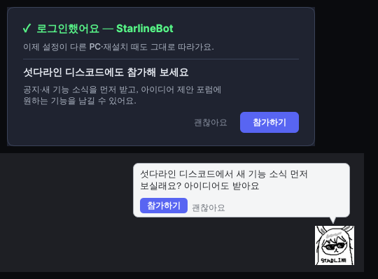
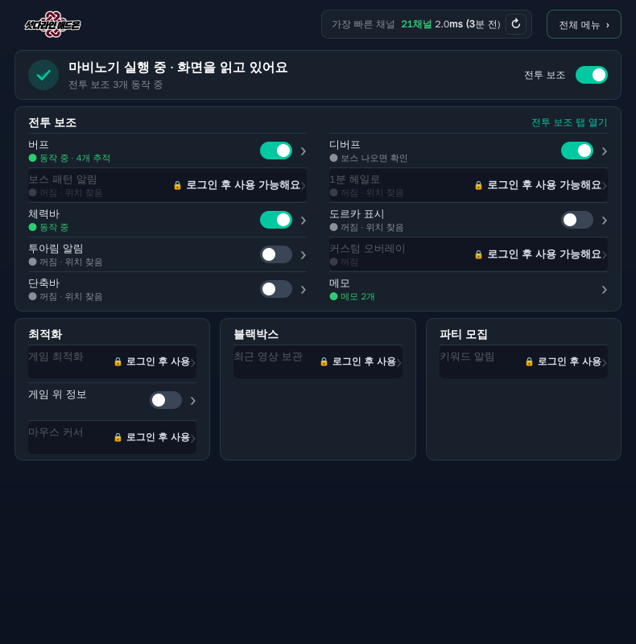
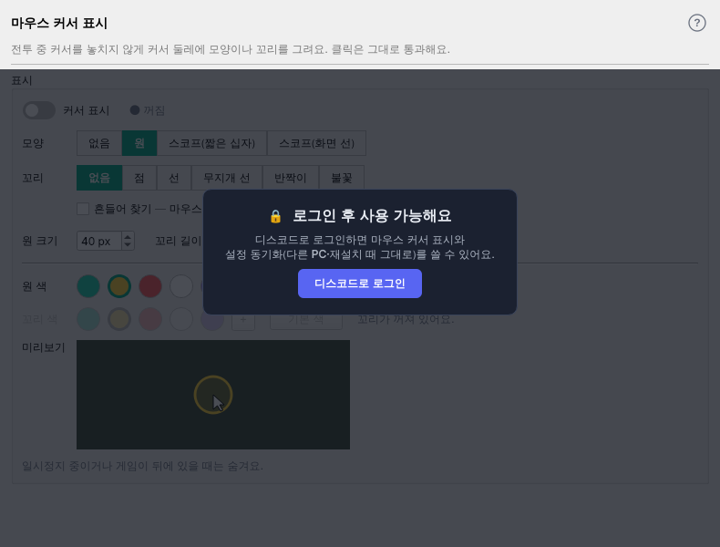
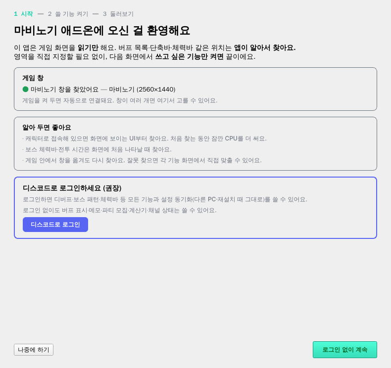

# 사용자 계정 관리 — 로그인·설정 동기화 (확정)

- 작성: 2026-11-07 초안 → **2026-11-11 확정(사용자 결정 11-09~11)**. 상태: **1단계 — 서버 준비 완료(addon_server 4a4c5de), 앱 0.46.0 구현(11-11)**. 규격은 3.4.1.
- 사용자 목적: ① 설정을 사람이 직접 관리하지 않고 **동기화** ② **누가 어떤 기능을 쓰는지**는 동기화된 설정으로 보기 ③ 쓰지 않았으면 하는 사용자 **차단**(동기화 이후).
- [기능 공개 정책 7절](feature-release-stage-review.md#7-사용-기능-전체-공개-2026-10-28-사용자-결정--16절의-로그인제작자-제한에-우선)(10-28 사용 기능 전체 공개)은 **2단계부터** 이 문서 4절로 대체된다. 1단계에서는 공개 범위가 지금과 같다.

## 1. 지금 (코드 확인, 2026-11-07)
| 항목 | 지금 | 문제 |
| --- | --- | --- |
| 로그인 | `discord_auth.py` Implicit Grant(scope `identify`), 앱이 `/users/@me` 직접 조회, `http://localhost:53123/callback` | 서버가 없어 로그인 기록이 어디에도 없음 |
| 로그인 상태 | `config.json`의 `discordUser {id, name}` | **파일에 제작자 ID를 적으면 제작자 기능이 열림**(`feature_access.is_creator()`) |
| 설정 옮기기 | 파일 내보내기·가져오기(`config.export_bundle`/`import_bundle`), 디스코드 DM 백업 릴레이 | 사람이 직접 해야 함 |
| 권한 확인 | `is_creator()`·`load_discord_user()` 호출 27곳 | 등급 판정을 한 곳(`feature_access`)으로 모아야 함 |

## 2. 결정 요약
| 주제 | 결정 |
| --- | --- |
| 비로그인 | **서버와 통신하지 않는다**(사용자 보기·차단 대상 아님) |
| 설정 동기화 | **디스코드 로그인해야만**. 1단계의 핵심 |
| 사용량 보기 | 따로 모으지 않음 — **동기화된 설정**의 기능 사용 값으로 본다(봇 명령) |
| 동기화 범위 | 오버레이 위치는 **해상도가 같을 때만** 적용. **DM 백업·파일 내보내기·가져오기는 그대로**(사용 편의) |
| 서버 | **A안: 디스코드 봇이 도는 GCP VM(무료 e2-micro)에 같이**, DB는 **SQLite**(별도 DB 서버 없음) |
| 주소 | **`https://starline-bot.duckdns.org`**(DuckDNS 무료, VM 136.119.121.58 연결 확인 11-11) |
| 서버 코드 | **discord_bot 저장소 안의 `addon_server/` 폴더**(사용자 결정 11-11 — 새 저장소 만들지 않음), VM `~/project/discord_bot/addon_server`, 봇과 **별도 프로세스(systemd 서비스)** |
| 차단 | **동기화 이후**(2단계) |
| 비로그인 기능 제한 | **2단계**(4절 목록) |
| 단계 | 1단계 = 로그인 + 설정 동기화 / 2단계 = 기능 나누기 + 첫 사용 로그인 카드 + 기존 사용자 안내 + 차단·테스터 |

- VM 여유(11-10 확인): 전체 952MB 중 쓸 수 있는 메모리 약 495MB, 스왑 1GB 설정 완료. 추가분(API + Caddy) 약 70~120MB.
- 서버 코드를 앱 저장소에 두지 않는 이유: VM에 앱 저장소(테스트 자료 포함 .git 약 900MB)를 받을 필요가 없다. discord_bot 저장소에 두면 봇 명령과 같은 DB 접근 코드를 함께 쓰고, VM에서 `git pull` 한 번으로 둘 다 받는다(재시작은 각각).

## 3. 1단계 — 로그인 + 설정 동기화

### 3.1 구조
```
앱(PC) ──HTTPS──> starline-bot.duckdns.org ─ Caddy(443, 인증서 자동) ─> 서버 API(127.0.0.1:8000, ~/project/discord_bot/addon_server)
                                                                          ├─ SQLite: 사용자·동기화 기록
                                                                          └─ data/settings/<디스코드ID>.zip
디스코드 봇(~/project/discord_bot, 같은 저장소) ──같은 SQLite 읽기──> /애드온 사용자 (1단계는 읽기만, 선택)
```

### 3.2 로그인 흐름 (비밀값은 서버에만)
1. 앱: 설정 › 계정 `디스코드로 로그인` → 로컬 대기(`localhost:53123`, 지금과 같음) → 브라우저로 `https://starline-bot.duckdns.org/auth/start?state=<무작위>&port=53123`.
2. 서버: 디스코드 인증 화면으로(Authorization Code, client secret은 서버만) → 디스코드가 서버 `/auth/callback`으로 코드 전달 → 서버가 코드 교환·사용자 확인 → 사용자 기록 → **서명한 앱 토큰** 발급.
3. 서버 → 브라우저 → `http://localhost:53123/callback?token=…&state=…`(앱이 state 확인) → 앱이 **내장 공개 키로 서명 확인** 후 저장. 브라우저에는 지금의 '로그인 완료' 카드.
- 앱 토큰: 서명(Ed25519 제안)된 `{디스코드 ID, 이름, 등급(user/creator), 발급·만료(30일)}`. 앱은 공개 키만 갖는다 → config.json을 고쳐 로그인·제작자 흉내 불가.
- 갱신: 앱 시작할 때 + 켜진 동안 하루 1번 `/me`로 새 토큰. 서버가 꺼져 있으면 **마지막 확인 뒤 7일**까지 그대로(제안), 넘으면 비로그인으로.
- 로그아웃: 앱이 토큰을 지우고 서버에 한 번 알림(봇에 `로그아웃 · 날짜`).
- `feature_access.is_creator()`는 **토큰의 등급**으로 판정(1단계부터 — 제작자 흉내 차단). 27곳의 호출은 `feature_access`의 등급 함수로 모은다(동작 변화 없음).
- 디스코드 개발자 포털: Redirect에 `https://starline-bot.duckdns.org/auth/callback` 추가, client secret 발급(서버 `.env`에만). 지금의 `localhost` Redirect는 새 흐름 확인 뒤 정리.

### 3.3 설정 동기화
| 언제 | 동작 |
| --- | --- |
| 설정이 바뀌면 | 30초 뒤 한 번(연달아 바꾸면 마지막 것만) + 앱을 끌 때 한 번 올림. 작업 스레드, 조용히 |
| 새 PC·재설치(이 PC에 동기화 기록 없음) + 서버에 설정 있음 | `서버에 저장된 설정이 있어요 (마지막 저장: 11월 9일 · <PC 이름>). 불러올까요?` → `불러오기` / `이 PC 설정 쓰기` |
| 두 PC 번갈아 | 시작 때 서버 것이 더 새것이면 받아 옴. 이 PC에도 안 올린 변경이 있으면(둘 다 바뀜) 위와 같은 물음 |

- 내용물: `config.export_bundle` 묶음(설정 + 직접 집은 아이콘 등) 그대로. 상한 2MB(제안). 받을 때는 `import_bundle`의 검사 그대로.
- **빼는 값**(PC마다 다름): 지금 `_SECRET_KEYS`·`_MACHINE_KEYS`에 더해 **설치 ID, 로그인 정보·토큰, 자동 찾기 지난 자리, 마지막으로 본 버전(릴리즈 노트)**, 동기화 기록 자체. 등록한 게임 창(gameExe — 실행파일 이름이라 PC마다 같음)은 따라온다(0.46.0). 받은 값이 없거나 게임이 아닌 이름(브라우저·탐색기·메신저·앱 자신)이면 이 PC 값 유지.
- **오버레이 위치**: 올릴 때 화면 해상도를 함께 적고, 받을 때 **해상도가 같을 때만** 위치를 적용(다르면 이 PC 위치 유지).
- 충돌: 서버가 버전 번호(rev)를 매기고, 올릴 때 '내가 받은 rev'를 함께 보냄 → 다르면 서버가 거절(409) → 앱이 위 물음.
- 화면(설정 › 계정): `디스코드로 로그인`/`로그아웃`, `☑ 설정 동기화`(로그인하면 기본 켬), 회색 한 줄 `마지막 동기화: 3분 전`. DM 백업·파일 내보내기·가져오기 버튼은 그대로.
- 비로그인: 지금과 똑같음(통신 없음).

### 3.4 서버 API (최소)
| 경로 | 하는 일 |
| --- | --- |
| `GET /auth/start` · `GET /auth/callback` | 로그인 흐름(3.2) |
| `GET /me` | 토큰 확인·새 토큰·(2단계) 차단 여부. 마지막 접속 시각 기록 |
| `POST /auth/logout` | 로그아웃 기록 |
| `GET /settings` | rev·저장 시각·PC 이름·크기 |
| `GET /settings/blob` | 설정 묶음 받기 |
| `PUT /settings` | 올리기(`If-Match: rev`, 2MB 상한, ZIP 형식 확인) → 새 rev |
| `GET /health` | 살아 있는지(운영 확인용) |
- 요청 수 제한(사용자당 분당 수십 회), 묶음 크기·형식 확인, 토큰 서명·만료 확인.
- SQLite(WAL): `users(discord_id, name, created, last_seen, logged_out, tier, status)`, `settings(discord_id, rev, updated, device, resolution, size, features)` — `features`는 받은 설정에서 기능 사용 값만 읽어 둔 것(봇 보기용).
- 비밀값: `~/project/discord_bot/addon_server/.env`(권한 600, git 제외 — 봇의 .env와 분리) — 디스코드 client secret, 서명 비밀 키. 공개 키는 앱 코드에 넣는다.

### 3.4.1 앱 ↔ 서버 규격(서버 discord_bot/addon_server 커밋 4a4c5de, 상세는 그 저장소 addon_server/README.md 1절) — 앱 0.46.0이 이대로 구현
- **로그인**: 브라우저 `GET /auth/start?state=<8~128자 [A-Za-z0-9_-]>&port=53123` → 항상 `http://localhost:<port>/callback`으로 돌아옴:
  성공 `?token=…&state=…` / 취소 `?error=access_denied` / 실패 `?error=login_failed` / 차단(2단계) `?error=blocked`(모두 `&state=`). 앱은 state를 반드시 확인. 요청은 10분 안·1회만.
- **토큰**: JWT, `alg=EdDSA`(Ed25519), header `kid="k1"`, 클레임 `iss="starline-bot"`, `aud="mabinogi-addon"`, `sub`(디스코드 ID), `name`, `tier`("user"|"creator", 서버가 CREATOR_IDS로 /me마다 정함), `iat`, `exp`(+30일).
  앱 확인: 서명(`header.payload`) + alg + iss + aud + exp — 앱은 순수 파이썬 Ed25519(`ed25519.py`)로 확인(의존성 추가 없음).
- **공개 키(앱 내장)**: raw base64 `wpSDRfPaiTpyr1+SXsJq8ZNKc7evZYmFHGujnapR18Y=` → `account.PUBLIC_KEY_HEX`(hex), `PUBLIC_KEY_IS_TEST = False`.
- **공통 오류**(헤더 `Authorization: Bearer <토큰>`): 401(토큰 없음·틀림·만료·서버에 없는 사용자 → 앱은 비로그인), 403(차단·2단계 → 비로그인), 429(분당 60회 초과 → 다음에 다시). 연결 실패·5xx는 앱이 7일 유예.
- `GET /me` → `{id, name, tier, status, token, expiresAt}` — 앱은 `token`만 받아 서명 확인 후 교체.  `POST /auth/logout` → 204.
- `GET /settings` → `{exists:false, rev:0}` 또는 `{exists:true, rev, updated(UTC ISO8601 'Z'), device, resolution, size}` — 앱은 날짜를 현지 시각으로 표시.
- `GET /settings/blob` → ZIP(헤더 `X-Settings-Rev`), 없으면 404.
- `PUT /settings?device=<PC 이름 64자>&resolution=<2560x1440>`, 헤더 `If-Match: <마지막 rev, 처음 0>`, 본문 ZIP → `{rev, updated, size}`(앱이 rev 저장).
  `409 {detail, rev}` = 둘 다 바뀜 → 앱이 `GET /settings`를 한 번 더 읽어 '마지막 저장: 날짜 · PC'와 함께 물음, '이 PC 설정 쓰기'면 응답 rev로 다시 PUT. 428·400·413(2MB 초과 등)·422(형식·비밀값 키).
- **묶음**: export_bundle 형식(`config.json` + `userdata/…`, 앱은 `sync.json`도 넣음 — 서버는 모르는 이름 무시). 압축 2MB·config.json 1MB·풀어서 64MB·4096개, 절대경로·`..`·역슬래시 금지, 비밀값 키 있으면 422.
  빼는 값(3.3)은 서버가 검사하지 않음 → 앱이 뺀다. 봇 '켠 기능'은 `{"<기능>": {"enabled": bool}}`·최상위 `…Enabled` 불값만 읽음(앱 설정 모양 그대로).

### 3.5 VM 운영
- **준비 상태(2026-11-11 사용자 확인)**: 스왑 1GB ✓, `starline-bot.duckdns.org` → VM ✓, GCP 방화벽 80·443 ✓, Caddy 설치·인증서 발급(테스트 응답 `ok`) ✓, DuckDNS 5분 자동 갱신(cron) ✓. 남은 것: 서버 코드·systemd·백업·디스코드 포털 Redirect.
- Caddy: `starline-bot.duckdns.org { reverse_proxy 127.0.0.1:8000 }` — Let's Encrypt 인증서 자동 발급·갱신.
- GCP 방화벽: tcp 80(인증서 확인용)·443 열기. API(8000)는 VM 안에서만.
- DuckDNS: 5분마다 IP 갱신(cron, 토큰은 VM에만) — VM IP가 바뀌어도 주소 유지.
- 서버: systemd 서비스(자동 시작·재시작), 로그는 journald.
- 백업: 하루 1번 SQLite `.backup` + 설정 폴더를 묶어 7일치 보관(제안: Cloud Storage 무료 범위로도 복사).
- 배포: 처음엔 사용자가 VM에서 `~/project/discord_bot`에서 `git pull` + 서버 서비스만 재시작(봇은 봇 코드가 바뀔 때만). 자동 배포는 별도 승인.

### 3.6 봇 (1단계, 선택)
- `/애드온 사용자`: 사용자별 `이름 · 마지막 접속 · 마지막 동기화 · 켠 기능`. `/애드온 사용자 @사람`: 설정 요약. 제작자만.
- 같은 SQLite를 읽기 전용으로 연다.

### 3.7 섯다라인 디스코드 서버 권유 (사용자 결정 2026-11-12)
- 대상 서버: 이미 운영 중인 **애드온·봇 전용 서버**(봇·애드온 소개, 공개 아이디어 제안 포럼). 초대 링크 **`https://discord.gg/VTbJ29HPma`**(만료·횟수 제한 없음, 앱에 넣는 공개값).
- 방식: **초대 링크**(로그인 권한은 `identify` 그대로 — `guilds.join`은 쓰지 않음). 사용자가 직접 참가 → 반감 없음.
- 권유 자리
  1. **로그인을 처음 마쳤을 때 한 번**: 로그인 완료 카드 아래 `섯다라인 디스코드에도 참가해 보세요` + 한 줄 설명(공지·새 기능 소식, 아이디어 제안 포럼) + `[괜찮아요]` `[참가하기]`.
  2. **설정 › 계정**: `섯다라인 디스코드 참가` 링크 항상.
  3. **문의하기 화면**: `기능 아이디어는 디스코드 아이디어 제안 포럼에 남겨 주세요` 한 줄 + 링크.
  4. **제작자 잡담에 가끔**: 말풍선 `섯다라인 디스코드에서 새 기능 소식 먼저 보실래요? 아이디어도 받아요` + `[참가하기]` `[괜찮아요]`.
     결정(11-12): `[참가하기]`를 한 번이라도 누른 사람에게는 다시 안 나옴, **`[괜찮아요]`는 45일 뒤 다시**, 그 밖엔 30일에 한 번까지. **비로그인에게도** 보인다. 기능 추천과 같은 날 겹치지 않게 — [잡담 명세 17절](creator-dialogue-spec.md).
- `[참가하기]` = 기본 브라우저로 초대 링크 열기(디스코드 앱이 있으면 앱으로). 앱은 '누른 적 있음'만 기억(설정 동기화 대상).
- 나중에(선택): 서버가 봇으로 멤버 여부를 확인해 이미 들어온 사람에게는 권유하지 않기.



## 4. 2단계 (계획 — 1단계 안정 후)
- **비로그인 기능**(사용자 결정 11-09): 버프 트래커(추가·삭제·표시 가능, **종료 알림 불가**), 메모, 파티 모집(**키워드 알림·파티장 제외 불가**), 분배·구슬 분배·환전비율·던전 입장 계산기, 서버별 채널 상태, 문의하기, 설정 내보내기·가져오기, 제작자 잡담. 자동 찾기는 바탕이라 비로그인 버프에도 쓴다.
- 그 밖의 모든 기능은 로그인 후(디버프, 보스 패턴, 1분 헤일로, 체력바, 도르카, 투아림, 커스텀, 단축바, 그림대화 만들기, 게임 최적화, 게임 위 정보, 마우스 커서, 최근 영상 보관, 설정 동기화, 테스트 기능). 테마 개인화·버프 사라짐 경고는 2단계 시작 전에 확인.
- 화면: 홈 잠긴 줄 위에 **흐린 층 + `🔒 로그인 후 사용 가능해요`**(스위치 숨김), 기능 화면은 머리 아래를 덮는 층 + 가운데 카드(`디스코드로 로그인`).
- [첫 사용 v3](first-use-v3-spec.md): 1단계(시작)에 `디스코드로 로그인하세요 (권장)` 카드 + `로그인 없이 계속`, 2단계(쓸 기능 켜기) 비로그인이면 **쓸 수 있는 기능만 + `로그인하면 11개 기능을 더 쓸 수 있어요` 카드**.
- 기존 사용자: 업데이트 후 처음 켤 때 `이제 대부분 기능은 디스코드 로그인 후 쓸 수 있어요 [로그인]` 한 번. 설정 값은 남음.
- 차단(봇 명령 `차단·해제`), 테스터 등급(테스트 기능 미리 열기), 차단 강도는 2단계 시작 때 정한다.
- 한계: 차단·잠금은 앱 안에서만(개조 exe는 못 막음). 서버에서만 주는 것(동기화)은 확실히 막힌다.





## 5. 테스트(1단계)
- 앱(맥, 가짜 서버): 서명 확인(위조 토큰·만료·다른 키 거절), config.json에 제작자 ID를 적어도 제작자 아님, 7일 유예, 로그아웃.
- 동기화: 30초 모으기·종료 시 올림, 빼는 값이 묶음에 없음, 해상도 다르면 위치 유지, rev 충돌 → 물음, 새 PC 불러오기, 비로그인 통신 0회.
- 서버: 로그인 흐름(디스코드 가짜), 2MB 초과·ZIP 아님 거절, rev 충돌 409, 토큰 없는 요청 거절, SQLite 백업 복원.
- Windows: 실제 로그인·두 PC(또는 재설치) 동기화·서버 재시작 중 앱 동작.
