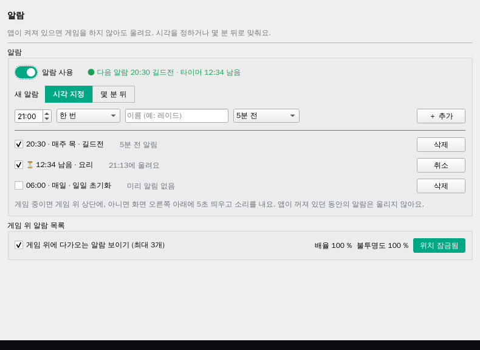
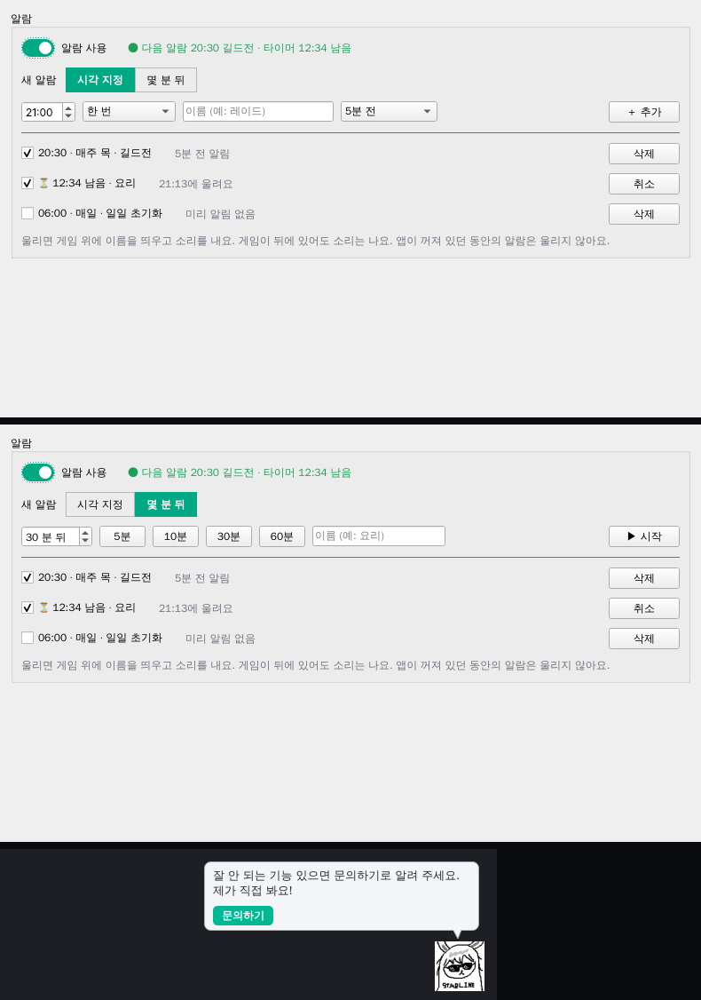
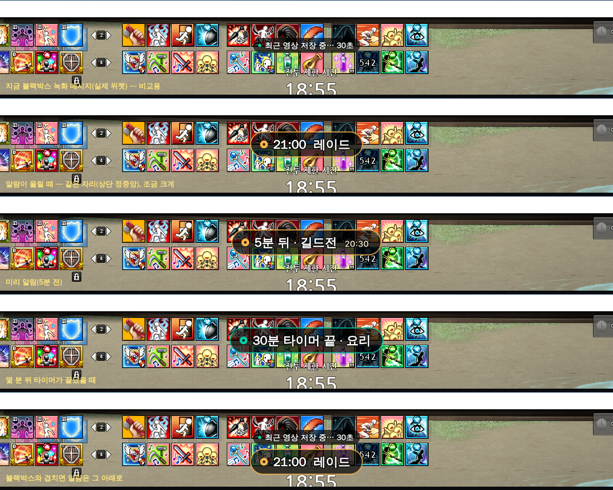
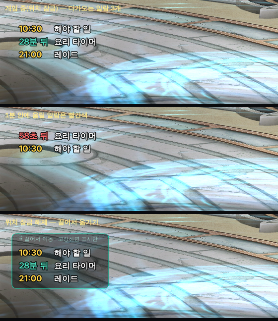

# 알람 (편의기능)

- 작성: 2026-11-13 (기획 세션). 상태: **기획 확정(사용자 결정 11-12~13), 미구현 — 개발 대상.**
- 사용자 요청: 현실 시각 기반 알람. **시각 직접 지정**과 **몇 분 뒤** 두 가지. 게임 안에서 다가오는 알람을 목록으로 미리 보기.
- 자리: **편의기능 › `알람` 탭**(사용자 결정 — 알람은 '앱이 켜져 있으면 울리는' 도구라 게임 위 정보(FPS) 화면에 두면 게임 전용처럼 보임).
- 알림 모양은 [화면 규칙 '알림 규칙'](ui-rules.md)의 ② 게임 위 알림 / ③ 앱 알림을 따른다.

## 1. 탭 화면

| 부분 | 내용 |
| --- | --- |
| 머리 | `알람` · `앱이 켜져 있으면 게임을 하지 않아도 울려요. 시각을 정하거나 몇 분 뒤로 맞춰요.` |
| 상태 줄 | `알람 사용` 스위치 + `● 다음 알람 20:30 길드전 · 타이머 12:34 남음` |
| 새 알람 — **시각 지정** | 시각(HH:mm) · 반복(`한 번`/`매일`/`요일 고르기…`) · 이름 · 미리 알림(`없음`/`5분 전`/`10분 전`) → `＋ 추가` |
| 새 알람 — **몇 분 뒤** | 분(1~600) 또는 빠른 버튼 `5분`·`10분`·`30분`·`60분` · 이름 → `▶ 시작` |
| 목록 | 체크(켜기·끄기) · `20:30 · 매주 목 · 길드전` · 회색 `5분 전 알림` · `삭제` / 타이머는 `⏳ 12:34 남음 · 요리` · 회색 `21:13에 울려요` · `취소` |
| 회색 안내 | `게임 중이면 게임 위 상단에, 아니면 화면 오른쪽 아래에 5초 띄우고 소리를 내요. 앱이 꺼져 있던 동안의 알람은 울리지 않아요.` |
| 게임 위 알람 목록 | `☑ 게임 위에 다가오는 알람 보이기 (최대 3개)` + 배율 · 불투명도 · 위치 잠금(오버레이 공통 규칙) |
- 한 번짜리 시각 알람은 울린 뒤 목록에서 꺼짐(지우지 않음 — 다시 켜면 다음 그 시각). 타이머는 울리면 목록에서 빠짐.
- 이름이 비면 `알람`/`타이머`.

## 2. 울릴 때

| 상황 | 화면 | 소리 |
| --- | --- | --- |
| 게임이 켜져 있음(앞·뒤 상관없이) | **② 게임 위 알림**: 게임 화면 상단 정중앙 큰 알약 **5초**(블랙박스와 같은 부품, 글자 22px). 시각 알람 주황 `21:00  레이드`, 미리 알림 `5분 뒤 · 길드전  20:30`, 타이머 민트 `30분 타이머 끝 · 요리`. 블랙박스 메시지와 겹치면 그 아래 | ✓ |
| 게임이 꺼져 있음(앱만) | **③ 앱 알림**: 오른쪽 아래 토스트 5초 | ✓ |
| 전투 보조 일시정지 중 | 위와 같음(일시정지는 전투 알림만 멈춤) | ✓ |
| 앱이 꺼져 있었음 | 그사이 지난 알람은 울리지 않음 | — |
- 표시 시간 5초(사용자 결정 — 8초는 중요한 순간 화면을 가림, 3초는 짧음). 클릭 통과·녹화 제외(블랙박스 메시지와 같음).
- **소리 자리**(사용자가 파일을 넣음): `assets/sounds/알람.mp3`(시각 알람·미리 알림), `assets/sounds/타이머.mp3`(타이머). 파일이 없으면 기존 기본 알림음. 음량은 앱 알림 음량 설정을 따름.

## 3. 게임 위 알람 목록 오버레이

- 다음 패턴 목록 오버레이(`upcoming_overlay.py`)와 같은 모양·규칙: 잠금 = 배경 없이 외곽선 글씨·클릭 통과, 해제 = 반투명 상자 + `⠿ 끌어서 이동 · 고정하면 표시만`.
- 줄: 시각 알람 `10:30  해야 할 일`(노랑), 타이머 `28분 뒤  요리 타이머`(민트, 1분마다), **1분 안은 빨강·초 단위**(`58초 뒤`).
- 가장 먼저 울릴 것부터 **최대 3개**. **게임이 앞에 있고 다가오는 알람이 있을 때만** 보이고, 없으면 숨음.
- 게임 위 정보(FPS) 화면에는 알람 항목을 넣지 않는다(시계와 알람 분리).

## 4. 동작·성능
- 시각 확인은 **새 타이머 없이** 기존 0.25초 판정 주기(게임 위 정보·현재 시각과 같은 곳)에서 비교만 — 추가 CPU 사실상 0. 게임 위 정보가 꺼져 있어도 알람용 시각 비교는 돈다(가벼움).
- 시각은 PC 시계 기준(게임 위 현재 시각과 같음). 절전 복귀 등으로 시각이 크게 건너뛰면 그사이 알람은 1분 안의 것만 바로 울리고 나머지는 지난 것으로 처리.
- 알람 목록은 설정에 저장 → 로그인하면 [설정 동기화](account-management-spec.md)로 다른 PC에도.
- 2단계(계정 관리 4절) 기능 나누기에서 알람의 로그인 여부는 그때 정한다(목록에 없던 기능).

## 5. 테스트
- 가짜 시계: 한 번·매일·요일 반복, 미리 알림 5·10분, 타이머 n분, 자정 넘김, 절전 건너뜀, 앱 재시작 후 지난 알람 안 울림.
- 표시 갈래: 게임 있음 → 게임 위 알림 5초 / 없음 → 토스트 5초 / 일시정지 중에도 울림 / 블랙박스와 겹치면 아래.
- 소리: 파일 있으면 그 파일, 없으면 기본음.
- 목록 오버레이: 정렬·최대 3개·1분 안 빨강·알람 없으면 숨김·게임 뒤면 숨김, 잠금/해제.
- 화면은 구현 후 탭·오버레이·알림 렌더로 사용자 확인.
