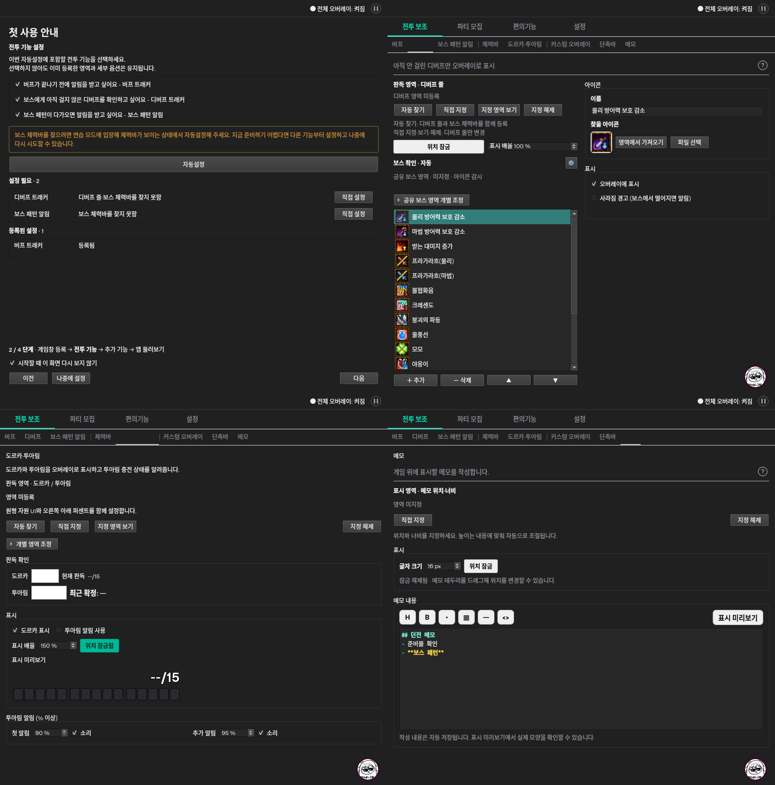

# 앱 사용성 보완 및 일괄 자동설정 공개 개발

- 기준 기획: [확정 명세](app-usability-polish-20261020-spec.md), 원격 기준 `a8ef9ad`.
- 날짜: 2026-10-20 (Asia/Seoul).
- 사용자 실제 렌더 피드백: **“이 배치로 확정”**. 화면 목업의 사전 승인에 이어 구현한 실제 위젯도 확인받았다.
- 개발 검증 기록이며 후속 독립 QA·실제 Windows 게임 캡처·배포 성공을 뜻하지 않는다.

## 적용한 동작

일괄 자동설정에만 적용하는 `batch_allowed` / `batch_pending` 정책을 분리했다. 버프·디버프·
보스·도르카·투아림 알림·체력바·단축바는 로그인 없이 선택/탐색/승인/저장이 가능하다.
기존 개별 자동찾기 버튼과 수집·진단 기능의 권한 검사는 바꾸지 않았다. 투아림 % 표시는 여전히
제작자 전용이며, 헤일로는 기존 로그인 접근 조건을 유지한다.

일괄 설정의 대상 선택은 여전히 `general.setupSelection`이며 기능 사용 설정이나 저장 영역을
켜거나 지우지 않는다. 선택 없음·게임창 미등록·미등록 대상 없음은 실제 원인을 표시한다.
일반 공개 대상은 캡처/탐색/승인 도중 로그인·로그아웃되어도 계속 처리한다. 제한 대상은
진입/승인 직전/저장 직전에 권한을 확인하고, 권한이 사라지면 해당 후보만 제외한다.
기존 중단/종료·영역 generation·대상 게임 재확인·취소/저장 실패 보호는 유지했다.
공동 자원 탐색은 두 대상 선택 시 한 요청이며 기존 부분 등록과 옵션 보존 동작을 유지한다.

첫 안내의 보스 준비 문구는 이번 탐색 대상인 미등록 보스 체력바/디버프 기준으로 표시한다.
등록된 보스 영역을 건너뛰거나 관련 대상을 선택하지 않으면 반복하지 않는다. 선택/등록 전에
게임 모드 확인이나 추가 필수 팝업을 만들지 않았다. 다른 대상부터 설정하는 흐름을 막지 않는다.

첫 안내 상단은 공통 제목 → 단계 제목 → 설명이다. 단계 번호/흐름은 하단 체크박스 위로 옮기고
현재 단계만 굵게 표시한다. 게임 등록 상태 바로 아래에 버튼을 왼쪽 정렬했다. 결과 세 그룹을
유지하면서 내용 높이만 사용하고, 부족한 공간은 본문 스크롤로 처리해 하단 조작을 유지한다.
선택 체크박스는 현재 폰트/폭에 맞춰 줄바꿈한다. 설정 필요 행의 `직접 설정`은 기존 설정 탭을
열며 기존 복귀 버튼으로 같은 단계/선택/다른 결과를 보존한다. 진행 중에는 직접 설정을 막는다.

| 화면 | 적용 내용 | 보존한 동작 |
| --- | --- | --- |
| 디버프 | 디버프 줄 제목/미등록 문구, 공동/개별 조작 두 줄 안내, 공유 보스 상태를 보스 확인 아래로 이동, 오른쪽 중복 문구 제거 | 좌우 편집·공동 자동찾기/개별 영역·감시/아이콘/경고 |
| 도르카·투아림 | 판독 확인 → 표시 → 투아림 알림의 동등한 그룹 | 원본 두 이미지·현재/최근 값·공통/개별 조정·배율/잠금·출력 미리보기·진단/권한 |
| 메모 | 영역 버튼 아래 위치/너비/자동 높이 안내, 입력란 아래 자동 저장/미리보기 안내, 맨 아래 중복 문단 제거 | 내용/서식/미리보기·잠금·영역 등록/해제·기존 저장값 |
| 설정 일반 | 실행·종료 / 오버레이 배치 / 알림 / 안내 다시 보기 소제목 | 기존 항목 순서·문의 상단·게임 등록 최하단·스크롤 |
| 그 외 | 오버레이 목록의 휠 조절 안내, 공통 위험 색상의 초기화와 간격, 목소리/헤일로/편린 시세 안내 | 기존 확인/취소·백업/가져오기·실제 음원·63초/5초·조회 상태/수동 새로고침 |

새 공개 기능으로 릴리즈 노트 **0.8.0**을 준비했다(원격 v0.8.* 태그 없음 확인).
기존 공개 노트를 다시 쓰지 않았고 태그 생성/Windows workflow/Release 게시를 실행하지 않았다.

## 테스트 이관과 개발 실행

이전 명세에서 로그인 없으면 차단하거나 승인 중 로그아웃을 취소하던 검사는 새 확정 정책에 맞춰
변경했다. assertion을 제거하거나 실패를 skip하지 않고, 공개 대상의 실제 저장/옵션 보존과
제한 대상의 저장 거부/나머지 대상 계속 처리로 기대 결과를 교체·확장했다.

- 기존 게임/로그인 필수 검사 → 게임 등록은 필수, 비로그인 투아림 등록 성공 검사.
- 공개 후보 승인 중 로그아웃 차단 → 캡처/탐색/승인 × 로그인/로그아웃 전환에서도 등록 성공.
- MainWindow 승인 중 로그아웃 취소 → 실제 login_changed 신호 이후 버프 저장/안내 유지 검사.
- 안내 이동 검사 → 결과 행의 실제 직접 설정 버튼을 눌러 이동/복귀/단계/설정 보존 검사.
- 공개 7종의 개별 비로그인 등록, 제한 대상 제외 및 권한 상실 세 단계, 보스 준비 8경계,
  수동 버튼 busy 제어를 추가했다. 공동 자원 테스트는 비로그인/로그인 양쪽으로 확장했다.
- 설정 흐름 두 파일: **174 passed / 43.07초**.
- 앞선 setup/settings grouping/interaction 묶음: **169 passed / 55.19초**. 이후 추가한 권한 경계는 위 174개에 포함하며 실행 수를 합산하지 않는다.

```bash
QT_QPA_PLATFORM=offscreen UV_CACHE_DIR=/tmp/deployment-uv-cache uv run pytest -q tests/test_setup.py tests/test_setup_common_resources.py
QT_QPA_PLATFORM=offscreen UV_CACHE_DIR=/tmp/deployment-uv-cache uv run pytest -q -m 'not windows_integration' --durations=15 --junitxml=/tmp/usability-full-results.xml
QT_QPA_PLATFORM=offscreen UV_CACHE_DIR=/tmp/deployment-uv-cache uv run python -m scripts.render_usability_polish
git diff --check
```

전체 격리 회귀: **2208 passed, 15 deselected, 3 warnings / 712.36초**.
15개는 명시적으로 제외한 Windows 네이티브 통합이며 Linux 통과로 대신하지 않는다.
경고 3개는 기존 Qt QMouseEvent 생성자 사용 중단 안내다. 테스트 실패/skip/assertion 완화는 없다.
기존 개인별 직접 자동찾기·수집/진단 제한, 공개 기능의 판독/알림과 설정/메모/프리셋 보존 회귀도
같은 전체 실행에 포함됐다. 렌더 스크립트의 마지막 격리 강화는 별도로 다시 실행해 통과했다.

## 실제 위젯 렌더

[렌더 스크립트](../scripts/render_usability_polish.py)는 MainWindow와 실제 컨트롤을 사용하고,
설정은 메모리 샘플/임시 경로, 네트워크·오디오·장치는 공통 외부 경계로 격리한다.
화면 배치를 위해 하드웨어 캡처나 시세 조회를 실행하지 않는다. 일반 기능의 영역/옵션/메모가
화면 이동·폰트 변경으로 바뀌지 않는지 샘플 JSON 전체를 비교한다.

12px 다크/라이트 790×800, 20px 다크/28px 라이트 790×620에서 안내 세 단계와 네 기능 화면,
설정 일반을 렌더했다. 본문/선택/기능 페이지의 가로 스크롤 없음, 결과 구간의 불필요한 내부
세로 스크롤 없음, 하단 다음 버튼의 창 내부 배치, 로그아웃 시 헤일로 선택 숨김을 검사했다.
작은 화면은 screen.availableGeometry를 제한해 앱의 기존 높이 조정 경로로 실제 620px를 확인한다.
오프스크린 Fusion에서는 팔레트를 명시적으로 주입하므로 실제 Windows 테마/DPI 검증과 구분한다.
미판독 원본 이미지·`--`는 실제 게임 판독값이 아니다.



- [게임창 등록](qa/assets/usability_polish_20261020/dark-12-guide-0.png)
- [추가 기능 설정](qa/assets/usability_polish_20261020/dark-12-guide-2.png)
- [설정 일반](qa/assets/usability_polish_20261020/dark-12-settings-general.png)
- [커스텀 오버레이](qa/assets/usability_polish_20261020/dark-12-custom.png)
- [라이트 28px·620px 높이](qa/assets/usability_polish_20261020/light-28-guide-1.png)
- [렌더 측정](qa/assets/usability_polish_20261020/metrics.json)

실제 Windows 비로그인 캡처/후보 승인/저장, 게임 생명주기·혼합 DPI·소리 청취·장시간 자원은
후속 확인 범위다. 이 문서는 독립 QA 통과나 실제 배포 승인이 아니다.
