# 자동설정 2차 기획: 단계별 첫 사용 안내

- 후속 기획(2026-11-03): [12절 자동 찾기 통합안](#12-첫-사용-자동-찾기-통합안-2026-11-03--기획미구현)은 사용자 후속 개발 요청으로 작업 브랜치에서 구현·QA 중이다. 최신 기준은 12.7~12.9절이며, Windows 실게임 확인 전에는 완료로 보지 않는다. 기존 절은 이전 설계 이력이다.
- 기존 2차 상태: 개발 진행 중. 사용자가 구현을 요청했고 10절의 세 가지 선택 및 아래 개발 중 화면 피드백을 반영한다. 세부 배치는 렌더로 재확인한다.
- 작성일: 2026-10-15
- 목적: 처음 사용하는 사람이 앱의 전체 설정 구조를 먼저 이해하지 않아도, 필요한 기능을 선택하고 순서대로 준비할 수 있게 한다.
- 대상: 첫 사용 안내, 게임창 등록, 기능 선택, 선택 기능의 영역 등록, 온보딩 투어 및 설정 재진입.
- 기준: 기존 `docs/app-usability-spec.md`와 구현된 개별 자동찾기/순차 승인 흐름.
- 이 문서는 2차의 목표와 검토 조건을 정의한다. 현재 배포본에 구현되었다는 의미가 아니다.

## 1. 변경 목적과 유지할 기반

현재 사용 준비 화면은 게임창 등록, 전체 기능 선택, 미등록/등록 목록, 자동설정과 재설정을 한 번에 보여준다. 2차에서는 처음 접하는 사용자의 안내를 단계로 나눠 한 번에 판단할 내용을 줄인다.

기능을 찾는 검출기와 사용자 승인 방식은 기존 것을 재사용한다. 자동찾기를 새로 설계하거나 정확성을 보장하는 기능을 추가하는 작업이 아니다.

### 유지할 동작

- 사용자가 선택한 기능만 사용 설정과 영역 등록 대상에 포함한다.
- 단계별 기능 체크와 개별 탭의 사용 체크는 같은 설정을 사용한다.
- 기존 사용자의 영역, 사용 체크, 임계값, 소리, 잠금, 배치와 프리셋을 보존한다.
- 이미 등록된 영역은 순차 자동설정에서 건너뛴다.
- 찾은 영역은 사용자가 확인하고 승인해야 저장한다.
- 버프는 기존 목록 위 경계 조정, 나머지는 민트색 점선과 확인 창을 사용한다.
- 못 찾거나 등록하지 않은 항목이 있어도 나머지 안내를 계속할 수 있다.
- 개별 탭의 직접 지정/자동찾기 및 기존 판독 미리보기는 유지한다.
- 등록 후 상시 미리보기, 별도 메인 상위 탭 및 등록 영역의 위치·크기 자동 검증은 추가하지 않는다.

## 2. 전체 흐름

```text
환영 및 게임창 등록
    ↓
전투 기능 선택: 버프 / 디버프 / 보스 패턴 알림
    ↓ 선택한 미등록 영역을 순차 확인·등록
추가 기능 선택: 투아림 / 체력바 / 단축바
    ↓ 선택한 미등록 영역을 순차 확인·등록
4단계 앱 둘러보기: 하이라이트 안내
    ↓
기존 앱 화면 사용
```

- 단계 진행 자체를 모든 기능의 등록 성공에 묶지 않는다.
- 기능을 선택하지 않거나 나중에 설정하기로 해도 앱의 다른 기능을 사용할 수 있다.
- '필수 기능'으로 표현하거나 모든 항목을 기본 선택해 사용을 강제하지 않는다.
- 단계의 분류는 안내를 위한 묶음이다. 기존 트래커/편의기능 탭의 소속을 변경하라는 요구가 아니다.

## 3. 단계별 동작과 문구

### 3.1 1단계: 게임창 등록

신규 사용자 문구 초안:

> 처음 오셨군요. 사용할 기능을 골라 나에게 맞게 설정해 보세요.
> 먼저 마비노기 게임창을 등록해 주세요.

- 게임창을 등록하는 이유는 앱이 게임 화면과 활성 상태를 구별하기 위해서라고 짧게 설명한다.
- 기존 '게임창 등록 시작' 동작을 제공한다. 카운트다운 동안 게임창을 선택하는 현재 방식을 유지한다.
- 등록된 게임이 있으면 현재 등록 정보를 보여주고 재등록을 강제하지 않는다.
- 게임이 아직 실행되지 않았으면 '나중에 설정'으로 다음 단계에 갈 수 있게 한다.
- 등록 실패는 원인을 확인할 수 있는 범위에서 알리고, 기존 등록을 임의로 지우지 않는다.
- 게임창 미등록 상태로 다음 단계에 갔다면 기능 선택은 가능하다. 게임창이 필요한 영역 자동설정은 실행하지 않고, 게임창 등록이 먼저 필요함을 안내한다.
- 게임창 등록은 이 단계에서 안내하며, 별도 시작 팝업을 중복해서 띄우지 않는다.

기존 사용자가 안내를 다시 여는 경우에는 '처음 오셨군요' 대신 '사용할 기능과 등록된 설정을 확인해 보세요.'와 같은 재설정 문구를 사용하는 안을 제안한다.

### 3.2 2단계: 전투에서 사용할 기능

안내 문구 초안:

> 전투에서 도움받고 싶은 기능을 선택하세요.
> 하나만 선택하거나, 이 단계를 건너뛰어도 됩니다.

| 기능 | 체크박스 문구: 한 줄 |
|---|---|
| 버프 트래커 | 버프가 끝나기 전에 알림을 받고 싶어요 - 버프 트래커 |
| 디버프 트래커 | 보스에게 아직 걸지 않은 디버프를 확인하고 싶어요 - 디버프 트래커 |
| 보스 패턴 알림 | 보스 패턴이 다가오면 알림을 받고 싶어요 - 보스 패턴 알림 |

- 신규 사용자는 선택 해제로 시작한다. 기존 사용자는 저장된 체크 상태를 표시한다.
- '자동설정'은 이 단계에서 선택한 기능의 미등록 영역만 순차 등록한다.
- 각 후보의 승인/거절 후 현재 단계 아래 등록 상태 목록을 즉시 갱신하고 다음 후보로 진행한다.
  사용자는 현재 단계에서 결과를 확인하고 '다음'을 누른다. 별도 설정 결과 화면은 두지 않는다.
- 아무것도 선택하지 않았다면 자동찾기를 실행하지 않고 다음 단계로 이동할 수 있다.
- '나중에 설정'은 이 단계의 영역 탐색을 생략하는 동작이다. 이미 저장한 체크나 영역을 초기화하지 않는다.
- 보스 패턴만 사용하고 싶은 경우에도 버프/디버프 등록을 요구하지 않는다.
- 개발 중 화면 피드백: 2단계는 기존 자동설정 화면처럼 상단에 '소개 문구 - 기능명' 한 줄 체크 목록,
  그 아래 전체 너비 자동설정 버튼, 하단에 설정 필요/등록된 설정/사용 안 함을 배치한다.
  개별 설정으로 이동하는 버튼은 안내 안에서 제외한다. 찾기와 영역 확인도 기존 자동설정 방식을 유지한다.

### 3.3 3단계: 이런 기능도 있어요

안내 문구 초안:

> 더 편하게 사용할 수 있는 기능도 있어요.
> 필요한 것만 선택하고, 지금 필요하지 않으면 건너뛰세요.

| 기능 | 체크박스 문구: 한 줄 |
|---|---|
| 투아림 | 투아림이 차면 알림을 받고 싶어요 - 투아림 |
| 체력바 | 체력·마나·스태미나를 보기 편한 곳에 표시하고 싶어요 - 체력바 |
| 단축바 | 단축바를 원하는 위치에서 보고 싶어요 - 단축바 |

- 선택, 기존 값 복원 및 순차 영역 등록은 2단계와 같은 방식이다.
- 이 단계도 선택 사항이며 사용을 강제하지 않는다.
- 2단계와 같은 선택 목록/자동설정/등록 상태 구성을 사용한다. 로그인 안내를 단계마다 반복하지 않는다.
- 투아림의 전체 수치 판독 신뢰도는 자동설정 순간에 확정하지 않는다. 숫자와 %가 영역에 포함되는지 확인하고, 실제 판독은 게이지가 차는 동안 기존 탭에서 확인하게 한다.
- 체력바/단축바처럼 기능 자체가 베타인 항목은 기존 로그인 조건을 유지한다. 일반 기능과 접근 조건이 다르다는 점을 해당 항목에서 알린다.
- 체력바 저값 경고 등 공유 보스바가 필요한 설정은 기존 의존성을 따른다. 체력바 표시만 켰다는 이유로 보스 패턴 알림의 사용 체크까지 자동으로 켜지 않는다.

메모/커스텀 오버레이는 3단계 선택 목록에 추가하지 않고 앱 둘러보기에서 소개한다. 자동찾기 대상에 추가하지 않으며, 기존 개별 탭은 계속 사용할 수 있다.

## 4. 베타 접근 조건과 자동찾기

- 사용자는 단계별로 필요한 기능을 선택하고 설정한다. 모든 설정을 한 번에 이해하고 하나의 큰 자동설정 버튼으로 해결하도록 요구하지 않는다.
- 단계별 첫 사용 안내 자체가 기존 로그인 사용자의 테스트를 위한 베타다.
  로그인한 사용자에게만 이 안내와 설정의 다시 보기 진입점을 노출한다.
- 안내 안에는 로그인 버튼이나 로그인 유도 문구를 어느 단계에도 표시하지 않는다.
  기존 앱의 로그인/기능별 접근 정책은 그대로 두며 이 베타 안내의 진입 조건만 구분한다.
- 기존 자동설정은 각 단계의 '자동설정' 동작에서 활용한다.
- 자동 진입, 명시적 다시 보기, 재개, 실행에서도 로그인 여부를 검사한다.
  진행 중 로그아웃하면 탐색을 취소하고 안내를 닫되 이미 승인한 설정은 보존한다.
- 안내 내부의 개별 설정 이동 버튼은 두지 않는다. 직접 지정이 필요하면 앱으로 이동한 뒤 기존 탭을 이용한다.
- 외부에서 설정을 바꾼 뒤 안내로 돌아오면 설정값을 다시 읽어 등록 현황에 반영한다.
  이때 임의로 안내 완료로 처리하지 않는다.
- 하단 '나중에 설정'은 현재 단계 탐색을 생략하고 다음 단계로 이동한다.
  의미가 중복되는 '앱으로 이동' 버튼은 안내에 두지 않는다.

## 5. 영역 확인·미발견·설정 보류

### 5.1 찾은 영역 확인

예시:

```text
버프 트래커 · 찾은 영역 확인
[게임 화면 위 민트색 영역]
추적할 버프의 아이콘과 남은 시간이 들어오나요?
기준 버프인 프리미엄 배틀 멤버십도 포함되는지 확인하세요.
[등록하지 않기] [이 영역으로 등록]
```

- 사용자가 승인한 항목만 저장하고 다음으로 진행한다.
- 거절하면 기존 값을 유지하고 미등록/등록하지 않음으로 기록한다.
- 이미 등록한 항목을 다시 찾거나 위치를 자동 검증하지 않는다. 잘못된 영역은 개별 탭에서 다시 지정한다.
- 보스바와 디버프 줄은 필요한 설정이 다를 수 있다. 공유 영역은 중복 등록/덮어쓰기를 피하고 각 필수 영역의 등록 여부를 반영한다.

### 5.2 못 찾은 항목

예시:

> 보스 패턴 알림
> 현재 화면에서 보스 체력바를 찾지 못했습니다.
> 보스 체력바가 보이는 상태에서 다시 시도해 주세요.

- 특정 UI를 못 찾았다는 이유로 해당 단계와 이후 안내 전체를 막지 않는다.
- '못 찾음'을 실제 보스 부재, 가림 또는 사용자 실수로 단정하지 않는다.
- 캡처 실패/게임창 미발견처럼 전체 탐색을 계속할 수 없는 상황은 나머지 영역을 거짓 실패로 나열하지 않는다. 해당 탐색을 중단하고 이후 설정을 보류할 수 있게 한다.
- 미발견, 거절, 저장 실패와 아직 시도하지 않음을 구분한다.
- 거절/미발견 시 현재 단계의 미등록 영역을 재시도할 수 있다. 직접 지정은 앱으로 이동한 뒤 기존 개별 탭에서 진행한다.
- 재시도할 때 앞서 승인해 저장한 영역은 건너뛴다.

## 6. 단계별 등록 상태 및 앱 둘러보기

### 6.1 2/3단계에서 즉시 확인

- 2/3단계에 기존 자동설정과 같은 등록 상태 목록을 두고 항목별 승인/거절/실패 때 즉시 갱신한다.
  별도 결과 화면을 만들거나 마지막에 다시 요약하는 단계를 추가하지 않는다.
- '등록됨 / 나중에 설정 / 찾지 못함 / 등록하지 않음 / 저장 실패'를 실제 결과에 맞게 구분한다. 사용하지 않은 기능을 실패 항목으로 포함하지 않는다.
- 판독값이 나온다는 이유만으로 '정상 작동' 또는 '자동 검증 완료'라고 표현하지 않는다.
- 남은 항목은 앱으로 이동한 뒤 해당 기능의 설정 탭에서 이어서 지정할 수 있게 안내한다.
- 모든 영역이 없어도 '다음'이나 '나중에 설정'으로 진행할 수 있다.
  '사용 안내 종료'와 '필요 영역 등록 완료'는 별개의 상태이다.

### 6.2 4단계: 하이라이트 앱 둘러보기

2026-10-20 라이브 후속 사용자 요청(제품 반영, Windows 후속 검증 전): 투어 안에서는 앞선 설정의 `4/4`를
반복하지 않고 현재 둘러보기의 `1/7`부터 `7/7`까지 순번만 표시한다. 총 순번은 실제 투어
목록 길이로 계산한다. 기존 4단계 안내 흐름과 설정 저장/완료 의미는 유지한다.
본문·순번·버튼이 각 단계의 실제 글꼴/폭에서 전부 읽히는지 검증한다.

어두운 배경과 버튼 강조를 사용하는 기존 투어를 활용한다. 화면 사용법을 소개하며 실제 등록을 대신하지 않는다.
3단계의 '다음' 또는 '나중에 설정'에서 별도 결과 화면 없이 이 투어로 바로 이어진다.

| 소개 대상 | 안내 문구 초안 |
|---|---|
| 트래커 탭 | 선택한 트래킹 기능은 여기서 조절할 수 있어요. |
| 편의기능 탭 | 체력바·단축바와 메모·계산기 등은 여기서 사용할 수 있어요. 투아림은 트래커 탭에 있어요. |
| 개별 기능 설정 | 아직 등록하지 못한 영역은 해당 탭에서 다시 찾거나 직접 지정하세요. |
| 오버레이 위치 잠금 | 오버레이를 옮긴 뒤 잠그면 클릭이 게임으로 통과해요. 잠금 방식은 기능별 설정에서 확인하세요. |
| 전체 일시정지 | 오버레이를 잠시 멈췄다가 다시 사용할 수 있어요. |
| 설정의 다시 열기 | 이 안내와 자동설정은 설정에서 다시 열 수 있어요. |

- 사용자가 선택하지 않은 기능을 모두 설정하게 만드는 투어로 구성하지 않는다.
- 현재 화면에서 사용할 수 없는 베타 동작을 필수 조작으로 안내하지 않는다.
- 이전/다음/건너뛰기 및 사용법 다시 보기를 유지한다.
- 투어 마지막 문구: '사용 안내를 마쳤습니다. 남은 설정은 각 기능의 설정에서 이어서 진행할 수 있어요.'
- 투어를 끝까지 보거나 건너뛰었다는 이유로 미등록 영역을 등록됨으로 바꾸지 않는다.

## 7. 기존 사용자·재실행·재설정

### 유지할 원칙

- 기존 사용자가 2차 버전을 실행했다는 이유로 기능을 전체 해제하거나 이미 등록한 영역을 다시 등록하게 하지 않는다.
- 저장된 게임창 정보가 있으면 1단계에서 이를 표시하고 다음으로 진행할 수 있다.
- 2/3단계에서는 현재 사용 설정을 그대로 보여주고 미등록 영역만 찾는다.
- 단계를 되돌아가도 이미 승인한 영역은 유지한다. 사용자가 기능 체크를 직접 바꾼 경우에만 해당 사용 설정을 변경한다.
- 앱 종료/중단 전에 승인해 저장한 영역은 기존 저장 정책으로 보존한다. 승인하지 않은 후보는 저장하지 않는다.
- 시작 시 '다시 보지 않기'와 설정의 '자동설정 다시 열기' 접근을 유지한다. 다시 열기만 해서는 탐색을 시작하지 않는다.
- 현 베타는 로그인하고 다시 보지 않기를 선택하지 않은 사용자에게 단계별 1단계를 기본 표시한다.
  등록 완료 여부와 tourShown/firstUseGuideShown 기록은 자동 진입을 차단하지 않는다.
  미로그인 사용자는 기존 앱 화면을 사용하며 기존 한 화면 자동설정을 대신 노출하지 않는다.
- 다시 보지 않기를 선택해도 앱 둘러보기/개별 설정 접근을 막지 않는다.

### 다시 열기 및 중단 후 진입 정책

- 설정의 '자동설정 다시 열기 (베타)' 하나로 단계별 1단계에 진입한다. 로그인 사용자에게만 표시한다.
  별도의 중복 첫 사용 안내 버튼이나 기존 한 화면으로 가는 버튼은 노출하지 않는다.
- 기존 한 화면 구현과 공유 자동찾기는 내부에 유지할 수 있으나 시작/대체 화면으로 사용하지 않는다.
  하이라이트 방식의 앱 둘러보기 다시 보기는 별도로 유지하고, 강조 대상은 실제 보이는 버튼으로 맞춘다.
- 업데이트 노트가 먼저 표시되는 순서와 트레이 시작 시 창을 강제로 띄우지 않는 동작을 유지한다.
- 안내 도중 앱을 종료한 뒤 안내에 다시 진입하면 마지막 단계가 아니라 1단계부터 시작한다. 저장된 설정과 승인한 영역을 복원해 현재 등록 상태를 표시한다.
- 이미 등록된 게임창과 영역은 다시 등록하도록 요구하지 않으며, 완료된 부분은 빠르게 다음 단계로 넘어갈 수 있다.

안내 재진입이 기존 베타의 시작 화면 노출 및 '다시 보지 않기' 설정을 무시하거나 초기화하지 않는다.

## 8. 이번 작업 범위 밖

- 자동찾기 알고리즘의 정확도 개선이나 모든 해상도/작게 보기 모드 지원 보장.
- 등록 영역이 계속 맞는지 자동 판정하는 기능과 지속적인 위치 추종.
- 게임 조작 자동화.
- 실제 추적/미러/알림의 동작 방식 또는 기존 탭 분류 변경.
- 별도 메인 상위 탭, 등록 후 상시 캡처 미리보기, 사용자 확인 완료 체크의 추가.
- 기존 로그인 정책의 해제 또는 새로운 로그인 서비스.

## 9. Acceptance Criteria 초안

| ID | 확인 가능한 성공 기준 |
|---|---|
| V2-01 | 게임창 등록, 전투 기능 선택, 추가 기능 선택, 하이라이트 앱 둘러보기의 4단계이며 별도 결과 화면은 없다. |
| V2-02 | 신규 사용자는 기능 미선택 상태에서 시작한다. 버프/디버프/패턴 알림 중 하나만 선택하거나 모두 건너뛰어도 다음 단계로 갈 수 있다. |
| V2-03 | 2단계는 버프/디버프/보스 패턴, 3단계는 투아림/체력바/단축바를 제공한다. 분류를 바꿨다는 이유로 실제 탭의 위치를 이동하지 않는다. |
| V2-04 | 현재 단계에서 선택한 기능의 미등록 영역만 탐색하며 다른 단계나 미사용 기능의 영역을 자동으로 등록하지 않는다. 선택한 기능이 사용하는 공유 필수 영역은 예외로 명확히 안내한다. |
| V2-05 | 후보는 설명과 함께 표시되고 승인해야 저장된다. 거절하면 저장하지 않고 다음 후보로 진행한다. |
| V2-06 | 보스바를 찾지 못해도 해당 항목을 보류하고 이후 기능/단계/앱 둘러보기로 진행할 수 있다. 보류를 등록 성공으로 표시하지 않는다. |
| V2-07 | 게임창이 없으면 등록을 나중으로 미루고 기능 설명/선택을 볼 수 있다. 그 상태에서 게임창이 필요한 자동 영역 등록을 실행하지 않는다. |
| V2-08 | 단계별 안내와 그 다시 보기 진입점은 로그인 사용자에게만 노출된다. 안내 안에는 로그인 UI가 없고 미로그인 상태의 직접 호출도 진입/탐색하지 않는다. |
| V2-09 | 기존 사용자의 체크/영역/알림/배치/잠금/프리셋이 보존되고 이미 등록한 영역은 다시 승인할 필요가 없다. |
| V2-10 | 단계 뒤로 이동/재시도/안내 재진입이 승인된 영역을 덮어쓰지 않는다. 중단/종료 후 승인 전 후보가 저장되지 않는다. |
| V2-11 | 2/3단계에서 항목별 결과가 즉시 등록 상태 목록에 반영된다. 하단은 이전/나중에 설정/다음이며 중복 '앱으로 이동' 버튼이 없다. 투어 종료와 등록 완료는 구분한다. |
| V2-12 | 투어는 실제 존재하는 화면/버튼을 강조하고, 기본 버프 추가나 모든 기능 사용을 필수로 안내하지 않는다. |
| V2-13 | 기존 자동찾기 진단과 승인/취소 기록, 단계별 사용 체크와 개별 탭 사용 체크의 연동을 유지한다. |
| V2-14 | 렌더링으로 각 단계의 문구·버튼·선택 목록·건너뛰기가 현재 창 크기에 들어오는지 확인하고 사용자 검토를 받는다. |
| V2-15 | 안내 도중 종료한 뒤 안내를 다시 열면 1단계에서 저장된 등록 상태가 표시된다. 이미 승인한 영역은 유지되고 완료된 부분은 재등록 없이 넘어갈 수 있다. |
| V2-16 | 로그인 + skipSetup=false이면 시청 기록/등록 완료와 무관하게 단계별 1단계로 시작한다. 설정의 단일 자동설정 버튼도 1단계를 연다. 기존 한 화면은 시작/설정/미로그인 대체 동선에 노출하지 않으며, 진입만으로 탐색/설정 초기화를 하지 않는다. |
| V2-17 | 메모/커스텀 오버레이는 3단계 선택 목록과 자동찾기 대상에 포함되지 않으며, 앱 둘러보기에서 소개하고 기존 개별 탭에서 사용할 수 있다. |

## 10. 추가 선택에 대한 결정

| 항목 | 결정 내용 | 결정 상태 |
|---|---|---|
| 3단계의 메모/커스텀 오버레이 | 3단계 목록은 투아림/체력바/단축바로 구성하고, 메모/커스텀 오버레이는 투어에서 소개 | 사용자 동의 |
| 안내를 다시 열 때 | 단계별 1단계 진입 하나로 통일하고 기존 한 화면과 중복 버튼은 노출하지 않음. 기존 로그인·skipSetup 정책은 유지 | 2026-10-15 추가 지시 반영 |
| 종료 후 단계 복원 | 승인한 설정은 보존하되, 안내는 1단계부터 현재 등록 상태를 보여주며 재진입. 이미 등록한 부분은 빠르게 건너뛸 수 있게 함 | 사용자 동의 |

위 세 선택에 대한 추가 결정사항은 없다. 구체적인 문구 길이, 간격, 단계 진행 표시의 모양은 렌더링으로 확인한다. 문서 전체의 최종 기획 확정 여부와 저장소 푸시는 별도 요청에 따른다.

## 11. 화면 다듬기 (2026-10-28 사용자 결정 — 3.2의 하단 목록·6.1 배치, 2단계 구성에 우선)

- 원칙: 영역을 지정해야 하는 기능만 2·3단계에서 설정한다. 나머지 기능은 새 4단계에서 "이런 게 있어요"로 소개만 한다.
  앞으로 기능이 늘어도 영역 지정이 없으면 4단계 카드만 추가한다.
- 단계: `게임창 등록 → 전투 보조 → 추가 설정 → 다른 기능 → 앱 둘러보기`(5단계). 진행 표시는 아래가 아니라 **제목 오른쪽 위**(`n / 5` + 현재 단계 강조).
- 1단계: 등록 상태(`● 아직 등록 안 됨` 주황 / 등록됨) + 전체 너비 `게임창 등록 시작` 버튼 + 회색 안내를 `게임창` 상자 하나로.
- 2·3단계: 체크 목록을 스크롤 없이 모두 펼친 `쓸 기능 고르기` 상자. 줄마다 오른쪽에 상태(`영역 지정 필요` 주황 / `등록됨` 초록)와 `직접 설정`.
  아래 `설정 필요 / 등록된 설정 / 이번 설정에서 제외` 목록은 없애고 자동설정 승인·거절·실패 결과는 그 줄의 상태로 즉시 갱신한다(6.1의 즉시 갱신 유지).
  실행 버튼은 `고른 기능 자동설정`. 진행 문구(progress)는 유지.
- 4단계 `다른 기능도 있어요`: 맨 위 **게임 최적화 강조 카드**(초록 테두리·`추천` 표시·한 줄 설명·바뀌는 항목: 게임 우선순위 높음 · CPU 배치 · 패스트핑 · 그래픽 효율(NVIDIA)
  · `최적화 탭 열기` 버튼 · `위치: 최적화 탭 · 마비노기를 켜면 자동 적용도 할 수 있어요`). 아래 `그 밖의 기능` 작은 카드 3열: 블랙박스, 파티 모집, 커스텀 오버레이, 메모, 계산기
  (카드 = 이름·한 줄 설명·`위치: … 탭`). 로그인 표시·버튼 없음(117행, 기능 공개 정책 7절 — 전체 공개).
- 110행(메모·커스텀 오버레이는 앱 둘러보기에서 소개)은 4단계 카드 소개로 바꾼다. 앱 둘러보기(하이라이트)는 그대로 두되 4단계와 같은 설명을 반복하지 않는다.
- 115행(안내 자체가 로그인 사용자 베타)은 폐기 — 안내는 모든 사용자 대상.


## 12. 첫 사용 자동 찾기 통합안 (2026-11-03 — 기획·미구현)

사용자 요청: 현재 첫 사용 안내를 렌더하고 자동 찾기를 넣는 방법 기획 → “첫사용 기획 푸시”.
이번 반영은 기획·목업 보관이며 제품 구현, 버전 변경, 릴리스·배포를 포함하지 않는다.
아래 **사용자 논의 방향 / 추천안 / 미결정 / 미검증**을 구분한다. 1~11절의 개별 승인 흐름과 다른 부분은 후속 제안이다.

### 12.1 기준과 현재 화면

- 기준 main: `b8df929d123626fb64be4cfa31e9f1cc466e2462`. 최신 공개 버전은
  [v0.38.1](https://github.com/StarlineBot/mabinogi_addon-releases/releases/tag/v0.38.1)(2026-11-02).
  `0.39.0`은 후속 논의상의 버전이며 게시 상태가 아니다.
- 현재 `SetupGuide`: 게임창 등록 → 전투 보조 → 추가 설정 → 다른 기능 → 앱 둘러보기(7장).
  2·3단계에서 고른 기능의 미등록 영역만 탐색한다.
- `SetupFlow`는 일반 영역마다 승인, 버프는 위 경계 확인, 도르카·투아림은 묶음 확인을 받는다.
  단순 버튼 문구 변경만으로 확인 없는 자동등록이 되지 않는다.
- 현재 베타 시작 안내는 명시적인 `skipSetup`을 존중하며, 안내를 봤다는 기록만으로 반복 표시를 막지 않는다.
- 실제 구현: [안내](../src/mabinogi_addon/ui/setup_guide.py),
  [순차 탐색·승인](../src/mabinogi_addon/ui/setup_flow.py), [시작·둘러보기 연결](../src/mabinogi_addon/ui/main_window.py).

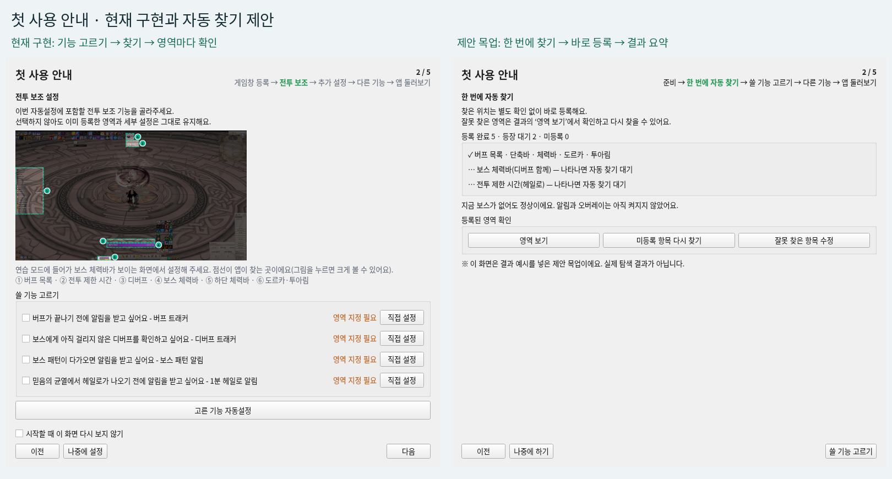

왼쪽은 현재 코드의 실제 Qt 렌더, 오른쪽은 성공값을 주입한 **제안 목업**이다.
등록 성공·등장 대기는 실게임 검출 결과가 아니다.

<details>
<summary>현재 첫 사용 안내 1~4단계 — 라이트 / 다크 실제 코드 렌더</summary>

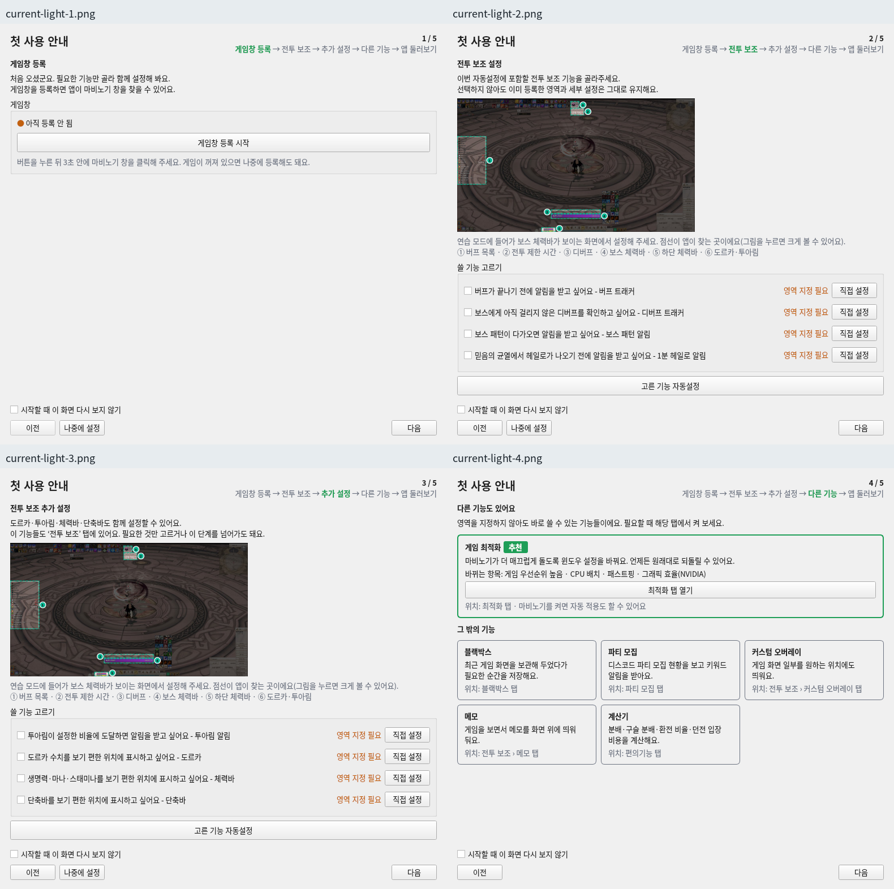

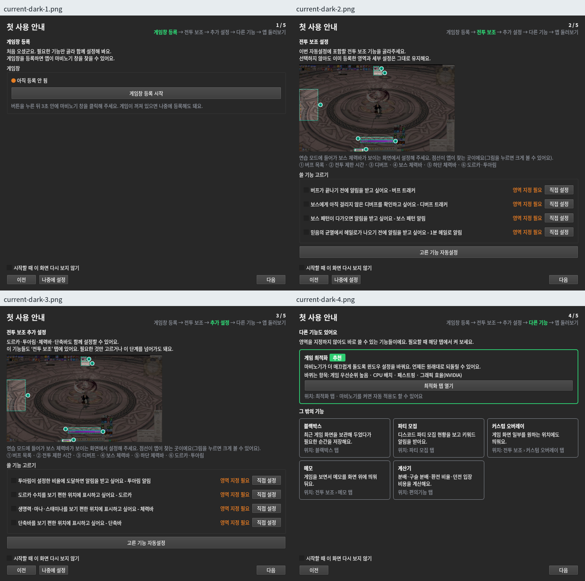

</details>

### 12.2 사용자 논의 방향과 이번 추천 흐름

**기존 사용자 논의 방향**([현행 기록](status.md)): 처음 한 번에 찾고 찾은 것 바로 등록·결과 요약,
‘자동 찾기 사용’ 기본 켜짐, 고정 UI 한 번 찾기, 보스바·헤일로 최초 등장 시 기능 사용 여부와 무관하게 영역만 찾기.
움직이는 UI의 10초/3회/1분 정책은 12.5절을 따른다.

**이번 UX 추천안**: 기존 5단계 틀·제목·게임창 상자·하단 버튼을 유지하고 아래로 바꾼다.

| 단계 | 화면과 행동 |
|---|---|
| 1 준비 | 게임창 등록 상태, 게임 화면 준비, ‘자동 찾기 사용’ 체크, ‘한 번에 자동 찾기’ |
| 2 한 번에 자동 찾기 | 탐색 중 → 찾은 항목 즉시 등록 → 결과 요약을 같은 단계에서 표시 |
| 3 쓸 기능 고르기 | 기존 8기능 체크 행을 모아 표시. 등록 영역과 기능 켜기를 구분 |
| 4 다른 기능 | 현재 소개 카드 유지 |
| 5 앱 둘러보기 | 현재 7장 유지. 개별 기능 설정 문구를 자동 찾기·다시 찾기까지 보완 |

**준비**

- 게임을 켜고 캐릭터 화면까지 진입한 뒤 상태 목록(즐겨찾기 포함), 단축바, 체력바, 도르카·투아림을 보이게 안내한다.
  다른 창이 UI를 가리지 않게 하고 탐색 중 게임 UI를 움직이지 않도록 설명한다.
- 미등록이면 기존 ‘게임창 등록 시작 → 3초 안에 게임창 클릭’을 사용한다. 앱 버튼 뒤 게임창으로 전환한다는 안내를 버튼 바로 아래 둔다.
  등록된 게임창은 다시 등록시키지 않으며, 등록 성공은 이 화면 상태만 갱신한다. 탐색 시작은 명시적인 버튼 한 번으로 한다.
- 기존 전체 UI 예시 그림은 ‘찾을 UI 예시 보기’로 재사용한다. 보스바·전투 시간은 지금 없어도 되므로 연습 모드를 필수로 요구하지 않는다.
- ‘자동 찾기 사용’은 준비 안내 아래, 기본 켜짐. 이후 설정 > 일반에서 변경하는 위치를 추천한다.
  설명: “켜짐: 움직인 UI를 다시 찾고, 보스바·전투 시간을 처음 보이면 찾아둬요. 꺼짐: 자동 재탐색·등장 대기 없이 안내만 해요.”
  꺼짐이어도 버튼으로 한 번 찾기는 가능하도록 추천한다. 이는 기존 구현 동작을 설명하는 문구가 아니다.

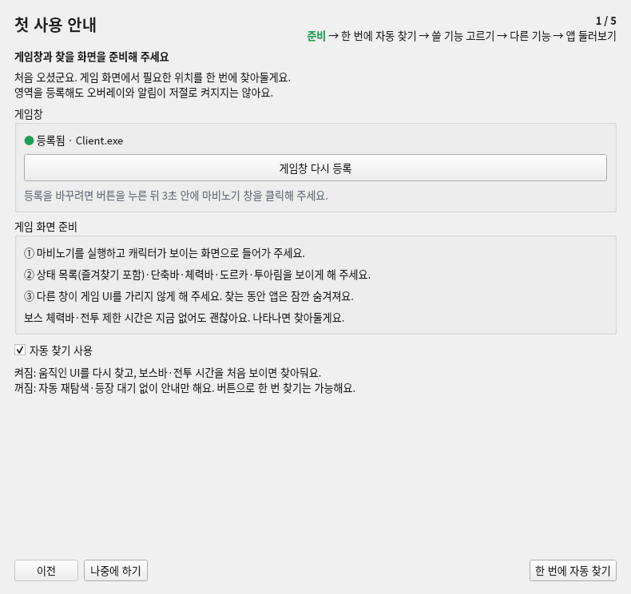

게임창 `Client.exe`는 준비된 상태를 설명하기 위한 모의 값이다.

**찾기·등록·결과**

- 사용 가능한 영역을 한 번에 찾는다. 영역은 버프·단축바·체력바·도르카·투아림·보스바(디버프 함께)·헤일로 타이머의 7개다.
  기능 사용 체크와 탐색 대상을 분리하되 기존 접근 권한을 우회하지 않는다.
- 캡처 순간 앱 숨김·복구 경로를 재사용한다. 찾은 항목부터 저장하고 **저장 성공 후에만** ‘등록됨’으로 표시한다.
  탐색 중 중복 실행 방지와 ‘찾기 중단’을 제공한다. 정확한 완료 시간이나 성공률은 약속하지 않는다.
- 결과는 **등록 완료 / 나타나면 자동 찾기 대기 / 미등록**으로 나눈다. 저장 실패·캡처 불가는 검출 실패와 구분한다.
- 영역별 승인 팝업을 정상 흐름에서 생략한다. ‘영역 보기’에서 원하는 항목을 강조하고, 잘못 찾은 항목만 해당 탭의 다시 찾기·직접 지정으로 연결한다.
  버프 자동 상단값 등록과 도르카·투아림 묶음 등록도 기존 확인 UI와 분리할 구현이 필요하다.
- 영역을 찾아두었다고 알림·오버레이를 자동으로 켜지 않는다. 신규 기능 체크는 모두 꺼짐, 기존 사용자의 선택은 유지한다.
  미등록 기능을 선택하면 설정 필요 상태를 유지하고 유효한 영역이 생긴 뒤 판독하는 방식을 추천한다.
- 로그인은 전체 안내의 필수 단계로 추가하지 않는다. 접근 제한이 있는 항목은 이용 조건을 표시한다.

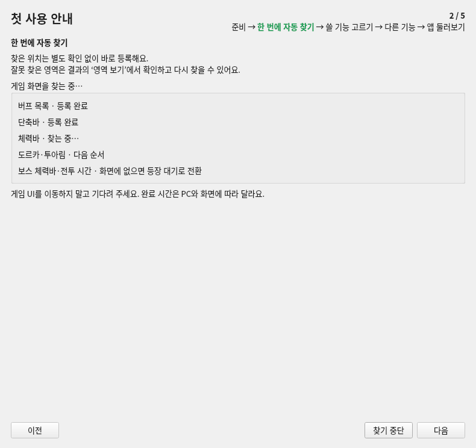

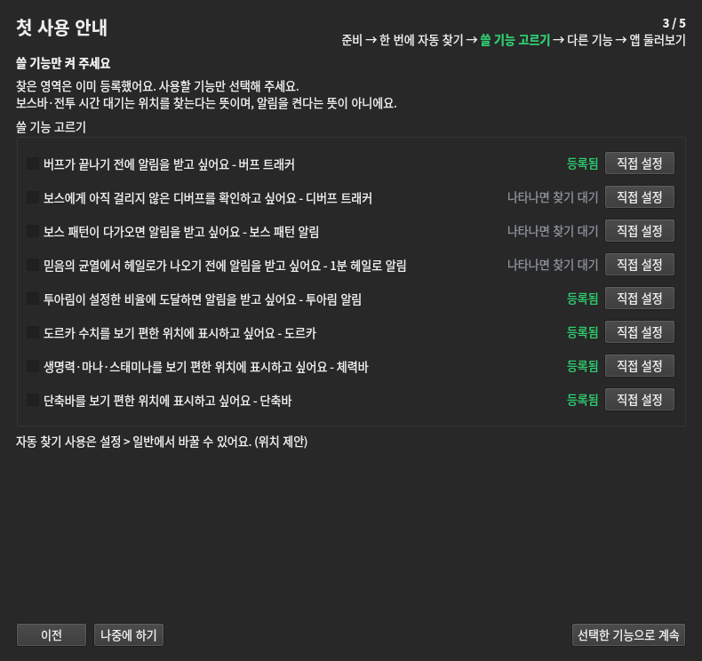

### 12.3 예외·복귀 흐름 (추천안)

| 상황 | 표시·다음 행동 |
|---|---|
| 게임 미실행·로그인 전 | 게임 실행·캐릭터 화면 진입 안내. 시작 비활성, 나중에 하기 허용 |
| 창 미지정·잘못 지정 | 게임창 등록 버튼과 3초 선택. 유효 대상 확인 후 시작 활성화 |
| 보스바·헤일로 미등장 | 켜짐이면 등장 대기, 꺼짐이면 미등록·해당 탭에서 찾기. 기능이 켜졌다는 의미가 아님 |
| UI 없음·가림·검출 실패 | 버프 등 준비 UI는 찾지 못함. 보스·시간도 보이는 근거가 있는데 검출 실패하면 실패로 분류. 단순 미검출을 정상 미등장으로 확정하지 않고 ‘화면에 보이는데 못 찾았나요?’ 경로 제공 |
| 부분 성공 | 성공분 유지, 미등록 항목만 다시 찾기. 계속 진행 가능 |
| 전부 실패 | 캡처·검출·저장 이유 구분. 다시 찾기·나중에 하기 제공, 기능 자동 켜기 없음 |
| 중단 | 저장 성공분 유지. 미시도·진행 중은 아직 찾지 않음. 늦게 도착한 결과 폐기, 작업 정리 전 중복 재시작 금지 |
| 다시 찾기·이전 | 미등록 항목만 재시도. 이미 등록된 항목은 사용자가 명시 선택할 때만 교체. 실패 시 기존 유효 값 유지. 이전 이동만으로 탐색 재시작하지 않음 |
| 나중에 하기 | 전체 안내를 종료하고 홈으로 이동. 설정·성공분 유지. 이미 안내한 자동 찾기 선택과 등장 대기 상태 유지 |
| 재실행·중도 종료 | 완료·보류 기록으로 전체 안내 반복 방지. 홈에 설정 이어하기 진입점. 비정상 종료 후 탐색은 자동 재개하지 않음. 설정에서 안내 다시 열기 가능 |

현재의 ‘시작할 때 이 화면 다시 보지 않기’ 수동 체크를 완료·보류 상태 기록으로 대체하는 것은 이번 추천이다.
기존 사용자 선택·저장 영역·접근 권한을 초기화하지 않는다.

<details>
<summary>제안 예외 화면 — 부분 실패 / 중단 / 자동 찾기 OFF</summary>

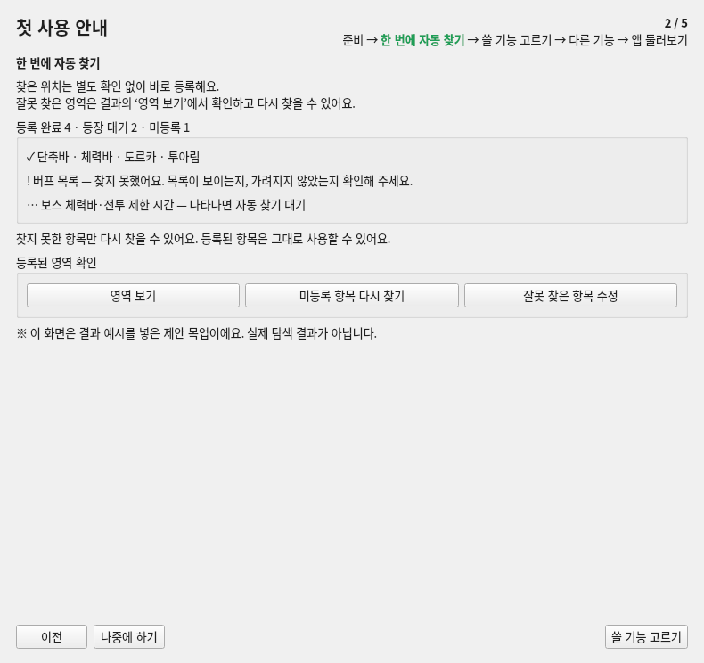

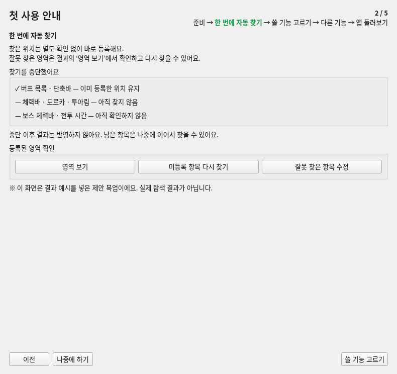

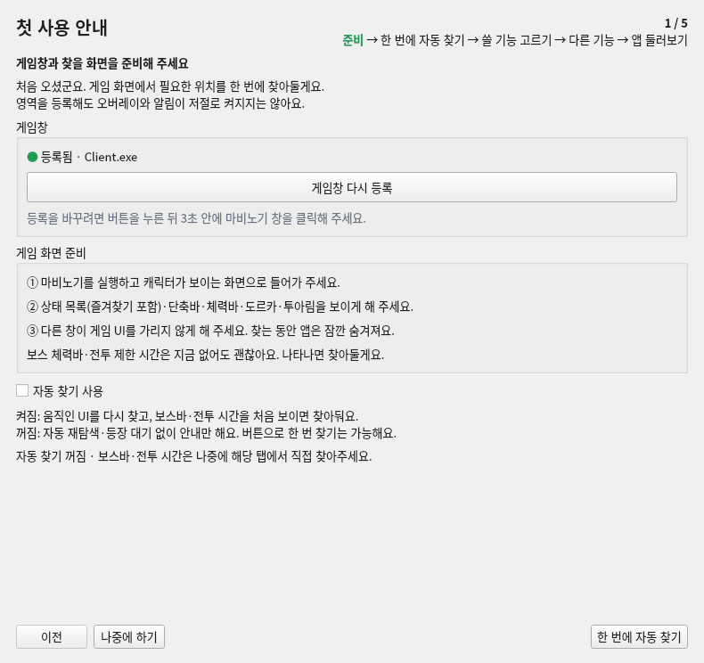

</details>

### 12.4 보스바·헤일로 등장 대기의 의미

처음 화면에 없는 것이 정상일 수 있으므로 실패 수에 넣지 않는다. 보스바는 디버프와 한 세트로,
헤일로는 전투 제한 시간 영역으로 찾아둔다. 패턴 알림·디버프·헤일로 기능이 꺼져 있어도 영역만 등록하며 알림은 켜지지 않는다.
단, 미등장과 실제 놓침을 구분할 신호와 대기 탐색 주기는 기술 검증이 필요하다. 고빈도 전체 화면 반복 탐색은 추천하지 않는다.
자동 찾기 OFF에서는 등장 대기를 시작하지 않고 해당 탭의 자동 찾기로 연결한다.

### 12.5 사용 중 재탐색·위치 저장

**사용자 논의 방향**

- 고정 UI(보스바·디버프 한 세트, 단축바, 체력바, 헤일로 타이머)는 한 번 찾으면 유지한다.
- 움직이는 버프·도르카·투아림은 자동 찾기 ON에서 **10초 넘게 못 읽으면 다시 찾기 → 3번 연속 실패하면 1분 간격**.
  도르카·투아림은 함께 찾는다.
- OFF면 재탐색하지 않고 10초 실패 시 안내와 해당 탭 자동 찾기를 제공한다.

**이번 추천 보완**: 판독 복구 시 실패 횟수 초기화, 같은 실패 구간의 안내 중복 방지.
게임 종료·최소화·대상 창 없음·캡처 불가는 검출 실패 횟수와 10초 누적에서 제외하고 대기한다.
OFF 전환 시 진행 결과 반영을 중단하되 등록된 영역·기능 사용 설정은 유지한다.
창 크기·해상도 변경으로 기존 영역이 무효해지면 무조건 삭제하지 말고 재확인을 안내한다.

**미결정: 다시 찾은 자리를 영구 저장할지.** 현재 도르카는 실행 중 위치만 바꿔 읽으며 저장하지 않는다.
추천은 유효 검출과 실제 판독을 확인한 위치만 저장하고 실패 시 이전 값을 유지하는 방식이다.
문서 푸시는 이 선택의 확정이나 기능 구현 승인이 아니다.

### 12.6 선행 기술 문제와 검증 범위

- **선행**: 헤일로 위치 찾기의 15분 판독 제한을 알림 판정 범위와 분리. 1920×1080 버프 자동 찾기 실패 조사·수정.
  기존 측정 결과는 [현행 기록](status.md)을 따른다. 표본 성공률을 모든 사용자 정확도로 확대하지 않는다.
- **구현 필요**: 기능 켜짐과 일괄 탐색 범위 분리, 승인 UI 없는 등록, 결과 상태 모델, 등장 대기·재탐색 스케줄,
  최초 안내 완료·보류 기록. 기존 검출기·등록·공유 영역 경로는 재사용 후보이며 신규 흐름 검증을 대신하지 않는다.
- **렌더 확인**: main 사본에서 Qt `QT_QPA_PLATFORM=offscreen`, Fusion, Noto Sans CJK KR 10pt.
  안내 790×744, 투어는 790×850 앱과 1600×1100 가상 화면. 현재 안내 4장·투어 7장·일반 영역 승인·버프 위 경계를 양쪽 테마로 새로 렌더하고 픽셀 확인.
  제안은 임시 스크립트에서 실제 안내 위젯을 변형한 8상태×2테마. 저장소에는 검토에 필요한 대표 이미지만 보관한다.
- **조건**: 게임·로그인·설정 저장·외부 장치·네트워크는 모의/격리. 오프스크린 OS 색상 전환 제약으로 Fusion 팔레트 명시,
  의미색은 앱 라이트·다크 함수를 사용. Windows 글꼴·창 장식과 차이가 있다. 투어는 실제 앱·투어 위젯의 합성이다.
- **전달 문서 검증**: 이미지 내장 HTML의 390/320px 가로 넘침 0·깨진 이미지 0, PNG 무결성 확인.
  이는 데스크톱 앱의 모바일 지원 검증이 아니다. 원본 44장과 전체 보고서는 별도 Library 전달본에 보관했다.
- **미검증**: Windows 실게임 등록·로그인·캡처·가림·DPI/다중 모니터, 앱 숨김·복구, 실제 검출 정확도,
  취소와 저장 경쟁·재실행 복원·재탐색 부하. 목업의 등록 성공은 이 검증을 통과했다는 뜻이 아니다.

다음 결정은 화면 구성 피드백과 재탐색 위치 영구 저장 여부다. 구현·배포 조작은 이번 문서 반영 범위에 없다.

### 12.7 사용자 결정(2026-11-03) — 기획 세션 검토 반영

검토 의견 5가지에 사용자가 동의했고, 12.5절 미결정은 C안으로 정했다. 아래가 12.1~12.6절보다 우선한다.

1. **3단계 '쓸 기능 고르기'는 스위치**(14절 5항 '기능 켜기 = 홈과 같은 스위치'). 줄 구성은 `기능 이름(굵게)·한 줄 설명(회색) | ● 상태 | 스위치 | 직접 설정`.
   상태는 `● 찾음`(정상 색)·`● 나타나면 찾기`(보조 색)·`● 못 찾음`(주의 색). 스위치의 뜻과 등록 방식은 12.8절(켜면 찾은 위치로 등록).
   못 찾은 기능도 켤 수 있고, 위치를 찾은 뒤 등록·동작한다. 신규 사용자의 기본값은 모두 꺼짐이다(목업의 켜진 줄·`등록됨` 글자는 12.8 이전 예시).
2. **2단계 결과는 항목마다 버튼**을 둔다. 전역 버튼 3개(`영역 보기 / 미등록 항목 다시 찾기 / 잘못 찾은 항목 수정`)는 쓰지 않는다.
   - 찾음 `✓ 이름 · 찾음 [보기][다시 찾기]`(12.8: 이 단계에서는 기억만, 등록은 3단계)
   - 못 찾음 `! 이름 · 못 찾았어요 — 이유 [다시 찾기][직접 지정]`
   - 대기 `… 이름 · 나타나면 찾아둘게요`(버튼 없음)
   - 위에 `찾음 N · 나타나면 찾기 N · 못 찾음 N` 요약을 두고, 아래에 `못 찾은 항목 다시 찾기` 버튼 하나를 둔다(못 찾은 항목이 있을 때만).
3. **'나타나면 찾아둘게요' 대기는 예상 자리부터** 본다. 보스 체력바는 해상도별로 자리가 고정이다(측정: 가로 가운데·아래에서 190~193px, 1920×1080은 262~263px).
   헤일로 타이머도 가로 가운데·해상도별 세로다. 대기 중에는 이 예상 자리만 작게 잘라 확인하고, 화면 전체 탐색은 드물게만 한다(간격은 개발이 CPU 측정으로 정함).
   CPU 목표(평균 1~2%) 안이어야 한다.
4. **'자동 찾기 사용'은 스위치**이며 두 곳에 둔다.
   - 1단계 준비 화면
   - 설정 › 일반의 새 구역 `자동 찾기`(`실행·종료`와 `오버레이 배치` 사이). 설명은 회색 두 줄로 쓴다.
     `켜면 게임 안에서 옮긴 버프 목록·도르카·투아림을 다시 찾아 저장하고, 보스 체력바·전투 시간은 처음 보일 때 찾아둬요.`
     `끄면 다시 찾지 않고, 못 읽을 때 안내만 해요. 각 탭의 자동 찾기 버튼은 그대로 쓸 수 있어요.`
5. 목업 안의 `※ 이 화면은 … 제안 목업이에요` 문구는 목업 표시용이며 **제품에 넣지 않는다.**
6. **다시 찾은 자리 저장 = C안(확인 후 저장)**. 대상은 움직이는 UI(버프 목록, 도르카·투아림 묶음)이다.
   - 새 자리에서 약 3초 연속으로 **제대로 읽힐 때만 등록 영역에 저장**한다. 확인 전에는 새 자리로 읽어 보기만 하고 저장값은 그대로 둔다.
     - 버프: 기준 버프 또는 등록 버프 아이콘이 잡힘
     - 도르카·투아림: 숫자·%가 읽힘
   - 확인에 실패하면 저장하지 않고 이전 값을 유지하며, 재시도 규칙(10초 → 3번 실패 후 1분 간격)을 따른다.
   - **직접 지정한 영역과 자동으로 찾은 영역을 구분하지 않고 덮어쓴다**(사용자). **조용히 저장**하고 알림 없이 `app.log`에만 기록한다(이전·새 값).
   - 지금 도르카의 '실행 중에만 쓰고 저장 안 함' 동작은 이 규칙으로 바뀐다.

7. **C안 개발 테스트 조건**(사용자, 2026-11-03):
   - 확인은 **같은 후보 영역**에서 **새 화면(새 프레임)으로 연속** 성공해야 한다. 같은 프레임을 여러 번 세지 않는다.
   - 확인 도중 **한 번이라도 판독이 실패하면 3초를 처음부터 다시** 센다.
   - 확인 도중 **사용자가 직접 지정·자동 찾기·지정 해제**를 하거나, **게임 창이 바뀌면**(다른 창 핸들·크기·해상도 변경, 게임 종료),
     진행 중인 후보와 늦게 도착한 결과를 **버린다**(세대 번호 등으로 오래된 결과 무시). 사용자의 새 지정이 이긴다.
   - 저장은 확인 완료 때 **한 번만** 한다(같은 값이면 쓰지 않음). 앱을 재시작하면 확인 중이던 후보는 잊는다(이어서 세지 않음).
   - 일시정지·최소화·게임이 뒤에 있는 동안은 확인 시간을 세지 않고 멈춘다(실패로도 세지 않음).
   - 테스트는 가짜 프레임 열(성공·실패 섞기)과 가짜 시계로 맥에서 돌린다. `app.log`에 이전·새 값 한 줄이 남는지 확인한다.

### 12.8 찾은 위치는 고른 기능에만 등록 (2026-11-03 사용자 결정 — 탭·홈 화면 추가 없음)

**배경**: 지금 코드는 버프·디버프·보스 패턴·1분 헤일로·단축바(와 메모)가 **영역이 있으면 곧 켜진 것**으로 동작한다
(`setup_state.enabled` = 영역 유효 여부, 홈에도 스위치 없음). 찾자마자 등록하면 사용자가 고르기 전에 이 기능들이 동작한다.
'사용' 스위치를 새로 만드는 안은 화면을 늘려 버렸다(첫 사용 정리 방향과 반대).

**결정: '영역이 있으면 켜짐' 규칙은 그대로 두고, 찾은 위치는 기억만 했다가 고른 기능에만 등록한다.**
1. **2단계 한 번에 자동 찾기**: 전부 찾되 기능 영역에 바로 등록하지 않고 **찾은 위치로 기억**한다
   (config 예: `autofind.found` = 기능별 `{box, 해상도, 찾은 시각}` — 키 이름은 개발이 정함). 결과 표시는 `✓ 찾음`이다(12.7-2의 `등록됨` → `찾음`).
2. **3단계 쓸 기능 고르기**: 켠 기능만 **기억한 위치로 등록**한다. 등록되는 순간 그 기능이 동작한다.
   - 도르카·투아림·체력바·커스텀처럼 원래 켜기 값이 있는 기능은 위치 등록과 함께 그 켜기 값도 켠다.
   - **기존 사용자의 3단계 초기 상태는 기능 종류별로 기존 값을 그대로** 보여준다(리뷰 지적 — 꺼 둔 선택 보존).
     - 영역 등록 여부로 동작하는 기능(버프·디버프·단축바, 보스 패턴·1분 헤일로는 아래 9항): 등록돼 있으면 켜짐.
     - 별도 사용 값이 있는 기능(도르카·투아림·체력바 `표시`·커스텀 오버레이): **영역이 남아 있어도 기존 ON/OFF 값 그대로**(꺼 둔 사람은 꺼짐).
   - 끄면: 영역 등록으로 동작하는 기능은 등록을 해제하고 위치를 기억으로 옮긴다(다시 켜면 복구). 별도 사용 값이 있는 기능은 사용 값만 끄고 영역은 그대로 둔다.
   - 켜면: 별도 사용 값이 있는 기능은 영역이 이미 있으면 사용 값만 켜고, 없으면 기억한 위치로 등록한 뒤 켠다.
   - 3단계 스위치의 뜻은 "이 기능을 쓸지"이다. 홈에 스위치가 있는 기능은 홈 값과 같다. 홈·탭 화면은 바꾸지 않는다.
3. **고르지 않은 기능**: 화면에 아무것도 추가하지 않고 기억만 한다. 나중에 그 탭에서 `자동 찾기`를 누르면
   **기억한 위치를 먼저 확인**(그 자리에서 판독되면 바로 등록)하고, 안 되면 지금처럼 전체를 찾는다.
4. **보스 체력바·전투 시간 '나타나면 찾아두기'**도 같은 방식이다. 찾으면 기억하고, 고른 기능(디버프·보스 패턴·1분 헤일로 중 고른 것)에만 등록한다.
   고른 기능이 없으면 기억만 한다.
5. **C안 다시 찾기(12.7-6)**는 등록된(동작 중인) 기능에만 해당한다. 기억만 한 위치는 판독하지 않으므로 다시 찾지 않는다.
6. **기존 사용자**: 동작 규칙이 그대로라 큰 이전은 없다. 예외는 9항 보스바 공유 기능의 내부 사용 값으로, 지금 등록 상태에서 한 번 채운다(동작 변화 없음). 새 사용자도 고르기 전에는 아무 기능도 동작하지 않는다.
7. **놓치는 것**: '기능은 꺼 두고 영역만 등록해 둔' 상태는 없다. 기억한 위치가 그 역할을 대신한다.
9. **보스 체력바를 함께 쓰는 기능의 분리**(리뷰 지적 — 화면 추가 없이 내부에서).
   - **지금 코드**: 보스바 영역은 공유 키 하나(`bossPattern.box`)이다. 보스 탭 읽기 루프(`boss_tab._tick`)가 그 영역으로 보스를 식별해 헤일로에 알려주고(`halo_capture.set_boss_context`),
     같은 흐름에서 패턴 경고·남은 패턴 목록도 낸다. 디버프도 이 영역을 공유한다(`config.save_boss_bar_region`).
   - **문제**: 그래서 '헤일로만 켬'으로 보스바를 등록하면 패턴 알림도 켜진다. 반대로 패턴을 끄려고 보스바 등록을 지우면 헤일로의 보스 식별과 디버프 보스 확인도 끊긴다.
   - **결정**:
     - 보스바 영역 판독(식별·HP)은 하나로 두되, **패턴 알림·헤일로·디버프 보스 확인을 기능별로 내부에서 켜고 끈다.** 화면 스위치는 추가하지 않는다.
     - 내부 사용 값은 3단계 선택과 각 탭의 등록·`지정 해제`가 정한다.
     - **보스바 판독은 이 영역을 필요로 하는 기능이 하나라도 있으면 유지**하고, 모두 필요 없을 때만 캡처를 멈춘다(리뷰 지적 — 2026-11-03).
       보스 존재 신호를 쓰는 곳은 패턴·헤일로·디버프 셋만이 아니다.
       - **체력바 보스전 저체력 알림**(`stat_bars_tab.set_boss_presence_source`): 보스전 중에만 울린다.
       - **블랙박스 전투 녹화**(`blackbox_controller.wants_boss_presence`)
       - 지금도 `boss_tab.set_presence_consumer`로 '존재 판정이 필요한 쪽'을 묻는 구조이므로, 이 목록을 패턴·헤일로·디버프까지 합친 하나의 '필요한 기능' 판정으로 넓힌다.
       - 홈 보스 줄 상태(`추적 중`)는 표시만 하므로 판독을 붙잡지 않는다.
     - **보스 탭 `지정 해제`**는 '패턴 알림을 그만 씀'으로 바꾼다. 헤일로·디버프가 보스바를 쓰는 동안에는 공유 영역을 남긴다. 아무도 안 쓸 때만 영역을 지운다(위치는 기억으로).
       디버프 쪽 보스바 해제도 같다.
   - **기존 사용자**: 지금 보스바가 있으면 패턴 알림 켜짐, 헤일로 영역이 있으면 헤일로 켜짐, 디버프 영역이 있으면 디버프 켜짐. 업데이트 뒤 동작이 같다.
   - **테스트**:
     - '헤일로만 켬' → 보스 식별·헤일로 경고는 나오고 패턴 경고·남은 패턴 목록·패턴 소리 0
     - '패턴만 끔(보스 탭 지정 해제), 헤일로 유지' → 공유 영역 유지, 헤일로 정상, 패턴 0
     - '디버프만 켬' → 보스 확인 정상, 패턴·헤일로 0
     - '체력바 보스전 저체력 알림만 씀' → 보스 존재 판정 유지(알림이 보스전에만 울림), 패턴·헤일로 0
     - '블랙박스 전투 녹화만 씀' → 보스 존재 판정 유지, 패턴·헤일로 0
     - 위 다섯이 모두 필요 없음 → 보스바 캡처 0, 영역은 기억으로(하나라도 필요해지면 다시 시작)
8. **테스트**:
   - 2단계 뒤 기능 영역이 비어 있고 기억만 있는지
   - 3단계에서 켠 기능만 등록되는지
   - 끄면 해제와 기억으로 옮겨지는지
   - 탭 자동 찾기가 기억한 위치를 먼저 쓰는지
   - 나타나면 찾기가 고른 기능에만 등록하는지
   - 기존 사용자 동작이 변하지 않는지

### 12.9 개발 작업 목록과 완료 기준 (2026-11-03 리뷰 정리)

새 화면이 필요한 설계 난제는 없다. 아래를 개발 범위로 하고, **완료 기준을 넘기 전에는 자동 찾기를 완료로 보지 않는다.**

| 작업 | 내용 | 근거 |
|---|---|---|
| 기억과 등록 분리 | 찾은 위치 기억 저장소, 3단계에서 고른 기능만 등록, 탭 자동 찾기는 기억 먼저 | 12.8-1~5 |
| 동시 덮어쓰기 방지 | 일괄 자동 찾기·나타나면 찾기·C안 다시 찾기·직접 지정이 같은 영역 결과를 덮어쓰지 않게(세대 번호, 사용자 지정 우선) | 12.7-7 |
| 기존 상태 보존·동기화 | 영역형/사용 값형 구분, 보스바 공유 기능 내부 값 1회 채우기, 홈·탭·3단계 상태 일치 | 12.8-2·6·9 |
| 보스바 공유 판독 | 필요한 기능(패턴·헤일로·디버프·체력바 보스전 알림·블랙박스 전투 녹화)이 하나라도 있으면 유지 | 12.8-9 |
| **선행: 헤일로 15분 한도** | 위치 찾기(`halo_timer.read_seconds`의 `total<=900`)를 헤일로 알림 판정 범위와 분리. tests/data 회귀(측정: 한도 3600에서 49장 찾음) | status 자동 찾기 측정 |
| **선행: 1080 버프 찾기 실패** | 1920×1080 4장 전부 `coarse_score` 실패 원인 수정과 회귀 | 같음 |
| 측정 | 나타나면 찾기·C안 다시 찾기의 실제 CPU(목표 평균 1~2%), Windows 실화면 동작(앱 숨김·복구, 가림, DPI) | 12.6, 12.7-3 |

**완료 기준**
- 1080 버프와 헤일로 회귀 테스트가 통과하고, Windows 실화면에서 확인한다.
- 보스바는 '헤일로만', '패턴만 끔', '디버프만', '체력바 보스전 알림만', '블랙박스 전투 녹화만', '모두 안 씀'을 모두 테스트한다.
- CPU 측정값을 status에 남긴다. 테스트 통과와 실게임 검증은 따로 적는다.

검토 반영 목업(기획 세션 렌더, 다크, 오프스크린 — 결과 값은 예시이며 실게임 검출 결과가 아니다):

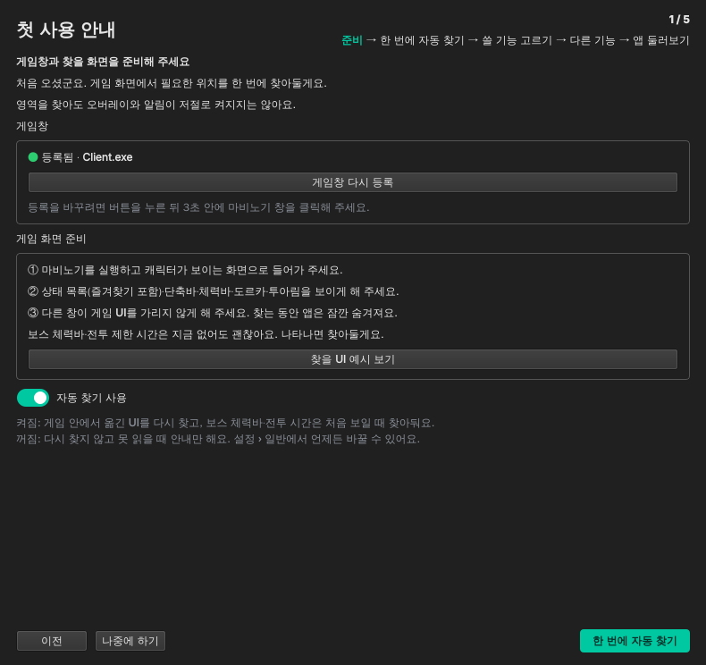

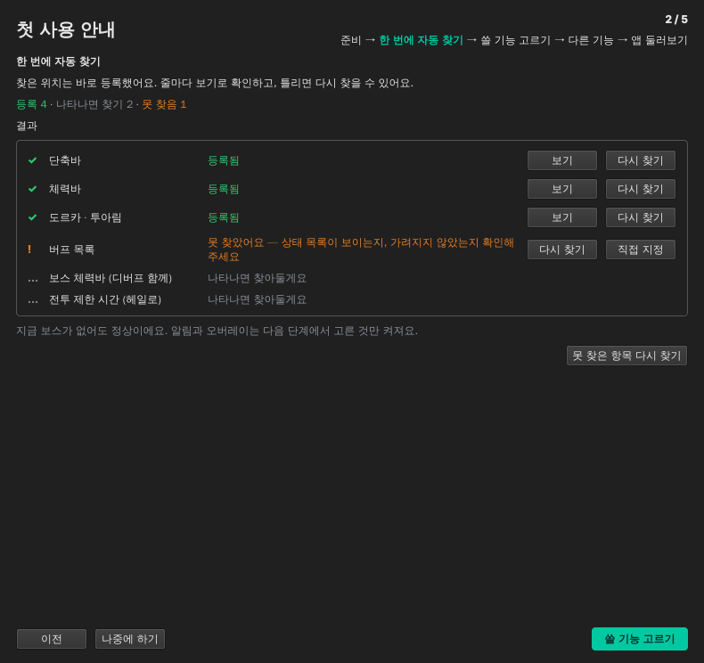

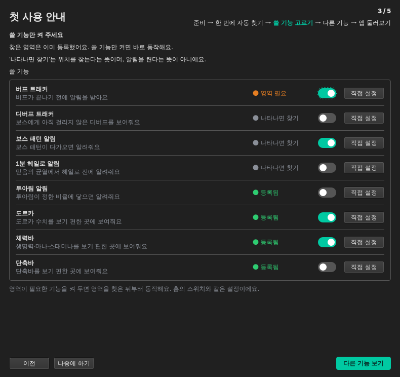

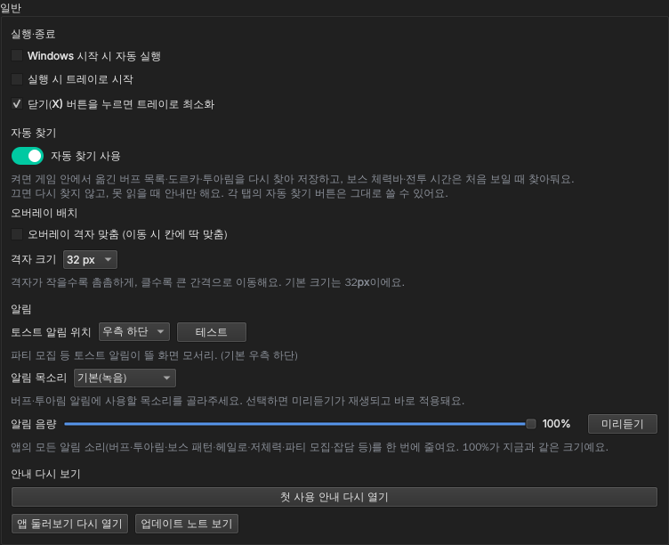
