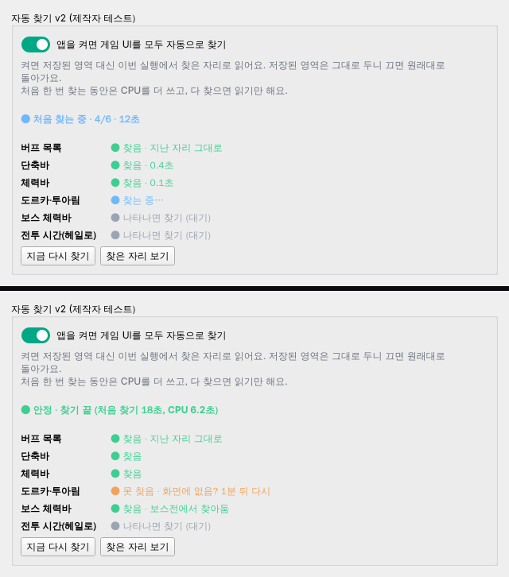

# 자동 찾기 v2 — 제작자 테스트판 기획

- 작성: 2026-11-06 (기획 세션). 상태: 기획 확정, 미구현. **제작자 전용**(`feature_access.is_creator()`).
- 사용자 결정(11-06):
  - 자동 찾기 v2를 다시 하되 **제작자 전용**으로 먼저.
  - **저장된 영역을 쓰지 않고, 앱을 켜면 앱이 게임 UI를 모두 알아서 찾는다.**
  - 처음 찾는 동안 CPU가 올라가는 것은 괜찮다. **한 차례 찾기가 끝나면 안정**(읽기만)되어야 한다.
- 이 문서가 [자동설정 명세 12절](auto-setup-v2-spec.md#12-첫-사용-자동-찾기-통합안-2026-11-03--기획미구현)보다 우선한다.
  12절의 첫 사용 안내 5단계·3단계 스위치·기억 후 등록은 **이번 범위가 아니다**(공개할 때 다시 정한다). 재사용할 규칙만 아래에 적었다.
- 배경: 0.39.0(12절 구현)은 사용자 PC에서 CPU 상승·커서 꼬리 끊김으로 0.39.1에서 되돌렸다(`cd2fb17`).
  QA A/B로 **CPU 상승은 자동 찾기**, 끊김은 보스 탭 틱(설정 5회 읽기)이 유력했고 끊김 쪽은 이후 main에서 고쳤다.
  그래서 이번엔 **언제 찾고 언제 멈추는지**를 명확히 하고 CPU를 숫자로 남긴다.

## 1. 한 줄 동작

앱 시작 → (게임이 앞에 있고 UI가 보이면) **처음 찾기** 한 차례 → 찾은 자리로 각 기능이 읽음 → **안정**(찾기 멈춤, 읽기만)
→ 못 읽게 되면 그 항목만 **다시 찾기**(간격 늘려 가며) / 보스바·전투 시간은 **나타나면 찾기**(작게만 확인).

## 2. 저장된 영역과의 관계

| 항목 | 규칙 |
| --- | --- |
| 위치 | 저장된 영역(직접 지정·탭 자동 찾기)을 **위치로 쓰지 않는다.** 이번 실행에서 찾은 자리로 읽는다. |
| 저장된 영역 | **건드리지 않는다**(덮어쓰기 없음). v2를 끄면 다음 실행부터 원래대로. |
| 어떤 기능을 쓸지 | 기능 켜짐 여부는 지금 설정을 그대로 쓴다. 영역이 있으면 켜지는 기능(버프·디버프·보스 패턴·1분 헤일로·단축바)은 '저장 영역이 있음 = 쓰는 기능'으로 보고, 별도 사용 값이 있는 기능(도르카·투아림·체력바·커스텀)은 그 값을 따른다. → 제작자가 쓰던 기능만 동작, 안 쓰던 기능은 찾은 자리만 표시. |
| 찾은 자리 기억 | `autofindV2.last`(기능별 `{box, 게임 창 크기, 시각}`)에만 저장 — **다음 실행의 첫 확인 후보**로만 쓴다(아래 3.1). 키 이름은 개발이 정함. |
| 실행 중 반영 | 각 탭에 '이번 실행 영역'을 넘기는 한 곳(런타임 영역 제공자)을 둔다. 도르카의 '실행 중에만 새 자리로 읽기'와 같은 방식. 탭 화면의 영역 표시는 `자동(v2)`로 구분. |
| 직접 지정 | v2가 켜진 동안 탭에서 직접 지정·자동 찾기를 하면 **그 실행 동안은 사용자 지정이 이긴다**(v2가 그 항목을 덮지 않음). 저장 동작은 지금과 같다. |

## 3. 찾기 단계와 CPU

### 3.1 처음 찾기 (앱 시작 때 한 차례)
- **시작 조건**: 게임 창이 있고 앞에 있으며 최소화가 아님 + 첫 화면에서 '게임 UI가 보이는지' 가벼운 확인(단축바 또는 체력바 하나라도 보임).
  로딩·로그인·캐릭터 선택 화면이면 시작하지 않고 10초 뒤 다시 확인(가벼운 확인만).
- **순서**(빠르고 확실한 것부터): ① 지난 자리 확인(`autofindV2.last` — 그 자리만 잘라 판독, 수 ms) → ② 단축바 → ③ 체력바 → ④ 버프 목록(즐겨찾기 포함) → ⑤ 도르카·투아림 묶음 → ⑥ 보스바·전투 시간은 지금 보이면 찾고 아니면 대기로.
- **한 번 찍은 화면으로** 여러 탐지기를 돌린다(항목마다 다시 캡처하지 않음). 화면이 바뀌어야 하는 항목만 다시 찍는다.
- **작업 스레드 하나**에서 차례로, 항목 사이에 짧게 쉰다(예: 50ms). 화면 스레드에서는 캡처·탐지 0(0.38.0 교훈 — 16ms 넘는 화면 스레드 일은 커서 꼬리 끊김).
- **끝 조건**: ①~⑤가 각각 '찾음' 또는 '못 찾음'이 되면 처음 찾기 종료 → **안정**. 못 찾은 항목은 3.3 규칙으로 넘긴다.
- **상한**: 처음 찾기 전체 CPU 시간이 정해 둔 한도(제안 20초)를 넘으면 남은 항목은 '못 찾음'으로 넘기고 종료(무한히 돌지 않게).
- **기록**: `app.log`에 `[자동 찾기 v2] 처음 찾기 18.0초(CPU 6.2초) · 찾음 5 · 대기 2 · 못 찾음 0` 한 줄 + 항목별 시간.

### 3.2 안정 (평소)
- 찾기 작업 **0**. 각 기능은 평소처럼 자기 영역만 읽는다.
- 목표: 앱 CPU **평균 1~2%**(지금 v2 꺼짐 상태와 같은 수준). 화면 스레드 추가 0.

### 3.3 다시 찾기 (못 읽게 됐을 때만 — 12.5·12.7-6 규칙 재사용)
| 대상 | 언제 | 어떻게 |
| --- | --- | --- |
| 움직이는 UI(버프 목록, 도르카·투아림) | **10초 넘게 못 읽으면** | 그 항목만 다시 찾기. 3번 연속 실패하면 **1분 간격**. 다시 읽히면 횟수 초기화. |
| 고정 UI(단축바, 체력바) | 10초 넘게 못 읽으면 | 같은 규칙이지만 보통 일어나지 않음. |
| 새 자리 확정 | 새 자리에서 **약 3초 연속 새 화면으로 제대로 읽힐 때** | 확정 전엔 새 자리로 읽어 보기만. 실패 한 번이면 처음부터. 확정은 런타임 영역 + `autofindV2.last`에만(저장 영역 안 건드림). 12.7-7 테스트 조건 그대로. |
| 세지 않는 때 | 게임 최소화·뒤로 감·창 없음·캡처 불가 | 10초·실패 횟수 모두 멈춤. |
| 게임 창 크기·해상도 변경, 게임 재시작 | 즉시 | 진행 중 결과 버리고(세대 번호) **처음 찾기를 다시** 한 차례. |

### 3.4 나타나면 찾기 (보스 체력바, 전투 시간)
- 처음엔 화면에 없는 게 정상이라 '못 찾음'으로 세지 않는다(대기).
- 대기 중엔 **예상 자리만 작게 잘라** 1초에 1번 확인(보스바: 가로 가운데·아래에서 약 190~263px — 12.7-3 측정값, 전투 시간: 해상도별 가운데 위).
  화면 전체 탐색은 드물게(제안 60초에 1번)만.
- 한 번 찾으면 대기 끝(안정). 보스바는 디버프와 한 세트.
- 이 대기 비용이 3.2 목표를 넘지 않는지 측정해 남긴다.

## 4. 화면 (제작자에게만 보임)

목업은 예시 값이다(실게임 결과 아님). 설정 › 일반의 `실행·종료`와 `오버레이 배치` 사이에 구역 하나.
- 스위치 `앱을 켜면 게임 UI를 모두 자동으로 찾기`(기본 꺼짐 — 제작자가 켜서 테스트). 바꾸면 다음 실행부터 적용, 켜는 즉시 처음 찾기를 한 번 시작해도 됨(개발 판단).
- 맨 위 상태 한 줄: `처음 찾는 중 · 4/6 · 12초` → `안정 · 찾기 끝 (처음 찾기 18초, CPU 6.2초)` / `다시 찾는 중(도르카·투아림)`.
- 항목별 상태: `찾음 · 지난 자리 그대로` / `찾음 · 0.4초` / `찾는 중…` / `나타나면 찾기 (대기)` / `못 찾음 · 이유 · 다음 시도`.
- 버튼: `지금 다시 찾기`(처음 찾기 한 차례 다시), `찾은 자리 보기`(게임 위에 민트 테두리로 잠깐 표시 — 기존 `region_highlight` 재사용).
- 홈·탭·첫 사용 안내는 바꾸지 않는다. 다른 사용자에게는 구역 자체가 없다.

## 5. 되돌린 0.39.0 코드 재사용
- `cd2fb17`이 되돌린 4커밋(835e5d9 위치 기억·안내 통합, 69fce05 상주 작업자·캐시, ea74092 이전 게임 창 재사용, 6fc03ee 투아림 100% 판정)과
  `claude/happy-hopper-hw8n26`의 WIP(설정 읽기 캐시)는 **부품으로 골라 쓴다**. 첫 사용 안내 통합(835e5d9의 안내 부분)은 이번에 넣지 않는다.
- **선행 수정 2건은 반드시 다시 넣는다**(되돌림으로 main에서 빠짐):
  - 헤일로 위치 찾기 15분 한도 분리(`halo_timer` — 위치 탐색만 3600초, 알림 판독은 900초 유지). 0.39.0 측정: 헤일로 4/89 → 49/89.
  - 1920×1080 버프 찾기 실패(`coarse_score`) 수정. 0.39.0 측정: 버프 81/89 → 88/89.
- 0.39.0에서 CPU를 올린 원인(자동 찾기가 안정 뒤에도 계속 돎/주기 탐색)을 개발이 먼저 짚고, 이번 설계의 '안정 = 찾기 0'으로 막았는지 테스트로 보인다.

## 6. 테스트와 완료 기준
- **맥(가짜 프레임·가짜 시계)**:
  - 처음 찾기 순서·한 번 찍은 화면 재사용·상한 20초 초과 시 종료.
  - 안정 상태에서 찾기 호출 0회(일정 시간 돌려 세기).
  - 다시 찾기: 10초·3회·1분 간격, 복구 시 초기화, 최소화·뒤로 감 동안 멈춤, 창 크기 변경 → 처음 찾기 다시.
  - 3초 연속 확정(12.7-7 조건), 사용자 직접 지정이 이김, 저장 영역 미변경(config 비교).
  - 비제작자: v2 코드 경로 미호출, 설정 구역 없음.
  - 회귀: `tests/data` 89장 기준 버프·단축바·체력바·도르카·투아림·보스바·헤일로 찾기 결과(0.39.0 측정 이상).
- **Windows(제작자)**: 앱 시작 → 처음 찾기 시간·CPU, 안정 후 10분 평균 CPU(v2 끔과 비교), 커서 꼬리 끊김 없음(`[계산·화면]` 로그), 보스전 진입 시 보스바 찾기, 창 모드 크기 변경.
- **완료 기준**: 안정 상태 CPU가 v2 끔과 같은 수준, 처음 찾기 CPU·시간이 status에 기록됨, 화면 스레드 16ms 넘는 v2 작업 0건.
