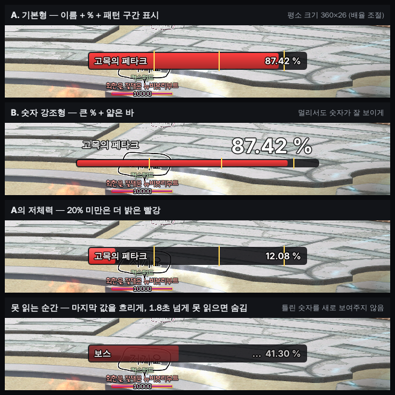

# 보스바 오버레이 기획

- 작성: 2026-11-05 (기획 세션). 상태: **0.45.0부터 모든 사용자 공개(사용자 결정 11-10, 노트에 베타 표기)** — 그전엔 제작자 전용으로 개발·테스트.
  구역 제목 `보스바 오버레이`(앱 화면에 '베타'·'제작자 테스트' 표기 없음), 기본 꺼짐. '진단 · 보스 HP바 수집'은 제작자 전용 그대로.
- 사용자 결정(11-05): 미러가 아니라 **HP %를 읽어 앱이 바를 직접 그린다**, 모양은 **A 기본형**, 이번 개발 회차에 넘김.
- 함께 볼 것: status '보스 체력바 따로 띄우기 아이디어(11-03, 독립 QA)', '보스바 오버레이 기획 검토(11-05)'.

## 1. 화면

| 항목 | 결정 |
| --- | --- |
| 모양 | **A 기본형**: 어두운 테두리 안 빨간 바, 왼쪽 이름, 오른쪽 `87 %`. 기본 360×26(배율 조절). |
| 숫자 | **정수 %만**(예: `87 %`). 기존 판독기는 정수 자리만 읽는다 — 목업의 소수 둘째 자리는 표시하지 않는다. 바 길이도 정수 %로 그린다. |
| 이름 | 등록 보스 5종은 이름, 나머지는 `보스`. |
| 패턴 구간 선 | 패턴 알림이 등록된 보스만 그 구간(예: 90·60·30)에 노란 세로선. 없으면 선 없음. |
| 색 | 빨강 고정, **20% 미만은 더 밝은 빨강**(목업 그대로). 단계별 색은 하지 않음. |
| 언제 보이나 | 보스바가 떠 있는 동안만(기존 보스 존재 판정 — 사라진 뒤 약 1.8초 유지). 게임 비활성이면 숨김. |
| 못 읽는 순간 | 마지막 값을 **흐리게 + `…`**. 1.8초 넘게 못 읽으면 숨김. 틀린 새 숫자를 그리지 않는다. |
| 조작 | 버프 오버레이와 같음: 잠금(클릭 통과)·드래그 이동·배율·불투명도·격자. 잠금 해제 중엔 예시 바(`보스 75 %`)로 위치 잡기. |
| 자리 | `전투 보조 › 보스` 화면에 `보스바 오버레이` 구역(사용 스위치·배율·불투명도·잠금). 제작자에게만 보임. |

## 2. 읽는 법 (기존 보스 판독 재사용)
- 보스 탭은 이미 **작업 스레드에서 0.3초마다** 등록 영역을 찍어 이름 식별 → HP 판독(등록 보스), 또는 존재 확인(이름 글자 + % 판독, 미등록 보스)을 한다.
- 미등록 보스도 존재 확인에서 %를 이미 읽는다 → 그 값을 결과로 내보내기만 하면 된다(추가 판독 없음).
- 오버레이를 켜면 보스바 공유 판독의 소비자(`set_presence_consumer`)로 등록해, 다른 소비자가 없어도 판독이 돈다.
- 화면 스레드는 **값이 바뀔 때만** 오버레이를 다시 그린다.

## 3. 잘못된 숫자를 막는 규칙 (필수)
1. **신뢰도**: 기존 값 판독 하한(`VALUE_MIN_SCORE` 0.6)을 그대로 쓴다. 하한 미만은 '못 읽음'.
2. **갑자기 오르는 값**: 직전보다 5%p 넘게 오르면 **2회 연속 같은 값**일 때만 반영. 내려가는 값은 바로 반영.
3. **얇은 일반 체력바 제외**: 영역 안 바 채움 띠 높이가 보스바(37px, 해상도 무관 고정)와 크게 다르면(±3px 밖) 보스바로 보지 않는다. 얇은 바는 글자도 작아 % 판독이 대개 실패하지만, 높이 검사를 한 번 더 둔다.
4. **기믹으로 보스바가 위로 밀리는 경우**: 보호막 같은 바가 원래 자리를 차지하고 보스바가 위로 올라가면, 등록 영역에 **다른 바의 %**가 읽힐 수 있다(미러보다 위험 — 틀린 HP를 그림).
   - 규칙: 매 판독 때 등록 영역과 **바로 한 칸 위**(약 39px, 펠롬 보스바↔에르그 간격 기준)를 같이 본다. **위 칸에도 보스바(이름 글자 + %)가 있으면 위 칸이 보스**, 등록 영역 값은 버린다.
   - 캡처는 등록 영역을 위로 약 45px 늘린 사각형 하나(작업 스레드, 추가 비용 수 ms).
   - 한 칸 간격은 **보호막 기믹 실화면으로 확인 전까지 추정값**. 실화면이 없으면 제작자 테스트에서 확인한다.
   - 등록 보스 5종은 이름 식별이 있어, 다른 이름의 바는 그 보스 값으로 쓰지 않는다(기존 동작).

## 4. 판독이 얼마나 확실한가 (2026-11-05 기획 세션 재확인)
- `tests/data` 보스 화면에서 보스바로 확인된 68장: 판독값이 모두 정상 범위, 신뢰 점수 대부분 1.0(최저 0.69).
- 과거 오독 1건(`2026-10-11_123333`, 100%를 30으로) → 하한 0.6 도입 후 **'못 읽음'으로 바뀜**(틀린 값 대신 비움). 이 화면은 3절 1·흐림 표시로 처리된다.
- 도르카와 다른 점: 도르카는 움직이는 작은 보라색 원 안 숫자(28×23)라 배경 영향이 크다. 보스 %는 고정 위치·큰 숫자(바 37px)·오른쪽 정렬 고정 칸·채도로 글자만 분리 → 훨씬 안정적. 이미 패턴 알림이 이 판독으로 동작 중.
- 알려진 약점: 이펙트·다른 창이 숫자를 가림, 저체력 숫자 칸 번짐(전용 경로 있음), 4K 일부 숫자 샘플. 모두 '못 읽음 → 흐림 → 숨김'으로 처리.

## 5. 테스트
- 회귀: 펠롬 5장(99·87·75·42·8 — 저체력 포함), 10-09 연속 장면(100→90), 10-11_123333(못 읽음 → 흐림), 보스 없는 화면(숨김).
- 규칙 2: 가짜 판독 열(87→20→87, 50→56 한 번) 단위 테스트. 규칙 3·4: 펠롬 에르그(등록 영역을 에르그 자리로 두면 위 칸 보스가 선택되는지).
- 자료(있을 때만): 보호막 기믹 중 1장, 보스 아닌 얇은 체력바 1장 → `tests/data`.
- Windows 확인(제작자): 1080·1440, 저체력 구간, 기믹 구간에서 틀린 숫자가 안 뜨는지, 마우스 꼬리 끊김 없음(`[계산·화면]` 로그).

## 6. 문제 순간 수집 (기획 추천 11-05, 사용자 확인 대기 — 기존 수집기 확장, 새로 만들지 않음)

이미 `전투 보조 › 보스 › 진단 · 보스 HP바 수집`(제작자 전용)이 있다: 스냅샷 저장 버튼, 수집 모드(바가 바뀔 때 자동 저장), 파일명에 보스·판독 HP(`pellom_hp087_012.png`).
오버레이용으로 부족한 점만 채운다.

| 부족한 점 | 확장 |
| --- | --- |
| 등록 보스(이름 식별)일 때만 저장 | 오버레이가 보이는 동안이면 **미등록 보스도** 저장(`unknown`). |
| 등록 영역(37px)만 저장 | 오버레이가 실제로 읽는 **위로 늘린 사각형**(한 칸 위 포함)을 저장 → 기믹 밀림 확인 가능. |
| 바가 바뀔 때마다 저장(문제 순간 찾기 어려움) | **방어 규칙이 작동한 순간 자동 저장**: 못 읽음 시작, 급상승 보류, 위 칸으로 전환, 높이로 제외. 파일명에 이유(`_unread`·`_jump`·`_upper`·`_height`)와 원판독·표시값. |
| 눈치챈 순간은 이미 지나감 | **최근 약 3초(판독 10회분) 보관** → `스냅샷 저장`을 누르면 그 10장을 한 번에 저장. 메모리 약 1~2MB. |

- 상한: 한 번 실행에 자동 저장 200장(넘으면 멈추고 표시). 저장은 작업 스레드에서(화면 스레드 PNG 쓰기 금지).
- 각 저장에 같은 이름의 `.json` 한 줄: 시각, 원판독값·점수, 표시값, 적용 규칙, 영역 좌표.
- 수집 구역은 지금처럼 제작자 전용. 공개 후 일반 사용자는 [문의 자동 진단](inquiry-auto-diagnostics-spec.md)의 '문제 신고'로 같은 최근 3초 묶음을 보내는 것을 그때 검토한다.
