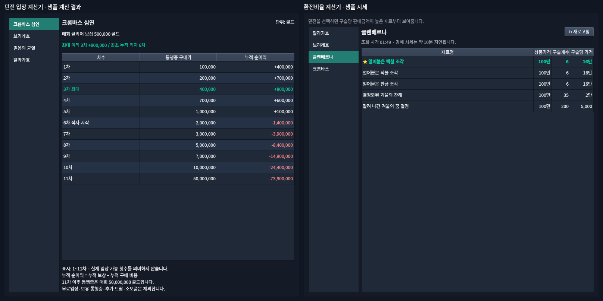

# 계산기 왼쪽 목록 밀도 통일

2026-10-20 개발 기록. 기준 소스는 `8fcfcb7`이며,
[통합 QA의 추가 UI 요청](qa/헤일로개발과_잡담로그_통합QA_20261020.md)을 처리한다.
계산 오답 수정이나 기존 투어·잡담 수정의 후속 독립 QA는 아니다.

## 구현

- 환전비율과 던전 입장에 같은 목록 위젯을 적용했다. 기본 폭 136 논리 px,
  항목 padding 상하 7px·좌우 8px로 맞췄다. 행 높이는 글꼴의 실제 높이로 결정한다.
- 두 계산기 전체 이름 중 가장 긴 이름과 Qt 텍스트/포커스 여백을 함께 측정한다.
  큰 글꼴에서만 필요한 만큼 두 목록을 같은 폭으로 넓혀 이름 잘림과 가로 스크롤을 방지한다.
  글꼴/스타일 변경 시 다시 계산한다. 고정 행 높이, 글자 축소, 스크롤바 강제 숨김은 사용하지 않는다.
- 글꼴과 선택/호버/키보드 포커스는 동일한 Qt 스타일·팔레트를 따른다.
  실제 던전/지역의 이름과 순서, 클릭/방향키에 따른 기존 선택 신호는 유지한다.
- 환전비율 상단의 기능 안내는 유지했다. 이 때문에 두 목록의 시작 높이는 다르다.
  오른쪽 시세/수익 계산·캐시·조회 작업은 변경하지 않았다.

## 렌더 및 확인



[큰 글꼴 비교](qa/assets/calculator_sidebar_20261020/fixed-large.png).
모든 결과는 실제 Qt 위젯에 샘플 시세를 주입한 미리보기다.

| 글꼴 | 두 목록 폭 | 두 목록 각 행 높이 | 오른쪽 표 폭 |
| --- | --- | --- | --- |
| Noto Sans CJK KR 12px | 136px | 32px | 624px |
| Noto Sans CJK KR 20px | 140px | 43px | 620px |

- 같은 790×760 크기에서 두 화면의 선택 전/선택/호버/키보드 포커스를 렌더했다.
  실제 클릭과 방향키 왕복 후 선택된 항목을 확인했다. 이름의 텍스트 필요 높이/행 높이,
  가로 스크롤 없음과 오른쪽 표 공간도 확인했다.
- 다크/라이트 팔레트, Qt 배율 100/125/150/200%에서 12/20px 글꼴을 확인했다.
  Windows 실제 폰트·혼합 DPI 실행을 의미하지 않는다.
- 기존 계산/시세/탐색/전체 탭 폭 관련 **52 passed / 16.53초**.
  `tests/test_dungeon_cost.py`, `tests/test_calculator_result_state.py`, `tests/test_market.py`,
  `tests/test_navigation.py`, `tests/test_navigation_all_widths.py`를 실행했다.
- 공개 노트와 Unicode I/O 계약 추가 검사: **12 passed / 1.55초**.
- 기존 QA `probe.py`는 152/120px의 수정 전 불일치를 재현하는 역사 자료로 그대로 유지한다.
  새 목록의 통과 검사로 실행하지 않는다. 새 렌더/상호작용 검증은 아래 스크립트다.

```bash
PYTHONPATH=src:. QT_QPA_PLATFORM=offscreen .venv/bin/python scripts/render_calculator_sidebars.py /tmp/calculator-sidebars
CALCULATOR_PREVIEW_THEME=light PYTHONPATH=src:. QT_QPA_PLATFORM=offscreen .venv/bin/python scripts/render_calculator_sidebars.py /tmp/calculator-sidebars-light
PYTHONPATH=src:.:tests QT_QPA_PLATFORM=offscreen .venv/bin/python -m pytest tests/test_dungeon_cost.py tests/test_calculator_result_state.py tests/test_market.py tests/test_navigation.py tests/test_navigation_all_widths.py -q
```

## 현재 상태

사용자가 이 채팅에서 수정 렌더를 보고 “좋아”라고 승인했다. 기본 136px·상하 7px 및 큰 글꼴에서의 공통 폭 확장을 확정했다. 후속 독립 QA와 실제 Windows 검증은 별도다.
이번 작업으로 버전 번호를 추가로 올리지 않고 준비 중인 0.7.1 공개 노트에 목록 정리를 추가했다.
Windows workflow·태그·Release 게시는 실행하지 않았다.
