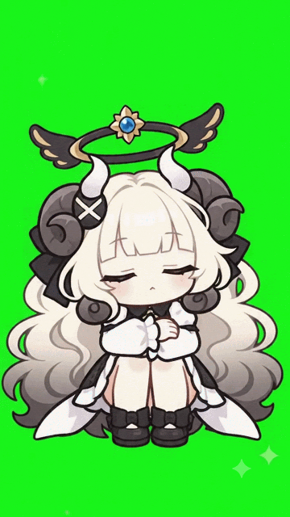
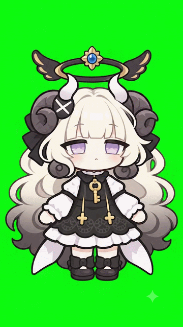

# 다래 쪼그려 자다 깨기 → 서 있기

이 폴더 하나로 끝납니다.

## 1. 만들기 — Google Flow (labs.google/flow)
1. 모델: 영상(Veo 3.1) → 모드 **Frames**
2. **시작 칸**에 `1_시작.png`, **끝 칸**에 `2_끝.png`를 이 폴더에서 끌어다 넣기
3. 아래 상자(= `요청문.txt`)를 통째로 복사해 붙여 넣고 만들기 — 길이 4초

 

```
첨부한 시작 장면에서 시작해 끝 장면으로 끝나는 짧은 애니메이션을 만들어줘.
- 카메라 고정, 캐릭터 크기와 위치 그대로, 화면 밖으로 나가지 않게 여백을 넉넉히
- 얼굴·눈 모양·머리핀(X 모양)·머리 크기·체형·옷·색·그림체는 시작 장면 그대로 — 중간에 바꾸지 마
- 배경은 초록 단색 그대로
[동작] 무릎을 끌어안고 쪼그려 자다가 천천히 고개를 들고 눈을 비비며 작게 하품, 그다음 일어나 끝 장면의 서 있기 자세가 되면서 끝나.
```

## 2. 올리기
- 다운로드한 원본(mp4나 gif)을 **이 폴더에 `결과` 이름 그대로**(`결과.mp4` 또는 `결과.gif`) 넣고 "올렸어"라고만 하기.

## 3. 검증 (기획이 씀)
- 아직 없음
