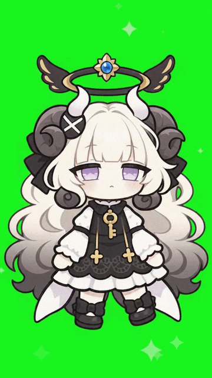
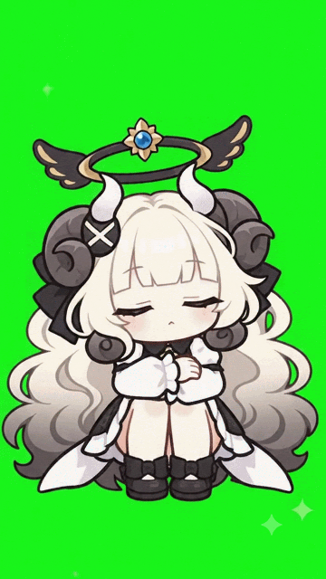
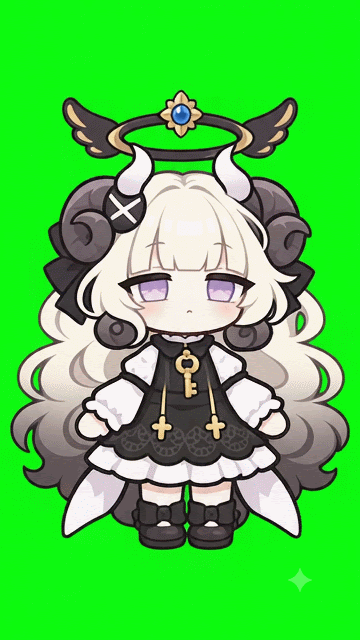
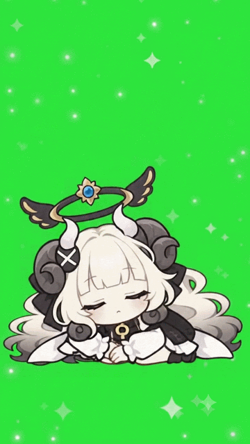
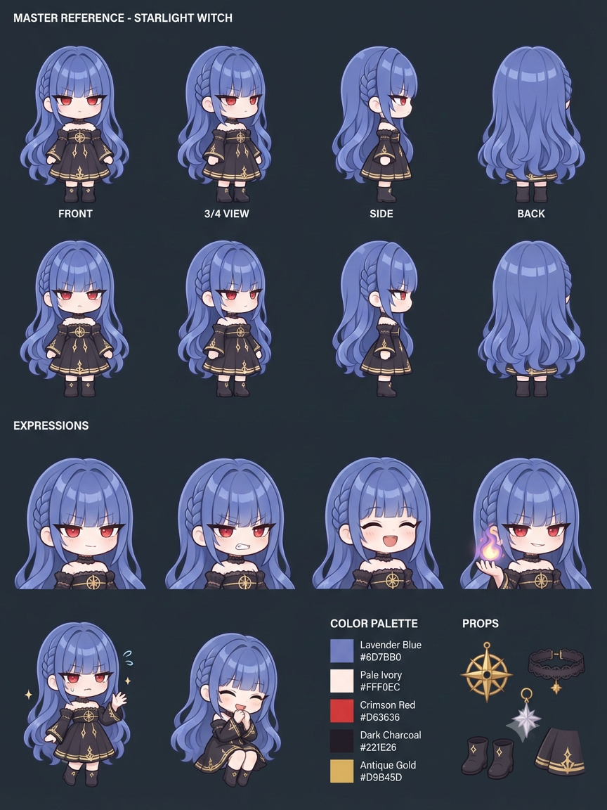
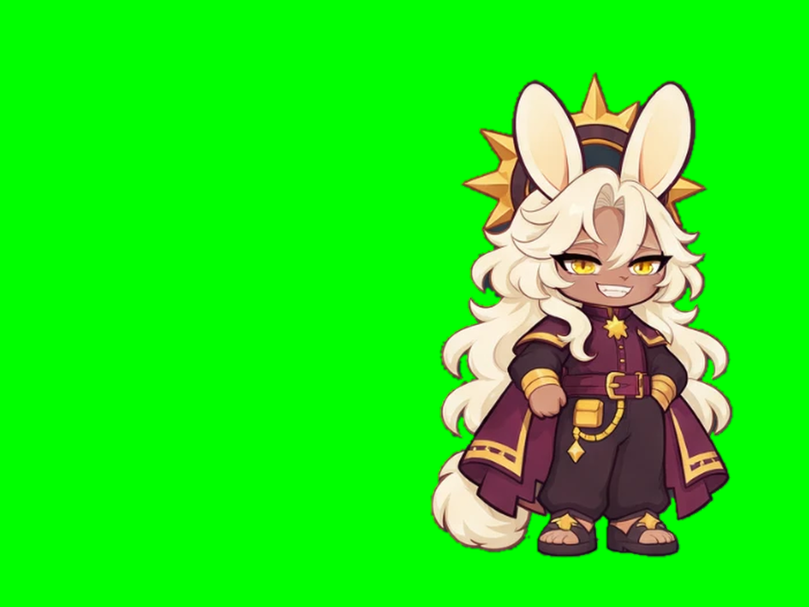
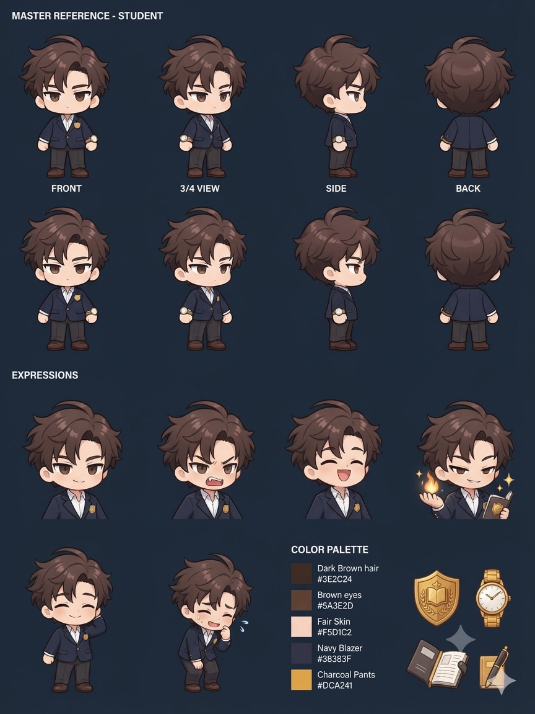
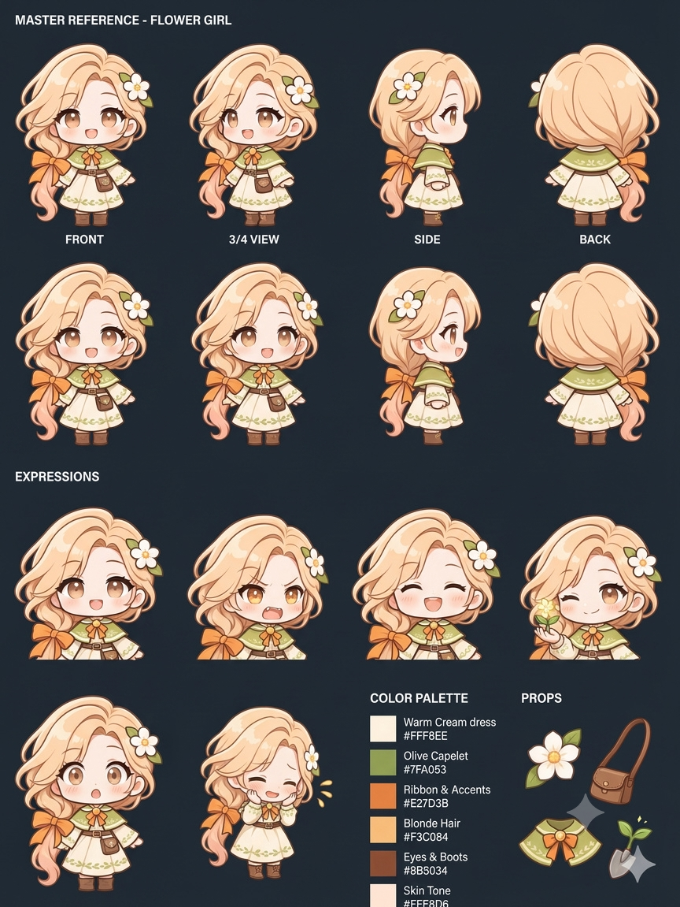

# 영상 작업 — 이 문서 하나만 보면 됩니다

**이 페이지는 GitHub에서 여세요** — 그림이 바로 보이고, 그림을 끌어다 Gemini·Flow에 넣을 수 있고, 회색 상자 오른쪽 위 복사 버튼으로 요청문을 복사합니다.
주소: https://github.com/StarlineBot/mabinogi_addon/blob/main/docs/characters/영상작업.md

## 하는 법 (모든 작업 공통)
1. 아래 작업 하나를 고른다.
2. 표의 그림을 끌어다 넣고(그림 위에서 마우스를 누른 채 Gemini·Flow 창으로 끌기), 회색 상자를 복사해 붙여 넣는다.
3. 나온 결과를 **다운로드 버튼**으로 받아 그 캐릭터 폴더(`docs/characters/assets/<캐릭터>/`)에 **아무 이름으로** 올리고, 이 세션에 **"올렸어"** 라고만 한다.
4. 기획이 검증 도구로 재서 **통과 / 다시**를 이 문서 '결과' 칸에 적는다. 다시면 그 작업의 요청문만 고쳐 둔다 — 다시 이 문서에서 복사하면 된다.

- **Flow** = labs.google/flow → 모델 '영상(Veo 3.1)' → 모드 **Frames** → '시작' 칸과 '끝' 칸에 그림, 길이 4초. 끝 장면을 정할 수 있어서 동작이 서 있기로 정확히 돌아온다.
- **Gemini 앱 이미지** = gemini.google.com → 이미지 만들기(그림 한 장).

## 오늘 할 일 (위에서부터)
| 순서 | 작업 | 어디서 | 결과 |
|---|---|---|---|
| 1 | 다래 떨어지기·착지 → 서 있기 | Flow | |
| 2 | 다래 쪼그려 자다 깨기 → 서 있기 | Flow | |
| 3 | 다래 엎드려 자다 깨기 → 서 있기 | Flow | |
| 4 | 레나 키 맞춘 시작 그림 | Gemini 이미지 | |
| 5 | 이안 키 맞춘 시작 그림 | Gemini 이미지 | |
| 6 | 아리아 키 맞춘 시작 그림 | Gemini 이미지 | |

4~6이 통과하면 기획이 그 캐릭터의 서 있기·걷기·동작 작업을 이 표에 이어서 넣습니다.

---

## 1~3. 다래 (Flow — 시작 칸·끝 칸 둘 다 넣기)

### 다래 떨어지기·착지 → 서 있기
| 시작 칸에 | 끝 칸에 |
|---|---|
|  |  |

```
첨부한 시작 장면에서 시작해 끝 장면으로 끝나는 짧은 애니메이션을 만들어줘.
- 카메라 고정, 캐릭터 크기와 위치 그대로, 화면 밖으로 나가지 않게 여백을 넉넉히
- 얼굴·눈 모양·머리핀(X 모양)·머리 크기·체형·옷·색·그림체는 시작 장면 그대로 — 중간에 바꾸지 마
- 배경은 초록 단색 그대로
[동작] 공중에서 아래로 떨어져 엉덩방아를 찧듯 털썩 주저앉았다가, 눈을 비비며 천천히 일어나 끝 장면의 서 있기 자세가 되면서 끝나.
```

### 다래 쪼그려 자다 깨기 → 서 있기
| 시작 칸에 | 끝 칸에 |
|---|---|
|  |  |

```
첨부한 시작 장면에서 시작해 끝 장면으로 끝나는 짧은 애니메이션을 만들어줘.
- 카메라 고정, 캐릭터 크기와 위치 그대로, 화면 밖으로 나가지 않게 여백을 넉넉히
- 얼굴·눈 모양·머리핀(X 모양)·머리 크기·체형·옷·색·그림체는 시작 장면 그대로 — 중간에 바꾸지 마
- 배경은 초록 단색 그대로
[동작] 무릎을 끌어안고 쪼그려 자다가 천천히 고개를 들고 눈을 비비며 작게 하품, 그다음 일어나 끝 장면의 서 있기 자세가 되면서 끝나.
```

### 다래 엎드려 자다 깨기 → 서 있기
| 시작 칸에 | 끝 칸에 |
|---|---|
|  |  |

```
첨부한 시작 장면에서 시작해 끝 장면으로 끝나는 짧은 애니메이션을 만들어줘.
- 카메라 고정, 캐릭터 크기와 위치 그대로, 화면 밖으로 나가지 않게 여백을 넉넉히
- 얼굴·눈 모양·머리핀(X 모양)·머리 크기·체형·옷·색·그림체는 시작 장면 그대로 — 중간에 바꾸지 마
- 배경은 초록 단색 그대로
[동작] 엎드려 자다가 천천히 몸을 일으켜 앉고, 눈을 비비며 작게 하품한 뒤, 일어나 끝 장면의 서 있기 자세가 되면서 끝나.
```

---

## 4~6. 키 맞춘 시작 그림 (Gemini 이미지 — 첨부 2장)
오른쪽 Starline 옆에 그 캐릭터를 그려 넣어 키 차이를 맞춘 그림입니다(다래는 이 방법으로 통과). 받으면 기획이 그 캐릭터만 잘라 시작 그림으로 만듭니다.

### 레나 키 맞춘 시작 그림 (Gemini 앱 → 이미지 만들기, 영상 아님)
| 첫 번째 첨부 | 두 번째 첨부 |
|---|---|
|  |  |

```
첫 번째 첨부 그림을 편집해줘. 오른쪽 캐릭터는 그대로 두고(다시 그리거나 크기·위치·모양을 바꾸지 마), 왼쪽 빈 곳에 두 번째 첨부의 캐릭터(FRONT 모습)를 그려 넣어줘.
- 왼쪽 캐릭터는 보통 키의 마녀 소녀(키 164cm, 오른쪽은 180cm). 머리 꼭대기(장식 빼고)가 오른쪽 캐릭터의 이마 높이에 오게.
- 머리(얼굴) 크기는 오른쪽 캐릭터와 같게 — 키 차이는 몸통과 다리 길이로.
- 발끝은 오른쪽 캐릭터와 같은 바닥선, 정면을 보고 차렷 자세, 서로 겹치지 않게.
- 디자인·그림체·색은 두 번째 첨부 그대로, 배경은 초록 단색 그대로.
```

### 이안 키 맞춘 시작 그림 (Gemini 앱 → 이미지 만들기, 영상 아님)
| 첫 번째 첨부 | 두 번째 첨부 |
|---|---|
|  |  |

```
첫 번째 첨부 그림을 편집해줘. 오른쪽 캐릭터는 그대로 두고(다시 그리거나 크기·위치·모양을 바꾸지 마), 왼쪽 빈 곳에 두 번째 첨부의 캐릭터(FRONT 모습)를 그려 넣어줘.
- 왼쪽 캐릭터는 키 큰 청년, 어깨가 넓고 다리가 긺(키 172cm, 오른쪽은 180cm). 머리 꼭대기(장식 빼고)가 오른쪽 캐릭터의 정수리(토끼귀 밑동)보다 조금 낮은 높이에 오게.
- 머리(얼굴) 크기는 오른쪽 캐릭터와 같게 — 키 차이는 몸통과 다리 길이로.
- 발끝은 오른쪽 캐릭터와 같은 바닥선, 정면을 보고 차렷 자세, 서로 겹치지 않게.
- 디자인·그림체·색은 두 번째 첨부 그대로, 배경은 초록 단색 그대로.
```

### 아리아 — 머리색 하나 골라 그 상자만 복사
- 지금 앱 아리아는 **복숭아빛 분홍 머리**, 마스터는 **금발→끝이 분홍**입니다.

| 첫 번째 첨부 | 두 번째 첨부 |
|---|---|
|  |  |

**가) 지금 앱처럼 복숭아빛 분홍 머리**
```
첫 번째 첨부 그림을 편집해줘. 오른쪽 캐릭터는 그대로 두고(다시 그리거나 크기·위치·모양을 바꾸지 마), 왼쪽 빈 곳에 두 번째 첨부의 캐릭터(FRONT 모습)를 그려 넣어줘.
- 왼쪽 캐릭터는 작고 아담한 소녀(키 156cm, 오른쪽은 180cm). 머리 꼭대기(장식 빼고)가 오른쪽 캐릭터의 눈 높이에 오게.
- 머리(얼굴) 크기는 오른쪽 캐릭터와 같게 — 키 차이는 몸통과 다리 길이로.
- 발끝은 오른쪽 캐릭터와 같은 바닥선, 정면을 보고 차렷 자세, 서로 겹치지 않게.
- 디자인·그림체·색은 두 번째 첨부 그대로, 단 머리색만 금발 없이 위에서 끝까지 복숭아빛 분홍으로, 배경은 초록 단색 그대로.
```
**나) 마스터 그대로 금발→분홍**
```
첫 번째 첨부 그림을 편집해줘. 오른쪽 캐릭터는 그대로 두고(다시 그리거나 크기·위치·모양을 바꾸지 마), 왼쪽 빈 곳에 두 번째 첨부의 캐릭터(FRONT 모습)를 그려 넣어줘.
- 왼쪽 캐릭터는 작고 아담한 소녀(키 156cm, 오른쪽은 180cm). 머리 꼭대기(장식 빼고)가 오른쪽 캐릭터의 눈 높이에 오게.
- 머리(얼굴) 크기는 오른쪽 캐릭터와 같게 — 키 차이는 몸통과 다리 길이로.
- 발끝은 오른쪽 캐릭터와 같은 바닥선, 정면을 보고 차렷 자세, 서로 겹치지 않게.
- 디자인·그림체·색은 두 번째 첨부 그대로, 배경은 초록 단색 그대로.
```

---

## 결과 (기획이 적음)
- 아직 없음
