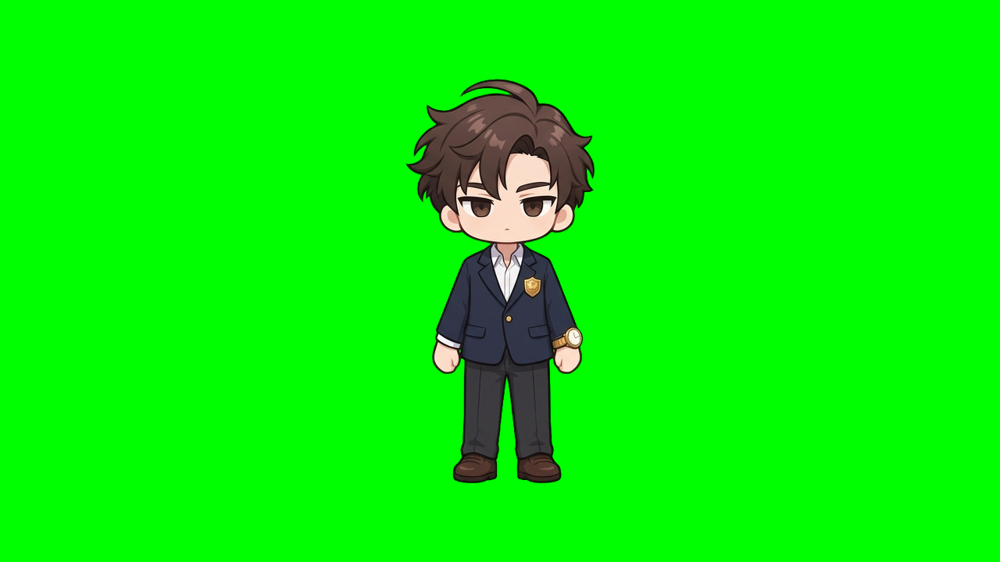
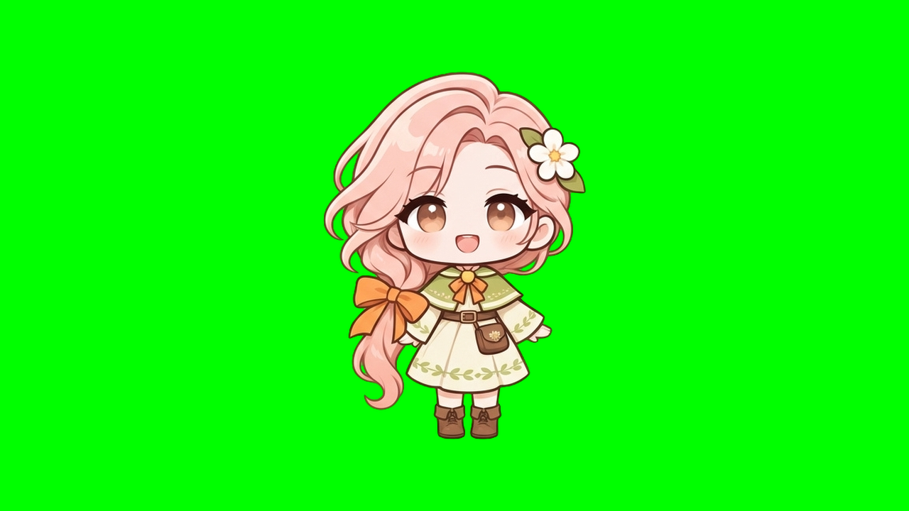
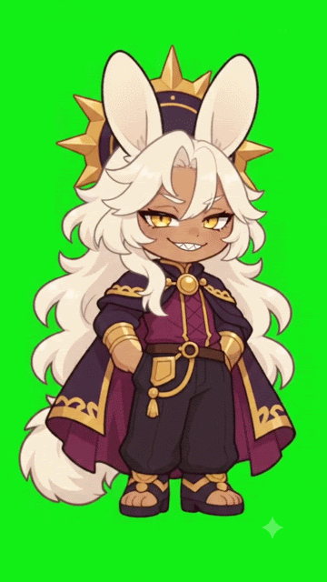
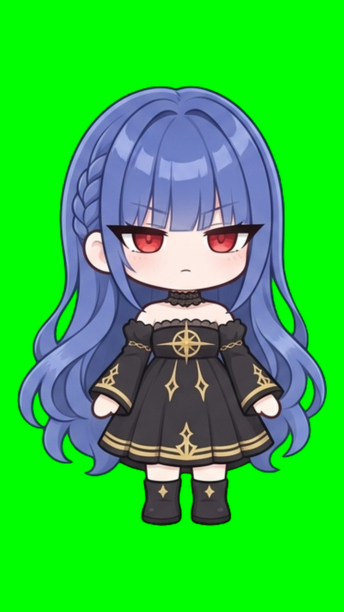

# 영상 작업 — 이 문서 하나만 보면 됩니다

**이 페이지는 GitHub에서 여세요** — 그림이 바로 보이고, 그림을 끌어다 Gemini·Flow에 넣을 수 있고, 회색 상자 오른쪽 위 복사 버튼으로 요청문을 복사합니다.
주소: https://github.com/StarlineBot/mabinogi_addon/blob/main/docs/characters/영상작업.md

## 하는 법 (모든 작업 공통)
1. 아래 표에서 작업 하나를 고른다(번호 순서대로 — 뒤 작업이 앞 작업 끝 장면을 쓰는 것이 있음).
2. 그 작업의 그림을 끌어다 넣고(그림 위에서 마우스를 누른 채 Gemini·Flow 창으로 끌기), 회색 상자를 복사해 붙여 넣는다.
3. 나온 결과를 **다운로드 버튼**으로 받아 그 캐릭터 폴더(`docs/characters/assets/<캐릭터>/`)에 **아무 이름으로** 올리고, 이 세션에 **"올렸어"** 라고만 한다(여러 개를 한꺼번에 올려도 됨).
4. 기획이 검증 도구로 잰다. **통과한 작업은 이 문서에서 빠지고**(남은 일만 보임), 다시면 표 '결과' 칸에 이유를 적고 그 작업의 요청문만 고쳐 둔다.

- **Flow** = labs.google/flow → 모델 '영상(Veo 3.1)' → 모드 **Frames** → **화면 비율 세로(9:16)** → '시작' 칸과 '끝' 칸에 그림, 길이 4초.
  - **그림은 모두 세로(720×1280)** 입니다(11-28 바꿈). 가로 그림으로 만들면 Gemini GIF가 640×360으로 나와 인물 키가 263px뿐 — 앱(서 있기 원본 519px)에서 키워 그려 흐려짐. 세로면 Gemini GIF 인물 약 460px, Flow 약 920px.
  - 끝 칸에 서 있기 그림을 넣으면 동작이 서 있기로 정확히 돌아온다. **반복** 작업은 두 칸에 같은 그림. **끝 칸 비움**이라고 적힌 작업은 시작 칸만.
- **Gemini 앱 이미지** = gemini.google.com → 이미지 만들기(그림 한 장).
- 시작 그림은 모두 **키 맞춤 결과에서 잘라 낸 그림**이라 캐릭터끼리 머리 크기·키 비율이 맞아 있다(11-28 사용자 '키 맞춘 걸로 같은 비율만 나오면 됨').

## 할 일 (위에서부터)
| 번호 | 캐릭터 | 작업 | 어디서 | 결과 |
|---|---|---|---|---|
| I0 | 이안 | 서 있기(반복) | Flow |  |
| I1 | 이안 | 옆모습 그림 | Gemini 이미지 |  |
| I2 | 이안 | 걷기(반복) | Flow |  |
| I3 | 이안 | 시계 보기(대기) | Flow |  |
| I4 | 이안 | 말하기 | Flow |  |
| I5 | 이안 | 알림 말하기 | Flow |  |
| I6 | 이안 | 쓰다듬기 | Flow |  |
| I7 | 이안 | 끌기(매달림) | Flow |  |
| I8 | 이안 | 떨어지기·착지 | Flow |  |
| I9 | 이안 | 구석 앉기 | Flow |  |
| I10 | 이안 | 구석에서 일어나기 | Flow |  |
| I11 | 이안 | 호감도 25 옷매무새 | Flow |  |
| I12 | 이안 | 호감도 75 차 마시기 | Flow |  |
| A0 | 아리아 | 서 있기(반복) | Flow | 다시 — 동작은 통과인데 또 가로(640×360, 인물 264px)로 나옴. 문서의 세로 그림(720×1280)을 새로 받아서 만들기 |
| A1 | 아리아 | 옆모습 그림 | Gemini 이미지 |  |
| A2 | 아리아 | 걷기(반복) | Flow |  |
| A3 | 아리아 | 머리 쓰다듬기(대기) | Flow |  |
| A4 | 아리아 | 놀람(클릭) | Flow |  |
| A5 | 아리아 | 말하기 가(머리 다발 잡고) | Flow |  |
| A6 | 아리아 | 말하기 나(두 손 모음) | Flow |  |
| A7 | 아리아 | 기쁨 웃음 | Flow |  |
| A8 | 아리아 | 쓰다듬기 | Flow |  |
| A9 | 아리아 | 기지개(가끔) | Flow |  |
| A10 | 아리아 | 끌기(매달림) | Flow |  |
| A11 | 아리아 | 떨어지기·착지 | Flow |  |
| A12 | 아리아 | 구석 앉기 | Flow |  |
| A13 | 아리아 | 구석에서 일어나기 | Flow |  |
| A14 | 아리아 | 호감도 25 물 주기 | Flow |  |
| A15 | 아리아 | 호감도 75 화관 엮기 | Flow |  |

---

## 레나

- 구석(11-28 사용자): 앉기(올라오기, L7) → 가만히 앉아 있기 반복(L8) → 내려오기(L9). 호감도 75 공중 앉기는 새로 만들지 않음 — 구석 앉기 영상(L7~L9)을 앱에서 머리 하나 높이로 더 띄우고 둥실 흔들어 씀(사용자 11-28 '앉기에서 위로 띄우기만 하면 공중 앉기').
- 마법서(11-28 사용자): 펼친 채 유지(L11)와 탁 덮기(L12)를 따로.

---

## 이안

### I0 이안 서 있기(반복)
Flow → 시작 칸·끝 칸에 **같은 그림**.

| 시작 칸에 | 끝 칸에 |
|---|---|
|  |  |

```
첨부한 시작 장면에서 시작해 끝 장면으로 끝나는 짧은 애니메이션을 만들어줘. 시작과 끝은 같은 장면이라 끊김 없이 반복 재생돼야 해.
- 카메라 고정, 캐릭터 크기와 위치 그대로, 화면 밖으로 나가지 않게 여백을 넉넉히
- 얼굴·무표정·머리 모양·손목시계·가슴 배지·머리 크기·체형·정장·색·그림체는 시작 장면 그대로 — 중간에 바꾸지 마
- 배경은 초록 단색 그대로
[동작] 무표정으로 반듯하게 서서 숨 쉬듯 어깨가 아주 살짝 오르내리고, 중간에 한 번 눈을 깜빡. 몸·팔·발은 거의 움직이지 마.
```

### I1 이안 옆모습 그림
Gemini 앱 → 이미지 만들기(영상 아님) → 아래 그림 한 장 첨부.

| 첨부 |
|---|
|  |

```
첨부 그림의 캐릭터를 그대로, 오른쪽을 향해 걷는 옆모습으로 다시 그려줘.
- 몸 전체가 오른쪽을 향한 옆모습(얼굴은 살짝 보이는 3/4 옆모습), 한 발이 앞으로 나간 걷는 중간 자세
- 그림 속 캐릭터 크기·키·발끝 높이는 첨부와 같게
- 얼굴·무표정·머리 모양·손목시계·가슴 배지·머리 크기·체형·정장·색·그림체는 첨부 그대로
- 배경은 초록 단색 그대로, 그림 크기와 가로세로 비율도 첨부 그대로
```

### I2 이안 걷기(반복)
Flow → 시작 칸·끝 칸에 **같은 옆모습 그림**.

| 시작 칸에 | 끝 칸에 |
|---|---|
| (I1 통과 뒤 `이안/이안_영상시작_옆모습.png`) | (같은 그림) |

```
첨부한 시작 장면에서 시작해 끝 장면으로 끝나는 짧은 애니메이션을 만들어줘. 시작과 끝은 같은 장면이라 끊김 없이 반복 재생돼야 해.
- 카메라 고정, 캐릭터는 화면 가운데에서 제자리 걷기(앞으로 나아가지 말 것), 크기 그대로, 화면 밖으로 나가지 않게
- 얼굴·무표정·머리 모양·손목시계·가슴 배지·머리 크기·체형·정장·색·그림체는 시작 장면 그대로 — 중간에 바꾸지 마
- 배경은 초록 단색 그대로
[동작] 오른쪽을 향해 차분하게 제자리 걷기. 양발과 양팔을 번갈아 고른 속도로 네 걸음 걷고 시작 장면과 같은 자세로 돌아와. 무릎을 높이 들지 말고 보폭을 고르게.
```

### I3 이안 시계 보기(대기)
Flow → 시작 칸·끝 칸에 **같은 서 있기 그림**(동작 뒤 서 있기로 돌아옴).

| 시작 칸에 | 끝 칸에 |
|---|---|
|  |  |

```
첨부한 시작 장면에서 시작해 끝 장면으로 끝나는 짧은 애니메이션을 만들어줘.
- 카메라 고정, 캐릭터 크기와 위치 그대로, 화면 밖으로 나가지 않게 여백을 넉넉히
- 얼굴·무표정·머리 모양·손목시계·가슴 배지·머리 크기·체형·정장·색·그림체는 시작 장면 그대로 — 중간에 바꾸지 마
- 배경은 초록 단색 그대로
[동작] 손목시계를 찬 팔을 들어 시계를 보고 잠깐 확인한 뒤 팔을 내려 끝 장면의 서 있기 자세로. 표정은 무표정 그대로.
```

### I4 이안 말하기
Flow → 시작 칸·끝 칸에 **같은 서 있기 그림**(동작 뒤 서 있기로 돌아옴).

| 시작 칸에 | 끝 칸에 |
|---|---|
|  |  |

```
첨부한 시작 장면에서 시작해 끝 장면으로 끝나는 짧은 애니메이션을 만들어줘.
- 카메라 고정, 캐릭터 크기와 위치 그대로, 화면 밖으로 나가지 않게 여백을 넉넉히
- 얼굴·무표정·머리 모양·손목시계·가슴 배지·머리 크기·체형·정장·색·그림체는 시작 장면 그대로 — 중간에 바꾸지 마
- 배경은 초록 단색 그대로
[동작] 무표정으로 짧게 말하듯 입을 여러 번 열고 닫아. 몸과 손은 거의 움직이지 말고 입만, 중간에 한 번 눈 깜빡. 마지막엔 끝 장면의 서 있기 자세로.
```

### I5 이안 알림 말하기
Flow → 시작 칸·끝 칸에 **같은 서 있기 그림**(동작 뒤 서 있기로 돌아옴).

| 시작 칸에 | 끝 칸에 |
|---|---|
|  |  |

```
첨부한 시작 장면에서 시작해 끝 장면으로 끝나는 짧은 애니메이션을 만들어줘.
- 카메라 고정, 캐릭터 크기와 위치 그대로, 화면 밖으로 나가지 않게 여백을 넉넉히
- 얼굴·무표정·머리 모양·손목시계·가슴 배지·머리 크기·체형·정장·색·그림체는 시작 장면 그대로 — 중간에 바꾸지 마
- 배경은 초록 단색 그대로
[동작] 손목시계를 찬 팔을 들고 다른 손 검지로 시계를 가리키며 말하듯 입을 여러 번 열고 닫아. 그다음 팔을 내려 끝 장면의 서 있기 자세로.
```

### I6 이안 쓰다듬기
Flow → 시작 칸·끝 칸에 **같은 서 있기 그림**(동작 뒤 서 있기로 돌아옴).

| 시작 칸에 | 끝 칸에 |
|---|---|
|  |  |

```
첨부한 시작 장면에서 시작해 끝 장면으로 끝나는 짧은 애니메이션을 만들어줘.
- 카메라 고정, 캐릭터 크기와 위치 그대로, 화면 밖으로 나가지 않게 여백을 넉넉히
- 얼굴·무표정·머리 모양·손목시계·가슴 배지·머리 크기·체형·정장·색·그림체는 시작 장면 그대로 — 중간에 바꾸지 마
- 배경은 초록 단색 그대로
[동작] 누군가 머리를 쓰다듬는 것처럼(쓰다듬는 손은 그리지 마) 몸은 가만히 선 채로 미간을 살짝 찌푸리고 눈을 가늘게 떠 약간 짜증 난 표정을 잠깐 짓다가, 다시 무표정으로 끝 장면의 서 있기 자세로.
```

### I7 이안 끌기(매달림)
Flow → **시작 칸에만** 그림, 끝 칸은 비움(자세를 유지한 채 끝남). 통과하면 기획이 끝 장면을 잘라 다음 작업 시작 그림으로 넣음.

| 시작 칸에 | 끝 칸에 |
|---|---|
|  | (비움) |

```
첨부한 장면에서 시작하는 짧은 애니메이션을 만들어줘.
- 카메라 고정, 캐릭터 크기 그대로, 화면 가운데에서 거의 움직이지 마(위로 날아오르지 말 것), 화면 밖으로 나가지 않게 여백을 넉넉히
- 얼굴·무표정·머리 모양·손목시계·가슴 배지·머리 크기·체형·정장·색·그림체는 시작 장면 그대로 — 중간에 바꾸지 마
- 배경은 초록 단색 그대로
[동작] 보이지 않는 손에 옷 뒷덜미가 잡힌 것처럼 발끝이 땅에서 살짝 떠서 매달려. 놀라지 않고 무표정으로, 팔다리를 축 늘어뜨린 채 몸이 아주 천천히 좌우로 흔들려. 매달린 채로 계속.
```

### I8 이안 떨어지기·착지
Flow → 시작 칸에 **I7 끌기(매달림)의 끝 장면**, 끝 칸에 서 있기 그림.

| 시작 칸에 | 끝 칸에 |
|---|---|
| (I7 통과 뒤 기획이 여기에 그림을 넣음) |  |

```
첨부한 시작 장면에서 시작해 끝 장면으로 끝나는 짧은 애니메이션을 만들어줘.
- 카메라 고정, 캐릭터 크기와 위치 그대로, 화면 밖으로 나가지 않게 여백을 넉넉히
- 얼굴·무표정·머리 모양·손목시계·가슴 배지·머리 크기·체형·정장·색·그림체는 시작 장면 그대로 — 중간에 바꾸지 마
- 배경은 초록 단색 그대로
[동작] 놓여서 그대로 아래로 떨어져 두 발로 착지하며 무릎을 살짝 굽혔다 펴고, 끝 장면의 서 있기 자세로.
```

### I9 이안 구석 앉기
Flow → **시작 칸에만** 그림, 끝 칸은 비움(자세를 유지한 채 끝남). 통과하면 기획이 끝 장면을 잘라 다음 작업 시작 그림으로 넣음.

| 시작 칸에 | 끝 칸에 |
|---|---|
|  | (비움) |

```
첨부한 장면에서 시작하는 짧은 애니메이션을 만들어줘.
- 카메라 고정, 캐릭터 크기 그대로, 화면 가운데에서 거의 움직이지 마(위로 날아오르지 말 것), 화면 밖으로 나가지 않게 여백을 넉넉히
- 얼굴·무표정·머리 모양·손목시계·가슴 배지·머리 크기·체형·정장·색·그림체는 시작 장면 그대로 — 중간에 바꾸지 마
- 배경은 초록 단색 그대로
[동작] 천천히 쪼그려 앉아 손목시계를 들여다보며 기다려. 앉은 채로 가끔 시계를 보고 눈 깜빡. 앉은 채로 계속.
```

### I10 이안 구석에서 일어나기
Flow → 시작 칸에 **I9 구석 앉기의 끝 장면**, 끝 칸에 서 있기 그림.

| 시작 칸에 | 끝 칸에 |
|---|---|
| (I9 통과 뒤 기획이 여기에 그림을 넣음) |  |

```
첨부한 시작 장면에서 시작해 끝 장면으로 끝나는 짧은 애니메이션을 만들어줘.
- 카메라 고정, 캐릭터 크기와 위치 그대로, 화면 밖으로 나가지 않게 여백을 넉넉히
- 얼굴·무표정·머리 모양·손목시계·가슴 배지·머리 크기·체형·정장·색·그림체는 시작 장면 그대로 — 중간에 바꾸지 마
- 배경은 초록 단색 그대로
[동작] 일어나 재킷 앞자락을 한 번 당겨 정돈하고 끝 장면의 서 있기 자세로.
```

### I11 이안 호감도 25 옷매무새
Flow → 시작 칸·끝 칸에 **같은 서 있기 그림**(동작 뒤 서 있기로 돌아옴).

| 시작 칸에 | 끝 칸에 |
|---|---|
|  |  |

```
첨부한 시작 장면에서 시작해 끝 장면으로 끝나는 짧은 애니메이션을 만들어줘.
- 카메라 고정, 캐릭터 크기와 위치 그대로, 화면 밖으로 나가지 않게 여백을 넉넉히
- 얼굴·무표정·머리 모양·손목시계·가슴 배지·머리 크기·체형·정장·색·그림체는 시작 장면 그대로 — 중간에 바꾸지 마
- 배경은 초록 단색 그대로
[동작] 셔츠 깃과 소매 끝을 손으로 반듯하게 정리하고 재킷 앞자락을 한 번 당겨 정돈한 뒤 끝 장면의 서 있기 자세로.
```

### I12 이안 호감도 75 차 마시기
Flow → 시작 칸·끝 칸에 **같은 서 있기 그림**(동작 뒤 서 있기로 돌아옴).

| 시작 칸에 | 끝 칸에 |
|---|---|
|  |  |

```
첨부한 시작 장면에서 시작해 끝 장면으로 끝나는 짧은 애니메이션을 만들어줘.
- 카메라 고정, 캐릭터 크기와 위치 그대로, 화면 밖으로 나가지 않게 여백을 넉넉히
- 얼굴·무표정·머리 모양·손목시계·가슴 배지·머리 크기·체형·정장·색·그림체는 시작 장면 그대로 — 중간에 바꾸지 마
- 배경은 초록 단색 그대로
[동작] 받침에 올린 찻잔을 꺼내 들고 김이 나는 차를 한 모금 조용히 마신 뒤, 찻잔을 치우고 끝 장면의 서 있기 자세로.
```

---

## 아리아

### A0 아리아 서 있기(반복)
Flow → 시작 칸·끝 칸에 **같은 그림**.

| 시작 칸에 | 끝 칸에 |
|---|---|
|  |  |

```
첨부한 시작 장면에서 시작해 끝 장면으로 끝나는 짧은 애니메이션을 만들어줘. 시작과 끝은 같은 장면이라 끊김 없이 반복 재생돼야 해.
- 카메라 고정, 캐릭터 크기와 위치 그대로, 화면 밖으로 나가지 않게 여백을 넉넉히
- 얼굴·눈 모양·복숭아빛 분홍 머리·주황 리본·흰 꽃 핀·머리 크기·체형·옷·색·그림체는 시작 장면 그대로 — 중간에 바꾸지 마
- 배경은 초록 단색 그대로
[동작] 웃는 얼굴로 서서 숨 쉬듯 어깨가 아주 살짝 오르내리고, 어깨 앞으로 늘어뜨린 머리 다발이 살랑 흔들리고, 고개를 아주 살짝 기울였다 돌아오며 한 번 눈을 깜빡. 몸은 거의 움직이지 마.
```

### A1 아리아 옆모습 그림
Gemini 앱 → 이미지 만들기(영상 아님) → 아래 그림 한 장 첨부.

| 첨부 |
|---|
|  |

```
첨부 그림의 캐릭터를 그대로, 오른쪽을 향해 걷는 옆모습으로 다시 그려줘.
- 몸 전체가 오른쪽을 향한 옆모습(얼굴은 살짝 보이는 3/4 옆모습), 한 발이 앞으로 나간 걷는 중간 자세
- 그림 속 캐릭터 크기·키·발끝 높이는 첨부와 같게
- 얼굴·눈 모양·복숭아빛 분홍 머리·주황 리본·흰 꽃 핀·머리 크기·체형·옷·색·그림체는 첨부 그대로
- 배경은 초록 단색 그대로, 그림 크기와 가로세로 비율도 첨부 그대로
```

### A2 아리아 걷기(반복)
Flow → 시작 칸·끝 칸에 **같은 옆모습 그림**.

| 시작 칸에 | 끝 칸에 |
|---|---|
| (A1 통과 뒤 `아리아/아리아_영상시작_옆모습.png`) | (같은 그림) |

```
첨부한 시작 장면에서 시작해 끝 장면으로 끝나는 짧은 애니메이션을 만들어줘. 시작과 끝은 같은 장면이라 끊김 없이 반복 재생돼야 해.
- 카메라 고정, 캐릭터는 화면 가운데에서 제자리 걷기(앞으로 나아가지 말 것), 크기 그대로, 화면 밖으로 나가지 않게
- 얼굴·눈 모양·복숭아빛 분홍 머리·주황 리본·흰 꽃 핀·머리 크기·체형·옷·색·그림체는 시작 장면 그대로 — 중간에 바꾸지 마
- 배경은 초록 단색 그대로
[동작] 오른쪽을 향해 차분하게 제자리 걷기. 양발과 양팔을 번갈아 고른 속도로 네 걸음 걷고 시작 장면과 같은 자세로 돌아와. 무릎을 높이 들지 말고 보폭을 고르게.
```

### A3 아리아 머리 쓰다듬기(대기)
Flow → 시작 칸·끝 칸에 **같은 서 있기 그림**(동작 뒤 서 있기로 돌아옴).

| 시작 칸에 | 끝 칸에 |
|---|---|
|  |  |

```
첨부한 시작 장면에서 시작해 끝 장면으로 끝나는 짧은 애니메이션을 만들어줘.
- 카메라 고정, 캐릭터 크기와 위치 그대로, 화면 밖으로 나가지 않게 여백을 넉넉히
- 얼굴·눈 모양·복숭아빛 분홍 머리·주황 리본·흰 꽃 핀·머리 크기·체형·옷·색·그림체는 시작 장면 그대로 — 중간에 바꾸지 마
- 배경은 초록 단색 그대로
[동작] 어깨 앞으로 늘어뜨린 머리 다발을 두 손으로 잡고 아래로 부드럽게 쓸어내리며 웃다가, 손을 놓고 끝 장면의 서 있기 자세로.
```

### A4 아리아 놀람(클릭)
Flow → 시작 칸·끝 칸에 **같은 서 있기 그림**(동작 뒤 서 있기로 돌아옴).

| 시작 칸에 | 끝 칸에 |
|---|---|
|  |  |

```
첨부한 시작 장면에서 시작해 끝 장면으로 끝나는 짧은 애니메이션을 만들어줘.
- 카메라 고정, 캐릭터 크기와 위치 그대로, 화면 밖으로 나가지 않게 여백을 넉넉히
- 얼굴·눈 모양·복숭아빛 분홍 머리·주황 리본·흰 꽃 핀·머리 크기·체형·옷·색·그림체는 시작 장면 그대로 — 중간에 바꾸지 마
- 배경은 초록 단색 그대로
[동작] 누가 콕 찌른 것처럼 깜짝 놀라 눈을 동그랗게 뜨고 어깨를 움찔, 당황해 땀방울이 하나 맺혔다가, 금방 웃으며 끝 장면의 서 있기 자세로.
```

### A5 아리아 말하기 가(머리 다발 잡고)
Flow → 시작 칸·끝 칸에 **같은 서 있기 그림**(동작 뒤 서 있기로 돌아옴).

| 시작 칸에 | 끝 칸에 |
|---|---|
|  |  |

```
첨부한 시작 장면에서 시작해 끝 장면으로 끝나는 짧은 애니메이션을 만들어줘.
- 카메라 고정, 캐릭터 크기와 위치 그대로, 화면 밖으로 나가지 않게 여백을 넉넉히
- 얼굴·눈 모양·복숭아빛 분홍 머리·주황 리본·흰 꽃 핀·머리 크기·체형·옷·색·그림체는 시작 장면 그대로 — 중간에 바꾸지 마
- 배경은 초록 단색 그대로
[동작] 한 손으로 늘어뜨린 머리 다발을 잡고 상냥하게 말하듯 입을 여러 번 열고 닫아. 몸은 거의 움직이지 말고 중간에 한 번 눈 깜빡. 마지막엔 손을 내려 끝 장면의 서 있기 자세로.
```

### A6 아리아 말하기 나(두 손 모음)
Flow → 시작 칸·끝 칸에 **같은 서 있기 그림**(동작 뒤 서 있기로 돌아옴).

| 시작 칸에 | 끝 칸에 |
|---|---|
|  |  |

```
첨부한 시작 장면에서 시작해 끝 장면으로 끝나는 짧은 애니메이션을 만들어줘.
- 카메라 고정, 캐릭터 크기와 위치 그대로, 화면 밖으로 나가지 않게 여백을 넉넉히
- 얼굴·눈 모양·복숭아빛 분홍 머리·주황 리본·흰 꽃 핀·머리 크기·체형·옷·색·그림체는 시작 장면 그대로 — 중간에 바꾸지 마
- 배경은 초록 단색 그대로
[동작] 두 손을 가슴 앞에 모으고 상냥하게 말하듯 입을 여러 번 열고 닫아. 몸은 거의 움직이지 말고 중간에 한 번 눈 깜빡. 마지막엔 손을 내려 끝 장면의 서 있기 자세로.
```

### A7 아리아 기쁨 웃음
Flow → 시작 칸·끝 칸에 **같은 서 있기 그림**(동작 뒤 서 있기로 돌아옴).

| 시작 칸에 | 끝 칸에 |
|---|---|
|  |  |

```
첨부한 시작 장면에서 시작해 끝 장면으로 끝나는 짧은 애니메이션을 만들어줘.
- 카메라 고정, 캐릭터 크기와 위치 그대로, 화면 밖으로 나가지 않게 여백을 넉넉히
- 얼굴·눈 모양·복숭아빛 분홍 머리·주황 리본·흰 꽃 핀·머리 크기·체형·옷·색·그림체는 시작 장면 그대로 — 중간에 바꾸지 마
- 배경은 초록 단색 그대로
[동작] 두 손을 모으고 눈을 휘며 소리 내 웃듯 기뻐하고, 어깨를 살짝 들썩인 뒤 끝 장면의 서 있기 자세로.
```

### A8 아리아 쓰다듬기
Flow → 시작 칸·끝 칸에 **같은 서 있기 그림**(동작 뒤 서 있기로 돌아옴).

| 시작 칸에 | 끝 칸에 |
|---|---|
|  |  |

```
첨부한 시작 장면에서 시작해 끝 장면으로 끝나는 짧은 애니메이션을 만들어줘.
- 카메라 고정, 캐릭터 크기와 위치 그대로, 화면 밖으로 나가지 않게 여백을 넉넉히
- 얼굴·눈 모양·복숭아빛 분홍 머리·주황 리본·흰 꽃 핀·머리 크기·체형·옷·색·그림체는 시작 장면 그대로 — 중간에 바꾸지 마
- 배경은 초록 단색 그대로
[동작] 누군가 머리를 쓰다듬는 것처럼(쓰다듬는 손은 그리지 마) 알아채고 눈을 감고 기분 좋게 웃으며 고개를 살짝 좌우로 기울이다가, 볼이 발그레해진 채 끝 장면의 서 있기 자세로.
```

### A9 아리아 기지개(가끔)
Flow → 시작 칸·끝 칸에 **같은 서 있기 그림**(동작 뒤 서 있기로 돌아옴).

| 시작 칸에 | 끝 칸에 |
|---|---|
|  |  |

```
첨부한 시작 장면에서 시작해 끝 장면으로 끝나는 짧은 애니메이션을 만들어줘.
- 카메라 고정, 캐릭터 크기와 위치 그대로, 화면 밖으로 나가지 않게 여백을 넉넉히
- 얼굴·눈 모양·복숭아빛 분홍 머리·주황 리본·흰 꽃 핀·머리 크기·체형·옷·색·그림체는 시작 장면 그대로 — 중간에 바꾸지 마
- 배경은 초록 단색 그대로
[동작] 두 팔을 위로 쭉 뻗고 까치발을 들어 기지개를 켠 뒤, 팔을 내리며 '하암' 하고 작게 하품하듯 웃고 끝 장면의 서 있기 자세로.
```

### A10 아리아 끌기(매달림)
Flow → **시작 칸에만** 그림, 끝 칸은 비움(자세를 유지한 채 끝남). 통과하면 기획이 끝 장면을 잘라 다음 작업 시작 그림으로 넣음.

| 시작 칸에 | 끝 칸에 |
|---|---|
|  | (비움) |

```
첨부한 장면에서 시작하는 짧은 애니메이션을 만들어줘.
- 카메라 고정, 캐릭터 크기 그대로, 화면 가운데에서 거의 움직이지 마(위로 날아오르지 말 것), 화면 밖으로 나가지 않게 여백을 넉넉히
- 얼굴·눈 모양·복숭아빛 분홍 머리·주황 리본·흰 꽃 핀·머리 크기·체형·옷·색·그림체는 시작 장면 그대로 — 중간에 바꾸지 마
- 배경은 초록 단색 그대로
[동작] 보이지 않는 손에 옷 뒷덜미가 잡힌 것처럼 발끝이 땅에서 살짝 떠서 매달려. 당황한 얼굴로 팔다리를 작게 버둥거려. 매달린 채로 계속.
```

### A11 아리아 떨어지기·착지
Flow → 시작 칸에 **A10 끌기(매달림)의 끝 장면**, 끝 칸에 서 있기 그림.

| 시작 칸에 | 끝 칸에 |
|---|---|
| (A10 통과 뒤 기획이 여기에 그림을 넣음) |  |

```
첨부한 시작 장면에서 시작해 끝 장면으로 끝나는 짧은 애니메이션을 만들어줘.
- 카메라 고정, 캐릭터 크기와 위치 그대로, 화면 밖으로 나가지 않게 여백을 넉넉히
- 얼굴·눈 모양·복숭아빛 분홍 머리·주황 리본·흰 꽃 핀·머리 크기·체형·옷·색·그림체는 시작 장면 그대로 — 중간에 바꾸지 마
- 배경은 초록 단색 그대로
[동작] 놓여서 아래로 떨어져 엉덩방아를 찧듯 털썩 주저앉았다가, 치마를 털며 웃으면서 일어나 끝 장면의 서 있기 자세로.
```

### A12 아리아 구석 앉기
Flow → **시작 칸에만** 그림, 끝 칸은 비움(자세를 유지한 채 끝남). 통과하면 기획이 끝 장면을 잘라 다음 작업 시작 그림으로 넣음.

| 시작 칸에 | 끝 칸에 |
|---|---|
|  | (비움) |

```
첨부한 장면에서 시작하는 짧은 애니메이션을 만들어줘.
- 카메라 고정, 캐릭터 크기 그대로, 화면 가운데에서 거의 움직이지 마(위로 날아오르지 말 것), 화면 밖으로 나가지 않게 여백을 넉넉히
- 얼굴·눈 모양·복숭아빛 분홍 머리·주황 리본·흰 꽃 핀·머리 크기·체형·옷·색·그림체는 시작 장면 그대로 — 중간에 바꾸지 마
- 배경은 초록 단색 그대로
[동작] 천천히 쪼그려 앉아 늘어뜨린 머리 다발을 품에 안고 웃어. 앉은 채로 가끔 눈을 감고 웃고 눈 깜빡. 앉은 채로 계속.
```

### A13 아리아 구석에서 일어나기
Flow → 시작 칸에 **A12 구석 앉기의 끝 장면**, 끝 칸에 서 있기 그림.

| 시작 칸에 | 끝 칸에 |
|---|---|
| (A12 통과 뒤 기획이 여기에 그림을 넣음) |  |

```
첨부한 시작 장면에서 시작해 끝 장면으로 끝나는 짧은 애니메이션을 만들어줘.
- 카메라 고정, 캐릭터 크기와 위치 그대로, 화면 밖으로 나가지 않게 여백을 넉넉히
- 얼굴·눈 모양·복숭아빛 분홍 머리·주황 리본·흰 꽃 핀·머리 크기·체형·옷·색·그림체는 시작 장면 그대로 — 중간에 바꾸지 마
- 배경은 초록 단색 그대로
[동작] 안고 있던 머리 다발을 놓고 일어나 끝 장면의 서 있기 자세로.
```

### A14 아리아 호감도 25 물 주기
Flow → 시작 칸·끝 칸에 **같은 서 있기 그림**(동작 뒤 서 있기로 돌아옴).

| 시작 칸에 | 끝 칸에 |
|---|---|
|  |  |

```
첨부한 시작 장면에서 시작해 끝 장면으로 끝나는 짧은 애니메이션을 만들어줘.
- 카메라 고정, 캐릭터 크기와 위치 그대로, 화면 밖으로 나가지 않게 여백을 넉넉히
- 얼굴·눈 모양·복숭아빛 분홍 머리·주황 리본·흰 꽃 핀·머리 크기·체형·옷·색·그림체는 시작 장면 그대로 — 중간에 바꾸지 마
- 배경은 초록 단색 그대로
[동작] 작은 화분과 물뿌리개를 꺼내 화분을 바닥에 내려놓고 물을 준 뒤, 화분을 들어 자랑하듯 보여 주며 웃어. 소품을 치우면 끝 장면의 서 있기 자세로.
```

### A15 아리아 호감도 75 화관 엮기
Flow → 시작 칸·끝 칸에 **같은 서 있기 그림**(동작 뒤 서 있기로 돌아옴).

| 시작 칸에 | 끝 칸에 |
|---|---|
|  |  |

```
첨부한 시작 장면에서 시작해 끝 장면으로 끝나는 짧은 애니메이션을 만들어줘.
- 카메라 고정, 캐릭터 크기와 위치 그대로, 화면 밖으로 나가지 않게 여백을 넉넉히
- 얼굴·눈 모양·복숭아빛 분홍 머리·주황 리본·흰 꽃 핀·머리 크기·체형·옷·색·그림체는 시작 장면 그대로 — 중간에 바꾸지 마
- 배경은 초록 단색 그대로
[동작] 작은 꽃들을 꺼내 손으로 화관을 엮고, 완성된 화관을 머리에 써 보며 웃다가, 화관을 치우고 끝 장면의 서 있기 자세로.
```

---

---

## idle(대기 동작) 추가 — 아이디어가 생기면
서 있다가 가끔 나오는 동작을 더하고 싶을 때 씁니다. **회색 상자를 복사해 Flow에 붙여 넣은 뒤 마지막 줄 `[동작]` 뒤만 바꿔 쓰면** 됩니다(그 위 줄은 그대로).
- Flow → 시작 칸·끝 칸에 **같은 서 있기 그림** → 동작 뒤 서 있기로 정확히 돌아와서 앱에서 바로 이어 붙음.
- 동작 글 쓰는 요령: 무엇을 하고 → (잠깐 유지) → 끝 장면의 서 있기 자세로. 소품은 꺼냈다가 치우게, 몸이 화면 밖으로 나가는 큰 동작은 피하기.
- 받으면 "올렸어" + 어느 캐릭터 idle인지만 알려 주세요 — 검증 뒤 '끝난 작업'에 적고 앱에 넣을지 여쭙니다.

### 다래 idle

| 시작 칸에 | 끝 칸에 |
|---|---|
|  |  |

```
첨부한 시작 장면에서 시작해 끝 장면으로 끝나는 짧은 애니메이션을 만들어줘.
- 카메라 고정, 캐릭터 크기와 위치 그대로, 화면 밖으로 나가지 않게 여백을 넉넉히
- 얼굴·졸린 눈 모양·머리핀(X 모양)·머리 크기·체형·옷·색·그림체는 시작 장면 그대로 — 중간에 바꾸지 마
- 배경은 초록 단색 그대로
[동작] (여기에 동작을 쓰기) 그다음 끝 장면의 서 있기 자세로 돌아오며 끝나.
```

### Starline idle

| 시작 칸에 | 끝 칸에 |
|---|---|
|  |  |

```
첨부한 시작 장면에서 시작해 끝 장면으로 끝나는 짧은 애니메이션을 만들어줘.
- 카메라 고정, 캐릭터 크기와 위치 그대로, 화면 밖으로 나가지 않게 여백을 넉넉히
- 얼굴·토끼귀·모자·머리 크기·체형·옷·색·그림체는 시작 장면 그대로 — 중간에 바꾸지 마
- 배경은 초록 단색 그대로
[동작] (여기에 동작을 쓰기) 그다음 끝 장면의 서 있기 자세로 돌아오며 끝나.
```

### 레나 idle

| 시작 칸에 | 끝 칸에 |
|---|---|
|  |  |

```
첨부한 시작 장면에서 시작해 끝 장면으로 끝나는 짧은 애니메이션을 만들어줘.
- 카메라 고정, 캐릭터 크기와 위치 그대로, 화면 밖으로 나가지 않게 여백을 넉넉히
- 얼굴·화난 눈매·빨간 눈·땋은 옆머리·검은 레이스 초커·머리 크기·체형·옷·색·그림체는 시작 장면 그대로 — 중간에 바꾸지 마
- 배경은 초록 단색 그대로
[동작] (여기에 동작을 쓰기) 그다음 끝 장면의 서 있기 자세로 돌아오며 끝나.
```

### 이안 idle

| 시작 칸에 | 끝 칸에 |
|---|---|
|  |  |

```
첨부한 시작 장면에서 시작해 끝 장면으로 끝나는 짧은 애니메이션을 만들어줘.
- 카메라 고정, 캐릭터 크기와 위치 그대로, 화면 밖으로 나가지 않게 여백을 넉넉히
- 얼굴·무표정·머리 모양·손목시계·가슴 배지·머리 크기·체형·정장·색·그림체는 시작 장면 그대로 — 중간에 바꾸지 마
- 배경은 초록 단색 그대로
[동작] (여기에 동작을 쓰기) 그다음 끝 장면의 서 있기 자세로 돌아오며 끝나.
```

### 아리아 idle

| 시작 칸에 | 끝 칸에 |
|---|---|
|  |  |

```
첨부한 시작 장면에서 시작해 끝 장면으로 끝나는 짧은 애니메이션을 만들어줘.
- 카메라 고정, 캐릭터 크기와 위치 그대로, 화면 밖으로 나가지 않게 여백을 넉넉히
- 얼굴·눈 모양·복숭아빛 분홍 머리·주황 리본·흰 꽃 핀·머리 크기·체형·옷·색·그림체는 시작 장면 그대로 — 중간에 바꾸지 마
- 배경은 초록 단색 그대로
[동작] (여기에 동작을 쓰기) 그다음 끝 장면의 서 있기 자세로 돌아오며 끝나.
```
