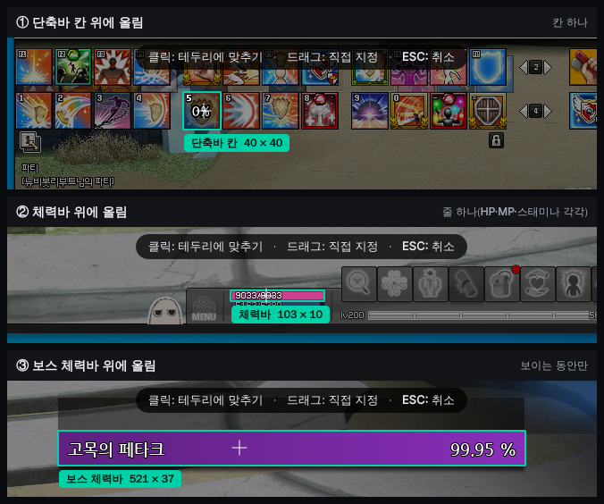

# 클릭 경계 자동 맞춤 기획

- 작성: 2026-11-05 (기획 세션). 상태: 기획 확정, 미구현. **처음엔 제작자 전용**으로 개발·테스트한다.
- 근거: status의 독립 QA 가능성 점검(11-03)과 사용자 결정(11-03 — 단축바·보스 체력바·체력바를 클릭하면 경계에 자동 맞춤), 사용자 결정(11-05 — 이것을 먼저 만들고 쿨타임 오버레이가 쓴다, 둘 다 제작자 전용으로 먼저).
- 이 기능을 쓰는 곳: [커스텀 오버레이](#3-쓰는-곳) 영역 지정, [쿨타임 오버레이](cooldown-overlay-spec.md) 스킬 등록. 백로그 '스킬칸 자동 맞춤'(TODO)도 이것으로 끝난다.

## 1. 동작

목업: `tests/data/image01.png` 실제 화면 위에 그렸고, 테두리 위치는 기존 탐지기가 이 화면에서 실제로 찾은 값이다(단축바 칸·체력바 (611,972,103,10)·보스 체력바 (698,817,521,37)).

| 조작 | 동작 |
| --- | --- |
| 선택창이 열림 | 지금처럼 화면이 어두워지고 바로 드래그할 수 있다. 뒤에서 경계 찾기가 한 번 돈다(사용자는 기다리지 않음). |
| 맞출 수 있는 곳 위에 마우스를 올림 | 그 부분만 밝아지고 **민트 테두리 + 이름·크기 표(예: `단축바 칸 40 × 40`)**. |
| 그 상태에서 **클릭** | 테두리에 딱 맞춘 영역으로 바로 확정(선택창 닫힘). 확인 버튼 없음. |
| **드래그** | 지금과 똑같은 직접 지정. 마우스가 맞출 곳 위에 있어도 4px 넘게 움직이면 드래그로 본다. |
| 맞출 곳이 아닌 곳에서 클릭 | 아무 일 없음(지금과 같음). 실패 안내 문구를 띄우지 않는다. |
| ESC | 취소(지금과 같음). |

- 안내 알약 문구: `클릭: 테두리에 맞추기 · 드래그: 직접 지정 · ESC: 취소` (경계를 하나도 못 찾았으면 기존 `드래그해서 영역을 지정하세요 · ESC: 취소` 그대로).
- 돋보기는 지금처럼 커서 옆에 뜬다. 맞출 곳 위에서는 돋보기 안에도 민트 테두리를 같이 그린다.

## 2. 맞출 수 있는 대상

| 대상 | 단위 | 쓰는 탐지기(기존) | QA 시간(1080, 이 컨테이너) |
| --- | --- | --- | --- |
| 단축바 | **칸 하나**(40×40, 48칸) | `detect/skillbar_anchor.locate_skillbar` → 칸 좌표는 `ui/skillbar_mirror.py` 격자 상수로 계산 | 0.36초 |
| 체력바 | **줄 하나**(HP·MP·스태미나 각각) | `detect/stat_bars.locate_stat_bars` + 줄 나누기(`_bands`) | 0.07초 |
| 보스 체력바 | 바 전체 | `detect/boss_bar.locate_boss_bar(validate=make_validator())` | 0.15초 |

- 보스바는 **화면에 보일 때만** 대상이 된다. 안 보이면 그냥 대상에서 빠진다(별도 안내 없음 — 11-03 결정).
- 전투 시간·미니맵·임의 창 테두리는 넣지 않는다(임의 UI는 새 개발·미검증).
- 체력바를 3줄 한 번에 잡고 싶으면 드래그한다. (줄 하나 단위는 기획 제안값 — 제작자 테스트 후 조정 가능.)

## 3. 쓰는 곳

| 화면 | 대상 | 비고 |
| --- | --- | --- |
| 커스텀 오버레이 › 영역 지정 | 단축바 칸·체력바 줄·보스바 | `RegionSelector(window_hwnd=…)` 드래그 모드에 추가. |
| 쿨타임 오버레이 › 스킬 추가 | **단축바 칸만** | 같은 선택창을 '칸만' 필터로 연다. 등록 시 그 줄의 페이지 번호도 함께 저장(쿨타임 명세 10.4). |
| 단축바 미러(고정 박스 모드)·아이콘 자르기(크롭 모드) | 바꾸지 않음 | 기존 동작 유지. |

## 4. 버벅임·비용 조건
- 경계 찾기는 **선택창을 열 때 1회, 작업 스레드에서** 돈다. 입력은 선택창이 이미 찍어 둔 스냅샷(물리 픽셀, 게임 창 합성 후)이다. 새 캡처를 하지 않는다.
- 화면 스레드는 마우스가 움직일 때 **찾아 둔 사각형 목록과 겹치는지만** 본다(사각형 수십 개 비교 — 비용 없음).
- 결과가 오기 전에도 드래그는 된다. 결과가 오면 그때부터 테두리가 뜬다. 선택창이 닫히면 결과를 버린다.
- 상시 비용 0(선택창이 열려 있을 때만 일함).

## 5. 좌표·화면 조건
- 스냅샷은 물리 픽셀, 선택창 좌표는 논리 픽셀이다. 기존 `self._dpr` 변환을 그대로 써서, 확정 영역은 지금 드래그 결과와 **같은 좌표 체계**로 내보낸다(`selected(x, y, w, h)`).
- 선택창은 지금처럼 주 화면만 덮는다(다중 모니터 확장 없음).
- 4K: 단축바는 UHD 변형이 있고, 체력바·보스바의 4K 경계는 미검증 → 제작자 테스트에서 확인. 못 찾으면 드래그로 지정하면 된다.

## 6. 제작자 전용
- `feature_access.is_creator()`일 때만 경계 찾기를 켠다. 다른 사용자는 선택창이 **지금과 완전히 같다**(문구·동작 변화 없음).
- 공개는 제작자 테스트 후 사용자 결정으로 한다.

## 7. 테스트
- 순수 함수로 분리: `스냅샷 → 대상 사각형 목록`, `커서 위치 → 겹치는 대상`.
- 회귀: `tests/data/image01.png`(단축바 48칸·체력바 3줄·보스바), UHD 단축바 화면 1장, 보스바 없는 화면(보스 대상 없음), 경계 하나도 없는 화면(기존 안내).
- 선택창: 클릭=맞춤 확정, 4px 넘는 이동=드래그, 비제작자는 경계 찾기 미호출.
- Windows 확인(제작자): 100%·150% 배율, 창 모드, 커스텀 오버레이 미러가 맞춘 영역을 정확히 비추는지.
