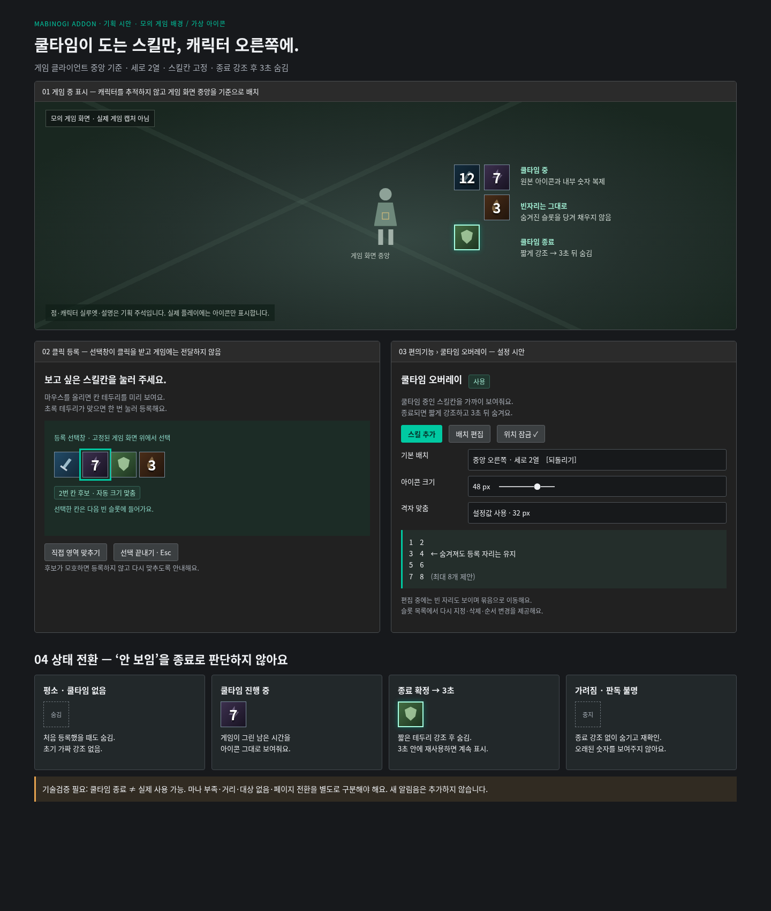
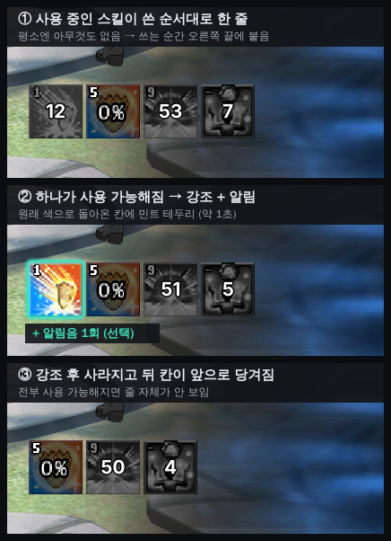

# 쿨타임 오버레이 기획

- 작성: 2026-11-03. 상태: 기획 초안 보관, 미구현·미배포.
- **2026-11-05 사용자 결정으로 배치·표시 방식이 바뀌었다 → [10절](#10-사용자-결정-2026-11-05--줄-단위-목록)이 3·4절과 9.2-1·9.2-6보다 우선한다.**
- 아래 사용자 결정·추천안·미검증 구분을 유지한다. 기획 푸시는 상세 제안값 확정이나 구현 승인이 아니다.
- 함께 검토: [문의 자동 진단](inquiry-auto-diagnostics-spec.md), [기존 단축바 자동찾기](tuarim-skillbar-autofind-spec.md).

기존 문의 기획을 유지하면서, 단축바 칸을 클릭해 등록하는 쿨타임 전용 오버레이를 추가합니다. 제품 코드 변경·실게임 검증·배포를 수행한 문서가 아닙니다.

## 한눈에 보는 결정과 제안

| 구분 | 내용 |
| --- | --- |
| 사용자 결정 (11-05, 우선) | **버프 오버레이처럼 한 줄 목록.** 평소엔 비어 있음 → 쿨타임에 들어간 스킬이 쓴 순서대로 줄 끝에 붙음 → 사용 가능해지면 강조+알림 후 빠지고 뒤 칸이 당겨짐. 판정은 '회색(어두운) 바탕+숫자 = 사용 중'뿐. 따로 모을 자료 없음. 캐릭터 오른쪽 2열 배치는 쓰지 않음. |
| 사용자 결정 (11-03, 일부 대체) | 커스텀 오버레이와 별도로 쿨타임 전용 기능. 단축바를 누르면 칸 크기에 맞춰 지정. 게임 중앙 캐릭터 오른쪽에 세로 2열 기본 배치, 격자 이동 가능. 평소 숨김 → 쿨타임 중 원본 아이콘/내장 숫자 표시 → 종료 강조 후 3초 숨김. |
| 추천안 | 게임 클라이언트 중앙 기준 상대 좌표, 캐릭터 시각 추적 없음. 2열 고정 슬롯, 왼쪽→오른쪽→다음 행 순서. 처음 최대 8개, 48px 아이콘·8px 간격·중앙에서 오른쪽 128px/위 96px에 묶음 좌상단. 위치 잠금·편집·묶음 크기 조절. 모두 제안값. |
| 미검증 | 클릭 주변 단일 슬롯 경계 감지, 쿨타임 진행/종료 분류, 스킬/페이지 동일성, 배율·가림 대응 및 비용. 숫자 OCR 표시를 기본 전제로 삼지 않음. 기술검증 전 임의 스킬 전체 지원을 약속하지 않음. |

## 1. 화면과 최소 조작

**편의기능 › 쿨타임 오버레이**를 전용 진입점으로 제안합니다. ‘스킬 추가’, ‘배치 편집’, ‘위치 잠금’, 아이콘 크기, ‘중앙 오른쪽으로 되돌리기’를 배치합니다. 기존 단축바 미러·커스텀 오버레이는 그대로 유지하며 설정을 덮어쓰지 않습니다. 첫 버전은 레이아웃 프리셋 하나로 시작합니다.

일반 표시 상태는 잠금·클릭 통과·포커스 유지가 기본입니다. 편집에서만 슬롯 가이드와 빈자리가 나타납니다. 묶음 전체를 드래그하며 공통 격자 설정을 사용합니다. 숨겨진 슬롯도 이동 손잡이를 통해 편집할 수 있습니다. 잠금 해제 상태의 휠 크기 조절은 기존 관례를 따르되 묶음 전체 크기에 적용하고, 설정의 크기 값과 동기화합니다. 더블클릭 원복은 기존 미러 관례를 참고한 선택적 추가입니다.

## 2. 스킬칸 클릭 등록

1. **스킬 추가**를 누르면 등록된 게임 창의 현재 화면을 선택창에 고정해 보여줍니다. 선택창이 포인터 클릭을 받아 게임 입력으로 전달하지 않습니다. 자동 키 입력·자동 클릭·게임 메모리 접근 없음.
2. 원본 단축바 자동찾기가 성공하면 격자의 칸 경계를 후보로 사용합니다. 마우스 아래 칸을 민트 테두리로 미리 표시하고, 크기는 주변 테두리에 맞춥니다. 확신 가능한 후보를 클릭하면 다음 빈 슬롯에 바로 등록합니다. 별도 정상 경로 확인 버튼은 두지 않습니다.
3. 전체 격자가 없으면 클릭 근처의 사각 테두리·이웃 칸 간격을 찾는 단일 칸 검출을 시도합니다. 이것은 새 개발입니다. 후보가 여러 개면 미리보기에서 선택하게 하고, 검증되지 않은 임의 크기를 자동 확정하지 않습니다.
4. 실패하면 “칸 테두리를 찾지 못했어요”와 **직접 영역 맞추기**를 제공합니다. 테두리 크기를 조절해 확인 후 등록할 수 있습니다. 자동 등록 실패가 기존 단축바 전체 설정을 변경하지 않습니다.
5. 중복된 소스 칸은 기존 등록을 강조하고 중복 추가하지 않습니다. 8개 상한 제안에 도달하면 교체·삭제 안내. 선택 완료/Esc로 돌아가며, 이미 등록한 칸은 유지하고 미확정 후보만 버립니다.

등록 직후에는 소스 썸네일·슬롯 번호를 보여줍니다. 스킬 이름 자동 인식은 필수가 아니며 “스킬 1” 같은 편집 가능한 이름을 사용합니다. 빈칸·인벤토리 아이콘·앱 미러가 원본 칸으로 등록되지 않도록 원본 게임/슬롯 근거를 검사합니다.

## 3. 중앙 오른쪽 세로 2열

| 항목 | 추천 동작 |
| --- | --- |
| 채움 순서 | 1·2 / 3·4 / 5·6 / 7·8 순서. 등록 슬롯의 위치는 고정합니다. 숨김·삭제 시 뒤의 스킬을 당겨 채우지 않습니다. 새 등록은 가장 앞의 빈 슬롯에 배치. 사용자가 목록에서 순서를 바꿀 때만 위치 변경. |
| 기준 좌표 | 등록 게임 **클라이언트 영역** 중앙을 원점으로 묶음 좌상단 오프셋 저장. 창 테두리·주 모니터 중앙 기준이 아님. 창 이동은 함께 이동하고 크기 변경은 새 중앙 기준 재배치. 캐릭터가 실제 중앙에서 움직여도 추적하지 않음. |
| 제안 치수 | 기본 아이콘 48×48, 간격 8, 2열×4행 상한 8개. 묶음 전체 104×216. 좌상단 오프셋 (+128, −96). Qt 논리 픽셀 기준으로 변환하고 실제 캡처는 물리 픽셀로 처리. 아이콘 크기 32~96px·8px 단위 제안. 출력 크기와 원본 칸 크기는 별개. |
| 격자와 이동 | 공통 설정의 격자 맞춤 여부와 칸 크기를 사용(현행 기본 32px). 쿨타임 묶음에 한해 격자 원점을 게임 클라이언트 중앙에 맞추는 확장이 필요. 기존 공용 grid는 주 화면 중앙 기준이므로 그대로 쓰면 다중 모니터에서 어긋남. |
| 화면 경계 | 아이콘이 게임 클라이언트 밖으로 나가면 표시 위치만 경계 안으로 보정하고 저장된 선호 오프셋은 유지. 창이 묶음보다 작으면 임의 축소 대신 숨김·설정 안내. 해상도 복귀 시 원래 상대 배치 복구. |

## 4. 상태와 전환 규칙

초기 판별 → 쿨타임 없음: 숨김 / 쿨타임 중: 표시 → 유효한 종료 확정: 강조·3초 → 숨김

| 상태 | 표시와 전환 |
| --- | --- |
| 초기 / 재연결 | 먼저 현재 상태를 판별. 이미 쿨타임이 없으면 숨기며 종료 효과를 내지 않습니다. 이미 쿨타임 중이면 즉시 원본 칸 표시. 실행 재개·등록 변경 시 예전 종료 이벤트를 복원하지 않음. |
| 쿨타임 중 | 선택한 원본 칸을 복제해 게임 내부 숫자를 그대로 보여줍니다. 새 숫자 폰트를 덧그리거나 자체 타이머로 남은 시간을 추정하지 않습니다. 숨김 상태에서도 유효한 원본 칸 관측은 계속되어야 시작을 발견할 수 있습니다. |
| 종료 후보 | 같은 슬롯·스킬·페이지에서 직전에 쿨타임 중이었고, 화면이 유효한 동안 종료 근거가 연속 확인될 때만 확정. 숫자 사라짐·밝아짐·빈칸·검은 화면 하나만으로 종료 확정하지 않음. 연속 확인 횟수/시간은 기술검증으로 결정. |
| 종료 강조 | 테두리 밝기 상승 1회(제안 0.4초), 아이콘은 종료 확정 시점부터 총 **3초** 표시한 뒤 숨김. 위치 점프·확대·반복 깜빡임·새 알림음 없음. 3초 안에 새 쿨타임이 확인되면 숨김 예약 취소 후 진행 상태 유지. |
| 판독 불명 | 가려짐·페이지 불일치·실패는 종료가 아닙니다. 잘못된 최신 숫자로 보이지 않도록 해당 아이콘을 즉시 숨기고 설정 상태에 “확인 대기” 표시. 효과와 숨김 타이머를 취소. 연속 관측이 끊긴 뒤 쿨타임 없음으로 돌아와도 강조하지 않는 보수적 정책 추천. |
| 게임 비활성 / 종료 | 묶음 숨김·수집 일시정지, 종료 효과 예약 취소. 다시 유효한 게임에 돌아오면 초기 판별부터 시작. 앱 설정의 배치 편집 시에는 가상 슬롯 미리보기만 보여줍니다. |

**쿨타임 종료는 실제 사용 가능과 다릅니다.** 마나 부족·거리·대상 없음·장비/자세 조건 때문에 사용할 수 없을 수 있습니다. 제품 문구는 ‘사용 가능!’ 대신 ‘쿨타임 종료’를 사용합니다. 쿨타임 표시와 기타 어두워짐을 분리할 수 없는 스킬은 지원 보류/확인 대기로 처리합니다.

## 5. 잘못된 연결과 화면 변화

| 상황 | 처리 원칙 |
| --- | --- |
| UI 배율·작게 보기·DPI 변경 | 출력 배율과 소스 게임 UI 배율을 구분. 소스 격자·칸 경계를 다시 검증하고 확인 전 관측 중지. 지원된 배율이면 새 경계로 후보를 보여 재연결, 실패하면 다시 지정. 40px를 모든 환경의 원본 크기로 강제하지 않음. |
| 단축바 이동·게임창 이동 | 게임창 이동은 클라이언트 상대 소스 좌표를 따라감. 게임 안 단축바가 이동하면 앵커를 재탐색하고 기존 슬롯 인덱스/내용이 같은지 확인. 새 위치에서 바로 종료 효과를 내지 않음. |
| 페이지 전환 | 등록 당시 페이지의 슬롯만 관찰. 페이지가 바뀌면 확인 대기, 되돌아오면 재판별. 보이지 않는 페이지의 쿨타임은 추정하지 않음. 페이지 동일성 검증이 충분하지 않으면 MVP를 고정 페이지 조건으로 한정하고 변경 시 다시 지정하도록 안내. |
| 스킬 교체·빈 슬롯 | 등록 위치에 다른 스킬/빈칸이 들어온 경우 자동으로 새 스킬을 따라가지 않음. “스킬이 바뀌었어요 · 다시 지정” 상태. 기본 아이콘 영역의 동일성 확인은 숫자·쿨타임 음영의 변화를 허용해야 하며 기술검증 대상. |
| 툴팁·다른 창·효과로 가려짐 | 관측 불명으로 처리. 게임 포그라운드 검사만으로 항상 위 창 가림까지 해결된다고 보장하지 않음. 기본 유효성/가림 판정을 검증해야 함. 미러 렌더 성공만으로 상태 판정 신뢰도를 보장하지 않음. |
| 잘못된 영역·창 미발견·재시작 | 잘못된 칸은 목록에서 다시 지정/삭제. 게임 미발견 시 숨김, 전체 데스크톱으로 대체 캡처 금지. 게임 프로세스 변경 때 소스 창·좌표를 다시 연결하고 전환 이력 초기화. 오래된 프레임·타이머로 종료 효과를 내지 않음. |

## 6. 코드 재사용과 기술검증

원격 main `398fdeb6b3d0fc9e4d04392181e3b2af126cfd22`를 다시 확인했습니다. 아래는 소스 조사 결과이며 Windows에서 동작을 검증한 결과가 아닙니다.

| 기존 근거 | 사용 가능 / 새 작업 |
| --- | --- |
| `detect/skillbar_anchor.py`: 페이지 조작부 앵커와 48칸 전체 격자 검증, 일부 가림 허용. | 원본 단축바 후보·좌표 변환 기반 재사용. 임의의 단일 칸 클릭 검출기와 페이지 번호 판독기는 아님. 전체 격자 성공이어도 개별 선택 칸의 가림은 별도 검사. |
| `ui/skillbar_mirror.py`: 원본 아이콘 40, 피치44, 행49, 블록620, 전체1168×89. 4칸 청크 복제. `skillbar_tab.py`: 120ms 갱신, 출력50~300%. | 원본 칸 crop와 선명한 복제 경로 참고. 현행 상수는 기존 격자 기준이지 신규 지원 규격이 아님. 청크 대신 개별 고정 슬롯 표시·조건부 숨김·3초 효과 필요. 120ms는 기존값이며 새 기능 주기 확정값이 아님. |
| `mirror_overlay.py / mirror_manager.py`: 잠금 시 클릭 통과, 드래그·격자 이동, 휠0.1 배율, 0.25~4.0 범위, DWM/mss 표시 경로, 비활성 숨김. | 표시·잠금·수명 관리 관례 재사용. DWM 표시는 픽셀을 자동으로 분석기에 주지 않음. 별도의 제한된 상태 관측이 필요하며 미러 전체화면 캡처를 그대로 새 기능에 복사하지 않음. |
| `ui/grid.py / config.py`: 공통 격자32px 기본, 주 화면 중앙 기준. 기존 미러·단축바는 화면 위치/앵커 설정 저장. | 게임 클라이언트 중앙 기준 배치·격자 확장, 새 설정 구역 필요. 기존 설정 보존. 안정적인 slotId/소스칸/페이지 근거/상대 위치/크기/잠금만 저장. 실행 중 쿨타임·남은3초 예약은 저장하지 않음. |
| `overlay_capture.py`: 앱 오버레이 상시 캡처 제외. | 새 쿨타임 오버레이도 제외 정책 등록. 자기 자신을 원본으로 재캡처하지 않게 하고 기존 정책을 해제하지 않음. |

**검증 우선순위:** 대표 스킬의 쿨타임 시작/종료와 마나 부족·거리·무대상·페이지 전환·빈칸·툴팁을 포함한 자료에서 오탐을 확인합니다. 숫자 OCR 없이 시각 신호(숫자 존재·쿨타임 음영 등)를 분류할 수 있는지 먼저 검증하고, 부족하면 지원 범위를 제한합니다. 숫자를 읽어 별도 카운트다운을 그리는 방향으로 몰래 바꾸지 않습니다. 원본 칸은 공유 캡처에서 나눠 쓰며 숨김 슬롯도 관측하므로, 최대 등록 수 기준 비용을 측정해야 합니다.

## 7. 문의 기획과 함께 검토

**문의의 핵심 흐름은 유지합니다.** 문의 문제 선택 → 해당 기능 자동 수집/캡처 → 내용·첨부 미리보기 → 최종 문의 보내기 흐름을 유지합니다. 첫 캡처 버튼·설정 탐색·파일 찾기를 되살리지 않습니다. 문의 일반/건의는 화면 수집 없음.

쿨타임 오버레이 문의는 최초에는 “그 밖의 문제 · 잘 모르겠어요” 경로를 사용합니다. 오버레이 자체가 캡처 제외되므로 자동 게임 캡처에 표시 오류가 찍히지 않을 수 있습니다. 원본 단축바·선택 슬롯/배율/페이지 상태·최근 로그를 진단 후보로 삼고, 오버레이 이미지가 찍힌다고 안내하지 않습니다. 새 전용 수집 경로는 제품 구현 후 별도 확장합니다.

함께 검토할 문서: [문의 자동 진단](inquiry-auto-diagnostics-spec.md). 문의의 60초·20장·8MiB 등은 여전히 제안값입니다.

## 8. 구현 단계를 분리하는 제안

1. **기술 확인:** 클릭 슬롯 경계와 쿨타임/비쿨타임/불명 분류를 대표 자료로 검증. 페이지·스킬 동일성을 확보하지 못하면 지원 조건을 먼저 정합니다.
2. **등록·표시:** 선택창의 입력 차단, 칸 등록, 고정2열, 상대 좌표·격자·잠금·크기, 미리보기. 이 단계에서 상시 미러를 최종 쿨타임 기능이라고 배포하지 않습니다.
3. **상태·안정성:** 초기 강조 금지, 종료3초·재사용 취소, 비활성/가림/교체, 게임 재시작·DPI·다중 모니터 검증. 그 다음 통합·QA 범위를 정합니다.
4. **문의 자동 진단:** 별도 기능 묶음으로 세션·자동첨부·전송·복원을 구현합니다. 쿨타임 인식 기술검증과 독립적으로 진행할 수 있습니다.

필수 시나리오: 최초 ready → 무강조 숨김 / 진행→종료→3초 숨김 / 3초 내 재사용→예약 취소 / 진행→가림·페이지 변경→무강조 / 게임 전환·스킬 교체→재판별 / 숨김 칸 발생→다른 슬롯 위치 불변 / 선택창 클릭→게임 스킬 미발동. 실제 Windows 실행·성능 검증 전에는 완료로 표시하지 않습니다.

## 목업과 확인 범위

코드 기반 정적 목업을 Chromium으로 렌더하고 PNG 픽셀을 직접 확인했다. 가상 자료·모의 게임 배경이며 실제 게임 캡처가 아니다. 기존 다크 UI·민트 강조색을 참고했다. 전달용 HTML은 데스크톱 및 390/320px에서 가로 넘침이 없음을 확인했으며, 저장소에는 유지보수용 명세와 대표 PNG만 보관한다. Windows 실게임·성능·입력 통과는 미검증이다.

## 9. 기획 세션 검토 (2026-11-05 — 버벅임·문제점)

함께 본 자료: 이 명세, status의 독립 QA 쿨타임 기술 점검(11-03)과 사용자 결정(% 칸 처리), 현재 코드 `ui/skillbar_tab.py`, 마우스 커서 끊김 조사 기록.

### 9.1 버벅임(마우스 꼬리 끊김) 위험과 설계 조건
- **그대로 베끼면 버벅인다.** 지금 단축바 미러는 `QTimer` 120ms마다 **화면 스레드에서 `mss` 캡처**(1168×89)를 하고 크기 조정·자르기까지 한다(`skillbar_tab._tick`·`_grab_rect`).
  커서 조사에서 끊긴 구간에 '화면 스레드 캡처 기능 경과≫CPU'(단축바 미러 55ms/s)로 잡힌 그 패턴이다.
  쿨타임은 숨김 상태에서도 계속 관측해야 하므로, 같은 방식이면 **상시** 화면 스레드를 붙잡는다.
- **필수 조건**
  1. **관측(캡처·판정)은 작업 스레드.** 등록 칸들을 덮는 작은 사각형 하나만 찍고 칸별로 자른다. 판정은 칸당 40×40 픽셀의 밝기·숫자 유무라 1ms 미만이다.
     화면 스레드는 상태가 **바뀐 칸만** 보이기·숨기기·다시 그리기를 한다(0.38.0 도르카·보스와 같은 원칙).
  2. **주기는 4~5회/초(200~250ms)**로 충분하다. 시작 발견이 0.25초 안이면 되고, 종료는 어차피 여러 프레임 연속 확인이 필요하다. 120ms를 따라가지 않는다.
  3. **표시(아이콘+게임 숫자)는 DWM 썸네일**을 쓴다(커스텀 오버레이와 같은 방식). 게임 화면 그 칸을 OS가 직접 비춰 주므로, 숫자가 부드럽게 바뀌어도 CPU를 거의 안 쓴다.
     관측용 캡처와 표시가 분리돼 표시 프레임이 관측 주기에 묶이지 않는다. 숨김은 썸네일을 끄기만 하면 된다.
  4. 같은 단축바 영역을 미러와 쿨타임이 각각 찍지 않도록, 가능하면 **공유 캡처 한 번**을 둘이 나눠 쓴다.
     단축바 미러의 화면 스레드 캡처를 작업 스레드로 옮기는 일은 커서 끊김 대책으로도 필요하다(status 화면 스레드 캡처 목록 — 단축바 120ms).
- **비용 목표**: 8칸 등록, 숨김 포함 상시 관측에서 화면 스레드 추가 0(바뀔 때만 수 ms), 작업 스레드 캡처 4~5회/초. Windows `[계산·화면]` 로그로 확인한다.

### 9.2 다른 문제점
1. **위치 기준(게임 클라이언트 중앙)**
   - [게임 창 기준 영역](window-relative-regions-spec.md)이 '모든 사용자에게 이관 위험'으로 보류됐다.
   - `registered_game_target`은 창 테두리를 포함한 사각형이라, 클라이언트 중앙은 새 작업이다(QA 지적).
   - 격자 원점까지 바꾸려면 공용 `grid` 확장이 필요하다.
   - **제안**: MVP는 다른 오버레이처럼 **화면 좌표로 저장**한다. 처음 만들 때만 '게임 화면 중앙에서 오른쪽 128px·위 96px'에 놓고, 이후 드래그·격자는 기존 그대로 쓴다.
   - 창 모드에서 게임 창을 옮겨도 따라가지 않는 것은 다른 오버레이와 같다. 중앙 기준 추적은 창 기준 영역 재개 때 함께 한다.
2. **판정 단순화(사용자 결정 11-03 반영)**: % 칸도 '쿨타임+사용 제약'으로 본다.
   - 판정: `어둡고 가운데 숫자 있음 = 표시` / `밝고 숫자 없음 = 사용 가능 → 종료`
   - 4절의 '쿨타임 종료 ≠ 사용 가능' 문구 정책은 유지한다. 종료 강조 문구 없이 3초 후 숨김.
   - 남은 기술 확인: % 칸이 사용 가능해질 때 실제로 밝아지고 숫자가 사라지는지, 귀퉁이 수량(99)·단축키 글자 제외, 공용 재사용 대기, 종료 연속 확인 프레임 수.
3. **들어갈 자리**
   - 편의기능은 지금 `계산기 · 그림대화 만들기`이고, 마우스 커서는 최적화로 옮겨졌다.
   - 쿨타임은 단축바에서 나오는 **전투 보조 기능**이라 `전투 보조 › 단축바` 안에 두는 안을 제안한다. 3단 `단축바 미러 / 쿨타임` 또는 같은 화면의 아래 구역 중 하나이며, 결정 대기다.
4. **스킬칸 클릭 등록**은 백로그 '스킬칸 자동 맞춤'과 status의 '커스텀 오버레이 경계에 붙이기'(사용자 결정 11-03 — 단축바 칸 클릭 시 경계 자동)와 같은 검출을 쓴다. **한 번 만들어 셋이 공유한다.**
5. **문의**
   - 7절은 6.3 확정(카드 6개·ZIP)에 맞춘다. 쿨타임 문제는 `그 밖의 문제`로 받는다.
   - 쿨타임 오버레이는 캡처 제외라 사진에 안 나온다는 안내를 붙인다.
6. **기술 검증 자료가 필요하다**(사용자 제공). 쿨타임 시작·진행·종료가 이어지는 단축바 화면 PNG 몇 장(초 표시 칸과 % 칸 각각), 마나 부족 같은 사용 제약, 페이지 전환 직후, 귀퉁이 수량이 있는 칸.

## 10. 사용자 결정 (2026-11-05 — 줄 단위 목록)

> 이 절이 3절(중앙 오른쪽 세로 2열), 4절의 '3초 후 숨김', 9.2-1(위치 기준), 9.2-6(자료 요청)보다 우선한다.

목업은 `tests/data/image01.png`의 실제 단축바 아이콘을 잘라 쓰고, 쿨타임 모습(회색·어둡게+숫자)은 흉내 낸 것이다(0% 칸만 실제 화면). 배경도 같은 실화면 일부.

### 10.1 동작
| 항목 | 결정 |
| --- | --- |
| 모양 | **버프 오버레이와 같은 한 줄**(가로). 묶음 위치 하나를 드래그로 옮긴다. 칸마다 고정 자리를 두지 않는다. |
| 평소 | 등록한 스킬이 모두 사용 가능하면 **아무것도 안 보인다.** |
| 사용 중 | 등록 칸이 '회색 바탕+숫자'가 되는 순간 **줄 끝에 붙는다(쓴 순서대로).** 표시는 그 단축바 칸을 그대로 비춘다(게임 숫자 그대로, DWM 썸네일). |
| 사용 가능 | 회색·숫자가 사라지면 그 칸을 **원래 색 + 민트 테두리로 강조**하고 **알림**을 준 뒤 빠진다. 뒤 칸들이 앞으로 당겨진다. |
| 판정 | `회색(어두운) 바탕 + 가운데 숫자 = 사용 중`, 그 외 = 사용 가능. 초/% 구분 없음(11-03 결정 그대로). 몇 초 남았는지 읽지 않는다. |
| 앱 시작·재연결 | 이미 사용 중이면 바로 줄에 넣고, 이미 사용 가능하면 강조·알림 없이 비워 둔다(4절 초기 판별 규칙 유지). |
| 장비로 쿨타임이 바뀜 | 예: 600초 스킬, 장비로 −200초. 남은 198초에서 장비를 끼면 게임이 즉시 사용 가능으로 바꾼다 → 회색·숫자가 사라지므로 **바로 강조+알림 후 빠짐**. 반대로 장비를 벗어 다시 쿨타임이 되면 회색+숫자가 생기므로 **줄 끝에 다시 붙음**. 자체 타이머를 두지 않고 게임 표시만 따르므로 별도 처리가 필요 없다. 전제: 게임이 장비 교체 즉시 단축바 표시를 갱신(사용자 플레이 관찰로 확인, 자료 불필요). 교체 순간 장비창이 단축바를 가리면 '가려짐'으로 처리. |
| 가려짐·페이지 바뀜 | 사용 가능으로 치지 않는다 → 강조·알림 없이 그 칸만 줄에서 뺀다(4절 '판독 불명' 유지). |

**제안값(개발 중 조정 가능)**
- 강조 시간 **약 1초** 뒤 빠짐(테두리 1회, 깜빡임 반복 없음). 강조 중 다시 쓰면 강조를 취소하고 줄 끝으로 간다.
- 알림은 **알림음 1회, 켜고 끄기 가능(기본 켬)**. 소리 고르기는 버프 종료 알림과 같은 방식을 재사용한다. 여러 개가 거의 동시에 끝나면 소리는 한 번만.
- 배율·불투명도·잠금(클릭 통과)·드래그 이동은 버프 오버레이와 같다([ui-rules](ui-rules.md) 오버레이 공통 규칙). 잠금 해제 중엔 예시 칸 3개를 보여 위치를 잡게 한다.
- 등록 상한은 8칸 제안 유지.
- 처음 위치는 버프 오버레이 아래쪽 근처, **화면 좌표로 저장**(다른 오버레이와 같음). 게임 창 중앙 기준·캐릭터 옆 배치·2열 격자는 하지 않는다 → 9.2-1의 위치 기준 문제가 사라진다.

### 10.2 자료
- 사용자에게 따로 받을 자료는 **없다.** 판정이 '회색+숫자'뿐이라 시작·진행·종료 연속 자료가 필요하지 않다.
- 개발 회귀 테스트는 이미 `tests/data`에 있는 단축바 화면으로 만든다. 사용 중 예: `2026-10-30_windowed_wireweb_*.png`(475·791·720), `image01.png`(0%·542), 2026-10-09·10-16 스크린샷의 회색+숫자 칸. 사용 가능 예: 같은 화면의 나머지 칸.
- 귀퉁이 수량(99)·단축키 글자는 '가운데 숫자'가 아니므로 사용 중으로 보지 않게 테스트에 넣는다.

### 10.3 그대로 유지
- 9.1 버벅임 조건 전부(작업 스레드 관측 4~5회/초, DWM 표시, 바뀐 칸만 화면 스레드, 단축바 미러와 공유 캡처).
- 2절 스킬칸 클릭 등록 = 공용 클릭 경계 검출(9.2-4). 3절의 고정 슬롯·채움 순서는 폐기.
- 들어갈 자리(9.2-3)는 아직 결정 대기.
