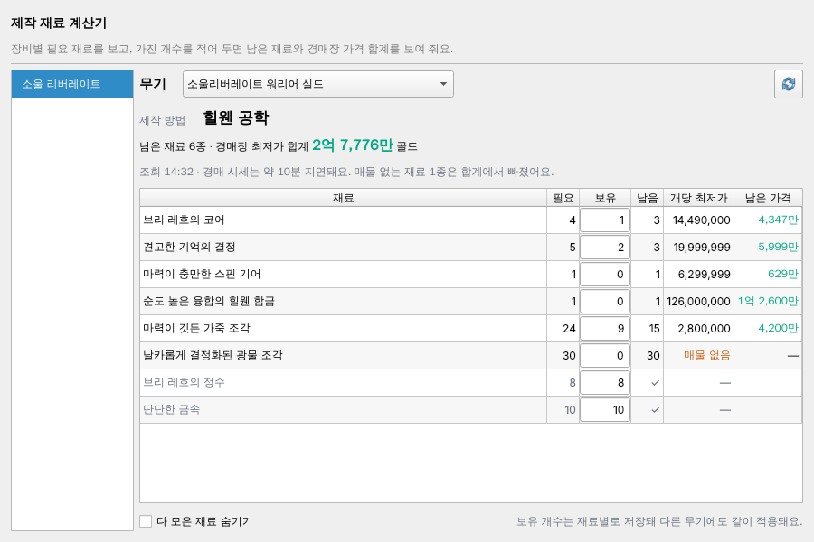
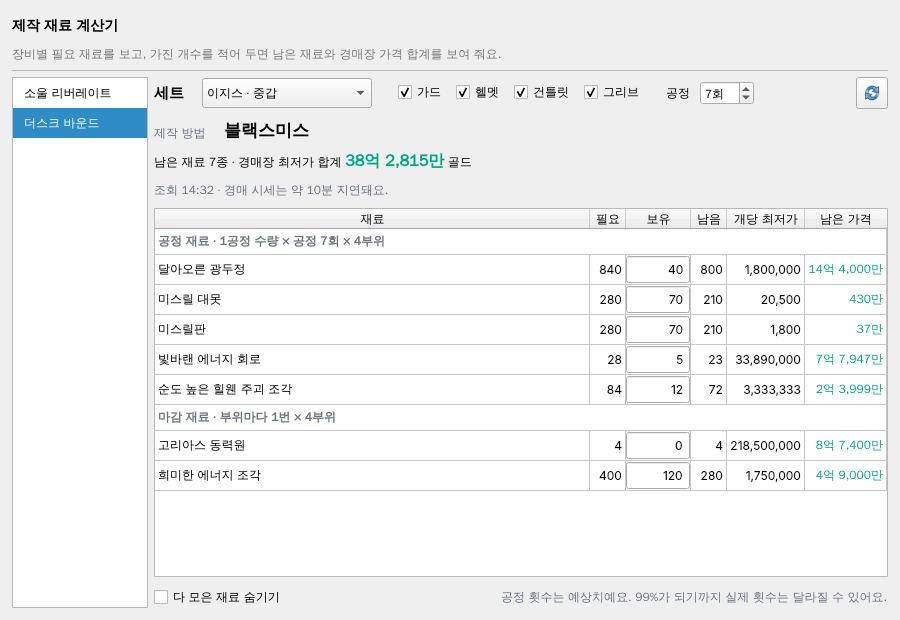

# 제작 재료 계산기

- 작성: 2026-11-15 (기획 세션). 상태: **0.50.0 개발 완료(소울 리버레이트·더스크 바운드, 렌더 사용자 확인 대기) — 모든 사용자 공개**(사용자 결정 11-15: 화면만 계산하는 기능이라 위험 없음 → 제작자 먼저 단계 없음).
- 사용자 요청(11-15): 장비별 제작 재료를 앱에서 보고, 가진 개수를 적어 두면 **남은 재료 위주로 경매장 총 가격**을 보여 준다. 재료 정리는 커뮤니티 시트를 그대로 옮긴다(사용자가 손으로 정리하지 않음).
- 버전: 새 기능 → 다음 minor. 릴리즈 노트 한 줄은 개발 커밋에서.
- 시리즈: **소울 리버레이트**(무기 29종, 1~4절) + **더스크 바운드**(방어구 3세트, 5절 — 사용자 추가 11-15, 개발 중 함께 넣기). 나이트 브링어는 나중에 같은 방식.

## 1. 화면

| 항목 | 결정 |
| --- | --- |
| 자리 | 편의기능 탭 줄 `분배 → 구슬 분배 → 환전비율 → **제작 재료 계산기** → 던전 입장 → 그림대화 만들기 → 알람`(사용자 결정 11-15). 머리 설명: `장비별 필요 재료를 보고, 가진 개수를 적어 두면 남은 재료와 경매장 가격 합계를 보여 줘요.` |
| 왼쪽 목록 | **시리즈** 단위(`calculator_sidebar`). `소울 리버레이트`, `더스크 바운드`(5절). `나이트 브링어`는 나중에 같은 방식(데이터 파일 추가). |
| 첫 줄 | `무기` + 드롭다운 — 한 줄. 오른쪽 끝 시세 새로고침 버튼(기존 `refresh_button`). |
| 무기 분류 | 드롭다운 하나 안에 **분류 머리 줄**(굵게·흐리게, 고를 수 없음 — 키보드 위아래도 건너뜀) + 들여쓴 무기 줄(사용자 결정 11-15). 분류·순서는 데이터 `categories`: **근접** 소드·해머·액스·실드·워리어 실드·블레이드·랜스·워리어 해머·워리어 액스·너클·핸들·콜로서스 미니어처·피에로 미니어처·체인 블레이드 / **마법** 스태프·원드·힐링 원드·마도서·실린더·가드실린더·사이드·오브 / **원거리** 보우·이터널 애로우·크로스보우·이터널 볼트·스로잉 스타·듀얼건 / **악기** 리라. 분류 없는 시리즈(더스크 바운드)는 그대로. 마지막으로 고른 시리즈·장비(시리즈마다)는 다시 열 때 복원(config `craftCalculator.lastSeries`·`lastItem`). 렌더 `render/craft_weapon_menu.png`. |
| 둘째 줄 | `제작 방법`(흐린 글자) + 제작 스킬 **17px 굵게, 일반 글자색**(민트 아님 — 합계와 눈길이 겹치지 않게). |
| 합계 줄 | `남은 재료 N종 · 경매장 최저가 합계 <민트 굵게 korean_gold> 골드`. |
| 상태 줄(흐림) | `조회 HH:MM · 경매 시세는 약 10분 지연돼요.` + 매물 없는 재료가 있으면 ` 매물 없는 재료 N종은 합계에서 빠졌어요.` 조회 중·실패·키 없음은 던전 입장 계산기와 같은 문구. |
| 표 | `재료 | 필요 | 보유 | 남음 | 개당 최저가 | 남은 가격`. 보유 = 숫자 칸(직접 입력, 0~9999, 화살표 없음). 남음 = max(0, 필요−보유). 남은 가격 = 남음 × 최저가(`korean_gold`, 민트). |
| 순서 | **남은 재료 위, 다 모은 재료 아래**(각 묶음 안은 데이터 순서). 다 모은 줄 = 흐린 글자, 남음 `✓`, 가격 칸 `—`/빈칸. 입력 중엔 줄이 움직이지 않게 다시 정렬은 **무기를 바꿀 때·탭에 다시 들어올 때만**. |
| 매물 없음 | 개당 최저가 칸 주황 `매물 없음`, 남은 가격 `—`, 합계에서 제외(상태 줄에 종 수). 조회 실패한 재료도 같은 자리에 `조회 실패`, 합계 제외. |
| 아래 줄 | 왼쪽 `다 모은 재료 숨기기` 체크(저장), 오른쪽 흐린 안내 `보유 개수는 재료별로 저장돼 다른 무기에도 같이 적용돼요.` |

## 2. 데이터
- 파일: 앱 자산 `src/mabinogi_addon/assets/craft/soul_liberate.json`(0.50.0 개발에서 docs에서 옮김 — 시리즈 = 이 폴더의 json 파일 하나). 형식: `{series, source, items: [{name, skill, materials: [[재료, 개수], …]}]}`.
- 29종, 무기마다 **1단계 재료 8종**(하위 재료로 풀지 않음 — 사용자 결정 11-15: 1단계 재료 모두 경매장 시세가 있음).
- 출처: 커뮤니티 제작 시트(최종 수정 2026-05-26)의 `무기재료` 표를 그대로 뽑음. 시트 이미지는 쓰지 않는다.
  - 검증(기획 세션): 시트에 저장된 스태프 화면과 8종·개수 일치, 하위 재료까지 푼 합계 18종도 시트와 일치(계산 구조 확인용).
  - 워리어 실드: 시트 `무기스펙`은 매직 크래프트, `무기재료`는 힐웬 공학 → **사용자 인게임 화면(11-15)으로 힐웬 공학 확정**, 8종·개수도 일치.
- 시리즈 추가는 데이터 파일만 늘리는 구조로(화면 코드에 무기 이름을 쓰지 않음). 파일의 `kind`로 화면 모양을 고른다: `simple`(소울 리버레이트 — 재료 × 1), `process`(더스크 바운드 — 5절).

## 3. 보유 수량
- **재료 이름별로 저장**(사용자 결정 11-15): config `craftOwned` = `{재료 이름: 개수}`. 다른 무기에서 같은 재료면 같은 값. 0은 저장하지 않아도 됨.
- 입력하면 바로 남음·남은 가격·합계 다시 계산(네트워크 없음). 설정 내보내기·설정 동기화 대상에 포함.
- 리셋 버튼은 두지 않는다(숫자 칸을 0으로).

## 4. 시세
- 기존 `market.auction.fetch_min_prices`(정확한 이름, 최저 개당가, 병렬)를 쓴다. 키는 `config.get_nexon_api_key()`.
- 무기를 고르면 그 무기 **재료 8종**을 조회(남은 것만 고르지 않음 — 보유를 바꿔도 다시 조회할 필요 없게). 재료별 **10분 세션 메모리 캐시**(무기끼리 공유, 영구 저장 안 함). 새로고침 버튼 = 그 무기 8종 강제 다시 조회.
- 작업 스레드에서 조회, 화면 스레드는 결과만 받음(던전 입장 계산기 `_fetch`·`_receive` 구조 재사용 — 작업 스레드에서 Qt 객체 접근 금지). 탭 닫을 때 취소.
- 최저가 기준이라 여러 개를 사면 실제 비용은 더 들 수 있음 — 탭 머리 설명 대신 **새로고침 버튼 툴팁**에 `최저가 기준이에요. 많이 사면 실제 비용은 더 들 수 있어요.`

## 5. 더스크 바운드 (공정형 방어구, 사용자 추가 11-15)

공정을 여러 번 거쳐 99%를 만들고 **마감 재료**를 넣어 완성하는 장비. 데이터: `src/mabinogi_addon/assets/craft/dusk_bound.json`(`kind: process`, 개발에서 docs에서 옮김).

| 세트 | 제작 방법 | 부위(4) | 세트 고유 공정 재료 |
| --- | --- | --- | --- |
| 이지스 · 중갑 | 블랙스미스 | 가드·헬멧·건틀릿·그리브 | 달아오른 광두정 30, 순도 높은 힐웬 주괴 조각 3 |
| 비고러스 · 경갑 | 블랙스미스 | 아머·레더 헬멧·글러브·부츠 | 끈적이게 엉긴 식물 덩어리 30, 순도 높은 힐웬 강판 조각 3 |
| 에테리얼 · 천옷 | 천옷 만들기 | 슈트·튜더 베레모·글러브·슈즈 | 순도 높은 실리엔 섬유 다발 3, 질긴 실 10, 최고급 실크 10, 최고급 옷감 10, 희미하게 빛나는 명주실 30 |

- 공통 공정 재료: 블랙스미스 두 세트는 미스릴 대못 10·미스릴판 10·빛바랜 에너지 회로 1, 천옷은 빛바랜 에너지 회로 1. 마감 재료(세 세트 공통): 고리아스 동력원 1, 희미한 에너지 조각 100. 전체 값은 JSON.
- **같은 세트의 4부위는 재료가 모두 같다**(사용자 확인 11-15 — 처음 받은 표는 갑옷 것). 그래서 부위는 '몇 부위를 만드는지'만 셈한다.

| 항목 | 결정 |
| --- | --- |
| 첫 줄 | `세트` 드롭다운(`이지스 · 중갑` 등) + **부위 체크박스 4개**(세트에 따라 이름이 바뀜, 기본 모두 체크) + `공정 [7회]` 숫자 칸(1~30, 기본 `default_processes` 7) + 새로고침. |
| 둘째 줄 | `제작 방법` + `블랙스미스`/`천옷 만들기`(1절과 같은 17px). |
| 필요 수량 | 공정 재료 = 1공정 수량 × 공정 횟수 × 체크한 부위 수. 마감 재료 = 수량 × 체크한 부위 수. 부위 0개면 표 비우고 `만들 부위를 골라 주세요.` |
| 표 | 같은 열(1절). 묶음 줄 두 개 — `공정 재료 · 1공정 수량 × 공정 N회 × M부위`, `마감 재료 · 부위마다 1번 × M부위`(흐린 굵은 글자, 칸 합침). 남은 것 위 정렬은 묶음 안에서. |
| 아래 안내 | `공정 횟수는 예상치예요. 99%가 되기까지 실제 횟수는 달라질 수 있어요.`(소울 리버레이트에선 1절 보유 안내) |
| 저장 | 보유는 3절 그대로(재료별 — 빛바랜 에너지 회로·마감 재료처럼 세트끼리 같은 재료는 공유). 세트별 체크한 부위·공정 횟수도 config에 기억(`craftChoice`). |
| 시세 | 4절 그대로(그 세트 재료 전부 조회, 재료별 10분 캐시). |

## 6. 테스트
- 데이터: 29종, 무기마다 8종, 개수 양의 정수, 이름 중복 없음, 워리어 실드 = 힐웬 공학·8종 개수(인게임 대조값).
- 계산(순수 함수): 남음·남은 가격·합계, 매물 없음·조회 실패 제외와 종 수, 정렬(남은 위·데이터 순서 유지), 보유 > 필요.
- 보유 저장: 재료별 공유(소드에서 정수 입력 → 블레이드에서 같은 값), 재시작 후 유지.
- 시세: 가짜 urlopen으로 성공·매물 없음·일부 실패·키 없음, 10분 캐시 재사용·새로고침 강제.
- 더스크 바운드: 3세트 × 4부위, 필요 수량 = 1공정 × 공정 × 부위 / 마감 × 부위(이지스 4부위 7공정 → 광두정 840·동력원 4), 부위 0개 안내, 세트 바꿔도 공통 재료 보유 유지, 체크·공정 기억.
- 화면: 오프스크린 렌더(시세 있음·조회 중·키 없음·다 모음 숨기기, 더스크 바운드 세 세트·부위 일부 체크) 사용자 확인.

## 7. 구현 메모 (0.50.0)
- `market/craft.py`(데이터·계산·10분 캐시), `ui/craft_tab.py`(화면), config `craftOwned`·`craftCalculator.hideDone`. 편의기능 탭 환전비율 계산기와 던전 입장 계산기 사이(사용자 결정 11-15, 알람은 맨 뒤).
- 매물 없음과 조회 실패를 가르려고 `auction.fetch_min_prices`에 `failed`·`urlopen` 선택 인자(기본은 예전 그대로 None).
- 렌더: `docs/assets/craft-materials-20261115/render/`(시세 있음·조회 중·키 없음·다 모음 숨기기).
- 무기 분류(0.50.0, 사용자 후보 확인 뒤 요청 11-15): `categories`가 모든 장비를 정확히 한 번씩 담지 않으면 분류 없이 데이터 순서(장비는 그대로 보임). 펼친 목록 20줄(Windows), 나머지는 스크롤.
- 더스크 바운드(0.50.0): `kind`로 화면 분기, 공정형은 부위 체크 4개(세트마다 이름)·`공정 [N회]`(1~30)·묶음 줄(칸 합침). 시리즈 순서는 파일의 `order`(소울 1·더스크 2). 세트별 체크·공정 = config `craftChoice`. 렌더 `render/dusk_aegis·dusk_vigorous·dusk_ethereal.png`, 위치 `render/craft_location.png`.
