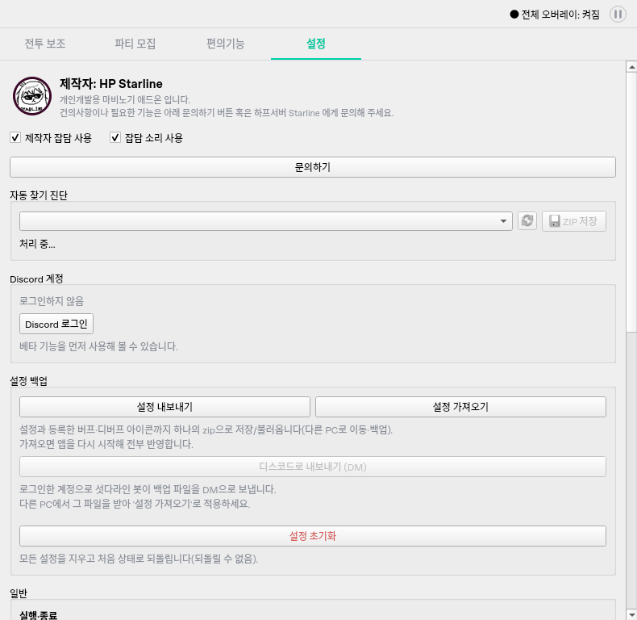

# 제작자 잡담 개발 기록

- 기준: `creator-dialogue-spec.md`, `creator-dialogue-publishing.md`.
- 2026-10-16 사용자 승인: 현재 배치, 문장에 맞춘 작은 말풍선, 얼굴을 가리키는 꼬리.
  꼬리 너비는 첫 삼각형 시안에서 30% 축소하고 길이는 유지했다.
- 최초 개발 범위는 선택적 소리 연동만 준비했다. 2026-10-20 사용자 요청으로 아래 전용
  알림음·50% 음량·소리 체크를 추가했다.

## 구현

- 일반 탭은 기존 800px 높이에 얼굴 공간 64px를 추가한다. 설정은 기존 사진만 사용하고
  중복 하단 공간은 숨긴다. 안내/투어/영역 지정/모달에서는 잡담을 차단한다.
- 작업 영역이 작은 경우 높이를 작업 영역/창 장식에 맞추고 기존 탭 스크롤을 유지한다.
  기존 시작 화면 테스트의 800px 고정 비교는 작업 영역 상한을 포함한 정확한 기대 높이로
  갱신했다. 단계 버튼의 화면 안 위치와 가로 스크롤 없음 검사는 유지한다.
- 말풍선은 좌우 10px/상하 7px, 최대 텍스트 폭 290px이다. 한글 대체 폰트까지 반영한
  `QTextLayout`으로 두 줄 이하인지 확인하며 긴 문장은 축소/스크롤 대신 표시하지 않는다.
- 클릭은 직전 완성 문장과 다른 대사로 교체하고 3초를 다시 시작한다. 말풍선 클릭은
  이벤트를 소비하며 뒤 컨트롤로 전달하지 않는다. 별도 top-level 창이나 최상위/포커스
  요청을 만들지 않는다.
- 실행별 단조 시계로 120초 간격, 최근 600초의 실제 자동 표시만 세어 40%/20% 추첨한다.
  실패 추첨도 간격을 소비하고 표시 직전 재확인에 실패하면 표시 횟수는 늘리지 않는다.
- 추첨/가림 확인용 1초 타이머 1개, 표시 만료 단발 타이머 1개, 수신 제한 단발 타이머
  1개를 재사용한다. 숨기면 추첨 타이머를 멈추고 종료 시 요청/타이머를 취소한다.
- Windows 가림은 대상 HWND 위 Z-order 창과 얼굴/말풍선 영역의 교차만 검사한다.
  클라이언트 실제 픽셀과 Qt 논리 크기 비율로 현재 창 좌표를 변환하며 화면 밖/모니터
  사이 빈 영역/입력 데스크톱 잠금/판정 실패는 노출 불가다. 포그라운드를 조건으로 삼지 않는다.
  WTS 잠금/연결 및 절전 메시지는 즉시 말풍선을 닫고, 등록한 알림은 종료 시 해제한다.
  이벤트 루프 지연/복귀 후 지난 말풍선은 되살리지 않는다.

## 데이터와 소리 경계

- 초기 12개 샘플 JSON을 번들 자산에 원문 그대로 포함했다.
- 공개 Raw 주소로 시작 시 한 번만 Qt 비동기 GET을 한다. 제한은 8초/128KiB,
  리다이렉트 거부, 최대 512항목/32부분/부분당 64선택지/완성 문장 60자다.
  무작위 선택은 32회이며 실패 후 항목당 짧은 완성 문장 하나만 최대 512회 확인한다.
  데이터가 지정한 코드/URL/함수를 실행하지 않으며 사진·설정·게임 정보를 전송하지 않는다.
- 정상 데이터만 `QSaveFile`로 원자 저장한다. 손상/권한/통신 오류는 마지막 정상 캐시 또는
  내장 데이터로 복구한다. 실행 중 주기 갱신과 클릭별 요청은 없다.
- `CreatorDialogue`는 표시 성공 뒤에만 `sound(text)`를 호출한다. 최초 기본값은 무음이었으며,
  현재 기본 콜백은 소리 옵션에 따라 전용 비동기 재생기를 사용한다. 테스트/확장용 콜백 주입과
  누락된 파일/재생 실패의 무음 처리를 유지하고, 버프/디버프 알림 재생기는 공유하지 않는다.

## 검증 및 배포 준비

- 신규 회귀는 실제 캡처/오디오/외부 통신 없이 데이터, 추첨, 만료/가림/잠금/절전,
  대사 교체, 설정, 클릭 소비, 반복 후 타이머 수, 선택적 소리 실패, 비동기 수신/캐시를 검증한다.
- 내장 파일과 캐시를 모두 읽지 못해도 오류 대사나 앱 예외 없이 표시를 생략한다.
  첫 표시 때 저장된 창 위치를 작업 영역에 다시 맞추고 투어 시작 시 말풍선을 즉시 닫는다.
- 관련 회귀 실행: `QT_QPA_PLATFORM=offscreen uv run pytest -q tests/test_creator_dialogue.py tests/test_setup.py tests/test_windows_ci.py`
  결과 **187 passed (33.19초)**. 100%/150% Qt 오프스크린 렌더에서 한 줄/두 줄과 설정 배치를
  확인했다. 이는 실제 Windows의 혼합 DPI/다중 모니터 검증이 아니다.
- 최종 전체 격리 회귀: `QT_QPA_PLATFORM=offscreen uv run pytest -q -m 'not windows_integration'`
  **832 passed, 4 deselected, 3 warnings (158.46초)**. 4개는 별도 Windows 통합 검사이며
  실행 성공으로 합산하지 않았다. 3개 경고는 기존 토스트 테스트의 Qt 마우스 이벤트
  생성자 폐기 예정 경고다. 로컬 로그인/IPC 소켓을 허용한 실행이며 외부 장치는 대체했다.
- 일반 테스트와 렌더에서는 `DialogueFeed.start`를 명시적으로 대체한다. Qt 네트워크는
  Python socket 대체만으로 차단되지 않기 때문이다. 수신 테스트는 가짜 reply를 주입해
  원래 start/수신/종료 경로를 실행한다. 기존 QThread 누수 검사는 유지했다.
- 실제 Windows HWND/DWM 가림 확인은 별도의 Windows 통합 테스트에 추가했다.
  Linux 렌더/가짜 API 통과로 실제 Windows/혼합 DPI 검증을 대신하지 않는다.
- 2026-10-16 공개 Raw 주소의 인증 없는 HEAD 응답은 **404**였다. 원격 대사 수신 성공으로
  보고하지 않는다. 내장 목록으로 즉시 동작하며, 릴리즈 작업은 공개 파일이 없을 때만
  번들 초기 파일을 등록한다. 기존 공개 파일은 수정/삭제하지 않는다. 이번 개발에서
  공개 저장소에 푸시하거나 릴리즈/태그를 실행하지 않았다.
- 정확한 새 SHA의 Windows 회귀/통합/exe 빌드와 실제 혼합 DPI·세션 전환은 아직 대기다.
- 렌더 재현: `QT_QPA_PLATFORM=offscreen uv run python -m scripts.render_creator_dialogue`.
  산출물 `/tmp/creator-dialogue-preview/`의 일반/설정/줄바꿈 화면을 확인한다.


## 잡담 알림음 추가 (2026-10-20)

- tests/data의 MP3 5개와 제품 sounds의 SHA256을 비교했다. 05는 버프 사라짐, 010은 보스 예고,
  014는 헤일로, 026은 보스 진입에 이미 쓰이며 bright만 미사용이었다. bright 원본(약 3.072초)을
  `sounds/제작자 잡담.mp3`로 손실 없이 복사했다. 기존 Windows 패키징은 전체 assets를 포함한다.
- `CreatorDialogue._play_sound()`가 최초 표시 때만 `SoundNotifier`를 만들고 이후 재사용한다.
  부모는 잡담 QObject, 볼륨은 `0.5`이며 다른 버프/헤일로/보스 알림과 독립된 재생기다.
  정상 표시 후에만 호출하고, 실패는 기존 예외 경계에서 시각 표시로 전파하지 않는다.
- 설정 두 체크는 같은 줄에 배치했다. `creatorDialogueSound` 기본 True/저장/복원,
  잡담 사용 OFF 시 소리 체크 비활성화·선호 보존을 적용했다. 소리 OFF는 즉시 정지하지만
  말풍선은 유지하며, ON 전환은 다음 표시부터 적용한다. `dismiss()`와 `shutdown()`은
  잡담 재생을 정지한다. 추가 타이머·스레드는 만들지 않았다.
- 실제 설정 렌더를 공유해 사용자에게 '이 배치 유지'로 승인받았다.



검증:

- 기존 잡담/표시 정책/설정 그룹 **94 passed / 29.50초**.
- 전용 재생 추가 회귀를 포함한 잡담 검사 **75 passed / 20.90초**.
  하단/설정 클릭·자동 표시, 50% 음량, 반복 요청 시 재생기 1개, 다른 알림 재생 유지,
  OFF/ON·선호 저장/재로드·종료 중단, 파일 누락·재생기 생성/재생 실패를 확인했다.
  기존 거절 시 콜백 금지·선택적 콜백 실패·생명주기 검사는 유지했다.
- 잡담 표시/데스크톱/네트워크 생명주기, 헤일로, 종료, 설정 그룹·백업·동기화, 공개 노트 관련
  148개를 추가 확인했다. 첫 실행은 **147 passed / 1 failed / 87.90초**로, 실패 1개는
  로컬 QTcpServer listen 권한을 빠뜨린 실행 환경 문제였다. 해당 사례를 로컬 소켓 허용 후
  다시 실행해 **1 passed / 1.69초**, Qt 연결·완료/취소·파괴 200회를 확인했다.
  이 재검사는 Windows API가 아닌 Linux에서 실행 가능한 Qt 네트워크 사례다.
- 전체 Linux 회귀 **2,260 passed / 399.44초**, 기존 Qt MouseEvent 폐기 예정 경고 3개다.
  `pytest -n 2 -q -m 'not windows_integration'`를 로컬 소켓 허용 환경에서 실행했다.
  직전 전체 2,250개에 새 소리 경계 사례 10개를 추가했으며 기존 회귀를 제거하지 않았다.
- 실행은 Qt 오프스크린과 프로젝트 공통 오디오/네트워크 격리 경계를 사용한다. 소스 파일과
  선택된 재생 경로·출력 볼륨·정지 동작을 검증한 것이며 실제 Windows 청취·장치 전환·
  게임 실행 중 체감 음량은 미검증이다. 선형 출력 50%를 체감 음량 절반이라고 단정하지 않는다.

재현(네트워크 생명주기 검사에는 로컬 소켓 허용이 필요):

```bash
QT_QPA_PLATFORM=offscreen python -m pytest tests/test_creator_dialogue.py tests/test_dialogue_display_policy.py tests/test_dialogue_network_lifecycle.py tests/test_dialogue_desktop_failure.py tests/test_halo_live.py tests/test_main_shutdown.py tests/test_settings_grouping.py tests/test_config_bundle.py tests/test_settings_sync.py tests/test_release_notes.py -q
```

미공개 `0.8.0`에 묶으며 Windows workflow·태그·게시 작업은 실행하지 않는다.
