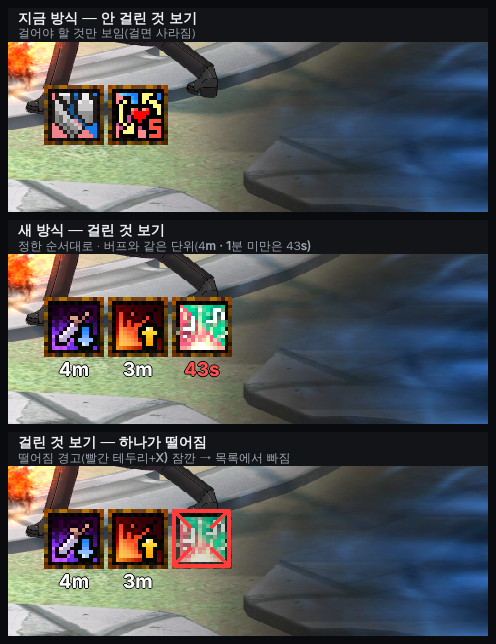
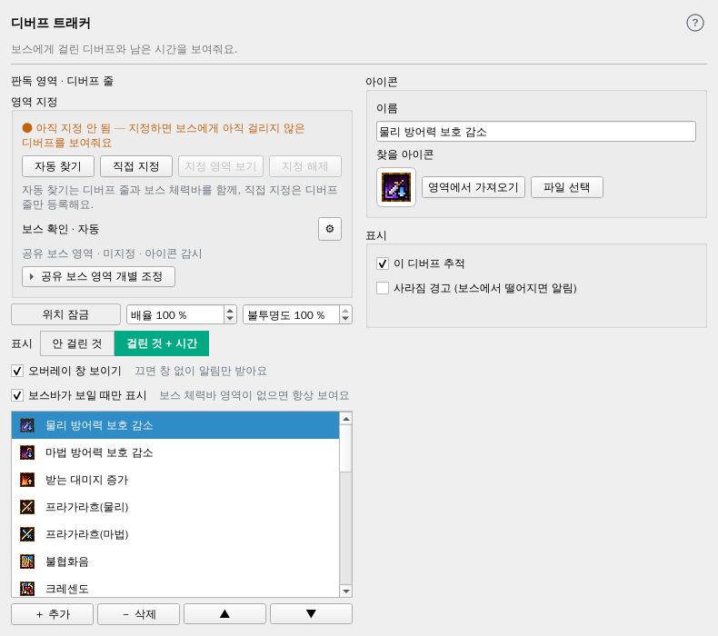
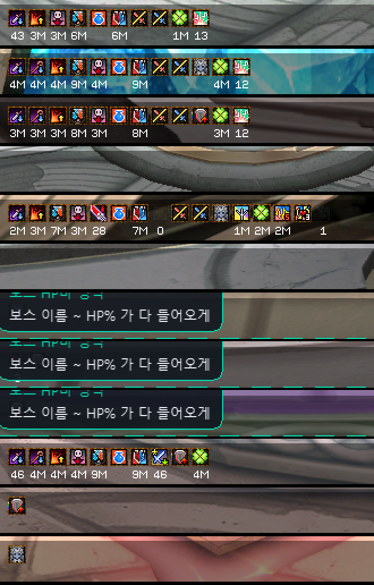

# 디버프 오버레이 — '걸린 것 + 시간' 보기

- 작성: 2026-11-08 (기획 세션). 상태: **0.45.0부터 모든 사용자 공개(사용자 결정 11-10, 노트에 베타 표기)** — 아래 4절 구현 메모.
  '표시 [안 걸린 것 | 걸린 것 + 시간]' 기본 `안 걸린 것`. 초→분 의심 판독 자동 저장(진단)은 제작자 전용 그대로.
- 사용자 요청(11-08): 지금은 걸고 싶은 디버프를 정해 두고 보스에게 걸면 오버레이에서 사라지는 방식. 버프 오버레이처럼 **안 보이다가 걸리면 나오고, 보스 디버프 줄의 시간을 읽어 그대로** 보여 주기.
- 사용자 결정(11-08):
  1. 지금 방식과 **고르게**(대체 아님).
  2. 순서는 지금처럼 **사용자가 정한 순서**.
  3. 시간은 게임 표시 그대로(분 단위), **마지막 1분만 초**. 단위는 **버프 오버레이와 같게**(`4m`, `43s`) — 다른 단위를 섞지 않음.
  4. 중첩 디버프는 **지금처럼 최종 단계 아이콘으로 걸림을 판정**(바꾸지 않음).
  5. 제작자 먼저.

## 1. 화면

실제 `BuffOverlay` 위젯(배율 150%)에 내장 디버프 아이콘과 예시 값을 넣어 렌더. 배경은 `tests/data/image01.png` 일부.

| 항목 | 결정 |
| --- | --- |
| 방식 선택 | 디버프 탭 `위치 잠금 · 배율 · 불투명도` 줄 아래 `표시 [안 걸린 것 \| 걸린 것 + 시간]`(커서 탭과 같은 세그먼트). 기본 `안 걸린 것`. 제작자에게만 보임. |
| 탭 설명 | 방식에 맞게: `보스에게 아직 걸리지 않은 디버프를 보여줘요.` / `보스에게 걸린 디버프와 남은 시간을 보여줘요.` 영역 안내 문구('지정하면 … 아직 걸리지 않은 …')도 같이 바꿈. |
| 걸린 것 + 시간 | 걸림 판정된 등록 디버프만 **정한 순서대로**. 아이콘 아래 시간: 1분 이상 `4m`, 1분 미만 `43s`(버프처럼 빨간 숫자), 시간 없는 디버프·못 읽음은 아이콘만. |
| 떨어짐 | 지금의 사라짐 경고(빨간 테두리+X, `사라짐 경고` 체크 시)를 잠깐 보여 주고 목록에서 뺀다. 경고를 끈 디버프는 바로 뺀다. |
| 그대로 | 걸림 판정(임계·0.3초 확인·아이콘별 임계·짝 구분), 중첩은 최종 단계 아이콘으로 판정, 배율·불투명도·잠금·창 보이기, `보스바가 보일 때만 표시`. |

## 2. 시간 읽기

- 게임 표시: 1분 이상 `NM`(1~9M), 1분 미만 `NN`/`N`(초). 시간이 없는 디버프는 글자 없음.
- 읽는 곳: 엔진이 찾은 **각 아이콘의 바로 아래 칸**(아이콘 폭 기준으로 잘라 옆 칸 글자와 분리 — `4M4M3M`처럼 붙어도 칸으로 나눔).
- 글자: 작은 픽셀 글꼴 `0~9`·`M` 11개 — `tests/data` 보스 화면 디버프 줄(65장, 중복 제거)에 모두 있음 → 템플릿·회귀 자료로 사용(새 자료 요청 없음).
- 표시 변환: `4M` → `4m`, `43` → `43s`(`duration.format_duration`의 초 표기와 같게), `0`도 `0s`.
- 못 읽음(밝은 바닥·이펙트): 숫자 없이 아이콘만. **틀린 숫자를 보이지 않는다**(확신 낮으면 비움).
- 비용: 걸린 디버프 수만큼 작은 칸 템플릿 비교 — 1ms 미만, 엔진과 같은 스레드(화면 스레드면 작업 스레드로 옮길지 개발 판단, 16ms 규칙).

## 3. 테스트
- 시간 판독 회귀: `tests/data` 디버프 줄에서 아이콘별 기대값(`4M`·`43`·`0`·없음), 붙은 글자(`4M4M3M`) 칸 나누기, 밝은 바닥 화면 → 비움.
- 방식 전환: 같은 프레임 열로 `안 걸린 것`/`걸린 것` 결과가 서로 보완(합치면 추적 대상 전체), 순서는 사용자 순서.
- 떨어짐: 걸림 → 미검출 3초 → 경고 5초 → 빠짐, 경고 끈 디버프는 바로 빠짐.
- 비제작자: 선택 줄 없음·지금 동작 그대로.
- 화면: 구현 후 탭·오버레이 렌더로 사용자 확인.

## 4. 구현 메모 (2026-11-08)

- 설정 `overlay.debuffDisplay`(`missing` 기본 | `applied`). 제작자가 아니면 탭이 늘 `missing`을 엔진에 준다(선택 줄 없음·문구 그대로).
- 엔진(`tracker/debuff_engine.py`): 걸림 판정은 그대로, 매칭한 아이콘 자리만 기록. `applied`면 걸린 것만 정한 순서로 + 시간, 경고 켠 것은 떨어짐 확정(3초)까지 그대로 → 경고 5초 → 빠짐, 끈 것은 깜빡임 방지(0.4초) 뒤 빠짐.
- 시간 판독(`detect/debuff_time.py`): 아이콘 아래 띠의 흰 글자(밝고 + 3×3 안에 60 이상 어두운 테두리 — 밝은 바닥 제외)를 덩어리로 나눠 같은 크기 템플릿과 픽셀 비교, 붙은 글자는 템플릿 폭으로 나눔.
  칸 안 흰 픽셀을 글자로 설명 못 하면 비움. 작업 스레드(디버프 추적 QThread)에서, 중앙 0.17ms(tests/data 43장).
- **글꼴이 두 크기**(7px — 10-12·10-18 등, 9px — 10-09·11-03·11-09 4K): 템플릿 `assets/debuff_time_glyphs/{글자}_s0`·`_t0~2`. 9px 글꼴의 `7`은 tests/data에 없어 아직 못 읽음(비움).
- **게임 글꼴에 따라 분도 M 없이 숫자만**(`4`·`9`) — 10-30·10-31 4K 6장(213520·213942·214016·214051·214648·0055251)은 매끈한 큰 글꼴로 숫자만, 같은 4K·같은 보스바 자리 11-09(000141)는 픽셀 글꼴로 `4M` → 해상도가 아니라 게임 글꼴 차이(QA e98aac6). 한 장으로는 초와 구별할 수 없어, M 없는 숫자는 **실제로 줄어드는 것을 본 뒤에만** `Ns`(빨강)로 보인다(같은 숫자가 2.5초 넘게 그대로면 숨김). `NM`은 바로 `Nm`.
- 렌더: [탭(제작자·걸린 것)](assets/debuff-applied-20261108/tab-creator-applied.png) · [탭(비제작자)](assets/debuff-applied-20261108/tab-user-missing.png) · [실제 판독 오버레이](assets/debuff-applied-20261108/overlay-real.png).

