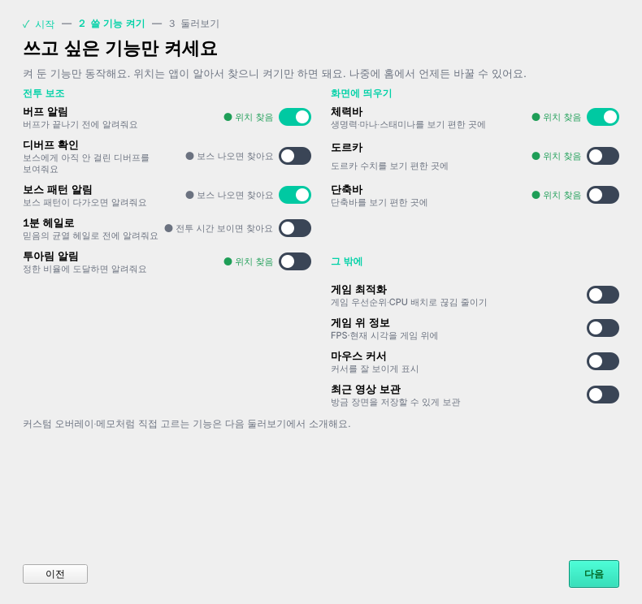
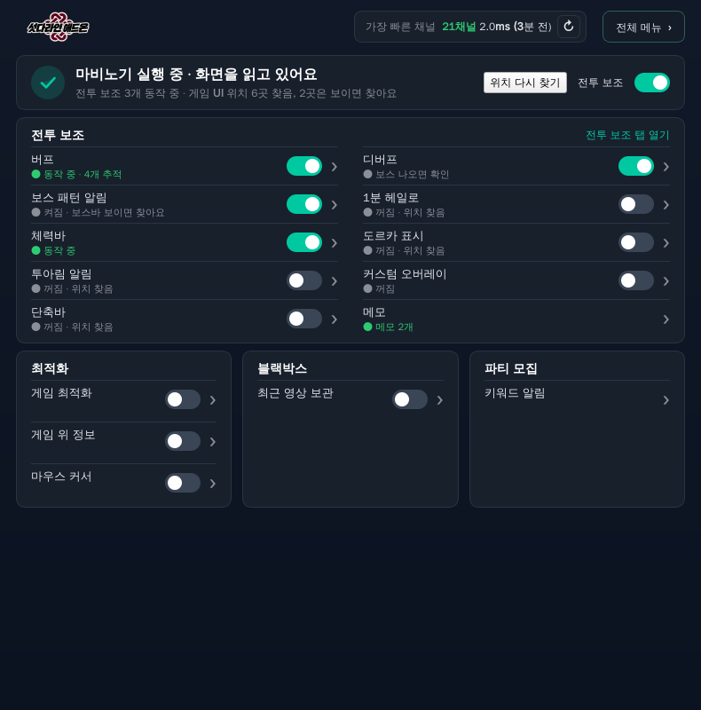

# 첫 사용 안내 v3 — 자동 찾기 공개

- 작성: 2026-11-09 (기획 세션). 상태: **기획 확정(11-09 사용자 결정), 미구현 — 개발 대상.** 모든 사용자 공개(한 번에).
- 배경: 자동 찾기 v2를 제작자가 켜 두고 써 본 결과 큰 문제 없음(사용자 11-09) → 공개 때 들어갈 첫 사용 안내를 미리 준비.
- 근거: [자동 찾기 v2 명세 0·0.1·2.1절](autofind-v2-creator-spec.md)(최종 방향·첫 사용 시안·사용 값 분리), [버프·디버프 탭 배치 17절](app-copy-help-combat-controls-spec.md).

## 1. 공개 전에 있어야 하는 것 (첫 사용 v3의 전제)
| 항목 | 지금 | 공개 때 |
| --- | --- | --- |
| 자동 찾기 v2 | 제작자 전용 스위치(설정 › 일반) | 모든 사용자, **항상 켬(스위치 없음 — 4.1)**, 못 찾으면 저장된 영역(v1) 사용(6절) |
| 기능 사용 값 분리 | v2 켬일 때만 버프·디버프·보스 패턴·1분 헤일로·단축바에 사용 값 + 홈 스위치 | 모든 사용자. 처음 값 = '지금 영역이 있으면 켜짐'(동작 변화 없음) |
| 홈 상태 문구 | '판독 영역을 지정해야 동작해요' 경고 상자 | v2 켬: `꺼짐 · 위치 찾음` / `켜짐 · 동작 중` / `켜짐 · 화면에 보이면 찾아요` / `켜짐 · 못 찾음 — 기능 화면에서 맞추기` |
| 게임 창 연결 | 시작 팝업에서 목록 고르기 | 마비노기 창이 **하나면 자동 연결**, 여러 개·없음일 때만 고르기(D6) |

## 2. 안내 화면 (0.1 시안 확정본 문구)

```
1 시작 — 2 쓸 기능 켜기 — 3 둘러보기
```

### 2.1 1단계 시작
- 제목: `마비노기 애드온에 오신 걸 환영해요`
- 본문: `이 앱은 게임 화면을 읽기만 해요. 버프 목록·단축바·체력바 같은 위치는 앱이 알아서 찾아요.` / `영역을 직접 지정할 필요 없이, 다음 화면에서 쓰고 싶은 기능만 켜면 끝이에요.`
- 게임 창 상자: `● 마비노기 창을 찾았어요 — <창 이름> (<해상도>)` / 못 찾음: `● 마비노기를 켜 주세요 — 켜면 자동으로 연결돼요` / 여러 개: 목록에서 고르기.
- 알아 두면 좋아요(회색 3줄):
  - `캐릭터로 접속해 있으면 화면에 보이는 UI부터 찾아요. 처음 찾는 동안 잠깐 CPU를 더 써요.`
  - `보스 체력바·전투 시간은 화면에 처음 나타날 때 찾아요.`
  - `게임 안에서 창을 옮겨도 다시 찾아요. 잘못 찾으면 각 기능 화면에서 직접 맞출 수 있어요.`
- 버튼: `나중에 하기` / `다음`.

### 2.2 2단계 쓸 기능 켜기
- 제목 `쓰고 싶은 기능만 켜세요`, 부제 `켜 둔 기능만 동작해요. 위치는 앱이 알아서 찾으니 켜기만 하면 돼요. 나중에 홈에서 언제든 바꿀 수 있어요.`
- 스위치는 **홈과 같은 값**. 새 사용자 기본 모두 꺼짐.
- **찾기 상태 표시(D5 결정)**: 화면을 읽는 8개 줄은 스위치 왼쪽에 작은 상태 — `● 위치 찾음`(초록) / `● 보스 나오면 찾아요`·`● 전투 시간 보이면 찾아요`(회색) / 게임 UI가 안 보이는 동안 `● 게임에 접속하면 찾아요`(회색, '못 찾음'으로 보이지 않게). 안내를 켜 둔 채 접속하면 그 자리에서 초록으로 바뀐다. '그 밖에' 4개는 상태 없음.

  

| 묶음 | 기능(홈 이름) | 한 줄 설명 |
| --- | --- | --- |
| 전투 보조 | 버프 | 버프가 끝나기 전에 알려줘요 |
|  | 디버프 | 보스에게 아직 안 걸린 디버프를 보여줘요 |
|  | 보스 패턴 알림 | 보스 패턴이 다가오면 알려줘요 |
|  | 1분 헤일로 | 믿음의 균열 헤일로 전에 알려줘요 |
|  | 투아림 알림 | 정한 비율에 도달하면 알려줘요 |
| 화면에 띄우기 | 체력바 | 생명력·마나·스태미나를 보기 편한 곳에 |
|  | 도르카 표시 | 도르카 수치를 보기 편한 곳에 |
|  | 단축바 | 단축바를 보기 편한 곳에 |
| 그 밖에(D4) | 게임 최적화 | 게임 우선순위·CPU 배치로 끊김 줄이기 |
|  | 게임 위 정보 | FPS·현재 시각을 게임 위에 |
|  | 마우스 커서 | 커서를 잘 보이게 표시 |
|  | 최근 영상 보관 | 방금 장면을 저장할 수 있게 보관 |

- 넣지 않는 것: 커스텀 오버레이·메모(직접 고르는 기능 — 둘러보기에서 소개), 파티 키워드 알림(설정이 필요한 기능), 제작자 전용 기능(쿨타임·보스바 오버레이 — 공개 때 추가).
- 아래 회색 한 줄: `커스텀 오버레이·메모처럼 직접 고르는 기능은 다음 둘러보기에서 소개해요.`
- 버튼: `이전` / `다음`.

### 2.3 3단계 준비 끝
- 제목 `준비 끝!`, `켠 기능: <이름 · 이름 …>`(없으면 `아직 켠 기능이 없어요 — 홈에서 언제든 켤 수 있어요`), `게임 화면에 보이면 앱이 위치를 찾고 바로 동작해요.`
- 둘러보기에서 알려 드릴 것(아래 3절 순서와 같게).
- 버튼: `둘러보기 없이 시작` / **`앱 둘러보기 시작`**(기본). 회색: `둘러보기는 설정 › 일반에서 언제든 다시 볼 수 있어요.`

## 3. 둘러보기(투어) 새 순서 — 지금 7단계 대체
| # | 가리키는 곳 | 제목 | 문구 |
| --- | --- | --- | --- |
| 1 | 홈 전투 보조 칸 | 기능 켜고 끄기 | `여기서 기능을 켜고 꺼요. 줄마다 지금 상태(동작 중·화면에 보이면 찾아요)가 보여요.` |
| 2 | 홈 줄의 `›` | 세부 설정 | `줄을 누르면 그 기능 화면으로 가요. 알림 시간·소리·오버레이 크기를 바꿀 수 있어요.` |
| 3 | 버프 탭 `[영역 다시 지정]` | 위치가 틀릴 때 | `앱이 잘못 찾았으면 여기서 다시 찾거나 직접 맞출 수 있어요.` |
| 4 | 버프 탭 `위치 잠금` | 오버레이 위치 잠금 | `오버레이를 원하는 곳에 옮긴 뒤 잠그면 클릭이 게임으로 통과해요.` |
| 5 | 전투 보조 2단 탭(커스텀·메모) | 직접 고르는 기능 | `게임 화면 일부를 따로 띄우는 커스텀 오버레이와 메모는 원하는 곳을 직접 골라 써요.` |
| 6 | 1단 탭 줄 | 그 밖의 기능 | `파티 모집·편의기능(계산기·그림대화 만들기)·최적화·블랙박스도 둘러보세요.` |
| 7 | 상단 `● 전투 보조: 켜짐` | 잠깐 쉬기 | 지금 문구 그대로 |
| 8 | 설정 › 일반 `안내 다시 보기` | 다시 열기 | 지금 문구 그대로 |

## 4. 기존 사용자
- 첫 사용 안내는 **새 설치에만**(기존 완료·보류 기록 그대로). 기존 사용자에게 다시 띄우지 않는다.
- 기존 사용자의 자동 찾기 v2 켜짐 여부는 D2. 업데이트 노트 헤드라인으로 알린다(예: `이제 위치를 앱이 알아서 찾아요`).
- 지금 5단계 안내·영역 승인 창(`SetupFlow`)·'다른 기능' 카드는 v3와 함께 없앤다. 각 탭의 `자동 찾기`·`직접 지정`은 그대로(영역 다시 지정 안).

## 4.1 자동 찾기 켜고 끄기 자리 (사용자 질문 11-09 — 설정에 두는 게 어색함, 홈? → 제안)
- **켜고 끄는 스위치를 없앤다(항상 켬).** 최종 방향에서 자동 찾기는 '기능'이 아니라 앱의 기본 동작이다. 홈 기능 줄 사이에 스위치로 두면 '버프 같은 기능 하나'로 보이고, 설정 깊은 곳은 존재를 모른다.
- **홈 상태 카드에 결과만 보인다**: `전투 보조 3개 동작 중 · 게임 UI 위치 6곳 찾음, 2곳은 보이면 찾아요` + `[위치 다시 찾기]`(처음 찾기 한 번 더). 각 기능 줄 상태(`꺼짐 · 위치 찾음` 등)와 함께 보면 충분.
- **틀릴 때 되돌릴 길 = 기능별 '직접 지정 고정'**: 기능 화면 `[영역 다시 지정]`에서 직접 지정하면 그 기능은 **고정**(자동이 덮지 않음, 다음 실행에도 유지). 위 1줄에 `직접 지정 · [자동으로 돌아가기]`.
  → 전체를 끄는 스위치가 필요한 상황(한 기능이 계속 틀림)을 기능 단위로 해결.
- 제작자 진단(항목별 상태·처음 찾기 시간·CPU·찾은 자리 보기)은 지금 v2 구역을 **진단 · 자동 찾기**(제작자, 맨 아래 접힘)로 옮긴다.
- **홈에도 넣음(사용자 결정 11-09 — 첫 사용과 홈 둘 다)**: 기능 줄 상태에 위치 문구(1절 표) + 상태 카드 요약(켜진 기능 기준) + `[위치 다시 찾기]`.

  

## 5. 결정
- **D1 결정(11-09)**: v2 + 사용 값 분리 + 첫 사용 v3 + 스위치 없애기를 **한 번에** 공개(v1 대비책 포함).
- **D2·D3 결정(11-09)**: 켜고 끄는 스위치 없음(항상 켬) + 홈 상태 카드 요약·`위치 다시 찾기` + 기능별 '직접 지정 고정'. 기존 사용자의 직접 지정 영역은 **자동으로 바꿈**(사람마다 크게·작게 잡았을 수 있음) — 단 v2가 못 찾으면 그 영역(v1)을 씀.
- **D4 결정(11-09)**: 2단계에 '그 밖에' 4개 포함.
- **D5 결정(11-09, 렌더 비교 후)**: 첫 사용 2단계와 홈 **둘 다** 찾기 상태를 보인다(2.2·4.1).
- **D6 결정(11-09)**: 마비노기 창을 자동으로 연결할 수 있으면 연결(보통 하나).

## 6. 스위치 없애기(항상 켬) 검토 — 2026-11-09 기획 세션
사용자: 기존 직접 지정 영역은 **자동으로 바꿈**(사람마다 크게·작게 잡았을 수 있음). 스위치 없애는 안은 좋지만 검토가 많이 필요.

| # | 위험 | 지금 코드(11-09 main) | 대책(제안) |
| --- | --- | --- | --- |
| 1 | 잘못 찾음 → 엉뚱한 곳을 읽음 | 89장 측정 엉뚱한 곳 0건(11-03). 새 자리는 3초 연속 판독 후 확정 | 기능별 '직접 지정 고정' + `자동으로 돌아가기`. 고정이 생기기 전에는 스위치를 없애지 않는다 |
| 2 | 다시 찾기 간격 — **결정: '계기'로(6.1)**(사용자 11-09: 로그인·캐릭터 선택 화면에서 실패가 쌓이면 접속 뒤 1분, 5분이면 5분 못 찾음) | 10초 → 3회 실패 후 1분 간격, 실패는 게임이 앞에 있으면 화면 종류와 상관없이 셈 | **간격 대신 '계기'로**: ① 게임 UI가 통째로 안 보이는 동안(로그인·캐릭터 선택·로딩)은 **실패로 세지 않고** 가벼운 'UI 보이나' 확인만 2~3초마다(수 ms) ② UI가 다시 보이는 순간 **모든 실패 횟수를 0으로** 하고 못 찾은 항목을 바로 찾음(다음 시도 시각을 기다리지 않음) ③ 게임 창이 다시 앞에 오거나 크기가 바뀔 때도 같은 '즉시 확인' ④ UI는 보이는데 그 항목만 없을 때(상태창 닫음 등)만 화면 전체 찾기를 10초×3 → 1분으로 늘림. 같은 자리로 다시 열면 기능이 원래 자리를 계속 읽고 있어 바로 복구됨 |
| 3 | 처음 찾기 CPU(도르카·투아림 전체 탐색 수 초) | 상한 20초, 작업 스레드 | 그대로. 시작 직후 커서 끊김 없는지 `[계산·화면]` 로그 확인 |
| 4 | 기존 사용자 업데이트 직후 못 찾는 항목 | 해당 없음(새 기능) | 아래 'v1 대비책' — v2가 못 찾으면 저장 영역으로 계속 동작 |
| 5 | 디버프 영역 폭 | 디버프 줄 = 보스바에서 계산 | 아이콘 20개 넘는 줄도 다 들어가는지 tests/data 최대 줄로 확인 |
| 6 | 문의 시 원인 파악 | 문의 ZIP에 저장 영역만 | 자동 찾기 상태(항목별 자리·출처 last/search/user·마지막 실패 이유) `info.json`에 추가 |
| 7 | 문제 버전 배포 시 되돌릴 길 | 스위치(제작자) | 화면 스위치는 없애되 **숨은 비상 설정**(config `autofind.disabled`, 문의 응대용·화면 없음) 남김 |
| 8 | 홈 요약 숫자 | — | **켜진 기능 기준**으로만 센다(`켜진 기능 위치 3곳 찾음, 1곳은 보이면 찾아요`). 꺼진 기능은 줄 상태에만 |
| 9 | `위치 다시 찾기` 남용 | — | 도는 동안 버튼 비활성 + `찾는 중…`, 끝나면 결과 한 줄 |
| 10 | 게임 재시작 후 늦게 찾음(11-08 제보) | 원인 확인됨(status) | 공개 전 수정 확인 |

**공개 방식(사용자 결정 11-09)**: 두 단계 없이 **한 번에**(사용량이 많지 않은 앱 — 안 되면 직접 지정). 스위치도 같은 버전에 없앤다(4.1).

**v1 대비책(사용자 제안 11-09)**: 영역은 v2로 찾고, **못 찾으면 저장된 영역(v1)을 쓴다.**
| 순서 | 무엇 | 비고 |
| --- | --- | --- |
| 1 | v2 지난 자리(`autofindV2.last`) | 수 ms |
| 2 | v2 찾기(화면 전체) | 처음 찾기·다시 찾기 규칙 그대로 |
| 3 | **못 찾음 → 저장된 영역(v1)이 있으면 그 자리로 읽기** | 상태 `저장된 영역 사용 · 자동으로 못 찾음`. v2 다시 찾기는 계속(10초 → 1분 …), v2가 찾아 3초 확인되면 v2 자리로 바꿈 |
| — | **직접 지정 고정**(4.1) | 사용자가 기능 화면에서 직접 지정하면 v1이 그 기능의 **1순위**(v2가 덮지 않음). `자동으로 돌아가기`로 해제 |
- 새 사용자는 v1이 없으니 3이 없다(못 찾음 → 기능 화면 안내).
- v1 자리에서도 못 읽으면 지금의 '못 읽음' 상태와 같음(틀린 값은 판독기가 걸러 냄).
- 기존 사용자 업데이트 직후: v2가 찾으면 표준 크기 자리(영역을 크게·작게 잡았던 것 해소), 못 찾는 항목만 예전 영역으로 계속 동작 → 업데이트로 기능이 끊기는 일이 없다.
- 숨은 비상 끄기 값(위 7)은 그대로 남긴다(화면 없음).

### 6.1 '계기'로 찾기 — 로딩마다 찾게 되지 않나 (사용자 질문 11-09)
- **로딩 화면을 지나도 비싼 찾기는 돌지 않는다.** 화면이 돌아온 순간 하는 일은 **지난 자리 확인(조각 하나 판독, 수 ms)**뿐이고, 마비노기 UI는 로딩 전후 같은 자리라 거의 항상 여기서 끝난다.
- **화면 전체 찾기(0.1~2초 CPU)**는 지난 자리 확인에 실패한 항목만.
- 실패 횟수는 **'UI가 보이는데 못 찾은 것'만** 센다. UI가 통째로 안 보이는 동안(로그인·캐릭터 선택·로딩)에 생긴 못 읽음은 세지 않는다.
  UI가 다시 보일 때 0으로 돌리는 것은 이 '세지 않은 구간'뿐 — **UI가 보이는데 없던 항목(상태창을 닫아 둠 등)의 간격은 그대로**(로딩마다 그 항목 화면 전체 찾기를 다시 하지 않게).
- 'UI가 통째로 안 보임' 판정: 이미 있는 'UI 보이나' 확인(`UI_CHECK_KEYS` 단축바·체력바를 지난 자리 여백 조각에서 찾기, 수 ms)을 2~3초마다. 둘 다 없으면 안 보임.
  사용자가 단축바·체력바를 일부러 숨긴 경우를 위해 '다른 찾은 항목이 하나라도 읽히면 보임'도 함께 본다.
- 확인 자료: 로그인·캐릭터 선택·로딩 화면 스크린샷이 있으면 'UI 안 보임' 판정 테스트에 쓴다(없으면 게임 아닌 화면·빈 화면 가짜 프레임으로).
- 테스트: 가짜 프레임 열 '게임 → 로딩 3초 → 게임'에서 화면 전체 찾기 0회, '로그인 2분 → 게임'에서 접속 후 3초 안에 처음 찾기, '상태창 닫힘 → 로딩 반복'에서 버프 찾기 간격 유지.

## 7. 둘러보기 렌더
둘러보기는 지금 카드(`TourOverlay`)를 그대로 쓰고 3절 문구·가리키는 곳만 바뀐다. 개발 후 8단계를 렌더해 사용자 확인(새 홈 스위치·버프 탭 배치 17절이 들어간 화면 기준).
