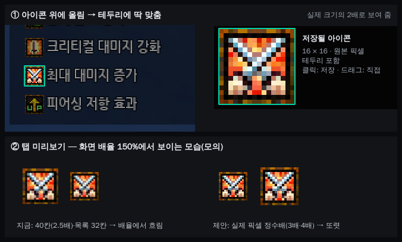

# 버프·디버프 아이콘 직접 지정 — 테두리 자동 맞춤·또렷한 미리보기

- 작성: 2026-11-06 (기획 세션). 상태: 기획, 미구현. 사용자 요청(11-06): 직접 지정할 때 이미지가 뚜렷하지 않음 → 원본 그대로, 아이콘 테두리에 맞게 자동 조절.
- 대상: 버프 탭·디버프 탭의 `매칭 아이콘` 화면에서 집기(`buff_tab._capture_icon_to` → `RegionSelector(save_path=…)` 크롭 모드).

## 1. 지금 (코드 확인)
| 항목 | 지금 | 결과 |
| --- | --- | --- |
| 저장 | `_save_crop`이 스냅샷을 **물리 픽셀 그대로** 잘라 PNG 저장(확대·축소 없음) | 파일 자체는 원본. 대신 손으로 드래그한 크기 그대로(예: 18×15, 배경 섞임) |
| 내장 아이콘 | `assets/buff/icon`·`assets/debuff/icon`은 **테두리(갈색 점선)까지 포함한 16×16** | 직접 집은 아이콘이 16×16 테두리와 어긋나면 매칭 기준이 내장 아이콘과 달라짐 |
| 탭 미리보기 | `_pixmap`이 최근접으로 버프 목록 32칸(2배), 디버프 목록 **28칸(1.75배)**, 아이콘 칸 **40칸(2.5배)** | 정수배가 아니라 픽셀 줄이 고르지 않고, Windows 배율 125·150%에선 Qt가 한 번 더 부드럽게 늘려 **흐려짐**(Likely — 사용자 화면 확인 필요) |
| 선택창 | 화면 전체 어둡게(알파 110), 드래그한 칸만 밝게, 커서 옆 6배 돋보기 | 16px 아이콘을 손으로 정확히 감싸기 어려움 |

## 2. 바꿀 것

①은 `tests/data/2026-11-03_나눔고딕_1080_시간없는목록.png` 실화면, 테두리는 아래 2.1 방식으로 실제 찾은 위치. ②는 150% 배율을 흉내 낸 모의.

### 2.1 테두리 자동 맞춤 (아이콘 집기 모드에서만)
- 마우스 아래에 **테두리 있는 16×16 아이콘**이 있으면 그 칸만 밝게 + 민트 테두리, 커서 옆 돋보기 자리에 **'저장될 아이콘'(16×16을 8배, 원본 픽셀)** 미리보기.
- **클릭 = 그 16×16을 그대로 저장**(확인 버튼 없음). **드래그 = 지금처럼 직접**. 아이콘이 아닌 곳 클릭은 아무 일 없음.
- 찾는 법: 내장 16×16 아이콘들의 **테두리 2px 고리 평균**을 틀로, 커서를 포함하는 16×16 후보(가로·세로 각 16자리)와 마스크 비교(`cv2.matchTemplate` TM_SQDIFF + 마스크). 거리 기준(제안 30) 넘으면 '아이콘 아님'.
- 기획 세션 시험(이 컨테이너): 1080 상태 목록 아이콘·펠롬 디버프 줄 아이콘 클릭 5곳 모두 테두리에 정확히 맞음(거리 4.3~4.4, 가려진 이웃 있는 칸 24.8), 아이콘 사이 빈칸 클릭은 57.8로 걸러짐. 1회 0.2~0.6ms → 마우스 움직일 때 화면 스레드에서 해도 됨(16ms 한참 아래).
- 4K: 상태 목록·디버프 아이콘이 4K에서 더 크게 그려지는지 `tests/data` 4K 화면으로 확인하고, 크면 그 크기(예: 32) 후보를 추가. 저장은 화면에 보이는 원본 크기 그대로.
- 클릭 경계 맞춤(0.43.0, 커스텀 오버레이·쿨타임)과 같은 선택창 구조(`_hover`·민트 테두리)를 재사용하고, 대상만 '아이콘'으로.

### 2.2 미리보기를 원본 픽셀 정수배로
- 아이콘 칸·목록 칸의 실제 물리 픽셀 수(논리 크기 × 화면 배율)에 맞춰 **원본을 정수배(최근접)로만** 키우고 `devicePixelRatio`를 맞춰 Qt가 다시 늘리지 않게 한다.
  예: 150%·아이콘 칸 40 → 물리 60 → 16×3=48로 그리고 가운데 정렬. 100% → 16×2=32.
- 대상: 버프·디버프 목록 아이콘, 아이콘 칸(매칭 아이콘·표시 이미지). 표시 이미지(40×40 등 큰 그림)는 칸보다 크면 지금처럼 줄이되 부드럽게.
- 버프·디버프 **오버레이**의 아이콘 그리기도 같은 문제가 있는지 개발이 확인(배율 50~300%) — 있으면 같은 방식, 없으면 그대로.

## 3. 테스트
- 회귀: 1080 상태 목록·펠롬 디버프 줄에서 클릭 좌표 → 기대 16×16 상자, 빈칸·글자 위 클릭 → 없음, 4K 화면(확인 후).
- 저장: 자동 맞춤 클릭 시 파일이 정확히 16×16이고 스냅샷 해당 픽셀과 같음. 드래그 저장은 지금과 같음.
- 미리보기: 배율 100·125·150·200%에서 그린 픽셀이 원본의 정수배인지(오프스크린 `devicePixelRatio` 주입).
- 화면: 선택창(아이콘 위)과 탭 미리보기를 렌더해 사용자 확인.
