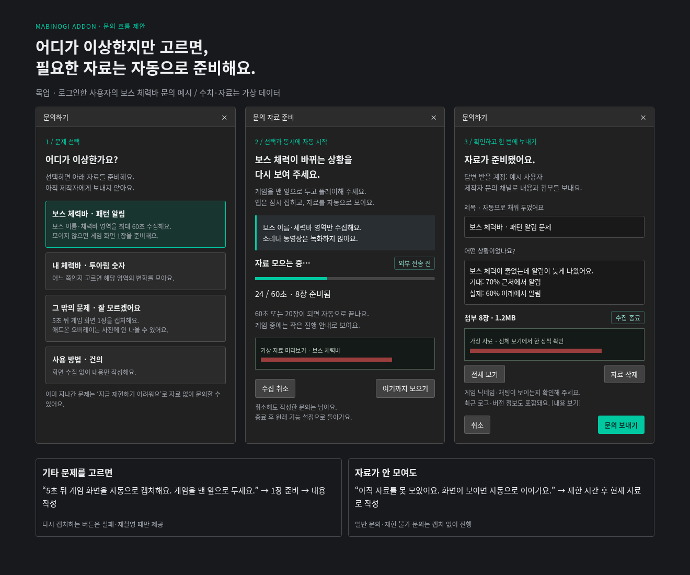

# 문의 자동 진단 흐름

- 작성: 2026-11-03. 상태: 기획 초안 보관, 미구현·미배포.
- 사용자 확정 요구: 문의에서 문제를 선택하면 기존 수집 가능한 기능은 재현 자료를 모으고, 그 외는 자동 화면 캡처. 별도 최초 수집/캡처 버튼이나 설정·폴더 탐색을 요구하지 않음.
- 추천안: 아래의 분류 묶음, 진단 로그인 제한 유지, 예외 복구·전송 정책과 시간/장수/용량 상한. 기획 푸시는 추천안 전체의 확정이나 구현 승인이 아님.
- 미검증: 자동 연동·종료/복원·이미지 업로드, Windows 게임 캡처와 오버레이 증거 확보.
- 함께 검토: [쿨타임 오버레이](cooldown-overlay-spec.md).

사용자는 “어디가 이상한가요?”만 고릅니다. 기존 수집이 가능한 기능은 재현 중 자료를 모으고, 그 밖의 문제는 게임 화면을 자동 캡처합니다. 자료는 마지막 **문의 보내기**에서 내용과 함께 전송합니다.

문제 선택 → 자동 자료 준비 + 재현 안내 → 내용·첨부 확인 → 문의 보내기

설정 탐색, 수집 모드 켜기, 최초 캡처 버튼, 폴더 찾기, 중복 동의 팝업을 요구하지 않습니다. 정상적인 플레이·게임을 앞으로 가져오기와 내용 입력은 사용자가 합니다. 아래 수치 중 ‘제안’은 기존 기능의 확정값이 아닙니다.

## 1. 첫 화면과 진단 경로

문의 진입은 기존 설정의 문의 화면을 기준으로 합니다. 제작자 도움말과의 연결은 제안이며, 홈 옆 톱니 설정 버튼·제작자 클릭 문의 안내·자동 잡담·상세 음량은 미결정 논의로 남깁니다. 이번 명세가 해당 기능을 확정하지 않습니다. 문제 항목을 기본 선택하지 않고, 사용자가 실제 선택할 때만 시작합니다.

| 첫 선택 | 선택지에서 미리 알릴 내용 / 자동 동작 | 재현 안내 |
| --- | --- | --- |
| 보스 체력바 · 패턴 알림 | “보스 이름·체력바 영역을 최대 60초 모아요. 모이지 않으면 게임 화면 1장을 준비해요.” → 보스 수집 경로 | 보스가 식별되고 체력이 변하는 장면을 보여 주세요. 알림의 기대 시점·실제 시점을 적어 주세요. |
| 내 체력바 · 투아림 숫자 | 내 체력바 / 투아림 중 하나를 선택. 각 선택지에 대상 영역·시간·미수집 시 게임 1장 안내. 두 번째 선택이 자동 시작점. | 내 체력바: 생명력·마나·스태미나가 변하는 장면. 투아림: 게이지 숫자가 변하는 장면. 한 바퀴를 강제하지 않음. |
| 그 밖의 문제 · 잘 모르겠어요 | “5초 뒤 게임 화면 1장을 캡처해요. 오버레이는 안 나올 수 있어요.” → 게임 전체 1회 캡처 | 문제가 보이는 게임 화면을 맨 앞으로 두세요. 버프·디버프·도르카 등도 첫 버전에서는 이 경로. |
| 사용 방법 · 건의 | “화면 수집 없이 내용만 작성해요.” → 텍스트 문의 | 재현 요구 없음. 최근 로그도 자동 첨부하지 않음. |

첫 화면에 **지금 재현하기 어려워요**를 보조 경로로 둡니다. 이미 사라진 증상·게임 종료 상태에서는 과거 화면을 복구할 수 없으므로, 당시 시각·기능·기대/실제 동작을 적고 화면 없이 보냅니다. 예전 수집 폴더를 자동으로 뒤져 첨부하지 않습니다.

## 2. 진행·종료·취소

| 상태 | 동작과 사용자 안내 |
| --- | --- |
| 준비 | 선택 직후 로그인·영역·게임 상태·다른 수집 여부 검사. “5초 뒤 시작해요” 카운트다운과 수집 범위 표시. 문의 창을 접고 게임 전면 전환을 기다림. 별도 시작 클릭 없음. |
| 수집 중 | 작은 진행 안내에 경과/최대 시간, 실제 저장 장수, “아직 전송하지 않았어요” 표시. 게임 입력을 가로막지 않음. 진행 안내에서 문의로 돌아올 수 있고 초안 유지. **여기까지 모으기**는 현재 자료 유지 후 종료, **수집 취소**는 해당 회차 자료 폐기 후 작성 화면. |
| 자동 종료 | **제안: 수집 60초·20장·임시 자료 합계 8MiB 중 먼저 도달**. 변경 프레임만 저장하고 초당 최대 1장. 게임 대기 포함 전체 준비 시간은 90초 상한. 보스 미식별·변화 없음은 진행 안내에 이유 표시, 빈 자료를 성공으로 표시하지 않음. |
| 대기·시간 초과 | 게임 비활성·최소화·캡처 불가 시 저장 일시정지. 유효한 게임이 돌아오면 같은 회차에서 재개. 상한 도달 시 현재 자료로 작성 화면 복귀. 0장이면 사전에 고지한 게임 1장 경로로 전환하되 남은 준비 시간 안에서만 실행. 유효한 게임이 없으면 이미지 없이 진행. |
| 완료 | 자료를 자동 첨부하고 “수집을 끝냈어요” 표시. 사용자가 입력 중이면 포커스를 빼앗지 않음. 게임 중이면 완료 안내만 남기고 강제로 창을 띄우지 않음. 제목은 문제명으로 자동 입력, 내용은 기대/실제 동작 중심으로 작성. |
| 종료·분류 변경 | 닫기·Esc·로그아웃·앱 종료·게임 프로세스 변경·치명적 오류 때 문의 소유 작업을 즉시 중단. 다른 문제 선택은 이전 작업 종료 후 새 안내로 시작. 입력 내용 유지, 이전 회차 이미지는 제거. 일반 문의로 변경하면 화면·진단 로그 첨부도 제거. |

**복원 원칙:** 문의가 시작한 수집만 자동 종료합니다. 시작 전 기능 켜짐·일시정지·창 상태를 기록하고, 이번 문의가 바꾼 임시 상태만 되돌립니다. 사용자가 도중에 바꾼 설정을 덮어쓰지 않습니다. 알림·오버레이를 강제로 켜지 않고 진단용 읽기만 임시 구동하도록 분리합니다. 파일 쓰기 작업을 정리한 뒤 첨부 목록을 확정합니다.

**중복 방지:** 문의 준비 회차는 앱에서 하나만 허용합니다. 연속 클릭·뒤로 가기·늦게 도착한 작업 결과는 같은 회차 ID로 무시합니다. 기존 수동 수집이 실행 중이면 별도 수집기를 추가하지 않고 이번 문의 시작 이후 새 프레임만 분기합니다. 기존 수동 수집은 사용자가 켠 상태로 유지하고 문의 소유 저장만 끝냅니다. 이 분기가 준비되지 않은 경우 “다른 자료를 모으고 있어요”와 자료 없이 작성 경로를 제공합니다.

## 3. 예외도 문의 안에서 해결

| 상황 | 처리 |
| --- | --- |
| 비로그인·로그인 만료 | 문의 자체는 계속 가능. 이미지 진단은 기존 로그인 제한 유지. 선택지에 “로그인 후 자동 준비” 표시하고 문의 안에서 로그인 연결. 성공하면 선택한 경로를 자동 재개. 취소/실패하면 화면 없는 문의. 로그인은 화면을 보내는 동의가 아니며 최종 전송은 별도. |
| 영역 미설정·잘못된 영역 | 설정으로 보내지 않음. 첫 버전은 안내된 게임 화면 1장으로 대체하고 “영역 미설정”을 진단 요약에 포함. 자동찾기·영역 덮어쓰기를 몰래 실행하지 않음. 필요 시 나중에 문의 안에서 영역 지정 기능을 확장. |
| 보스 미식별·기능 꺼짐·일시정지 | 보스 식별 조건 때문에 자료가 0장일 수 있음. 재현 안내 후 상한까지 기다리고 게임 1장으로 대체. 기능 꺼짐은 기존 설정을 켜서 저장하지 않고 진단 읽기를 분리해야 함. 전체 일시정지는 존중하며 이미지 없이 진행 가능. |
| 게임 미발견·등록 안 됨 | “게임 화면을 찾지 못했어요” 안내. 대기 중 유효 대상이 나타나면 자동 진행, 90초에 종료. **전체 바탕화면 대체 캡처 금지**. 게임창 등록은 문의 안의 선택적 복구 동선으로 제공할 수 있음. |
| 최소화·가림·화면 전환 | 게임 전면·동일 창/프로세스·크기를 캡처 전후 확인. 좌표 기반 캡처에는 다른 항상 위 창이 섞일 수 있으므로 strict 옵션만으로 완전한 가림 방지를 보장하지 않음. 감지되는 가림은 저장 중지, 판별 불가/빈 화면은 실패로 안내하고 자료 없이 진행. 미리보기는 항상 제공. |
| 권한 제한·지원 안 되는 기능 | 제작자 전용 헤일로/FPS 등의 전문 수집을 일반 로그인 문의로 열지 않음. 일반 게임 1장과 설명·관련 로그로 진행. OS 캡처/저장 권한 오류는 이미지 없이 문의 가능. 관리자 실행을 자동 요구하지 않음. |
| 오버레이·미러·커서 표시 오류 | 현재 캡처 제외 정책으로 화면 1장에 해당 표시가 빠질 수 있음. “이 사진에는 애드온 표시가 안 나올 수 있어요” 안내. 첫 버전은 게임 사진+관련 설정·표시 상태 로그+설명으로 접수하며 시각적 재현 증거 확보를 보장하지 않음. |

**오버레이 후속 선택지:** 정책을 유지한 채 앱 내부 표시 미리보기 렌더를 진단 자료로 추가할 수 있으나, 위치·가림·깜빡임까지 증명하지 못합니다. 실제 합성 화면 기록은 별도 설계·검토 대상입니다. 기존 캡처 제외를 자동으로 풀거나 단순 스크린샷으로 해결된다고 안내하지 않습니다.

## 4. 첨부 확인·전송·보관

- 한 장씩 확대할 수 있는 전체 미리보기, 개별/전체 삭제, 실제 장수·합계 용량 제공. 삭제한 자료는 재자동첨부하지 않음. 로그·버전·진단 요약도 펼쳐서 확인. 첫 버전은 개인정보가 보이면 삭제하고 내용으로 대체할 수 있도록 하며 자동 마스킹을 보장하지 않음.
- 게임 닉네임·채팅이 찍힐 수 있음을 선택지 아래와 전송 전 표시. 선택한 기능 영역만 우선 수집하고 오디오·영상·타 기능 이미지·과거 폴더는 수집하지 않음. 설정 전체/토큰/웹훅 주소/개인 경로 대신 허용된 진단 항목만 정리.
- 최종 **문의 보내기** 한 번으로 제목·내용·남긴 자료·로그를 제작자 문의 Discord 채널로 전송. 로그인 계정은 답변 연결에 사용. 첨부 삭제 후 텍스트만 보내기도 가능. 일반 문의에는 화면·최근 로그 자동 수집 없음.
- **제안 용량:** 최종 압축 진단 묶음 1개, 로그 포함 8MiB 이하. 수집 이미지 원본 판독 해상도는 보존. 초과하면 중복·대표 프레임 수를 줄이고 실제 남은 자료를 미리보기에서 다시 알림. 자동 분할 전송은 하지 않음. 이는 제품 상한 제안이며 수신 측 실제 제한을 배포 전에 확인해야 함.
- 현행 txt 1파일 전송을 ZIP 또는 다중 첨부로 확장해야 함. 버그 로그 포함 진단 묶음 안 파일 목록과 미리보기가 일치해야 함. 제목/내용은 현행 전송 잘림을 그대로 두지 말고 제한을 표시하거나 전체 본문을 묶음 안에 보존.
- 전송 중 버튼 잠금·진행 표시. 명확한 실패는 초안과 임시 자료를 유지하고 **다시 보내기** 제공, 재수집 없음. 용량 거절은 자료 줄이기 또는 이미지 없이 보내기. 응답 유실/타임아웃은 “전송 여부를 확인하지 못했어요”로 구분, 무조건 자동 재전송하지 않음. 회차 ID를 포함해 중복 문의 식별; 웹훅만으로 중복 방지를 보장하지 않음.
- 문의 전용 임시 폴더에 회차별 저장. 성공·문의 취소·첨부 삭제 때 해당 파일과 압축본 정리. 실패 시 문의가 열린 동안만 재시도용 유지, 닫을 때 삭제. 비정상 종료 잔여물은 다음 시작 때 회수(제안: 24시간 넘은 것 자동 삭제). 기존 수동 수집 자료는 정리 대상 아님. 서버 보관 기간은 별도 정책 확정이 필요하며 로컬 삭제가 서버 삭제는 아님.

## 5. 코드 확인과 새 개발 범위

2026-11-03 원격 main을 확인한 기준: `398fdeb6b3d0fc9e4d04392181e3b2af126cfd22`. 아래는 코드 조사 결과이며 Windows 실게임 실행 검증이 아닙니다.

| 현행 코드에서 확인 | 문의 연동에 필요한 새 작업 |
| --- | --- |
| 보스: 300ms 읽기, 로그인·영역·게임/앱 활성·보스 식별 조건. 정규화된 이름/체력바 영역, 평균 영상 차이 4 이상 저장. 내 체력바: 200ms 읽기, 로그인·영역·활성·일시정지 조건, 차이 5 이상 저장. 투아림: 150ms 읽기, 영역·활성 및 알림/표시 요청 조건, 차이 6 이상 저장. UI는 로그인 제한이나 저장 분기에 로그인 재검사가 없음. | 공통 세션·로그인 재검사·변경 프레임 중복 제거·시간/장수/용량 상한·실제 저장 성공 집계·자동 종료/복원. 세 기능에 문의용 자동 종료 상한은 확인되지 않음. 단순 체크박스 자동 클릭만으로 완성할 수 없음. |
| 설정 진단 스냅샷: 로그인 사용자, 앱 최소화 후 **5초**, 버프/디버프/투아림 지정 영역 PNG 로컬 저장. 영역당 3200만 픽셀 제한. | 첫 버전 일반 오류는 게임 1장으로 단순화. 향후 버프/디버프 전용 진단은 해당 영역만 선택 수집하도록 확장 가능. 기존 3영역 전체 자동 첨부는 하지 않음. |
| screen_grab의 게임 전체 캡처 재사용 가능. 기본값에는 데스크톱 fallback 존재. strict 경로는 전면/최소화/창 동일성 검사. overlay_capture는 오버레이 캡처 제외. | `require_game=True, strict_game=True` 강제, 캡처 전후 세션 취소/로그인 검사, 유효 게임 조건을 연속 수집에도 적용. 가림과 실제 Windows 캡처 검증 필요. 제외 정책 유지. |
| 문의: 제목·내용·분류, 버그 로그 자동 첨부. 로그인 없이 전송 가능. Discord multipart는 txt 파일 1개; 전송 timeout 기본 5초. | 문제별 진단 연결·초안 상태·이미지 미리보기·삭제·크기 제한·진단 묶음 업로드·정리·실패/불확실 응답 처리. 5초 전송 제한은 이미지 크기에 맞춰 검토. |

**수치 구분:** 기존 150/200/300ms는 읽기 주기이며 저장 간격 상한이 아닙니다. 기존 영상 차이 4/5/6은 수집 필터입니다. **60초·20장·초당 1장·90초·8MiB·잔여물 24시간은 모두 이번 문의 흐름의 제안값**입니다.

### 코드 근거와 검증 기준

확인 파일: inquiry_dialog.py, inquiry.py, boss_tab.py, stat_bars_tab.py, tuarim_tab.py, settings_tab.py, diag_capture.py, screen_grab.py, overlay_capture.py. 저장소 AGENTS.md·CLAUDE.md·docs/status.md·기획서 및 기존 UI 문구/팔레트·다크 화면 참고.

출처: [고정 소스 기준](https://github.com/StarlineBot/mabinogi_addon/tree/398fdeb6b3d0fc9e4d04392181e3b2af126cfd22/src/mabinogi_addon). 제작자 전용 헤일로 수집은 별도 정책이며 일반 문의 세 경로에 포함하지 않음.

개발 완료 판정: 선택 1회로 시작 / 설정·폴더 이동 없음 / 일반 문의 무캡처 / 게임 없는 상태 데스크톱 미수집 / 모든 종료 경로에서 문의 수집 해제·복원 / 중복 클릭·기존 수집 충돌 안전 / 첨부 삭제 반영 / 보내기 전 진단 자료 외부 전송 없음(로그인 인증 통신은 별도) / 실패 시 재수집 없이 초안 재시도. 실제 Windows에서 DPI·다중 모니터·최소화·항상 위 창·로그아웃·종료 중 캡처를 별도 확인.

## 목업과 확인 범위

코드 기반 정적 목업을 Chromium으로 렌더하고 PNG 픽셀을 직접 확인했다. 가상 자료·모의 게임 배경이며 실제 게임 캡처가 아니다. 기존 다크 UI·민트 강조색을 참고했다. 전달용 HTML은 데스크톱 및 390/320px에서 가로 넘침이 없음을 확인했으며, 저장소에는 유지보수용 명세와 대표 PNG만 보관한다. Windows 실게임·성능·입력 통과는 미검증이다.

## 6. 기획 세션 검토 (2026-11-05 — 현재 앱과 맞춰 본 결과)

원격 main(v0.39 이후) 코드와 다시 맞춰 봤다. **개발할 수 있다.** 5절의 코드 근거는 지금도 맞다.
- 문의는 설정 › 제작자 헤더의 `문의하기` → `InquiryDialog`이다. 분류는 `버그/기능 요청/기타`이고, 버그일 때 최근 로그 txt 1개를 첨부한다. 전송 제한 시간은 5초이고 본문은 1900자에서 자른다.
- 수집 3종(보스·내 체력바·투아림)은 로그인 사용자 노출 그대로다. 영상 차이 필터 `mean() >= threshold`도 그대로다.
- `capture_for_autofind(require_game=True, strict_game=True)`가 이미 있다. 우리 창·오버레이를 숨기고 게임 창만 찍으며, 바탕화면 대체를 막는다.

**현재 앱 결정과 맞춰야 할 점**
1. **화면 규칙**([ui-rules](ui-rules.md))
   - 목업은 HTML이다. 개발 전에 **Qt로 다시 렌더**해 확인받는다.
   - 기존 `문의하기` 대화 상자(제목·내용·분류 콤보)를 '문제 선택 → 준비 → 확인' 3단계로 바꾸므로 레이아웃 변경이다.
2. **수집 중 작은 진행 안내**
   - 새 최상위 창이다. **클릭 통과·판독 캡처 제외**(`overlay_capture`) 대상에 넣어 게임 입력과 판독을 막지 않게 한다.
   - 게임이 앞에 있을 때 보이는 규칙도 다른 오버레이와 같게 한다.
3. **보스 경로**
   - 보스바 판독은 이제 '필요한 기능이 하나라도 있으면 유지'한다([첫 사용 12.8-9](auto-setup-v2-spec.md)).
   - 문의 수집도 그 '필요한 기능'으로 등록해야 한다. 패턴·헤일로·디버프가 모두 꺼진 사용자도 문의 동안은 보스바를 읽고, 끝나면 놓는다.
   - 알림·오버레이는 켜지 않는다(3절과 같음).
4. **전송 형식**(결정 대기)
   - 디스코드 웹훅은 메시지 1개에 **첨부 10개까지**, 무료 서버 기준 **합계 약 10MB**이다(배포 전 실제 확인).
   - 20장 상한이면 개별 첨부가 넘친다. 제안: **ZIP 1개(전체 자료·로그·진단 요약) + 대표 이미지 최대 3장을 따로 첨부**해 디스코드에서 바로 보이게 한다. 8MiB 상한 안에서.
   - 전송 제한 시간은 5초에서 **업로드 크기에 맞게 늘린다**(예: 60초). 이미 작업 스레드라 화면은 멈추지 않는다.
5. **분류 대응**
   - 새 첫 화면 4가지가 지금 콤보를 대신한다(`보스 체력바·패턴 알림` / `내 체력바·투아림 숫자` / `그 밖의 문제` / `사용 방법·건의`).
   - 디스코드 쪽 분류 표시는 이 이름을 쓴다.
6. **오류·설정 자동 수집 서버**(TODO, 보류)와는 별개로, 지금 웹훅 경로만으로 만든다.

**개발 규모와 단계 제안**(결정 대기)
- 범위가 크다. 공통 회차 관리, 수집 3종 연결, 캡처, 3단계 화면, 미리보기·삭제, ZIP 전송, 정리·재시도를 모두 포함한다. 그래서 두 번에 나눈다.
  - **1단계**
    - 문제 선택 화면
    - `그 밖의 문제`(5초 뒤 게임 1장, strict)
    - `사용 방법·건의`(텍스트)
    - `지금 재현하기 어려워요`
    - 첨부 미리보기·삭제
    - 전송 확장(이미지 + 로그, 제한 시간, 실패·재시도)
    - 임시 폴더 정리
  - **2단계**: 보스·내 체력바·투아림 자동 수집 연결
    - 공통 회차
    - 60초·20장·8MiB 상한
    - 변경 프레임만
    - 기존 수동 수집과 분기
    - 보스바 판독 필요 등록
    - 종료·복원
- 1단계만으로도 "화면 보내 주세요" 요청 대부분을 대신한다. 2단계는 1단계를 실사용한 뒤 진행한다.

### 6.1 사용자 목표 확인 (2026-11-05)

> 수집 모드·진단 스크린샷이 여기저기 흩어져 있고 문의에는 로그만 붙어서, 매번 제작자가 사용자에게 직접 스샷을 받아 처리한다(서로 대면이 불편).
> **앱에서 문의할 때 문제 하나만 고르면, 진짜 문제가 있는지 수집하고 스샷을 찍어 한 번에 보내게** 하고 싶다.

**지금 흩어져 있는 수집·진단**(코드 확인):

| 위치 | 이름 | 보이는 사람 |
|---|---|---|
| 보스 패턴 | `진단 · 보스 HP바 수집` | 로그인 |
| 체력바 | `진단 · 체력바 판독 / 수집` | 로그인 |
| 도르카·투아림 | `진단 · 도르카/투아림 판독 / 수집` | 로그인 |
| 설정 | `진단 · 오류 신고용 자료`(진단 스냅샷 저장 — 버프·디버프·투아림 영역 PNG / 자동 찾기 진단 목록·ZIP 저장) | 로그인 |
| 1분 헤일로 | `진단 · 시간 자료 수집` | 제작자 |
| FPS 측정 | `진단 · 프레임 수집` | 제작자 |

**기획 세션 제안 — 문의 하나로 모으기(결정 대기)**
1. **문의가 유일한 입구**가 된다.
   - 일반·로그인 사용자 화면에서는 위 표의 로그인용 수집·진단 구역을 없앤다.
   - 제작자에게는 지금처럼 남긴다(직접 시험용).
2. **문제 선택지에 이미 있는 자료를 연결**한다.
   - 보스 체력바·패턴 → 보스 HP바 수집
   - 내 체력바 / 투아림·도르카 → 체력바·도르카/투아림 수집
   - 버프·디버프 → 진단 스냅샷(해당 영역 PNG) + 게임 1장
   - **자동 찾기·영역 지정이 안 돼요** → 이미 남아 있는 **자동 찾기 진단 기록(ZIP)** + 게임 1장(새 선택지 — 사용자가 따로 찾을 필요 없음)
   - 그 밖의 문제 → 게임 1장
   - 사용 방법·건의 → 글만
3. 6절의 1·2단계는 **개발 순서**로만 쓰고, 사용자 목표대로 **한 번에 완성해서 내보낸다**.

### 6.2 사용자 결정·화면 목업 (2026-11-05)

목업은 [`docs/assets/inquiry-unified-20261105/`](assets/inquiry-unified-20261105/)에 있다. 기획 세션의 Qt 렌더이며, 자료 썸네일은 예시 게임 화면이다.

**사용자 결정**
- **기존 분류를 살린다.** 단순 문의·제안도 있기 때문이다. 맨 위 `문의 종류`는 분할 버튼 `문제 신고 / 기능 요청 / 기타`이다.
  - 지금 콤보의 `버그`를 `문제 신고`로 바꾸는 이름 변경은 확인 대기다.
- **`문제 신고`일 때만** `어디가 이상한가요?` 카드 6개와 자동 수집을 보여준다.
  - `기능 요청`·`기타`는 제목·내용만 쓰고 바로 보낸다(단계 표시 `문의 종류 → 보내기`).
- **작은 팝업 대신 앱 크기(790×800)의 새 창**에서 준비한다. 첫 사용 안내와 같은 틀이다(제목·단계 표시·아래 버튼 줄).

**화면**
1. `step1_bug.png`: 문의 종류 + 카드 6개(2열) + `지금은 재현하기 어려워요 — 자료 없이 쓸게요` + `자료 모으기 시작`
2. `step1_feature.png`: 기능 요청은 제목·내용·`보내기`
3. `step2_collect.png`: 자료 모으는 중
   - 게임으로 가면 창은 접힌다. 앱으로 돌아오면 진행·`수집 취소`·`여기까지 모으기`·최근 자료를 보여준다.
4. `step2_chip.png`: 게임 위 작은 진행 표시
   - **클릭 통과·판독 캡처 제외**라 누를 수 있는 링크를 넣지 않는다.
   - 문구: `문의 자료 모으는 중 · 24/60초 · 8장 · 끝나면 앱에서 확인해요`
5. `step3_send.png`: 확인하고 보내기
   - 제목은 자동으로 채운다. 내용 칸이 있다.
   - 첨부 썸네일마다 `✕`, `모두 지우기`
   - `함께 보내는 정보`(앱 버전·Windows·해상도·기능 설정 요약·최근 로그) 펼쳐 보기
   - `문의 보내기`

**아직 결정 대기**: 6.1의 ① 탭의 수집·진단 구역 일원화, ② 카드 6개 구성, ③ ZIP + 대표 이미지 3장 전송, ④ `버그` → `문제 신고` 이름.

### 6.3 사용자 결정 확정 (2026-11-05) — 6.1·6.2의 결정 대기를 정리한다

1. **일원화**
   - 일반·로그인 사용자 화면에서 탭마다 있는 수집·진단 구역을 없앤다. 대상: 보스 `진단 · 보스 HP바 수집`, 체력바·도르카/투아림 `판독 / 수집`, 설정 `진단 · 오류 신고용 자료`.
   - 문의가 유일한 입구다.
   - **제작자에게는 지금 구역을 그대로 둔다**(직접 시험용, 헤일로·FPS 수집 포함).
   - 판독 확인(미리보기)처럼 사용 정보인 부분은 각 탭에 그대로 둔다(10절).
2. **카드 6개**를 확정한다: 보스 체력바·패턴 알림 / 내 체력바 / 도르카·투아림 숫자 / 버프·디버프 / 자동 찾기·영역 지정 / 그 밖의 문제·잘 모르겠어요.
3. **전송 = ZIP 1개**. 대표 이미지를 따로 붙이지 않는다(사용자: 어차피 받아서 저장소에 올려 확인).
   - **ZIP 하나**에 이미지·로그·진단 요약·본문 전체를 넣는다. 8MiB 상한이고, 웹훅 실제 제한은 배포 전에 확인한다.
   - **누가 올렸는지 구분**
     - 디스코드 로그인 사용자는 디스코드 ID·이름을 넣는다.
     - 로그인 안 한 사용자는 **설치 ID**를 넣는다. 처음 실행할 때 무작위로 만들어 config에 보관하는 값이며 개인정보가 아니다. 예: `guest-3f9a2c1e`.
   - **같은 문의와 구분**: 문의마다 **회차 ID**(무작위)를 붙인다. 같은 내용을 두 번 보내도 회차 ID가 다르다.
     다시 보내기(전송 실패 후)는 **같은 회차 ID**를 쓰므로, 받는 쪽에서 같은 문의의 재전송임을 알 수 있다.
   - **ZIP 이름**: `문의_YYYYMMDD-HHMM_<디스코드이름 또는 guest-설치ID앞8자>_<회차ID앞6자>.zip`(파일 이름에 쓸 수 없는 글자는 바꾼다).
   - **ZIP 안 `info.json`**: 회차 ID, 설치 ID, 디스코드 ID·이름(로그인 시), 앱 버전, 문의 종류, 고른 카드, 수집 시작·끝 시각, 첨부 목록을 넣는다.
   - **디스코드 메시지 본문** 첫 줄에도 `보낸 사람 · 회차 ID · 문의 종류 · 카드`를 적는다. 채널에서 ZIP을 열지 않고도 구분할 수 있다.
4. **분류 이름**: `버그` → **`문제 신고`**. `기능 요청`·`기타`는 그대로 둔다.
