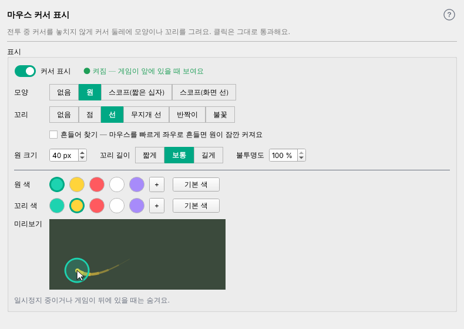
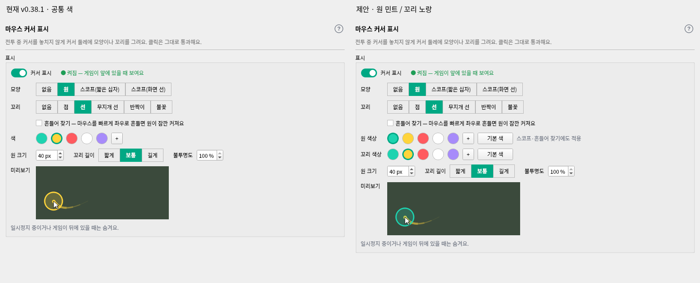
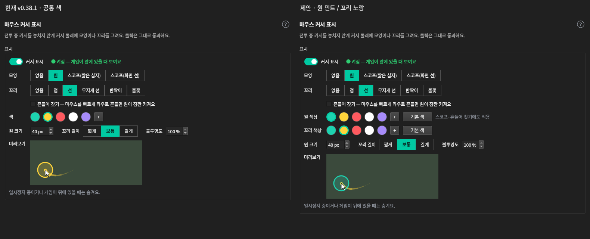

# 마우스 커서 표시 명세 (+ 편의기능 탭 재배치)

- 결정일: 2026-11-01 (사용자 결정, 렌더 목업 확인). [TODO 커서 표시 아이디어](TODO.md)(2026-10-28)를 확정한다. YoloMouse의 효과 목록을 참고했다.
- 버전: 새 기능이다. **1절 탭 재배치는 0.35.0**(그림대화와 함께, 2단은 `계산기 · 그림대화`까지), **2절 이후 마우스 커서는 0.36.0**(2026-11-01 사용자 결정. 같은 번호였던 게임 창 기준 영역은 보류 — 0.36.0은 마우스 커서만). 0.36.0에서 2단에 `마우스 커서`를 붙인다.
- 공개 범위: **모든 사용자**(0.37.0 사용자 결정). 0.36.x는 제작자 계정만(첫 개발) — 화면 문구에는 공개 단계(알파·베타)를 쓰지 않았다.
- 목업: [`docs/qa/assets/mouse_cursor_20261101/`](qa/assets/mouse_cursor_20261101/)
  - `effects.png`: 게임 화면 위 효과 8가지
  - `mouse_tab.png`: 마우스 커서 화면
  - `convenience_calc_tabs.png`: 편의기능 탭 B안
  - `home_*.png`: 홈 배치 두 안(채택 `home_a_four_boxes.png`)

## 1. 탭 위치

- **0.37.0(사용자 결정 안 A, 현재)**: 편의기능 2단 한 줄 `분배 계산기 · 구슬 분배 계산기 · 환전비율 계산기 · 던전 입장 계산기 · 그림대화 만들기`(탭 이름 = 화면 제목, 계산기 3단 없음).
  마우스 커서는 **최적화 2단 세 번째**(`최적화 · FPS 측정 · 마우스 커서`). 최적화 시작·종료와 무관하게 켜는 즉시 동작한다.
- 아래는 0.35.0~0.36.x 배치(B안) 기록이다.

### (지난 배치) 편의기능 탭 재배치 (B안)

- 2단 탭을 **`계산기 · 그림대화 · 마우스 커서`**로 한다.
- `계산기` 안에 3단 탭 **`분배 · 구슬 분배 · 환전비율 · 던전 입장`**을 둔다.
  - 3단 탭 이름에서 '계산기'를 뺀다. 화면 안 제목(`분배 계산기` 등)은 그대로 둔다.
  - 3단 스타일은 보스 패턴과 같은 회색(`_tertiary_qss`, 14절 1항)이다.
- 백로그의 '계산기 통합'을 이것으로 해결한다. 12절의 '첫 던전이 선택된 채 열림' 규칙은 그대로 유지한다.
- 다른 화면에서 계산기로 바로 가는 경로(홈 `전체 메뉴`, 첫 안내 등)가 있으면 새 위치로 맞춘다.
- [그림대화 명세](sketch-chat-spec.md)의 '계산기 탭들 뒤'는 이 배치의 2단 `그림대화`를 뜻한다.

## 2. 마우스 커서 화면 (최적화 › `마우스 커서`, 0.36.x는 편의기능 › `마우스 커서`)

위에서 아래로 배치한다.

1. 제목 `마우스 커서 표시`, `?` 도움말. 회색 안내 `전투 중 커서를 놓치지 않게 커서 둘레에 모양이나 꼬리를 그려요. 클릭은 그대로 통과해요.`
2. `표시` 상자
   - `커서 표시` 스위치(14절 5항, 홈과 같은 값)와 상태 `● 켜짐 — 게임이 앞에 있을 때 보여요` / `● 꺼짐`
   - **`모양`**: `없음 · 원 · 스코프(짧은 십자) · 스코프(화면 선)`
   - **`꼬리`**: `없음 · 점 · 선 · 무지개 선 · 반짝이` (모양과 **따로** 고른다. 사용자 결정)
   - **`흔들어 찾기`** 체크(사용자 결정 — 넣음): 마우스를 빠르게 좌우로 흔들면 원이 잠깐(약 1초) 크게 커졌다가 돌아온다. 모양이 `없음`이어도 흔들 때만 보인다.
   - `색`: 프리셋(민트·노랑·빨강·흰색·보라)과 `+` 직접 고르기. 무지개 선은 색 설정을 쓰지 않는다.
   - `원 크기`(px, 20~120, 기본 40), `꼬리 길이`(`짧게 · 보통 · 길게`), `불투명도`(100%~20%, 10%씩. 버프·디버프 15절 규칙과 같음)
   - `미리보기`: 지금 설정으로 원·꼬리가 움직이는 작은 예시
   - 회색 `일시정지 중이거나 게임이 뒤에 있을 때는 숨겨요.`
- **위치 잠금은 없다.** 커서를 따라다니고 클릭은 항상 통과한다.
- 기본값: 꺼짐, 모양 원, 꼬리 없음, 흔들어 찾기 **꺼짐**(0.36.1 변경 — 전투 중 빠른 움직임 오판·렉, QA·사용자 실측), 노랑.

## 3. 효과 정의 (`effects.png`)

| 효과 | 모습 | 구현 |
|---|---|---|
| 원 | 커서 중심, 반투명 채움 + 굵은 테두리 | 커서 크기만 한 투명 창이 따라 움직임 |
| 스코프(짧은 십자) | 가운데가 빈 십자 + 얇은 원 | 같음 |
| 스코프(화면 선) | 화면 끝까지 가는 1px 가로·세로 선 | **1px 두께 화면 길이 창 2개**가 커서 줄·칸을 따라감 |
| 꼬리: 점 | 지나간 자리에 점점 작아지고 흐려지는 점 | 지나간 길을 덮는 투명 창을 다시 그림 |
| 꼬리: 선 | 끝으로 갈수록 가늘고 흐려지는 선 | 같음 |
| 꼬리: 무지개 선 | 선 꼬리의 색이 길이를 따라 바뀜 | 같음 |
| 꼬리: 반짝이 | (0.37.0) 움직일 때 틱마다 1~2개의 작은 별(+)이 위아래로 튀어 포물선으로 떨어지며 깜빡이고 흐려짐(가로 -90~90·세로 -220~80px/s, 중력 420px/s², 수명 0.45~0.8초, 최대 40개) | 조각 범위만큼 창 |
| 꼬리: 불꽃 | (0.37.0) 틱마다 불티 5개(±4px), 최대 70개, 수명 0.3~0.6초, 반지름 4~7px→40%까지 축소. 무작위 10~50px/s + 진행 반대쪽 15% + 위로 40px/s. 색 흰→연노랑→노랑→주황→빨강→어두운 빨강(색을 고르면 흰→옅은 색→고른 색→어둡게), 투명도 (1-나이)^0.7×0.7, 가산 혼합 | 같음 |

- 효과는 선과 점으로 그린다. 다른 프로그램의 그림이나 무늬를 가져오지 않는다.
- 꼬리 길이는 최근 시간 기준(짧게 0.2초 · 보통 0.3초 · 길게 0.45초 — 개발이 렌더로 조정)이다.

## 4. 동작·성능 원칙

- 커서 위치는 초당 60번 **읽기만** 한다(Windows `GetCursorPos`, `system/`에 둔다). 입력을 조작하지 않는다.
  - 맥에서는 Qt `QCursor.pos()` 대체 구현으로 화면을 렌더하고 테스트한다.
- 표시 조건은 다른 오버레이와 같다. 게임이 앞에 있고 일시정지가 아닐 때만 보인다. 클릭 통과(입력 투명), 항상 위에 둔다.
- **CPU 목표(평균 1~2%)를 지킨다.**
  1. 커서가 멈추면 꼬리를 다시 그리지 않는다. 가만히 있으면 원 창 이동도 하지 않는다.
  2. 꼬리 창은 최근 꼬리가 들어가는 범위만큼만 만들고, 화면 전체 창을 쓰지 않는다.
  3. 개발 때 Windows 4K에서 효과별 CPU를 측정해 [status](status.md)에 적는다. 넘치면 꼬리만 초당 30번으로 낮추고, 반짝이는 조각 수를 줄인다.
- 흔들어 찾기 판정: 짧은 시간(약 0.5초) 안에 좌우 방향이 여러 번(0.36.1부터 4번 이상) 바뀌고 가로 이동이 600px 이상이면 흔든 것으로 본다. 값은 개발이 실사용으로 조정한다.
- 판정·꼬리 점 계산은 순수 함수로 두어 맥에서 테스트한다. 커서 위치 목록을 넣으면 꼬리 점과 흔들기 결과가 나오는 형태다.

## 5. 홈

- 홈 기능 목록에 `마우스 커서` 스위치를 넣는다(사용자 결정).
- 배치는 **(가) 아래 줄 4칸** `최적화 · 블랙박스 · 파티 모집 · 편의기능(마우스 커서)`로 정했다(2026-11-01 사용자 결정, `home_a_four_boxes.png`).
  - 먼저 이렇게 하고, 실화면에서 이상한 점(좁은 칸의 글자 등)은 나중에 잡는다.
  - 버린 안: (나) 셋째 칸을 `파티 모집 · 편의`로 합치기.
- 스위치는 마우스 커서 화면의 `커서 표시`와 같은 값이다. `›`를 누르면 최적화 › 마우스 커서로 간다.
- **0.37.0**: 마우스 커서 줄을 `최적화` 칸(게임 최적화 · FPS 표시 · 마우스 커서)으로 옮기고 아래 줄은 다시 3칸(최적화 · 블랙박스 · 파티 모집).

## 6. 검증

- **단위 테스트**
  - 꼬리 점 계산(길이별 시간 범위, 멈추면 더 그리지 않음)
  - 흔들기 판정(흔들기 / 직선 이동 / 느린 이동)
  - 설정 저장·복원
  - 홈과 탭 스위치 동기화
  - 편의기능 탭 순서와 계산기 3단
- **렌더(사용자 확인)**: 마우스 커서 화면, 편의기능 › 계산기 3단, 홈
- **Windows 실화면**: 게임 위에서 효과별 모습과 클릭 통과, 게임이 뒤로 가면 숨김, 4K에서 효과별 CPU 측정값

## 7. 원·꼬리 색상 분리 (2026-11-03 제안 → **2026-11-07 사용자 확정 → 구현(0.44.0)**)

> **확정(11-07)**: 아래 '확정 배치(A안)'가 '추천 배치'보다 우선한다. 지금 화면 흐름(위에서 모양 → 아래에서 색 → 바로 밑 미리보기)을 유지하고,
> 모양 줄마다 색을 붙이는 배치는 눈이 지그재그로 움직여 쓰지 않는다. 나머지(활성 상태·선택/복원·설정 이전)는 이 절 내용 그대로.

### 확정 배치 (A안 — 색 두 줄, 2026-11-07)

- 순서: `커서 표시` → **모양 → 꼬리 → 흔들어 찾기 → 원 크기·꼬리 길이·불투명도** → 구분선 → **원 색 → 꼬리 색** → 미리보기 → 안내 한 줄.
  (지금은 색과 미리보기 사이에 있는 크기 줄을 모양 묶음으로 올린다 — 색을 고르면 바로 아래 미리보기에서 확인.)
- 원 색·꼬리 색 두 줄은 견본 5개·`+`·`기본 색`이 **같은 세로줄**에 오게 맞춘다. 기존 `색` 한 줄과 그 오른쪽 안내 문구는 없앤다(효과별 안내는 해당 줄이 흐려질 때 그 줄 오른쪽에).
- 미리보기는 원·스코프에 원 색, 꼬리·반짝이·불꽃에 꼬리 색을 쓴다(목업은 원 민트·꼬리 노랑).
- 목업은 실제 `CursorTab`을 메모리에서 재배치한 오프스크린 렌더다(제품 파일 변경 아님).

**구현(11-07)**: 설정 키 `ringColor`·`tailColor`·`tailColorChosen`(아래 '기존 설정 이전' 가정대로 확정 — 예전 `color`는 두 색으로 복사,
`colorChosen`은 `tailColorChosen`으로, 새 키가 있으면 새 키 우선). 색 분리 규칙은 `cursor_fx.ring_color`·`tail_color`·`sparkle_multicolor` 하나를
미리보기(`cursor_tab`)와 실제 오버레이(`cursor_overlay`)가 같이 쓴다. 흐려진 줄은 견본도 옅게, 이유는 줄 오른쪽 한 줄.
반짝이·불꽃의 '노랑(기본) = 기본 팔레트' 안내는 오른쪽 문구 대신 꼬리 줄의 노랑 견본·`기본 색` 말풍선으로 둔다(오른쪽 문구는 흐릴 때만).
렌더(실제 제품 화면): [라이트·다크 — 기본/흐림/스코프+불꽃](assets/mouse-cursor-colors-20261107/implemented.png).

사용자가 최신 공개판 화면 확인과 원·꼬리 색을 각각 설정하는 화면 기획을 요청했다.
이 절은 검토용 기획이며 **기능 구현·릴리스 승인이 아니다**. 이전 색 분리 보류 후 다시 요청한 기획으로,
현행 2절의 단일 색 설정은 아직 그대로다. 클릭 효과 등 다른 기능은 범위에 넣지 않는다.

### 기준과 화면 비교

- 확인한 최신 공개판: [v0.38.1](https://github.com/StarlineBot/mabinogi_addon-releases/releases/tag/v0.38.1)
  (2026-11-02 15:25:51 UTC 게시), 소스 태그 `c62898fedb236ee5d1819173edf93a4943970da1`.
- 확인 당시 main: `797d3fb84a3f61dae947bff091894c22d9adb750`.
  공개판과 차이는 `docs/status.md` 게시 기록 3줄뿐이고 제품 코드는 동일했다.
- 아래는 **커서 표시 켬·원·선 꼬리** 예시다. 새 설치 기본값(표시 꺼짐·꼬리 없음)을 찍은 화면은 아니다.
  왼쪽은 현재 단일 색(노랑), 오른쪽은 원 민트·꼬리 노랑 제안이다. 각각 790×600, 같은 테마·폰트·미리보기 시각이다.

### (지난) 추천 배치 — 11-07 확정 배치로 대체

기존 `색` 한 줄을 **`원 색상` → `꼬리 색상`** 두 줄로 바꾼다.
전체 순서는 모양 → 꼬리 → 흔들어 찾기 → 원 색상 → 꼬리 색상 → 크기·길이·불투명도 → 미리보기다.
각 행에 기존 견본(민트·노랑·빨강·흰색·보라), `+` 직접 고르기, **`기본 색`** 버튼을 둔다.
원 색상 안내는 `스코프·흔들어 찾기에도 적용`이다. 새 토글이나 전체 적용 버튼은 추가하지 않는다.

### 활성 상태와 효과별 적용 범위

| 대상·상태 | 색상 컨트롤과 동작 |
|---|---|
| 원·스코프(짧은 십자)·스코프(화면 선) | 원 색상 활성. 선택한 색을 모양에 적용한다. |
| 모양 없음 + 흔들어 찾기 꺼짐 | 원 색상 견본·직접 선택·기본 색 비활성. `모양과 흔들어 찾기가 꺼져 있어요.` |
| 모양 없음 + 흔들어 찾기 켜짐 | 원 색상 활성. 흔들 때 나타나는 원에도 같은 색을 쓴다. |
| 꼬리 없음 | 꼬리 색상 견본·직접 선택·기본 색 비활성. `꼬리가 꺼져 있어요.` |
| 꼬리 점·선 | 꼬리 색상 활성. 고른 색과 기존 수명별 투명도 적용. |
| 꼬리 무지개 선 | 꼬리 색상 비활성. `무지개 선은 고유 색을 사용해요.` |
| 꼬리 반짝이 | 꼬리 색상 활성. 노랑(기본)은 여러 색, 그 외는 고른 단색. `노랑(기본): 여러 색 반짝이` 안내. |
| 꼬리 불꽃 | 꼬리 색상 활성. 노랑(기본)은 흰→노랑→주황→빨강의 기본 팔레트. 다른 색은 흰→옅은 선택색→선택색→어둡게. `노랑(기본): 기본 불꽃색` 안내. |

반짝이·불꽃은 색 선택을 무시하는 효과가 아니다. v0.38.1의 노랑 견본은 기본 효과 팔레트 복원 의미도 갖는다.
이 규칙은 **꼬리 행에만** 남긴다. 원 색을 고르거나 복원해도 꼬리 팔레트 상태는 변하지 않는다.
무지개 선만 꼬리 색을 항상 무시한다. 커서 화살표 자체의 흑백은 변경하지 않는다.

비활성화되어도 저장된 색은 지우지 않는다. 다시 지원하는 모양·꼬리를 고르면 해당 색을 사용한다.
전체 `커서 표시`가 꺼져 있어도 위 조건에 맞는 설정과 미리보기는 편집할 수 있다.

### 선택·취소·기본 색 복원

- 견본 선택은 해당 행만 즉시 저장하고 미리보기·실행 중 효과에 반영한다.
- `+`는 기존 색 선택 창을 사용하며 제목은 `원 색상` / `꼬리 색상`이다.
  창의 적용을 눌러야 저장·반영하고 취소·닫기·Esc는 기존 값을 유지한다.
- 원 행의 `기본 색`은 원·스코프·흔들기 색만 노랑으로 복원한다.
- 꼬리 행의 `기본 색`은 꼬리 색을 노랑으로, 팔레트 상태를 기본으로 복원한다.
  노랑 견본을 눌러도 v0.38.1처럼 같은 결과가 된다.
- 복원 범위에는 모양·꼬리 종류·크기·길이·불투명도·전체 켜짐 여부를 포함하지 않는다.

### 기존 설정 이전 (구현 시 가정)

새 키 이름은 `ringColor`, `tailColor`, `tailColorChosen`을 가정한다. 실제 구현에서 확정해야 한다.

1. 처음 읽을 때 기존 정규화된 `color`를 두 색으로 복사하고 `colorChosen`은 꼬리 상태로 그대로 옮긴다.
   새 키가 이미 있으면 그 값을 우선하고 빠진 키만 보완한다.
2. 손상된 색은 기존 검증 규칙대로 기본 노랑으로 보정한다. 새 설치는 두 색 노랑·꼬리 기본 팔레트다.
3. 과거 저장된 노랑 + `colorChosen=true`도 이전 시 그대로 보존한다.
   단색 노랑 반짝이·노랑 계열 불꽃이 업데이트 직후 기본 팔레트로 바뀌지 않게 한다.
   이후 꼬리 노랑 견본 또는 기본 색을 누르면 기본 팔레트로 돌아간다. 이를 위한 별도 토글은 추가하지 않는다.
4. 이전 후 두 색을 별도로 저장하며 미리보기와 실제 오버레이 모두 같은 분리 규칙을 사용해야 한다.

### 확인 범위와 후속 구현 검증

- 실제 `CursorTab`과 같은 소스를 메모리에서 수정한 UI 목업을 Qt offscreen / `QWidget.grab()`으로 렌더했다.
  PySide6 6.11.2, Fusion, Noto Sans CJK KR, DPR 1. 제품 파일을 바꿔 렌더한 것은 아니다.
- 라이트·다크 현재/제안 PNG를 열어 시각 검수했다. 원·꼬리 없음, 무지개 선, 반짝이, 불꽃,
  모양 없음+흔들기 켬 상태도 임시 목업으로 렌더했다. 저장소에는 대표 비교 이미지 두 장만 보관한다.
- 현행 `cursor_tab.py`, `cursor_fx.py`, `cursor_paint.py`, `cursor_overlay.py`, `theme.py`,
  `theme_panel.py`, `config.py`를 기준으로 효과별 색 사용·선택창 적용 시점을 확인했다.
- 실제 설정 이전·저장·오버레이 연결은 아직 구현하지 않았다. 구현 시 독립 색 변경, 취소/복원,
  비활성 상태의 색 보존, 과거 `colorChosen` 이전, 미리보기와 오버레이 일치를 확인해야 한다.
- Windows 실게임 합성·입력 통과·DPI/폰트·성능은 미검증이다. Qt 목업 검수로 실기 통과를 대신하지 않는다.
