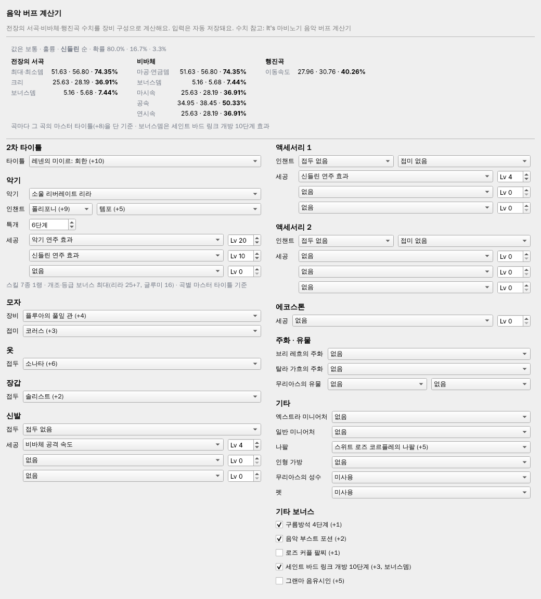

# 음악 버프 계산기

- 작성: 2026-11-16 (기획 세션). 상태: **기획 확정, 미구현 — 개발 대상, 모든 사용자 공개**(사용자 결정 11-16: 계산만 하는 기능이라 위험 없음).
- 배경: [TODO '음악 버프 계산기(나중에, 11-01)'](TODO.md) — 공식·표 출처가 없어 보류 → 11-16 참고 사이트 스크립트에서 공식과 표를 확인해 재개.
- 버전: 새 기능 → 다음 minor. 릴리즈 노트 한 줄은 개발 커밋에서.

## 1. 화면

| 항목 | 결정 |
| --- | --- |
| 자리 | 편의기능 탭 줄에 `음악 버프 계산기`. 머리 설명: `전장의 서곡·비바체·행진곡 수치를 장비 구성으로 계산해요. 입력은 자동 저장돼요. 수치 참고: It's 마비노기 음악 버프 계산기`. |
| 위쪽(고정, 스크롤 안 됨) | 첫 줄 흐린 글자 `값은 보통 · 훌륭 · 신들린 순 · 확률 80.0% · 16.7% · 3.3%`. 그 아래 곡 세 묶음을 가로로: **전장의 서곡**(최대·최소뎀, 크리, 보너스뎀) · **비바체**(마공·연금뎀, 보너스뎀, 마시속, 공속, 연시속) · **행진곡**(이동속도). 각 줄 = 흐린 이름 + `보통 · 훌륭 · **신들린%**`(소수 둘째 자리, 신들린 굵게). 표(QTable) 아님. 맨 아래 흐린 안내 `곡마다 그 곡의 마스터 타이틀(+8)을 단 기준 · 보너스뎀은 세인트 바드 링크 개방 10단계 효과`. |
| 버프 합계 | **표시하지 않음**(사용자 결정 11-16 — 다들 곡 수치만 봄). |
| 보너스뎀 줄 | 세인트 바드 링크 개방 10단계를 체크했을 때만 서곡·비바체에 보임(= 최대뎀·마공의 10%). |
| 아래(스크롤) | 입력 **2단**. 왼쪽: 2차 타이틀 → 악기 → 모자 → 옷 → 장갑 → 신발. 오른쪽: 액세서리 1 → 액세서리 2 → 에코스톤 → 주화·유물 → 기타 → 기타 보너스. 창을 약 1,150px로 늘리면 스크롤 없이 다 보임. |
| 구역 제목 | **14px · 굵기 700**(공용 `section_label` 600보다 크게 — 입력 칸이 많은 계산기 예외, 사용자 요청 11-16). |
| 입력 바꾸면 | 위 수치 즉시 다시 계산(순수 계산, 네트워크 없음). |
| 저장 | 모든 입력을 바꾸는 즉시 config에 자동 저장(`musicBuff`), 앱을 다시 켜면 그대로(사용자 결정 11-16 — 저장 버튼 없음). 프리셋 여러 개·결과 저장은 이번에 없음. 설정 내보내기·동기화 포함. |

## 2. 입력 칸 (사이트 입력에서 결정대로 줄임)

| 구역 | 칸 | 비고 |
| --- | --- | --- |
| 2차 타이틀 | 드롭다운 `이름 (+N)` | 1차(마스터) 타이틀 칸 없음 — 곡마다 그 곡 마스터 +8 고정(사용자 결정 11-16) |
| 악기 | 종류 `소울 리버레이트 리라 / 데모닉 글루미 선데이`, 인챈트 접두·접미, 특개 0~8단계, 세공 3줄(옵션 + Lv) | 개조 보너스·등급 보너스는 악기 기본값(최대) 고정: 리라 25 + 7%, 글루미 16 + 0%. 등급·개조·지속 개조 칸 없음 |
| 모자 | 장비(플루아의 풀잎 관 +2~4), 접미(코러스) | 접두·세공 없음(음악 버프 옵션이 없음) |
| 옷 | 접두(앙코르·소나타·안락의) | 세공 없음 — 옷 세공은 지속시간뿐이라 지속시간 제외로 빠짐 |
| 장갑 | 접두(솔리스트) | 세공 없음 — 풍년가 채집 속도뿐이라 빠짐 |
| 신발 | 접두(솔리스트·잔허의), 세공 3줄 | 세공 옵션: 비바체 마법 시전·공격·연금술 시전 속도, 행진곡 도보 이동 속도 |
| 액세서리 1·2 | 접두·접미, 세공 3줄 | 세공 옵션 9종(연주 비율·효과, 비바체 속도, 행진곡 이동) |
| 에코스톤 | 세공 1줄 | 다른 세공과 더하지 않고 **큰 쪽만**(3절) |
| 주화·유물 | 브리 레흐 주화·탈라 가흐 주화(`서곡·비바체 공격력 +0.1~1%`), 무리아스의 유물 접두 개수(순수한 +1~3)·접미 개수(선물 공격력 +0.3~0.9%) | 주화 지속시간 칸 없음 |
| 기타 | 엑스트라 미니어처, 일반 미니어처, 나팔, 인형 가방, 무리아스의 성수(+1~8), 펫 | 토템(지속시간 전용) 없음. 인형 가방은 버프가 있는 것만(지속 전용 포인셰·키리아 제외). 펫은 초록빛 페어리 드래곤(풍년가) 제외 |
| 기타 보너스(체크) | 구름방석 4단계 +1, 음악 부스트 포션 +2, 로즈 커플 팔찌 +1, 세인트 바드 링크 개방 10단계 +3(보너스뎀·확률 방식 변경), 그랜마 음유시인 +5 | 마기그래프(지속 전용) 없음 |

- 빼는 것(사용자 결정 11-16): 스킬 랭크 칸(7종 1랭 고정), 지속시간 표시와 지속 전용 입력·옵션, 풍년가, 이벤트 숫자 입력, 1차 타이틀, 악기 등급·개조 보너스·지속 개조 칸.
- **세공 Lv 칸 상한 = 그 옵션의 `max`**(표 `reforge_options`, 예: 악기 `악기 연주 효과` 25·`신들린 연주 비율` 8, 액세서리 4, 에코스톤 `악기 연주 효과` 20·나머지 6~10). 옵션을 바꿔 상한보다 크면 상한으로 낮춤. 옵션 '없음'이면 Lv 0·비활성. 같은 부위에서 같은 옵션을 두 줄 고르면 레벨을 더한다(사이트와 같음).
- 악기 아래 흐린 안내: `스킬 7종 1랭 · 개조·등급 보너스 최대(리라 25+7, 글루미 16) · 곡별 마스터 타이틀 기준`.

## 3. 계산 (참고 구현 `assets/music-buff-20261116/reference_calc.py`)

공식은 참고 사이트 스크립트의 계산 함수를 읽고 다시 쓴 것(코드 복사 아님). 표는 `music_buff_tables.json`(사이트 스크립트의 상수 표를 **실행하지 않고 글자로 읽어** 정리, 필요한 것만).

1. **곡 합계** = 악기연주 15 + 노래 15(1랭) + 악기 개조 보너스(리라 25/글루미 16) + 악기 접두·접미 + max(악기 세공 `악기 연주 효과`, 에코스톤 `악기 연주 효과`) + 모자 장비·접미 + 옷·장갑·신발 접두 + 액세서리 1·2 접두·접미 + 2차 타이틀 + 미니어처(엑스트라·일반) + 구름방석 + 나팔 + 인형 가방 + 포션·팔찌·세인트 바드 + 그랜마 5 + 성수 + 펫 기본 + 유물 접두 개수 + **곡 마스터 타이틀 8**.
2. **특수 보너스%** = 특개 단계표(0, 0.5, 1, 1.5, 2.3, 3, 3.8, 4.5, 5.5) + 악기 등급 보너스(리라 7) + 브리 레흐 주화 + 탈라 가흐 주화 + 0.3 × 유물 접미 개수. 서곡 대미지·비바체 마공에만 곱함(크리·속도·이동 X).
3. **연주 배율**: 보통 1 + a, 훌륭 1.1 + b, 신들린 1.3 + c(%/100). a·b·c = max(악기 세공 + 액세서리 1·2 세공, 에코스톤 세공)의 보통·훌륭·신들린 연주 효과.
4. **확률**: 훌륭 비율 보너스 = max(u(악기 + 액세서리), u(에코스톤)), u(n) = n>0 ? 5 + (n−1)×2 : 0. 신들린 비율 = max(악기 + 액세서리, 에코스톤).
   - 세인트 바드 꺼짐: 가중치 보통 24, 훌륭 5 + 훌륭 보너스, 신들린 1 + 신들린 비율.
   - 세인트 바드 켜짐: 신들린 비율 ×10 ≥ 120 → 신들린 100%, 아니면 훌륭 보너스 ×10 ≥ 350 → 훌륭 100%, 아니면 가중치 24 / 5 + 10×훌륭 / 1 + 10×신들린.
5. **곡 수치**(1랭 기본: 서곡 대미지 20·크리 11, 비바체 마공 20·속도 11, 행진곡 이동 12), m = 연주 배율, t = 1 + 곡 합계/100, s = 1 + 특수/100:
   - 서곡 대미지 = 20 × t × s × m (+ 붉은 페어리 드래곤이면 20 × 0.02 × s), 크리 = 11 × t × m (+ 11 × 0.02).
   - 비바체 마공(= 연금뎀) = 20 × t × m × s (+ 푸른빛 페어리 드래곤 하모니), 속도 3종 = (11 + 해당 속도 세공) × t × m (+ 하모니). 속도 세공 = max(신발 + 액세서리, 에코스톤).
   - 행진곡 이동 = (12 + 이동 세공) × t × m.
   - 보너스뎀 = 서곡 대미지·비바체 마공 × 0.1(세인트 바드 켜짐일 때만).
6. 표시: 소수 둘째 자리 반올림, `%`는 신들린 값 뒤에만.

## 4. 검증
- 참고 구현으로 **사이트 기본 화면 수치를 그대로 재현**(타이틀 없음 조건): 서곡 33.17 · 36.49 · 43.12, 크리 17.05 · 18.76 · 22.17, 비바체 같은 값, 행진곡 18.60 · 20.46 · 24.18, 확률 80.0 · 16.7 · 3.3.
- `test_vectors.json` 4개(사이트 기본 · 앱 기본 · 시안 예시 · 글루미+확률 세공+펫+주화·유물·성수) — 앱 계산 함수의 기대값으로 쓴다. 사이트와 직접 맞춘 것은 첫 번째뿐, 나머지는 같은 공식의 결과.
- 게임 업데이트로 새 인챈트·인형 가방·타이틀이 생기면 표(JSON)만 고친다. 사이트와 다를 때 기준은 게임 화면.

## 5. 테스트(개발)
- 계산: `test_vectors.json` 4개를 소수 넷째 자리까지 비교, 세인트 바드 확률 분기 3개(신들린 100% · 훌륭 100% · 가중치), 에코스톤 큰 쪽만, 특수 보너스가 크리·속도에 안 곱해짐.
- 표: 지속 전용·풍년가 옵션 없음, 모든 항목 buff > 0(체크 제외), 이름 중복 없음.
- 저장: 입력 변경 즉시 저장 → 재시작 후 같은 값·같은 결과, 표에 없는 저장값(게임 업데이트로 빠진 항목)은 '없음'으로.
- 화면: 오프스크린 렌더(기본·시안 예시·세인트 바드 끔·글루미) 사용자 확인, 창 760·1150 높이.
