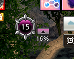
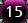

# 도르카 이동 후 미판독 및 새 원본 자동 찾기 실패

- 날짜: 2026-10-16 (Asia/Seoul).
- 원본 기준 SHA: `55e0ce43f0d37a09d902543000c691a259878990`, tree `f03f6a9447a703804453b4aad86b0ce7b85fda82`.
- 직전 QA `4a6334d` 이후 변경은 원본 PNG 1개뿐이며 제품 코드는 `828c224`와 같다.
- 원본: `tests/data/스크린샷 2026-10-16 234015.png`, 2560x1440,
  Git blob `fafa4d8bd995c6e2c0b476ca70e73b3b23a158a4`와 로컬 파일 해시 일치 확인.
- 사용자는 이 화면에서 자동 찾기 실패를 제보했고, 원본 도르카 UI는 고정 위치가 아니므로
  게임 화면 어디로 이동하더라도 다시 찾을 수 있어야 한다고 명확히 했다.
- QA에서는 제품 구현·기본 이미지·기존 테스트·원래 기획서를 변경하지 않았다. 커밋 이력도 조회하지 않았다.

## 요약

1. 새 원본에서 **위치 자동 찾기 자체가 실패**한다. 숫자는 올바른 영역을 입력하면 **15**로 읽힌다.
2. 별개로 **정상 등록 후 원본 UI 이동에 대한 재탐색이 없다**. 알려진 정상 앵커를 옮겨도
   자동 찾기 함수 자체는 새 위치를 찾지만 실제 판독 루프는 이전 좌표만 반복 캡처한다.
3. 두 현상을 '처음에는 되고 그 다음에는 안 됨' 하나의 상태 문제로 뭉뚱그리지 않는다.
   자동 찾기 함수는 이전 등록 좌표로 검색을 제한하지 않는다. 현재 장면의 앵커 검출 실패와
   실행 중 고정 ROI 문제를 각각 수정·검증해야 한다.

## Confirmed Bug: DORCHA-AUTOFIND-QA-02

- 심각도: **P2**, 정상 표시 중인 UI를 자동 찾기로 등록하지 못한다. 앱 크래시나 게임 입력 방해로 확인한 문제는 아니다.
- 조건: 새 원본 전체 또는 앱 창에 가리지 않은 왼쪽 위 도르카 주변만 검출기에 입력한다.
- 기대: 내부 숫자 영역 `(577,123,28,23)`을 찾아 승인 흐름으로 전달한다.
- 실제: 두 입력 모두 결과 None, rejection은 `anchor_not_found`다.
- 사용자 영향: UI가 보이고 숫자도 판독 가능하지만 자동 찾기에서 확인 불가 안내가 나온다.
- 기술적 원인: 원 내부 숫자가 아닌 장식을 찾는 단계에서 실제 위치의 점수가 합격 기준에 미달한다.
  `detect/dorcha_anchor.py:33`의 흑백 탐색과 `:52`의 원본 해상도 재탐색 모두 같은
  `detect/autofind_anchors.py:12`의 기준 **0.97**을 사용한다.
- 원본 해상도에서 실제 장식의 최적 위치는 `(569,106,45,57)`, scale=1.0,
  마스크 CCORR_NORMED **0.9383997**이다. 새 주변 ROI 안에서 모든 지원 배율을 비교해도
  실제 배율 1.0이 최고였고 기준에 못 미쳤다. 좌표를 정확히 주면 `read_dorcha`는 **15**를 반환한다.
- 같은 숫자 15의 이전 원본 `211914`는 자동 찾기 `(941,948,28,23)` 및 숫자 판독이 성공하며
  앵커 점수는 약 **0.9799677**이다. 15라는 숫자 자체나 이전 등록 유무만으로 설명되지 않는다.
- 현재 샘플에서 앵커 표현/마스크/기준의 조합이 정상 외형을 충분히 포괄하지 못함을 확인했다.
  배경·명암·이펙트 중 하나만을 단독 원인으로 확정하지 않는다.
- 재현: `scripts/qa_dorcha_moved_ui.py`의 `test_new_visible_ui_must_be_located` 두 입력.
- 검증: 전체 화면 / 주변 ROI 2건 실패. 새 숫자 15 직접 판독 / 이전 숫자 15 자동 찾기 대조군 2건 통과.
- 한계: 이 PNG에는 앱 창과 실패 안내가 포함된다. 실패 당시 검출기에 실제 전달된 진단 입력과
  동일하다고 주장하지 않는다. 다만 도르카 UI는 앱에 가리지 않은 곳에 있고 그 주변만 잘라도 실패하여,
  앱 창이 원본 UI를 가렸다는 설명으로는 이 실패가 해소되지 않는다.





## 최신 요구사항 미충족: DORCHA-MOVE-QA-01

- 분류: **Confirmed Bug, P2 (이번 대화에서 명확해진 이동 후 재탐색 요구 기준)**.
  기존 명세 위반과는 구분한다. `docs/dorcha-overlay-spec.md:72`에는 지속 자동 추종을
  이번 범위에서 제외한다고 명시돼 있어, 기존 구현은 그 고정 영역 범위와 일치했다.
  사용자의 조작이나 설정을 원인/과실로 보지 않고 명세와 필요한 동작의 차이를 개발에 전달한다.
- 조건: 정상 판독되던 게임 원본 UI가 등록 위치를 벗어나 다른 곳으로 이동한다.
- 기대: 게임 화면 범위에서 재탐색해 새 위치의 현재 값을 표시한다. 이전 값 유지나 추정 복원은 하지 않는다.
- 실제/사용자 영향: `--/15`로 바뀐 뒤 UI가 다른 곳에 정상적으로 있어도 회복하지 않는다.
- 기술적 원인: `ui/dorcha_tab.py:128`의 `_tick()`은 `:137`에서 저장된 `_region`만 캡처하고
  `read_dorcha()`를 호출한다. `_on_auto_find():230`의 전체 화면 찾기는 버튼 실행 경로이고,
  판독 실패 후 재탐색하거나 실행 중 원본 UI의 이동을 반영하는 연결은 없다.
- 재현은 새 원본의 앵커 문제와 분리하기 위해 **이전 정상 원본의 장식 전체**를 사용한다.
  가상 화면에서 내부 숫자 `(20,20)`의 15를 먼저 읽고, 원형 장식 전체를 옮겨 내부 숫자를 `(150,90)`에 둔다.
  이동한 가상 화면에 실제 자동 찾기를 직접 실행하면 `(150,90,28,23)`이 나오고 숫자도 15다.
- 실제 DorchaTab 루프를 200ms 간격 10회 실행했지만 캡처 11회 모두 `(20,20,28,23)`이고
  최종 값은 None이다. 이는 재현 관측 구간이지 합의된 최대 복구 지연 기준은 아니다.
- 재현: `test_moving_source_must_be_reacquired_for_new_requirement` 1건 실패.
  실제 Qt 탭/판독기/검출기를 쓰고 화면 캡처·설정 입출력·로그인/DPI 경계만 격리했다.
- 개발 전제: 기존 명세의 지속 추종 제외 문장과 최신 요구를 먼저 일치시키고
  찾기 범위, 재탐색 시작 조건, 허용 지연 및 비용을 검증 가능하게 확정한다.

## 실행 결과 및 기존 검사와의 관계

```bash
PYTHONPATH=src:. QT_QPA_PLATFORM=offscreen python -m pytest scripts/qa_dorcha_moved_ui.py -q --tb=short
PYTHONPATH=src:. QT_QPA_PLATFORM=offscreen python -m pytest tests/test_dorcha_reader.py tests/test_dorcha_autofind.py tests/test_dorcha_tab.py -q --tb=short
```

- 새 독립 재현: **3 failed, 2 passed (4.08초)**. 일반 pytest 수집 밖에 두며 수정 전 실패가 예상된다.
- 기존 숫자 판독/자동 찾기/도르카 탭 검사는 **87 passed (17.52초)**다.
  기존 표본 대부분은 같은 하단 배치를 사용한다.
  그 표본 통과가 이번 새 정상 화면의 자동 찾기나 이동 후 재탐색을 보장하지 않는다.
- 실행 환경은 Linux Qt offscreen/OpenCV, CPU 스레드 1개다. 실제 Windows 게임 캡처,
  이동 영상, 혼합 DPI·다중 모니터 및 장시간 재탐색 비용은 이번에 직접 측정하지 않았다.
- 앞선 릴리즈 QA는 당시 고정 ROI 명세와 확보 표본 기준의 결과다. 이번 정상 원본의
  자동 찾기 누락과 새 이동 요구를 반영해 후속 제품 변경 및 재검증이 필요하다.

## 개발 검토 방향

- 도르카 장식의 정상 외형을 새 원본까지 대표하도록 개선한다. 공용 ACCEPT만 낮추어
  투아림/단축바까지 약하게 만들지 말고 다른 UI·배경·숫자의 오탐도 함께 검증한다.
- 찾기 범위는 등록된 게임 창 전체를 기준으로 한다. 특정 모서리나 직전 ROI에만 가두지 않는다.
  기존 게임 창 인식과 물리/논리 좌표 변환을 재사용한다.
- 평상시 작은 ROI 판독을 활용하더라도 미판독 시에는 전체 범위로 재탐색할 수 있어야 한다.
  전체 다중 배율 탐색을 200ms마다 UI 스레드에서 무조건 실행하는 방식은 게임 영향과 UI 멈춤을 검증해야 한다.
- 후보 장식과 내부 0~15 값의 일관성을 확인하고 여러 후보는 임의 선택하지 않는다.
  미검출/가림/캡처 실패에서는 --/15를 유지하며 과거 값·회복 주기로 추정하지 않는다.
- 오버레이 표시 위치와 게임 원본 추적 위치를 혼동하지 않는다. 재탐색으로 다른 기능의 영역이나
  투아림 알림 설정을 덮어쓰지 말고 종료·중지·게임 전환 중 작업과 결과를 안전하게 폐기한다.
- 새 원본 및 이동→가림→재등장, 여러 위치 반복, 앱/게임 전환과 비용 제한을 후속 독립 QA에 포함한다.

## 함께 전달할 UI 요구

- 사용자 요청: 편의기능에서 **단축바 → 체력바 → 도르카** 순서로 관련 기능을 모아 배치한다.
  탭 이동으로 기존 인덱스 기반 초기 진입/투어/설정 동작이 틀어지지 않는지 검증한다.
- 색상 후속 요청: **채운 칸은 보라색, 빈칸은 어두운 회색을 유지**한다.
  앞서 전달한 '칸과 숫자 모두 단계색' 추천은 철회한다. 숫자만 색을 바꾸는 방식도
  빨강에서 정확한 N을 읽기 어려울 수 있다는 사용자 우려가 있어 최종 확정하지 않았다.
  [숫자 가독성 비교 시안 요청](../dorcha-color-preview-request.md)에 따라
  A: 흰색 N/15 + 작은 단계색 표시 / B: N/15 전체 밝은 단계색 / C: N만 밝은 단계색을
  실제 게임 배경 위에서 같은 크기로 렌더해 보여준 뒤 사용자 선택을 받는다.
  0~5/6~10/11~15 경계도 비교용 가정이다. 시안 승인 전 제품 정책으로 확정하지 않는다.
- 툴팁 요청: 메인 하단과 설정 상단 제작자 사진의 `잡담` 대신 **섯다라인** 또는 제작자 ID로
  식별되도록 변경한다. 이 채팅의 추천은 두 곳 모두 `섯다라인`이다.
  현재 위치는 `ui/creator_dialogue.py:135`, `ui/settings_tab.py:562`다.
- 사용자는 클릭해도 반응이 없다고 느끼는 점도 언급했다. `_eligible()`/`request()`의 여러
  표시 제한이 있어 소스에 클릭 연결이 없다는 뜻은 아니다. 해당 순간의 무반응 원인은 아직 재현하지 못했다.
  툴팁 명칭 변경과 클릭 동작 검증을 구분하며 사용자 과실로 설명하지 않는다.
- 색/배치/툴팁은 이 문서에서 개발 요청으로 정리했을 뿐 QA에서 구현하지 않았다.

## 공유와 배포 판단

QA 보고서·실패 재현·원본 크롭만 공유한다. 이번 기준에는 확인된 자동 찾기 문제가 있으므로
새 릴리즈 명령은 제공하지 않는다. 앱 전체가 불안정하거나 기존 다른 판독기가 모두 실패한다고
확대 해석하지 않는다. 수정 후 같은 원본과 재현으로 다시 확인한다.
