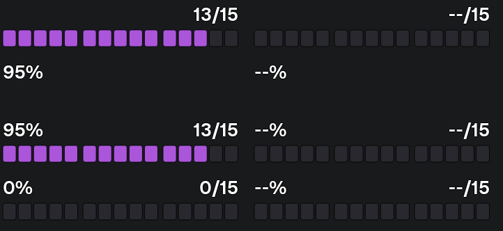
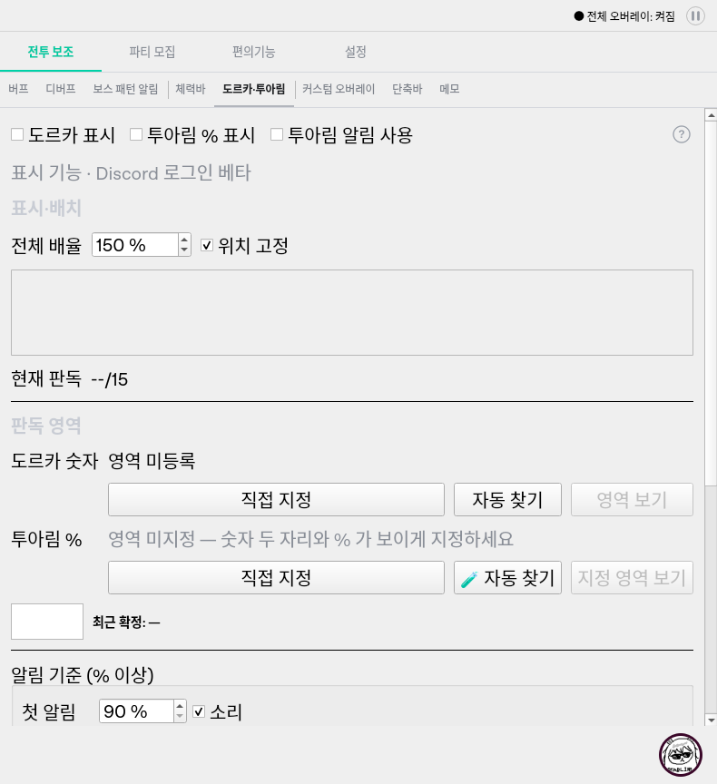

# 도르카·투아림 통합 및 재시작 수정 독립 QA

> 후속 `15c916d`: 자동 Windows 회귀·실제 네이티브 통합·exe 빌드 성공을 확인했다.
> 아래 Windows 접근 위반과 빌드 미검증은 이전 실행의 기록이며 현재 차단 상태가 아니다.
> 도르카 자체 가림 재현은 여전히 실패한다. [네트워크 경계 후속 독립 QA](Qt네트워크_테스트경계_수정_독립QA_20261017.md) 참조.

- 날짜: 2026-10-17 (Asia/Seoul).
- 검증 제품: `1b7c8a4bd603af6100c251413a360d71489c041c`.
- 요구사항: `dorcha-tuarim-integration-spec.md`, `dorcha-overlay-spec.md`,
  `navigation-structure-spec.md` 및 기존 도르카 재시작 독립 재현.
- 구현자의 통과 보고를 대신 사용하지 않고 실제 소스/원본 PNG/Qt 동작/Windows 로그를 검사했다.
  src/tests/scripts 932개 blob과 실행 사본이 일치한다. 커밋 이력/메시지는 조회하지 않았다.
- 제품/자산/원본 자료/기존 테스트/원래 독립 재현 코드는 변경하지 않았다.

## 결론

**릴리즈 보류.** Windows 전체 회귀가 네이티브 접근 위반으로 중단돼 통합·exe 빌드가 미검증이다.
기능 통합과 등록된 게임 문맥에서의 옛 숫자 영역 오인 수정은 아래 범위에서 확인했다.
사용자가 본 --/15와 연결 가능한 자체 창 가림 경로는 여전히 남아 있으며, 당시 실제 원인도 미확정이다.

## 확인된 검증 실패: WINDOWS-QT-NETWORK-AV-QA-01

- 심각도 **P1 (배포 검증 차단)**. Windows CI 실행에서 네이티브 크래시가 실제로 발생했다.
  실제 게임 사용자 앱에도 같은 크래시가 난다고 확정한 것은 아니다.
- 발생 조건: 정확한 제품 SHA의 main 자동 Windows 전체 격리 회귀 실행.
- 실행: [Windows validation 39010841429](https://github.com/StarlineBot/mabinogi_addon/actions/runs/39010841429),
  job `117332878278`. Isolated regression **failure**, Native Windows integration/Verify exe build는 **skipped**.
- 실제 로그: 96% 진행 뒤 2026-10-17 15:51:54 KST에
  **Windows fatal exception: access violation**. 정상 pytest 결과 요약에 도달하지 못했다.
- 크래시 당시 현재 스레드: `ui/dialogue_feed.py:31`의 `QNetworkAccessManager(self)` 생성,
  `creator_dialogue.py:118` -> `main_window.py:443` -> `tests/test_navigation.py:26`의 window fixture.
  호출자의 실제 테스트 ID는 이 로그만으로 식별되지 않는다.
- 기술적 원인 범위: QtNetwork 네이티브 생성 중 접근 위반이라는 실패 지점은 확인했다.
  그 객체 자체의 결함인지, 앞선 테스트의 수명/정리 문제나 메모리 손상/Qt 환경 문제인지는 미확정이다.
  다른 스레드에 나온 진단 큐 대기 스택만으로 진단 worker를 원인으로 지목하지 않는다.
- 사용자 영향: 현재 exe 빌드 검증까지 도달하지 못했으므로 이 수정본을 배포 준비 완료로 볼 수 없다.
  이번 변경과 직접 관련 없어 보이는 생성 경로도 회귀 범위에서 조사해야 한다.
- 후속 검증: 정확한 수집 순서/테스트 ID/반복 생성 횟수를 남기고 Windows에서 네이티브 수명 문제를
  좁힌다. 실패 테스트 skip, assertion 약화, 임의 rerun 성공으로 원인 확인을 대신하지 않는다.
  실제 수정 후 자동 Windows 회귀·네이티브·exe 빌드를 확인한다. 사용자에게 반복 수동 실행을 요구하지 않는다.

## 기존 도르카 재시작 문제

원래 독립 재현과 통합 표준 검사를 함께 실행했다.

```bash
PYTHONPATH=src:. QT_QPA_PLATFORM=offscreen python -m pytest scripts/qa_dorcha_restart_after_move.py tests/test_resource_integration.py -q --tb=short
```

- 결과: **1 failed, 28 passed (11.29초)**. 원래 5조건 중 4개는 통과하고 자체 가림
  `runtime-recovery`만 실패한다. 원래 스크립트의 기대값은 수정하지 않았다.
- `DORCHA-RESTART-STALE-ROI-QA-01`은 등록된 게임 문맥을 사용하는 원래 재현에서 **수정 확인**했다.
  옛 A의 다른 0을 현재 도르카로 채택하지 않고 B의 실제 15를 다시 찾는다.
- `ui/dorcha_tab.py:266`은 처음 저장 영역을 사용할 때 장식과 숫자 문맥을 검증한다.
  명시적으로 승인한 현재 게임 대상은 `_approved_target`으로 실행 중에만 구분한다.
  게임 문맥 변경/중단/재시작 때 이 임시 신뢰는 보존되지 않는다.
- 승인 영역 A를 자동으로 B로 덮어쓰지 않으며 앱 오버레이의 위치/잠금과 혼동하지 않는다.
- `DORCHA-RESTART-SELF-CAPTURE-QA-02`는 **미해결**이다. 자체 창의 렌더가 장식만 가리는
  통제된 합성 입력에서는, 기존 실행은 15를 읽다가 재시작 후 --/15가 되고 명시적 자동찾기로 복구된다.
- 관련 위치: `ui/dorcha_tab.py:312` 실행 중 재탐색/`:375` 부근 mss 직접 캡처와,
  `ui/screen_grab.py`의 명시적 자동찾기 창 숨김 경로. 이번 변경은 자체 창 제외를 추가하지 않았다.
- 심각도 P2/Highly Likely Bug 분류와 Windows 실캡처·당시 겹침 미확정이라는 제한은 이전 보고서를 유지한다.
  실제 사용자 --/15 원인이 확정됐거나 이 수정으로 해결됐다고 설명하지 않는다.

## 통합 요구사항과 독립 검사

```bash
PYTHONPATH=src:. QT_QPA_PLATFORM=offscreen python -m pytest docs/qa/assets/resource_integration_20261017/probe.py -q --tb=short
```

최종 **13 passed (7.38초)**.

- 독립 8조합: 도르카 표시/% 표시/알림을 각각 ON/OFF한다. 판독 결과를 임의 숫자로
  대체하지 않고 테스터 원본 도르카 0, 투아림 95/100% PNG를 실제 판독기에 연결했다.
  캡처 경계는 요청한 원본 영역을 반환하고 소리 출력만 수집한다.
- 알림 또는 % 표시가 필요할 때 투아림 캡처는 tick당 1회이며, 도르카 OFF면 도르카를 읽지 않는다.
  세 설정이 모두 OFF가 되면 두 종류의 새 캡처가 중단된다.
- %만 켜도 95%를 표시하고, 알림만 켜면 자원 표시 없이 90/95 알림 이벤트가 각각 한 번 발생한다.
  도르카는 실제 0/15이며 100% 보류가 도르카 값을 지우지 않는다.
- 100% 원본은 None으로 보류하고 --%로 바뀐다. 95로 돌아오거나 % 표시를 반복 전환해도
  같은 주기 알림이 다시 울리지 않는다. 실제 스피커로 소리를 들은 검사는 아니다.
- UI 4조건: 13/20px 글꼴, 진단 도구 접기/펼치기. 긴 Windows 형식 한글 경로를 넣고
  통합 화면의 보이는 각 버튼을 실제로 스크롤해 viewport 안에 들어오는지 검사했다.
  이전 tuarim 주소는 같은 scroll 별칭이며 실제 탭은 8개다.
- 앱은 고정 창 치수를 사용한다. 임의 resize 요청을 작은 화면 검증으로 간주하지 않았고,
  이 4조건을 800x600 화면/혼합 DPI 통과로 표현하지 않는다.
- 실제 QPainter 렌더 1조건: 도르카만/%만/둘 다/실제 0과 각 미판독 상태의 배치·고정 치수를 확인했다.





설정 화면 렌더는 초기 미등록/표시 OFF 상태다. 스크롤 아래 진단 버튼 접근은 별도 기하 검사로 확인했다.
렌더 시안에 숫자를 넣은 것을 실제 Windows 게임 판독 성공으로 취급하지 않는다.

## 관련 회귀

```bash
PYTHONPATH=src:. QT_QPA_PLATFORM=offscreen python -m pytest tests/test_resource_integration.py tests/test_dorcha_overlay.py tests/test_navigation.py tests/test_tuarim_settings_width.py tests/test_setup.py tests/test_tour_layout.py tests/test_dorcha_restart.py tests/test_dorcha_tracking.py tests/test_dorcha_game_target.py tests/test_dorcha_roi_context.py tests/test_dorcha_autofind.py tests/test_tuarim.py -q --tb=short
PYTHONPATH=src:. QT_QPA_PLATFORM=offscreen python -m pytest scripts/qa_navigation_tour_layout.py docs/qa/assets/navigation_20261017/repeated_tour_probe.py -q --tb=short
```

- 관련 표준 회귀: **337 passed (129.83초)**. 기존 설정/초기값 OFF/로그아웃/정지와 일반 알림 유지,
  영역/잠금/배율 보존, 한쪽 실패 독립성, 0 재무장/중복 알림 방지, 50~300% 표시 픽셀·글자 폭,
  안내/투어/내부 진입 호환과 도르카 취소/늦은 결과/게임 문맥을 포함한다.
- 기존 독립 탐색·투어 및 반복 종료: **15 passed (19.99초)**. 원래 재현/반복 timer 취소를 유지 통과한다.
- 별도 위치·잠금 복원 8조건과 기존 실제 자원 원본 7조건: **15 passed (9.39초)**.
  22개 오버레이 창의 인스턴스 재생성 비교는 통과했지만, 다른 테스터의 Windows 고정 유실
  제보 원인을 찾았거나 실제 exe 프로세스 재실행까지 통과했다는 뜻은 아니다.
- 위 실행과 새 13조건은 중복 검사를 포함하므로 고유 통과 총계로 합산하지 않는다.
- 원래 독립 재현을 보존했고, 수정 확인된 조건의 일반 회귀 편입과 새로운 8탭 기대값 변경은
  요구사항에 맞는지 별도로 읽었다. 기존 9개 내부 키 중 별칭을 별도 탭으로 세지 않는다.

## 한계 및 개발 전달

Linux Qt/OpenCV와 저장된 원본을 사용한 범위다. 새 실제 게임 실행/알림 청취/장시간
Windows 메모리·핸들·GDI·스레드 계측/혼합 DPI/절전 복귀는 이번에 직접 검증하지 않았다.
Windows의 실제 실행 증거는 위 실패 로그이며 Linux 통과로 대체하지 않는다.

개발 세션에서는 Windows 네이티브 크래시를 먼저 추적하고 정확한 수정 SHA의 테스트·빌드를
완료해야 한다. 사용자 --/15와 관련된 자체 가림 미해결/당시 원인 미확정도 유지한다.
기능 통합이 정상인 부분과 전체 QA 미완료를 구분하며 이번에는 릴리즈 명령을 제공하지 않는다.
