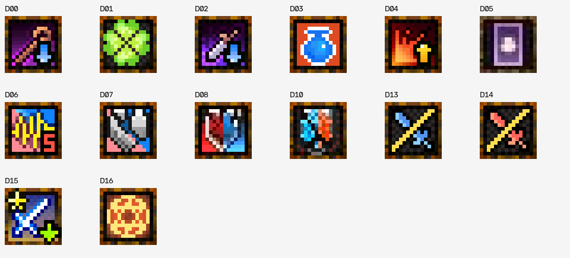
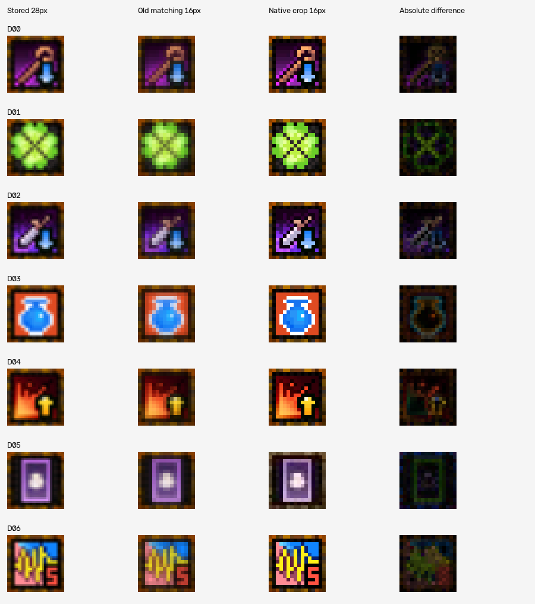
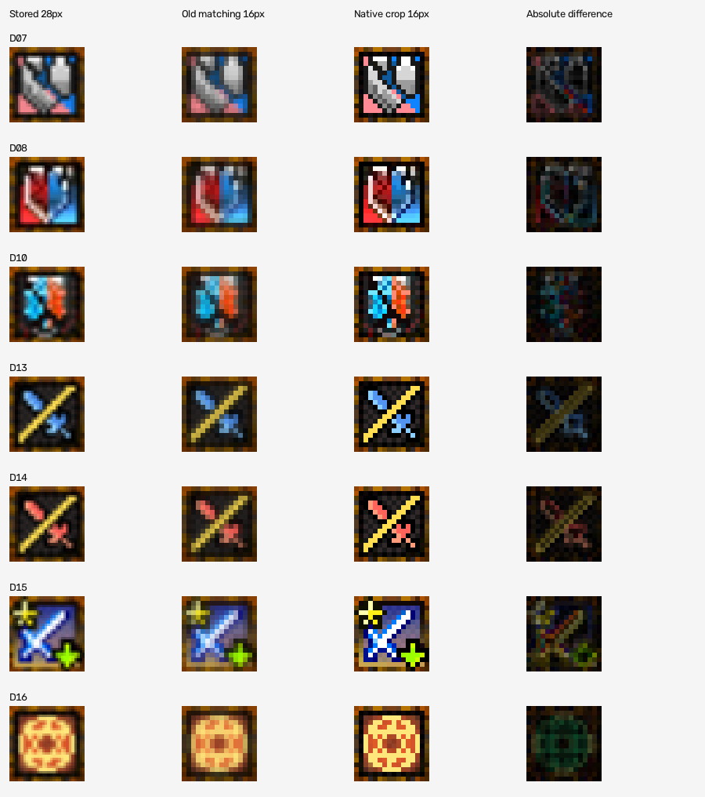
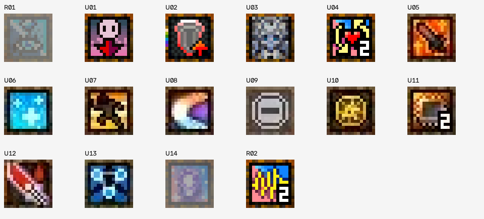
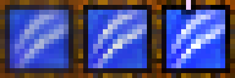

# 디버프 원본 크롭 및 판독 이미지 교체 검토

> 아래 최초 수집의 미확정 항목은 당시 자료 기준이다. 후속 확인으로 이면을 보는 눈과
> 쿤의 선명한 원본 대응을 확인했다. 이면은 체력바 판독 불가 QA의 추가 원본 절,
> 쿤과 불협화음 보류는 이 문서 마지막 절을 따른다. 앱 이미지 교체 승인을 뜻하지 않는다.

- 작성일: 2026-10-16 (Asia/Seoul)
- 기준 소스: `589ddfc4afccc1e3e080bbacab7b4775a05b232a`
- 목적: 보유 원본 스크린샷에서 디버프 판독용 이미지를 추출하여 개발 세션에 전달한다.
- 상태: 자료 준비 완료. 제품 이미지, 앱 구현, 사용자 설정은 변경하지 않았다.
- 결론: **원본 크롭을 교체 검토 자료로 제공한다. 선명한 이미지로 일괄 교체하면
  오탐이 해결된다고 결론 내릴 수는 없다. 프라가라흐 쌍은 실제 엔진 실행에서도 혼동한다.**

## 1. 자료와 추출 규칙

- `tests/data` 바로 아래 PNG 42개 중 전체 화면 37개의 하단 보스/디버프 영역을 육안 조사했다.
  나머지 5개는 버프 단독 이미지 또는 버프 영역이라 이번 수집 대상이 아니다.
- 디버프가 보이는 15개 화면, 아이콘 130개 슬롯을 좌표와 함께 기록했다.
- 원본 이미지 42개와 기본/개발용 디버프 아이콘 21개의 Git blob SHA를 현재 원격 tree와 대조했다.
  63개 모두 일치했다. 커밋 이력은 조회하지 않았다.
- 원본 PNG의 픽셀을 **16 x 16 그대로** 잘랐다. 시간 글자는 포함하지 않는다.
  보간, 선명화, 색 보정, WebP/JPEG 재압축을 하지 않았다. 결과는 불투명 BGR 3채널 PNG다.
- 비교/목록 이미지의 확대에만 Nearest를 사용했다. **미리보기 PNG를 판독 템플릿으로 쓰지 않는다.**
- 이름은 현재 등록 이미지와 실제 크롭의 외형을 대조한 것이다. 게임 툴팁/API로 효과의
  의미를 확인한 것은 아니며, 대응이 불확실한 그림에는 임의로 이름을 붙이지 않았다.

자료 폴더: [`assets/debuff_native_20261016/`](assets/debuff_native_20261016/)

| 파일 | 내용 |
| --- | --- |
| `candidates/` | 등록 이미지와 대응되는 교체 검토 후보 14종. 기존 아이콘과 같은 파일명 |
| `references/` | 반투명/이름 미확정/숫자 차이 참고용 16개. 자동 교체 대상 아님 |
| `manifest.json` | 원본 경로와 SHA, 화면별 슬롯 순서, 추출 위치, 현재 템플릿 대응 |
| `metrics.json` | 크롭 픽셀 SHA-256, 130슬롯 점수, 화면 전체 ROI/배경 점수, 엔진 재현 결과 |
| `rebuild.py` | 제품을 수정하지 않는 재추출/검증 도구 |

## 2. 교체 검토 후보 14종



좌표는 원본 PNG의 0-based `(x,y)`이며 전부 크기 `(16,16)`이다.
`S08` 등은 아래 원본 목록과 `manifest.json`의 화면 ID다.

| ID | 등록 이름 | 원본 | 좌표 | 기본 제공 여부 |
| --- | --- | --- | --- | --- |
| D00 | 마법 방어력 보호 감소 | S35 | (1023,1212) | 기본 |
| D01 | 모모 | S35 | (1167,1212) | 기본 |
| D02 | 물리 방어력 보호 감소 | S08 | (1025,1214) | 기본 |
| D03 | 물풍선 | S35 | (1095,1212) | 기본 |
| D04 | 받는 대미지 증가 | S35 | (1041,1212) | 기본 |
| D05 | 방해 카드 | S25 | (1205,1214) | 기본; 다른 화면의 확실한 양성 표본 없음 |
| D06 | 불협화음 | S35 | (1185,1212) | 기본; 숫자 차이 참고 R02도 확인 |
| D07 | 붕괴의 파동 | S36 | (1113,1212) | 기본; 다른 화면의 양성 표본 없음 |
| D08 | 야옹이 | S35 | (1113,1212) | 기본 |
| D10 | 케라 | S35 | (1059,1212) | 기본 |
| D13 | 프라가라흐(마법) | S35 | (1149,1212) | 기본 |
| D14 | 프라가라흐(물리) | S35 | (1131,1212) | 기본 |
| D15 | 공격력 감소 | S08 | (1151,1214) | `devdata`에만 있음; 기본 배포 여부 별도 결정 |
| D16 | 마기그래프 | S36 | (1293,1212) | `devdata`에만 있음; 같은 화면에 동일 픽셀 3개 |

주요 원본은 모두 기존 `tests/data`에 있으므로 다시 첨부할 필요가 없다.

| ID | 원본 파일 | 크기 |
| --- | --- | --- |
| S08 | `스크린샷 2026-10-07 013118.png` | 2560 x 1440 |
| S20 | `스크린샷 2026-10-09 193901.png` | 2560 x 1440 |
| S25 | `스크린샷 2026-10-09 201512.png` | 2560 x 1440 |
| S34 | `스크린샷 2026-10-14 000646.png` | 2560 x 1440 |
| S35 | `스크린샷 2026-10-15 213313.png` | 2556 x 1436 |
| S36 | `스크린샷 2026-10-15 213734.png` | 2556 x 1436 |

현재 등록 원본은 28 x 28이고, 엔진이 `INTER_AREA`로 높이 16px까지 축소한다.
아래의 열 순서는 등록 원본, 현재 판독용 축소본, 원본 크롭, 절대 픽셀 차이다.




## 3. 교체하지 말고 식별/상태 확인할 참고 이미지



| ID | 관찰 내용 | 취급 |
| --- | --- | --- |
| R01 | 이면을 보는 눈과 외형 대응. S36의 (1275,1212), 반투명 상태 | 정상 불투명 기준 이미지로 쓰지 않음 |
| R02 | 불협화음과 외형 대응. S36의 (1221,1212), 우하단 숫자 2 | D06의 숫자 5와 비교; 숫자 차이 처리 검토용 |
| U01 | 분홍 해골과 붉은 아래 방향 표시 | 이름 미확정 |
| U02 | 회색 방패와 주황 위 방향 표시 | 이름 미확정 |
| U03 | 회색/푸른 그물 또는 결정 무늬 | 이름 미확정; 쿤으로 자동 연결하지 않음 |
| U04 | 여러 색 음표/선과 우하단 숫자 2 | 이름 미확정; 크레센도로 자동 연결하지 않음 |
| U05 | 주황 불꽃/검 모양 | 이름 미확정 |
| U06 | 청록 결정 무늬 | 이름 미확정; 쿤 템플릿 최고 점수만으로 식별 불가 |
| U07 | 노란 인물 실루엣 모양 | 이름 미확정 |
| U08 | 흰색/보라/파랑 초승달 모양 | 이름 미확정 |
| U09 | 회색 둥근 테두리와 가로 막대 | 이름 미확정 |
| U10 | 금색 원형 문양 | 이름 미확정 |
| U11 | 갈색 두루마리/문서와 숫자 2 | 이름 미확정 |
| U12 | 붉은 날과 흰 손잡이 모양 | 이름 미확정 |
| U13 | 푸른 눈/모래시계 유사 무늬 | R01과 같은 효과인지 미확정; 대응 이름을 붙이지 않음 |
| U14 | 흐린 보라 사각형 무늬 | 이름/활성 상태 미확정; 교체 금지 |

`쿤`, `크레센도`는 이번 자료에서 확실히 대응시킬 정상 아이콘을 확보하지 못했다.
참고 이미지는 모습의 예시이며, 서로 다른 효과 16종을 확정했다는 뜻은 아니다.

## 4. 교체 비교 결과와 한계

### 4.1 원본과 같은 화면에서 1.0은 정확도 검증이 아니다

추출한 픽셀을 다시 원본과 비교하면 자기 자신이라 1.0이 나온다. 이를 개선의 증거로 쓰지 않았다.
다른 화면의 동일 이름 슬롯을 별도로 비교했으며, 동일 픽셀이 반복된 화면과 진짜 다른
픽셀의 수는 `metrics.json`의 `other_scene_distinct_non_source_pixels`로 구분했다.
최솟값은 해당 표본의 점수이며 실제 사용자 환경의 최악값이나 정답 확률이 아니다.

| 대상 | 다른 화면 최저 점수: 기존 | 원본 후보 | 해석 |
| --- | --- | --- | --- |
| 마법 방어력 보호 감소 | 0.819597 | 0.694946 | 일부 화면에서는 오히려 점수 감소; 시작 기준 0.68과 가까움 |
| 물리 방어력 보호 감소 | 0.843361 | 0.703874 | 일부 화면에 대한 허용 폭 감소 |
| 불협화음 | 0.733765 | 0.687354 | 숫자/렌더링 차이까지 함께 검증 필요 |
| 프라가라흐(마법) | 0.871967 | 0.755243 | 선명화만으로 모든 화면 점수가 높아지지 않음 |
| 프라가라흐(물리) | 0.834567 | 0.708416 | 같은 한계 |
| 공격력 감소 | 0.830233 | 0.934688 | 다른 화면 1개에서는 개선 |

확실히 이름이 대응되는 다른 아이콘 슬롯에 대해 시작 임계 이상으로 교차 인식한
`대상 ID x 슬롯` 건수는 기존 14건, 후보 11건이다. 프라가라흐 쌍에서 11건이 남는다.
이는 수집 표본의 중복을 포함한 건수이며 사용자 환경의 오탐률이 아니다.
이름이 미확정인 슬롯은 확정 음성 표본으로 세지 않았다.

보스가 없는 배경 4개에서는 기존/후보 모두 대상 14종의 시작 임계를 넘지 않았다.
`metrics.json`에는 실제 엔진의 회색 후보 검색 및 컬러 확인을 사용한 15개 화면 ROI 점수도 있다.
비교 ROI는 `(1000,1195,570,88)`이며 앱에 저장한 영역을 바꾼 것은 아니다.

### 4.2 Confirmed Bug: DEBUFF-NATIVE-QA-01

- 심각도: P2, 디버프 식별 정확성. 크래시/게임 입력 간섭 문제는 아니다.
- 발생 조건: 실제 원본에서 자른 프라가라흐 한 종류의 16 x 16 패치만 두 종류가 등록된
  `DebuffEngine`에 연속 입력한다. 탐지 방식은 `off`, 시간은 0.15초 간격 8회다.
- 예상: 적용된 한 종류만 숨기고, 반대 종류는 미적용 오버레이 항목으로 남는다.
- 실제: 기존 이미지와 원본 후보 모두 **두 종류를 모두 숨긴다**. 반대 종류까지 적용으로 판단한다.
- 사용자 영향: 둘 중 하나만 적용된 상황에서, 아직 필요한 반대 종류의 표시가 사라질 수 있다.
- 기술적 원인: 같은 위치에서 각 템플릿을 독립 평가한다. 공유하는 테두리/대각선 무늬가 강해
  다른 색의 아이콘도 컬러 상관계수 0.68을 넘는다. 같은 위치의 후보 간 배타적 식별이 없다.
- 검증: 앱의 실제 `best_scores()`와 `tick()` 호출로 네 경우를 실행했다. 결과 전문은
  `metrics.json`의 `identity_repro`에 있다. 단순 점수 추측이나 육안 추정이 아니다.
- 한계: 한 아이콘만 존재하는 입력을 원본 크롭으로 구성한 통제 재현이다. 전체 라이브
  화면에서 사용자가 겪은 모든 오인식의 원인을 확정한 것은 아니다.
- 코드: `src/mabinogi_addon/tracker/debuff_engine.py:197`의 `_best`,
  `:228`의 `_detect`, `:381`의 `tick`,
  `src/mabinogi_addon/detect/icon_matcher.py:30`의 `match_icon`.
  아래 재현 명령으로 함께 실행한다.

| 입력에 실제 존재하는 아이콘 | 템플릿 | 정답 점수 | 반대 종류 점수 | 최종 결과 |
| --- | --- | --- | --- | --- |
| 마법만 | 기존 | 0.937419 | 0.796064 | 둘 다 적용으로 판단 |
| 마법만 | 원본 후보 | 1.000000 | 0.881816 | 둘 다 적용으로 판단 |
| 물리만 | 기존 | 0.911876 | 0.796914 | 둘 다 적용으로 판단 |
| 물리만 | 원본 후보 | 1.000000 | 0.881816 | 둘 다 적용으로 판단 |

## 5. 개발 세션 전달 사항

1. 먼저 이 문서와 `manifest.json`, `metrics.json`을 확인한다. **14개를 무조건 덮어쓰지 않는다.**
2. 판독용 16px 원본과 오버레이 표시용 이미지를 구분한다. 현재 디버프 카탈로그는
   `display_image=None`으로 판독 아이콘을 표시에도 쓰므로, 28px를 바로 16px로 바꾸면
   오버레이 외형도 바뀐다. 표시 품질을 유지할지 명시적으로 결정한다.
3. 현재 입력은 native 16px이지만, 이미지 하나만 교체해 다른 화면의 정답 여유가
   줄어들지 확인한다. 필요하다면 렌더링별 템플릿 지원을 검토하되, 템플릿을 늘린 뒤
   최고 점수만 취하면 오탐 후보도 늘 수 있으므로 양성/음성 검증을 같이 한다.
4. 프라가라흐 마법/물리, 방어력 감소 마법/물리를 한 종류만 넣은 경우를 각각 검증한다.
   후보 간 경쟁/구분 색상 확인 등 식별 보완을 검토하고, 일괄 임계 상향만으로 해결하지 않는다.
5. 불협화음 숫자 5/2처럼 무늬 위 숫자가 바뀌는 사례를 놓치지 않는다. 시간 OCR은
   디버프 종류 식별의 대안으로 사용하지 않는다.
6. 사용자 `data/debuff/icon`의 같은 이름 파일이 기본 이미지를 덮어쓸 수 있다.
   기본 이미지 교체가 모든 기존 설치에 적용된다고 가정하지 말고, 실제 로딩 경로와
   사용자 추가 아이콘 보존/호환 정책을 확인한다. 설정 초기화를 해결책으로 삼지 않는다.
7. 기본에 없는 `공격력 감소`, `마기그래프`를 이번 자료 수집만으로 새 기본 기능으로
   추가하지 않는다. 이름 미확정과 반투명 참고본도 확정 이미지로 넣지 않는다.

## 6. 재현/자료 검증

저장소 루트에서 실행한다. `--check`는 파일을 쓰지 않고 원본 SHA, 저장된 30개 크롭의
픽셀 일치, 미리보기, 비교 수치와 엔진 재현 결과를 검증한다. 제품 수정 후 결과가 달라지면
이 자료는 기준 소스의 스냅샷임을 유지하고 변경점을 별도로 분석한다.

```bash
PYTHONPATH=src uv run python docs/qa/assets/debuff_native_20261016/rebuild.py --check
```

Windows PowerShell:

```powershell
$env:PYTHONPATH = "src"
uv run python docs/qa/assets/debuff_native_20261016/rebuild.py --check
```

크롭을 재생성할 때만 `--check` 대신 `--write`를 사용한다. 원본 좌표/이름 판단을 바꾸려면
먼저 `manifest.json`과 대응 근거를 함께 갱신한다. 미해결 오인식 재현의 `observed_missing=[]`는
현재 결함을 기록한 값이지 정상 기대값이 아니다. 도구의 `PASS`는 자료 검증 성공을 뜻한다.

독립 실행에서 추출/검증을 완료했다. 임시 복사본의 크롭을 1픽셀 1채널만 변조하거나
원본 SHA를 틀리게 기록한 경우도 각각 검증 실패로 잡히는 것을 확인했다.
Windows 실게임, 다른 DPI/게임 배율, 영상 기반 장시간
정확도는 이번 수집에서 검증하지 않았다. 제품 교체나 릴리즈 QA를 통과시킨 작업이 아니다.

## 7. 후속 추가 원본: 쿤 (2026-10-16)

- 기준: `012a1db721190fb89111a3f067f9c4ad2dc135fa`. 제품 변경 없이 원본 PNG 1개만 추가됐다.
- 사용자 제공 원본: `tests/data/스크린샷 2026-10-16 213335.png`, **2556x1436**.
- Git blob: `1de6717c568cbcb9a90f21bb40c8a4940b1bca18`. 로컬 원본 해시 일치를 확인했다.
- 쿤 네이티브 16x16 위치: 보스 디버프 줄 `(1023,1212)`, 화면 중앙 `(1366,379)`.
- 현재 28x28 등록 이미지의 실제 엔진용 16x16 축소본과 컬러 비교했다.
  보스 줄 **0.976469**, 중앙 **0.947166**으로 두 위치 모두 감지 기준 **0.68**을 넘는다.
- 실제 보스 ROI `(1016,1195,521,88)`를 기존 감시(off)/자동(auto)에 각각 0.1초 간격 8틱 입력했다.
  두 모드 모두 쿤 적용을 확정하고 미적용 오버레이를 숨겼다. 앱의 판독 범위를 중앙까지 확대하지 않았다.
- **쿤은 정상 원본 대응 미확정 목록에서 제외한다.** 원본은 두 위치지만 같은 장면이므로
  다양한 장면의 정확도·모든 유사 아이콘과의 식별까지 검증한 것은 아니다. 기존 이미지도
  이번 원본에서 정상 인식되므로 선명한 자료를 얻었다는 이유만으로 제품 이미지를 교체하지 않는다.
- 기본 목록 중 정상 원본 대응 확인 대기는 **크레센도**다. **불협화음은 사용자 요청으로
  숫자 2/5 차이에 대한 추가 확인을 보류**한다. 방해 카드·붕괴의 파동의 장면 다양성 부족은 별개다.
- 새로 추가된 다른 스크린샷 전체를 재식별했다는 결과는 아니다.

개발 참고 크롭과 재실행 도구: `assets/kun_native_20261016/`.

```bash
PYTHONPATH=src python docs/qa/assets/kun_native_20261016/analyze.py
```



크롭은 원본 픽셀 그대로이고 비교 이미지만 최근접 8배 확대다. 제품 소스·설정·아이콘은 수정하지 않았다.

## 8. 후속 추가 원본: 방해 카드·붕괴의 파동 (2026-10-16)

- 기준: `a09edfe631adc2f0999e432f9958154952fb7a2c`. 제품 변경 없이 PNG 2개만 추가됐다.
- 추가분은 크레센도·불협화음 자료가 아니라 방해 카드·붕괴의 파동으로 확인했다.
  최초 안내에서 두 대상을 잘못 짚었으나 실제 원본을 확인해 정정했다.
- 원본은 `스크린샷 2026-10-16 213733.png`, `213830.png`, 모두 **2556x1436**.
  Git blob은 각각 `863ce53400b060e421e227c709e2d9aba5586cac`,
  `8194b92c120fb93e52bffe1cf1ca31c037e04c86`이며 로컬 해시 일치를 확인했다.

| 원본 | 확인된 아이콘 | 원본 16x16 좌표 | 현재 등록 이미지의 정답 점수 |
| --- | --- | --- | --- |
| 213733 | 방해 카드 | (1113,1212) | 0.966387 |
| 213733 | 붕괴의 파동 | (1077,1212) | 0.919839 |
| 213830 | 붕괴의 파동 | (1023,1212) | 0.919194 |

현재 실제 엔진에 보스 ROI `(1016,1195,521,88)`를 기존 감시(off)/자동(auto) 각각
0.15초 간격 8틱 입력했다. 첫 원본에서는 두 항목 모두 적용으로 확정했고,
두 번째 원본에서는 붕괴의 파동만 적용, 방해 카드는 미적용 표시로 남겼다.
두 번째 원본에는 다른 디버프도 보이므로 '붕괴의 파동만 있는 화면'이라고 단정하지 않는다.
검증 대상 두 항목 중 하나만 존재하는 대조군이라는 의미다.

따라서 방해 카드와 붕괴의 파동 모두 기존과 다른 장면의 정상 원본을 추가 확보했고,
이번 표본에서 현재 판독 이미지가 동작함을 확인했다. 붕괴의 파동은 이번 두 장면에서도
정상 판독했다. 전체 게임 환경의 오탐률이나 모든 숫자/투명도 차이를 검증한 것은 아니다.

네이티브 크롭·실제 엔진 재실행 도구와 점수는 `assets/card_wave_native_20261016/`에 보관한다.
비교 이미지는 위에서부터 방해 카드/붕괴 다중 장면/붕괴 다른 장면이고 각 행의
왼쪽은 현재 판독용 축소본, 오른쪽은 새 네이티브 원본이다.


```bash
PYTHONPATH=src python docs/qa/assets/card_wave_native_20261016/analyze.py
```

현재 자료 기준 정상 원본 대응 미확정 항목은 **크레센도**이며, **불협화음 숫자 차이 검증은
사용자 요청에 따라 계속 보류**한다. 제품 이미지·구현·설정은 교체하거나 수정하지 않았다.
