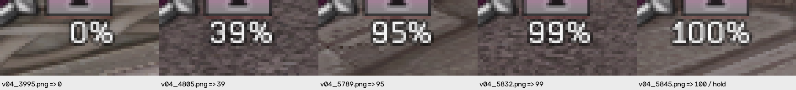
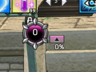

# 신규 도르카·투아림 원본 자료 독립 QA

- 날짜: 2026-10-17 (Asia/Seoul).
- 데이터 포함 기준: `1b60091101b63f6ceb2d45ff75bb709f1647cb1f`.
- 이번 설정 폭 수정의 제품 소스는 `bff2497`와 같으며, 이 자료 추가로 판독기/모델은 바뀌지 않았다.
- 원본 ZIP/PNG/파일명/제품/기존 테스트를 바꾸지 않았다. 커밋 이력/메시지는 조회하지 않았다.
- 추가 진단 ZIP에 기록된 버전은 0.4.81이다. 판독 구현/자산은 현재까지 변경되지 않아
  현재 소스에서도 직접 재실행했다. 버전 기록을 사용자 업데이트 누락의 근거로 삼지 않는다.

## 자료와 재현

- `tests/data/autofind_20261016T192204168176Z_e70b6c5c.zip`, Git blob
  `2df5e973412440f1d6bf5cdead55d14006cc78dd`: 도르카 자동 찾기의 실제 3840x2160 입력/자산/로그.
  23개 항목, 원본 PNG SHA256 무결성 검사 통과, 필수 자산 누락 없음.
  저장된 도르카 검출 자산/숫자 참조는 현재 제품 로드 결과와 픽셀 단위로 동일하다.
- `tests/data/투아림게이지 샘플 모음.zip`, Git blob `843674a62afdb47ce1ce74dc298a1bd693700440`:
  PNG **1242장**, 각 58x28, 파일명은 모두 v04 접두사다. 파일명은 정답 라벨로 쓰지 않는다.
- 아래 명령의 실제 결과는 **6 failed, 1 passed (4.21초)**다. 실패는 도르카 1건과
  사람이 읽어 라벨링한 투아림 5건이며 6개의 독립 결함으로 세지 않는다.

```bash
PYTHONPATH=src:. QT_QPA_PLATFORM=offscreen python -m pytest scripts/qa_new_resource_samples.py -q --tb=short
```

## Confirmed Bug: TUARIM-SAMPLE-READ-QA-01

- 심각도 **P2**. 실제로 다른 %가 표시된 입력을 모두 4로 읽어 현재 값/임계 알림에 잘못된 관측을 공급한다.
- 조건: 제공된 58x28 원본 PNG를 현재 `read_percent()`에 무변형으로 넣는다.
  이 크기는 현재 영역 선택 기본값 `TUARIM_BOX_SIZE=(58,28)`와 같고 숫자/%가 원본에 보인다.
- 기대: 아래 사람이 확인한 정수. 100%는 현재 안전 보류 계약에 따라 None이다.
- 실제: 아래 5개 전부 **4**. 95/99를 읽지 못하므로 90/95 임계값 알림 누락으로 이어질 수 있다.
  실제 스피커 알림을 재생해 검증한 것은 아니다.

| 원본 멤버 (`새 폴더 (2)/`) | 그림으로 확인한 값 / 기대 | 현재 결과 |
| --- | --- | --- |
| v04_3995.png | 0% / 0 | 4 |
| v04_4805.png | 39% / 39 | 4 |
| v04_5789.png | 95% / 95 | 4 |
| v04_5832.png | 99% / 99 | 4 |
| v04_5845.png | 100% / None | 4 |



전체 1242장에 `read_percent()`를 각각 실행하면 **1242장 모두 4**를 반환한다(0.41초, OpenCV 1스레드).
전체 그림을 사람이 라벨링한 것은 아니므로 오독률 100%라고 계산하지 않는다. 위 5개의 오독은 직접 확인했다.
**v04를 정답 4로 간주해 전부 레퍼런스에 학습시키면 안 된다.**

### 코드 경로와 원인 범위

- `detect/tuarim_reader.py:168`은 가로/세로 비율 >=2.5일 때만 여백 정렬 경로로 간다.
  이번 58/28은 약 2.07이라 기존 경로를 탄다.
- `:171`의 `_prep()`는 여백/버튼 일부/배경을 포함한 전체 28px 높이를 13px로 축소한다.
  원본 숫자 행이 별도로 정렬되지 않고 고정 자리 오프셋의 NCC 분류로 진행한다.
- 현재 레퍼런스/정렬이 이 입력을 4로 수용하며 100%도 안전 보류하지 못한다.
  이 경로는 결정적으로 확인했지만 정렬만 바꾸면 모든 새 글꼴/렌더 변형이 해결된다고 주장하지 않는다.
- 이번 화면 폭 라벨 수정은 판독기를 바꾸지 않았다. 폭 수정이 숫자 판독을 망가뜨린 회귀라고 단정하지 않는다.

개발 전달: 원본을 보존하고 숫자/% 행·배율·여백을 검증한 뒤 판독한다. 기본 박스/기존 등록 영역을
사용자 실수로 처리하거나 파일명 v04를 신뢰하지 않는다. 90~99 및 100→0 전환에서 잘못된 저값이
재무장 근거가 되는지도 별도 tracker 회귀로 확인한다. 불확실한 입력을 그럴듯한 4로 확정하지 않는다.

## Confirmed Bug: DORCHA-LIVE-RENDER-QA-01

- 심각도 **P2**. 정상적으로 보이는 도르카 0 UI의 자동 찾기가 실패해 등록 승인을 진행하지 못한다.
- 조건: 추가 도르카 진단의 무변형 전체 입력을 현재 `run_detector("dorcha", ...)`에 넣는다.
- 기대: 실제 원형 내부 0을 포함하는 올바른 영역을 반환하고 판독/승인 흐름으로 이어진다.
- 실제: None, `anchor_not_found`. 저장 자산으로 ZIP replay도 `replayed=True`, `matches_recorded=True`, result=None이다.
- 로그의 실제 위치 주변 후보는 `(526,107,45,57)`, 배율 1.0, **0.9500485659**로 기준 0.97에 못 미친다.
  대체 모델은 같은 부근 약 **0.9057137370**다. 원본 해상도 fallback까지 실행됐지만 합격 후보가 없다.
- 이전의 '축소 후보 상위 3개만 봐서 실제 고점 후보를 누락' 사례와 달리 이번에는 위치 근처 후보가
  정밀 단계까지 와도 점수가 미달이다. 후보 수만 늘려 해결된다고 단정하지 않는다.



### 코드 위치와 검증 한계

- `detect/resource_anchor.py:40` 공용 장식 검출, `:65` 원본 fallback, `:81` 기준 미달 거부.
- `detect/dorcha_anchor.py:23`은 후보가 없으면 숫자 판독 전에 실패한다.
- 현 고정 오프셋의 숫자 영역 `(534,124,28,23)`을 별도로 읽어도 `read_dorcha()`는 None이다.
  따라서 단순히 장식 기준만 낮추면 최종 0까지 읽힌다고 보장하지 않는다.
- 근처 원점/크기 정밀 탐색도 일부 해봤지만 안전 기준을 넘는 새 모델을 확보한 것은 아니다.
  이 입력의 구체적인 렌더/배율/정렬 차이 중 무엇이 결정적인지는 후속 모델 검증이 필요하다.
- 미래 회귀는 현재 모델을 강제하지 않고 현재 제품 자산으로 전체 입력을 다시 찾도록 했다.
  성공 시 화면의 실제 0 중심 부근 포함 및 숫자 0 판독까지 검사한다. 엉뚱한 배경 검출을 성공으로 세지 않는다.

개발 전달: 현재와 새 원본의 장식/숫자 렌더·기하를 대조하고 필요한 원본 기반 자산/정렬을 검증한다.
0.97 기준을 무조건 낮추거나 숫자 검증을 삭제하지 않는다. 기존 0~15/다른 배경/가림/복수 위치
거부 및 투아림의 독립 찾기 경로도 회귀 확인한다.

## 환경과 결론

Linux/OpenCV에서 실제 PNG를 재실행한 결과다. 새 Windows 게임 실행/화면 재캡처/알림 청취/장시간 자원은 미검증이다.
두 문제는 후속으로 새로 제공된 데이터에서 확인됐고 이번 QLabel 변경으로 발생한 것으로 보지 않는다.
제품을 임의 수정하지 않고 원본 재현/원인 범위/개발 확인 사항만 공유한다. 릴리즈 명령은 보류한다.
