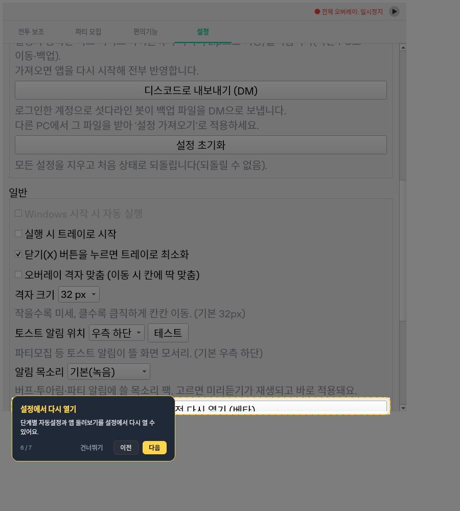
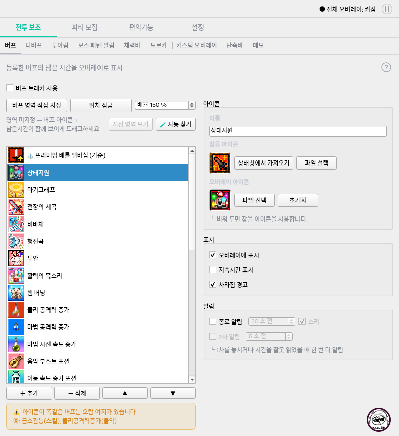

# 전투 보조 탐색 구조 및 투어 독립 QA

- 날짜: 2026-10-17 (Asia/Seoul).
- 제품 기준: `97da9bb61a81aec55d2fdf804a868acecbadfe61`.
- 비교 기준: 직전 독립 QA `99adfb4`. 커밋 이력/메시지 대신 두 소스 tree와 파일 내용을 비교했다.
- 요구사항: `docs/navigation-structure-spec.md`, 관련 도르카/잡담 명세 및 `docs/기획서.md`.
- 제품/원본/기존 테스트를 수정하지 않았다. 검증 사본의 변경 제품 파일 4개 모두 원격 Git blob과 해시가 일치한다.

## Confirmed Bug: NAV-TOUR-LAYOUT-QA-01

- 심각도 **P3**. 큰 글꼴 조건에서 투어 설명이 강조 버튼 일부를 가리는 안내 UI 결함이다.
  앱 크래시, 설정 손상, 판독/알림 실패 또는 게임 방해로 확대하지 않는다.
- 조건: 논리 작업 영역 `(0,0,900,1000)`, 기존 설정, 위젯 글꼴 20px,
  사용법 투어의 여섯 번째 '설정에서 다시 열기' 단계로 이동한다.
- 기대: 스크롤/레이아웃이 끝난 실제 강조 대상과 설명 카드가 겹치지 않고 버튼 이름을 읽을 수 있다.
- 실제: 설정의 자동설정 다시 열기 버튼 일부와 문구를 설명 카드가 덮는다.
- 사용자 영향: 안내받는 버튼과 설명의 연결이 불명확해진다. 투어 다음/건너뛰기 자체가 막히는 문제는 아니다.
- 관련 요구사항: NAV-14/NAV-17 및 6.1절의 '카드가 대상과 핵심 버튼을 가리지 않는다'.



### 재현 및 결정적인 실행 근거

```bash
PYTHONPATH=src:. QT_QPA_PLATFORM=offscreen python -m pytest scripts/qa_navigation_tour_layout.py -q --tb=short
```

- 전체 행렬: **2 failed, 10 passed (14.93초)**.
- 3개 논리 작업 영역, 기본/큰 글꼴, 완료/건너뛰기 경로의 12개 조합이다.
  작업 영역은 `(0,0,900,1000)`, `(0,0,800,600)`, `(-1600,120,900,700)`을 모사한다.
- 실패 2건은 같은 겹침의 완료/건너뛰기 경로다. 서로 다른 두 결함으로 세지 않는다.
- 각 투어 단계마다 **실제 Qt 이벤트 루프 50ms와 추가 processEvents 8회** 후 검사했다.
  초기 배치 중의 순간적인 값만으로 실패 판정한 것이 아니다.
- 해당 단계 하나만 별도 프로세스에서 실행해도 **1 failed (1.55초)**로 재현했다.

| 값 (투어 로컬 QRect) | 단계 진입 직후 | 이벤트 처리 후 |
| --- | --- | --- |
| 강조 대상 | `(23,719,740,42)` | `(23,778,740,33)` |
| 설명 카드 | `(23,774,320,129)` | `(23,774,320,129)` |

대상은 아래로 이동하고 현재 보이는 영역 크기도 달라졌지만 카드 위치는 그대로다.
화면 캡처에서도 버튼 왼쪽/이름 일부가 가려진 것을 확인했다.

### 기술적 원인과 위치

- `ui/main_window.py:911`의 `go_settings()`가 탭을 전환하고 `:919`에서 대상을 스크롤 안에 보이게 한다.
- `ui/tour_overlay.py:148`의 `_show_step()`는 이 진입 함수 직후 동기적으로 `:159`에서 카드를 배치한다.
- 이후 Qt 레이아웃/스크롤 정착으로 대상 좌표가 바뀐다. `_target_rect()`는 현재 visibleRegion으로
  강조 위치를 계산하지만, 카드 배치는 그 변화에 맞춰 갱신되지 않는다.
- `TourOverlay.eventFilter()`의 갱신 대상은 host Move/Resize뿐이며, 이번 대상/스크롤 변화에는 호출되지 않는다.
- 따라서 강조 구멍은 새 버튼 위치를 따르고 카드만 옛 위치에 남는다.
- 변경 전 같은 큰 글꼴 조건의 실행 비교는 하지 않았다. 이번 개편이 처음 만든 회귀라고 단정하지 않으며,
  현재 구현이 새 명세의 큰 글꼴 투어 조건을 만족하지 못한다는 발견이다.

### 개발 전달 사항

레이아웃/스크롤이 정착한 뒤 카드와 강조 좌표를 함께 재계산하고, 투어 진행·종료·숨김 시
예약된 갱신이 오래된 투어나 파괴된 위젯을 건드리지 않도록 확인한다.
지속 polling이나 글꼴 강제 축소로 대체하지 않는다. 동일 12조건과 기존 투어 복귀/접근 권한/종료 검사를 재실행한다.
재현은 일반 수집 밖 `scripts/qa_navigation_tour_layout.py`에 두며 불일치 assertion을 완화하지 않는다.

## 통과한 범위

- 원격 소스의 상위 순서: 전투 보조 / 파티 모집 / 편의기능 / 설정.
- 전투 보조의 9개 기능은 승인된 순서다. 체력바 다음 도르카이며 탭의 베타 표기만 제거됐다.
- 편의기능은 기존 계산기 3개이며, 기능 진입만으로 사용 체크를 변경하거나 계산식을 바꾸지 않았다.
- 체력바/도르카/단축바의 편집 활성 조건은 실제 해당 위젯의 표시 여부를 사용한다.
  고정된 예전 편의기능 인덱스로 판정하는 경로는 남아 있지 않다.
- `tests/test_navigation.py`, `test_setup.py`, `test_tracker_layout.py`, `test_creator_dialogue.py`:
  **245 passed (59.02초)**. 정확한 기능 진입, 시작/안내, 기본 배치, 로그인/접근,
  투어 앞뒤 이동/복귀/숨김, 잡담 제외, 반복 전환의 객체/설정 보존과 기존 QThread 누수 검사 포함.
- 독립 행렬 10개 통과 조건에서는 기능 사용/영역/배율/잠금/임계값/메모/알 수 없는 추가 설정을
  넣은 뒤 반복 전환, 투어 앞뒤 이동과 완료/건너뛰기 후 설정·선택·일시정지 상태를 확인했다.
  실패 2개 조건은 6단계에서 중단했으므로 그 조건의 완료 후 검증까지 성공했다고 세지 않는다.
- `scripts/qa_tuarim_right_structure_background.py`, `scripts/qa_tuarim_coarse_candidate_miss.py`:
  **17 passed (14.35초)**. 실제 투아림 진단 ZIP과 이전 98% 원본의 해결 상태가 유지된다.
  이번 푸시에 판독기/템플릿 변경은 없다.

## 실제 렌더 확인

`scripts/render_navigation.py`를 독립 실행해 제품 MainWindow의 PNG 19개를 만들었다.
9개 기능, 편의기능, 큰 글꼴 버프/디버프, 기본 글꼴 투어 7단계를 포함한다.
이는 별도 모형 화면이 아니라 실제 제품 위젯이다.

- 기본 790px 창에서 탭 9개의 이름과 버프의 좌우 목록/편집 배치를 확인했다.
- 도르카 자식 미리보기의 배경이 정상 채워지고, 실제 게임용 부모 없는 오버레이는 투명 속성을 유지한다.
- 큰 글꼴의 기존 세로 배치/스크롤 예외는 유지된다. 기본 화면까지 상하 배치로 바뀌지는 않았다.
- 기본 글꼴의 설정 안내와 별개로 위 독립 큰 글꼴 조건에서는 겹침이 재현된다.



## Windows 및 환경 한계

제품 SHA가 일치하는 자동
[Windows validation 38990951713](https://github.com/StarlineBot/mabinogi_addon/actions/runs/38990951713),
job `117273018972`의 최종 로그와 성공 상태를 직접 확인했다.

- 격리 회귀 **1329 passed, 1 skipped, 5 deselected**, 446.23초.
- 네이티브 Windows 통합 **5 passed, 1330 deselected**, 2.44초.
- 필수 exe 빌드 **success**, 검증된 exe **123653680 bytes**.
- 선택적 아티팩트 업로드만 skipped이며 테스트/필수 빌드를 생략한 것이 아니다.

이 QA의 큰 글꼴 재현은 일반 회귀 수집 밖에 있어 기존 CI 통과만으로 해당 결함이 부정되지 않는다.

실행은 Linux offscreen Qt, 임시 설정과 명시적 장치/네트워크 경계에서 했다.
시스템 트레이가 없는 환경에서는 Windows 트레이가 생성하는 pause QAction만 테스트에서 제공해
실제 `_set_paused()` 경로를 실행했다. 제품 구현을 고친 것이 아니며 이 경계 차이를 앱 결함으로 세지 않았다.
20px 글꼴/작업 영역 모사는 Windows 혼합 DPI 캡처와 동일하다고 주장하지 않는다.
실게임 장시간 캡처/알림 청취, OS 핸들/GDI 추세 및 작업 영역의 실제 장치 변경은 미검증이다.

## 결론

기능 이동과 주요 회귀는 통과했지만, 큰 글꼴 투어 겹침 **P3 한 건**은 미해결이다.
제품을 임의로 수정하지 않고 문서/재현/이미지만 공유한다.
이는 크래시성 결함은 아니지만 QA 전체 통과로 표현하지 않으며, 릴리즈 명령은 수정 후 재검증까지 보류한다.
