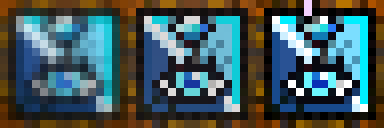

# 체력바 판독 불가 화면의 표시 깜빡임 QA

> 후속 확인: 수정본 `c058b7d`에서 원래 재현 10건이 모두 통과했다. 아래 최초 실패 기록은
> 보존하며 현재 판정과 Windows 상태는 마지막의 수정 후 독립 검증 절을 따른다.

- 확인일: 2026-10-16.
- 기준 SHA: `cec9bcd5928f2a0f36836cf41b7fd02948d60902`.
- 제보: 첨부 화면에서 체력바 오버레이가 깜빡이며, 맵 이동으로 게임 화면이 검어질 때도 동일하다.
  사용자는 이 상태에서는 잠깐씩 나타나는 것보다 표시하지 않는 동작을 원한다.
- 원본: `tests/data/스크린샷 2026-10-16 205627.png`, 2560x1440, 원격 Git blob
  `56ba66ae76c0e3e2e8249b68ce86f1a246bf40cd`와 로컬 해시 일치.
- 이전 QA 공유본과 비교한 원격 변경은 새 기획 문서·기획서·원본 PNG뿐이며 제품 코드는 동일하다.
  다른 새 기획의 검토나 제품 수정은 이번 범위에 포함하지 않는다. 커밋 이력은 읽지 않았다.

## Confirmed Bug: STAT-VIS-QA-01

### 심각도·조건·영향

- 심각도: P2, 판독 불가 중 반복 표시와 부정확한 상태 노출.
- 체력바 기능 및 바 표시가 켜지고 로그인·기존 활성 조건이 성립한다.
- 맵 전환의 검은 프레임이나 세 바가 온전히 판독되지 않는 입력이 지속된다.
- 정상 판독을 한 번도 하지 않은 초기 상태와 정상 표시 후 전환 양쪽에서 재현된다.
- 사용자 영향: 읽을 수 없는 동안 세 바가 반복해서 표시·숨김된다. 정상 판독이 다시 성공한 것도
  아닌데 기본값이나 이전 수치가 일시 노출될 수 있다. 시각 경고나 소리 경고가 켜져 있지 않아도 발생한다.
- 사용자의 조작·좌표 설정·YoloMouse를 원인으로 판단한 결과가 아니다. 고정된 검은 입력만으로 재현했다.

### 원인과 코드 위치

1. `src/mabinogi_addon/ui/stat_bars_tab.py:483`: 매 200ms 판독 틱의 시작에서 `_apply_visibility()` 호출.
2. 같은 파일 `:469`~`:473`: 읽을 수 있는 세 바의 존재 여부 없이 활성/표시 체크만으로 `show()`.
3. 같은 파일 `:512`~`:515`: 이후 판독이 실패하면 세 오버레이를 `hide()`.
4. 다음 틱은 실패 상태를 표시 조건에 반영하지 않으므로 다시 `show()`부터 수행한다.

따라서 픽셀이 전혀 바뀌지 않는 검은 프레임에서도 `Show -> Hide -> Show -> Hide`가 반복된다.
새 흔들림 타이머를 끄거나 판독 임계값을 낮춰 해결할 문제가 아니다. 실제 재현에서는 바별 경고와
보스 조건을 모두 꺼서 흔들림/소리와 무관한 표시 경로임을 분리했다.

추가로 같은 파일 `:498`~`:501`의 캡처 `None` 경로는 효과만 해제한 뒤 반환하며 창을 숨기지 않는다.
최초 캡처조차 없는 상태에서 세 바가 나타나거나, 직전 수치가 계속 보이는 것도 실행 확인했다.
검은 프레임의 반복 깜빡임과 `None`의 지속 표시는 서로 다른 증상이므로 구분한다.

### 독립 재현

```sh
PYTHONPATH=src:. QT_QPA_PLATFORM=offscreen python -m pytest scripts/qa_stat_overlay_invalid_frame_flicker.py -q --tb=short
```

기존 제품 코드를 고치지 않고 실제 `StatBarsTab`과 세 `StatBarOverlay`에 Qt 이벤트 필터를 설치했다.
각 조건에 동일 입력을 4틱 반복하고, 틱 마지막의 `isVisible()`뿐 아니라 중간 Show/Hide도 기록했다.

| 입력 | 최초 상태 / 정상 판독 후 | 실제 결과 |
| --- | --- | --- |
| 고정 검은 104x32 프레임 | 두 상태 모두 | 창마다 매 틱 Show/Hide 반복. 틱 마지막은 숨김 |
| 보유 저HP 원본에서 HP 띠만 가린 프레임 | 두 상태 모두 | 동일한 Show/Hide 반복 |
| 업로드 PNG의 원본 픽셀 좌표 ROI | 두 상태 모두 | 판독 실패 중 동일한 Show/Hide 반복 |
| 캡처 None | 최초 상태 | 세 창 Show 후 계속 표시 |
| 캡처 None | 정상 판독 후 | 직전 표시가 계속 남음 |
| 정상 원본 반복 | 대조군 | 표시 유지, 반복 Show/Hide 없음 |
| 비활성 상태 | 대조군 | 캡처/표시 없음 |

- 결과: **8 failed, 2 passed (0.62초)**. 실패 6건은 판독 불가 중 재표시, 2건은 캡처 실패 시 표시 유지다.
- 고정 검은 입력의 최초 상태 4틱에서 세 창 합계 **Show 12회 + Hide 12회**를 확인했다.
- 업로드 ROI는 화면에 표시된 `932,1403 / 104x32`를 원본 픽셀 좌표로 재생한 보조 사례다.
  당시 실제 DPI·캡처 메타데이터가 없어 이 ROI가 라이브 판독 원본과 같다고 단정하지 않는다.
  결함 확정은 그 가정에 의존하지 않으며 독립 검은 프레임과 부분 가림에서도 동일하다.
- Linux offscreen에서 Qt 창 이벤트의 반복을 실행 확인했다. 실제 Windows 화면의 점멸 빈도나
  compositor 표시 시간은 직접 측정하지 않았다. Windows에서 눈으로 본 깜빡임은 사용자의 라이브 제보다.
- 미해결 재현은 일반 `testpaths=tests` 밖의 `scripts/qa_*.py`에 두었다. 수정 전 실패가 예상 결과다.

## 기존 QA의 누락과 관련 회귀

앞선 흔들림 QA에서 판독 실패 후 시각 경고 중단과 틱 마지막의 숨김은 확인했으나, 같은 틱의
중간 Show 이벤트는 검사하지 않았다. `test_first_partial_capture_does_not_show_default_full_hp`도
틱 종료 후 상태만 확인하여 일시 표시를 놓친다. 이 제보는 앞선 통과 결과로 반박할 수 없다.

```sh
PYTHONPATH=src:. QT_QPA_PLATFORM=offscreen python -m pytest tests/test_stat_bars_stability.py tests/test_stat_shake.py docs/qa/assets/stat_shake_20261016/probes.py -q --tb=short
```

실제 관련 회귀 **58 passed**. 이 통과와 별개로 위 독립 재현은 8건 실패한다.
이미 검증된 제품 코드와 동일하므로 새 수동 Windows CI 실행을 요구하지 않았다.
기존 CI 성공이 이번 중간 표시 결함의 통과를 뜻하지 않는다.

## 개발 세션 전달

1. 표시 가능 여부와 데이터 판독 유효성을 함께 판단해, 판독 불가 중에는 show 호출 자체가 없어야 한다.
   틱마다 먼저 표시하고 실패 후 숨기는 순서를 유지한 채 지연 시간을 조절하는 것으로 해결하지 않는다.
2. 검은 프레임·세 바 불완전·캡처 실패에서는 숨김을 유지한다. 원래 수치를 0%로 바꾸거나
   세 바 완전성 검사를 완화하지 않는다. 정상 세 바를 다시 읽은 뒤 수치를 반영하고 표시한다.
3. 표시 체크·기능 ON·전체 정지 해제·로그인·포커스 복귀·영역 재지정에서도 유효 입력이 없는
   기본/직전 바를 일시 노출하지 않게 모든 `_apply_visibility` 호출 경로를 확인한다.
   기존 잠금 해제 배치 동작과의 충돌이 있으면 별도로 안내하며 정상 판독처럼 위장하지 않는다.
4. 소리 무장·시각 경고의 0.4초 확인·불명 구간 중단 정책과 저장 위치/드래그는 보존한다.
5. 회귀 검사는 종료 시 숨김뿐 아니라 Show 이벤트/호출 순서를 검사한다. 정적 검은 프레임 반복,
   정상 -> 검정 -> 정상과 캡처 None 복구, 표시/정지 왕복 및 실제 Windows 맵 이동을 포함한다.

QA에서는 제품 구현과 기존 테스트를 수정하지 않았다. 보고서와 미해결 재현만 공유하며,
수정 후 독립 재검증 전에는 이번 제보를 해결/전체 무문제로 판정하거나 새 릴리즈 명령을 제공하지 않는다.

## 수정 후 독립 검증 (2026-10-16)

### 대상과 실행 판정

- 제품 수정 SHA: `c058b7d59584027c01acd5f3e9e968d1dded83ac`.
- 제품 트리: `2cc9f44ef71959224c2a76a993615c5d2093034f`.
- 최초 QA 공유본 이후 변경은 체력바 탭, 공개 노트, 흔들림 검사 입력 도우미, 신규 표시 검사,
  개발 설명 5개다. 판독기·오버레이·효과 타이머·공용 캡처는 동일하다. 커밋 이력은 읽지 않았다.
- 이후 `0543d4e63245091c48486062081ad553d3f42c5d`까지 추가된 것은 원본 PNG 16개뿐이다.
  제품 소스와 설정·테스트 코드가 해당 제품 수정본과 동일함을 트리로 확인했다.
- **STAT-VIS-QA-01의 검은 화면 반복 표시와 캡처 None 잔류를 해결한 것을 독립 재현으로 확인했다.**
  확인 가능한 범위에서 새 제품 버그는 발견하지 못했다. Windows 최종 검증과 실게임 확인은 구분한다.

원래 `scripts/qa_stat_overlay_invalid_frame_flicker.py`는 수정하지 않았다. Git blob
`25dce1a21bdda53dafe40498653838ba536f8b4d` 동일성을 확인하고 원래 실행 명령으로 재검증했다.

- 수정 전 **8 failed, 2 passed** -> 수정 후 **10 passed (0.70초)**.
- 검은 프레임·부분 가림·원본 ROI·None의 최초/정상 표시 후 상태에서 Show 이벤트가 더 이상 발생하지 않는다.
- 정상 프레임은 계속 표시하고 비활성 상태는 계속 숨기는 대조군도 통과했다.
- `_display_valid`는 최초 False이고 세 바의 유효한 수치를 먼저 적용한 뒤 표시한다.
  실패, 정지, 기능 OFF, 비활성, 로그아웃, 영역 재지정에서 유효성을 버린다.
  정상 판독 없이 표시 체크나 정지 해제만으로 기본/직전 바를 재노출하지 않는다.

### 관련 회귀와 추가 반복

| 실제 실행 범위 | 결과 |
| --- | --- |
| 원래 독립 재현 | 10 passed |
| 표시·체력바·판독 공백·흔들림·독립 흔들림·종료·공개 노트 | 99 passed (10.83초) |
| Qt 150%: 원래 재현과 신규 표시 검사 | 30 passed (1.36초) |
| 준비/단계별 설정 및 자동 디버프 | 165 passed (24.60초) |

테스트 집계는 검사군 간 중복이 있으므로 고유 테스트 수로 합산하지 않는다.
제품 테스트의 입력 도우미 변경은 실제 제품처럼 수치 적용 후 표시 유효성을 부여하도록
맞춘 것이다. 기존 효과/좌표/소리 assertion을 삭제하거나 실패를 skip한 변경이 아니다.

별도 실제 탭 틱에서 `정상 -> 검정 -> 검정 -> None -> 정상 -> None`을 200주기,
총 **1,200틱** 반복했다. 유효 입력에만 표시되고 무효 입력의 중간 Show는 없었다.
캡처도 1,200회, 동일 오버레이 3개와 각 1개 효과 타이머를 유지했다. 이는 빠른 상태 전환
검사이며 수시간 자원 누수 측정을 뜻하지 않는다. 렌더·색·잠금·드래그·격자·저장 위치와
소리 무장/시각 확인 지연의 기존 검사도 통과했다.

판독 불가 중에는 잠금 해제 배치용 기본 바도 나타나지 않는 동작을 확인했다.
정상 판독 후에는 기존 배치·이동이 가능하다. 미판독 수치를 0으로 만들거나 세 바 완전성
조건을 낮춰 표시를 강행하지 않는다.

### Windows 자동 실행 상태

제품 수정본의 [38899178201](https://github.com/StarlineBot/mabinogi_addon/actions/runs/38899178201)과
첫 이미지 추가본의 [38899378059](https://github.com/StarlineBot/mabinogi_addon/actions/runs/38899378059)는
추가 푸시에 따라 워크플로의 기존 concurrency 정책으로 **cancelled**됐다. 테스트 실패로 해석하거나
이 실행에서 네이티브/빌드가 통과했다고 주장하지 않는다.

현재 동일 제품 코드의 최신 실행은
[38899906854](https://github.com/StarlineBot/mabinogi_addon/actions/runs/38899906854),
대상 SHA `0543d4e63245091c48486062081ad553d3f42c5d`다. API와 실제 job 로그에서 최종 **success**를 확인했다.

- 격리 회귀: **1028 passed, 1 skipped, 4 deselected**.
- Windows 네이티브: **4 passed, 1029 deselected**.
- exe 빌드: 성공, **123,613,681 bytes**.
- job: `116969417348`. 선택적 exe 업로드는 정상 생략됐다.
- 새 수동 Run workflow를 요구하지 않았다. 취소된 실행과 최종 성공을 구분했다.

제품 수정과 동일 소스의 Windows 게이트까지 통과하여 제한된 베타 배포 기준에서 릴리즈 명령 제공 가능하다.
원격 최신 태그 `v0.4.76`, 공개 노트 맨 위 `v0.4.77` 및 다음 태그 미사용을 확인한다.
이번 QA 공유는 보고서·추가 원본 크롭과 재실행 도구뿐이며 제품을 추가 수정하지 않는다.
실제 태그 생성과 릴리즈는 사용자가 직접 한다.

### 환경 제약

실행 검증은 Linux Qt offscreen과 실제 PNG, 제어한 캡처·활성/로그인 조건이다.
Windows 맵 이동 중의 실제 화면 점멸, compositor·혼합 DPI·잠금/절전과 장시간 자원은 직접 측정하지 않았다.
사용자의 실제 맵 이동 확인은 후속 라이브 검증으로 남기며, Qt Show 반복을 없앤 실행 결과와 구분한다.

## 추가 원본: 이면을 보는 눈

- 사용자 추가 제보의 원본: `tests/data/스크린샷 2026-10-16 210734.png`, 2560x1440.
  Git blob `baec4d9cbbbb415a6e36927e136cc05a417c7cea` 일치를 확인했다.
- 실제 네이티브 16x16 위치: 보스 디버프 줄 `(1043,1214)`, 화면 중앙 `(1317,475)`.
- 현재 28x28 등록 이미지를 엔진과 동일하게 16x16으로 축소한 뒤 직접 비교했다.

| 위치 | 현재 등록 이미지와 컬러 점수 | 감지 기준 |
| --- | --- | --- |
| 보스 디버프 줄 | 0.918124 | 0.68 이상 |
| 화면 중앙 | 0.893827 | 0.68 이상 |

두 위치 모두 현재 판독 이미지로 감지 기준을 넘는다. 두 크롭끼리는 0.968216이고 동일 픽셀은 아니다.
실제 보스 ROI를 기존 아이콘 감시(off)와 자동(auto) 엔진에 각각 8틱 입력해 적용 상태 확정과
미적용 오버레이 숨김도 확인했다. 중앙 아이콘은 참고 원본 추출용이며 실제 감시 영역을 중앙까지 넓히지 않는다.
둘 다 같은 스크린샷의 자료라 서로 다른 장면의 정확도 검증으로 간주하지 않는다.
예전에 반투명 상태라 참고만 한 R01과 달리 이번 두 위치는 선명한 추가 참고 원본으로 보관할 수 있다.
이 한 장만으로 기존 등록 이미지 교체가 항상 유리하거나 모든 오탐이 해결된다고 결론내리지 않는다.



개발 전달용 네이티브 크롭은 `assets/eye_native_20261016/boss.png`, `center.png`다.
비교 이미지는 관찰용 최근접 8배 확대이고 판독 후보 자체는 원본 16x16 픽셀을 보존한다.
재실행: `PYTHONPATH=src python docs/qa/assets/eye_native_20261016/analyze.py`.
메타데이터와 점수는 같은 폴더의 `metrics.json`에 기록한다. 앱 아이콘/판독 이미지는 교체하지 않았다.
