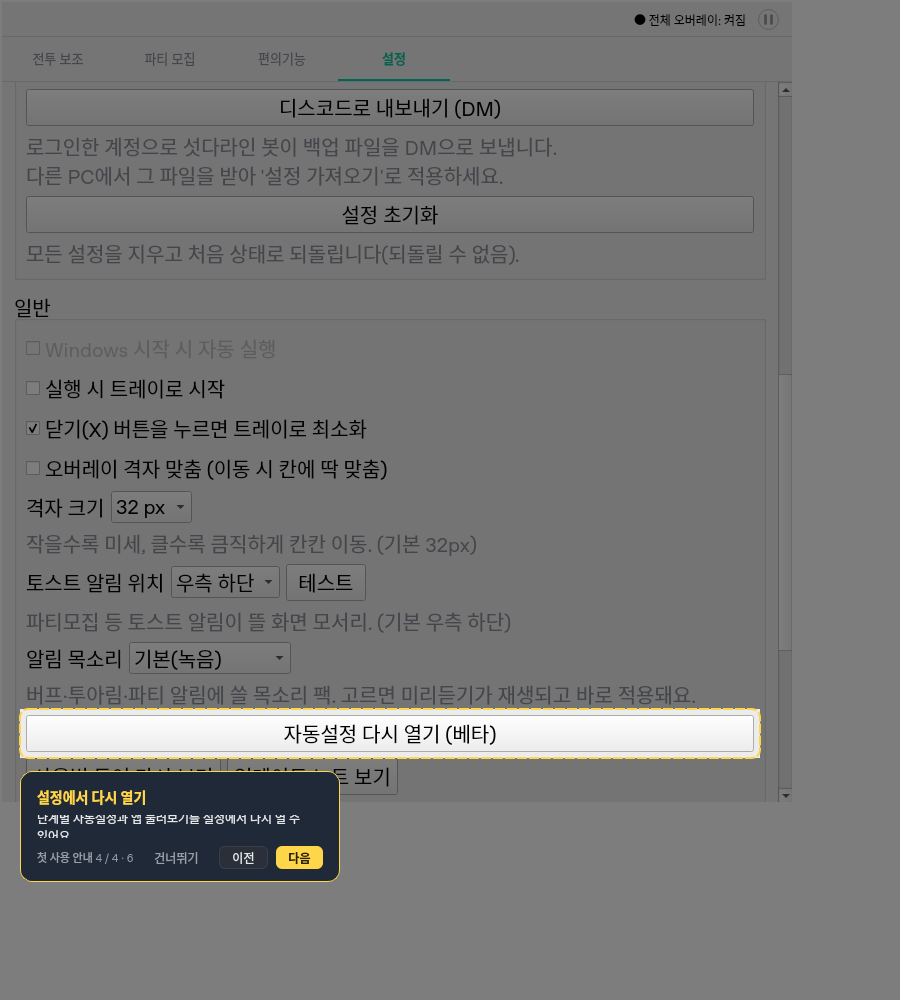
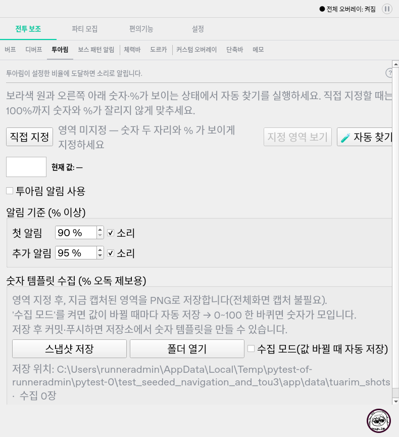

# 큰 글꼴 투어 겹침 수정 후 독립 QA

- **후속 상태:** `bff2497`의 설정 폭 수정 후 원래 경로/투어 18조건이 모두 통과했고,
  Windows 진단에서도 투아림 가로 범위 0과 버튼 전체 표시를 확인했다.
  다만 Windows 행렬은 다음 보스 화면 폭 검사에서 실패해 exe 빌드는 미실행이다.
  [설정 폭 수정 후 QA](투아림_설정폭_수정후_독립QA_20261017.md) 및
  [추가 도르카·투아림 원본 QA](신규_도르카_투아림_원본자료_QA_20261017.md) 참조.

- 날짜: 2026-10-17 (Asia/Seoul).
- 제품 기준: `62fccdcd915797f350a9b15e0a091f59ae3715c8`.
- 대상: `NAV-TOUR-LAYOUT-QA-01`. 원래 재현 도구와 12조건의 기대값을 바꾸지 않았다.
- 제품 변경은 `ui/tour_overlay.py`의 이벤트 기반 재배치다. 렌더 도구/테스트/문서와
  v0.4.82 노트도 갱신됐다. 판독기, 설정 형식, 메뉴 구조, 메인 창은 이전 검증과 같다.
- 커밋 이력/메시지를 조회하지 않았다. QA는 제품/기존 테스트를 수정하지 않았다.
- 실행한 제품 파일 Git blob `71f7e42e92fd455a969eccc8ad7dd6046131850b`,
  원래 재현 `cf45b24fd919b8c8be15d7ed70e722dab8e6ddea`와 원격 해시가 일치한다.

## 원래 실패 검증

```bash
PYTHONPATH=src:. QT_QPA_PLATFORM=offscreen python -m pytest scripts/qa_navigation_tour_layout.py -q --tb=short
```

수정 전 **2 failed, 10 passed**였던 행렬이 수정본에서 **12 passed (17.00초)**다.
20px 글꼴, 900x1000 논리 작업 영역의 설정 안내 단계도 레이아웃 정착 후 카드와 버튼이 겹치지 않는다.
기본/큰 글꼴, 3개 작업 영역(음수 원점 포함), 단계 앞뒤 이동, 완료/건너뛰기,
사용 설정/영역/메모/잠금/전체 정지/선택 화면 보존까지 같은 assertion으로 확인했다.

`scripts/render_navigation.py --large-tour`로 실제 MainWindow를 다시 렌더했다.
단계 6에서 강조 버튼과 설명이 분리된 것을 이미지로도 확인했다.



## 구현 및 비동기 정리

- `tour_overlay.py:131`은 대상과 부모의 Move/Resize/LayoutRequest/Show/Hide를 받는다.
  스크롤로 상위 내용 위젯이 이동하는 경로까지 포함한다.
- `:146`은 소유한 단발 타이머를 한 개만 예약해 이벤트 묶음을 다음 루프에서 재배치한다.
  주기 polling이나 매 틱 갱신을 추가한 것은 아니다.
- `:182`의 단계 변경은 기존 예약과 이전 대상 필터를 정리하고 새 대상만 감시한다.
- `dismiss()`는 중복 호출을 막고 예약/대상/부모/호스트 필터를 해제한다.
  타이머는 투어의 자식이며 정적 singleShot으로 파괴 뒤 콜백을 남기는 변경이 아니다.
- 글꼴 축소, 카드 치수 변경, 안내 대상 제거로 겹침 검사를 회피하지 않았다.

## 관련 검사

- `test_tour_layout.py`, `test_navigation.py`, `test_setup.py`, `test_tracker_layout.py`,
  `test_creator_dialogue.py`: **262 passed (76.63초)**.
- 원래 재현 12건이 새 회귀에 편입돼 위 건수와 중복되므로 고유 총계로 단순 합산하지 않는다.
- 호스트 이동 없이 스크롤, 이벤트 100건의 단일 예약 병합, idle 무실행,
  이전 대상 해제, 숨김 직후 재열기, 종료 중 예약 취소와 기존 투어 복귀/권한/잡담 제외를 포함한다.
- 기존 QThread 누수 및 외부 장치/네트워크 경계 검사를 유지한 상태에서 독립 실행했다.

## 추가 독립 반복 검사

```bash
PYTHONPATH=src:. QT_QPA_PLATFORM=offscreen python -m pytest docs/qa/assets/navigation_20261017/repeated_tour_probe.py -q --tb=short
```

**3 passed (3.07초)**. 건너뛰기/숨김/새 투어로 교체의 3경로를 각각 **30회** 반복했다.
매회 재배치를 예약한 직후 종료하고 실제 이벤트 루프와 Qt DeferredDelete를 처리한다.

- 종료된 투어의 `_place_card` 콜백 실행 없음.
- 기존 예약 정지, 감시 대상 해제, 이전 투어 C++ 객체 파괴 확인.
- 투어 최상위 창 잔존 없음, 본창 표시 유지, 본창 소유 타이머 객체 수 일정.

이는 짧은 생명주기 반복 검사이며 Windows OS 핸들/GDI/실게임 장시간 메모리 추세 측정이 아니다.

## Windows

정확한 제품 SHA의 자동
[Windows validation 38992463140](https://github.com/StarlineBot/mabinogi_addon/actions/runs/38992463140),
job `117277658259`의 실패 로그를 직접 확인했다.

- 격리 회귀 **6 failed, 1340 passed, 1 skipped, 5 deselected**, 413.77초.
- 실패는 `test_tour_layout.py`에 편입된 원래 행렬의 20px 글꼴 6조건이다.
  `scripts/qa_navigation_tour_layout.py:80`의 투아림 `horizontalScrollBar().maximum() == 0`에서 실패한다.
- **투어 겹침 assertion까지 가기 전에 실패한 것이다.** 따라서 Windows에서 원래 겹침이
  다시 발생했다거나 이번 재배치 타이머가 Windows에서 고장났다고 단정하지 않는다.
- 네이티브 통합과 필수 exe 빌드는 **skipped**이며 성공으로 대신하지 않는다.
- 메뉴/투아림 UI 및 원래 QA 스크립트는 직전 소스와 같다. Windows 전체 회귀에 이 행렬이
  이번에 편입되면서 드러난 실패이며 새 투어 수정이 투아림 폭을 바꾼 회귀라고 단정하지 않는다.
- 로그에는 실제 viewport/컨트롤 치수와 가로 범위값이 없어 Windows의 사용자 영향은 추가 확인이 필요하다.

## Confirmed Bug: TUARIM-SETTINGS-WIDTH-QA-01

- 심각도 **P3**. 큰 글꼴·긴 Windows 형식 경로·세로 스크롤 조합에서 투아림 설정 버튼 일부가 잘린다.
- 조건: 위젯 글꼴 20px, 영역 미등록 상태, 샘플 긴 경로를 수집 폴더 표시값으로 넣는다.
  실제 파일을 만들거나 설정 파일의 사용자 경로를 바꾸지 않는 명시적 입력 대조다.
- 기대: 표시 경로가 길어도 자동 찾기 등 조작 버튼 전체가 viewport 안에 남는다.
- 실제: viewport 폭 **776px**, 투아림 내용 최소 폭 **798px**, 자동 찾기 버튼 x=667/w=119로
  오른쪽 끝 **786px**이 viewport를 **10px** 벗어난다. 렌더에서도 오른쪽 잘림을 확인했다.
- 영향: 자동 찾기 버튼 문구와 오른쪽 조작 영역 일부가 가려진다. 게임 UI의 위치 검출 알고리즘 결함은 아니다.
- 원인: `tuarim_tab.py:228`의 긴 경로 QLabel이 minimumSizeHint 폭 750px을 요구하고,
  여백을 포함한 내용 폭이 viewport보다 커진다. `main_window.py:109`는 가로 스크롤을 항상 숨긴다.
  wordWrap=True만으로 이 경로의 최소 폭 제약을 해결하지 못한다.



```bash
PYTHONPATH=src:. QT_QPA_PLATFORM=offscreen python -m pytest scripts/qa_tuarim_settings_width.py -q -s --tb=short
```

**1 failed, 5 passed (2.72초)**. 짧은 경로/CI의 소스 경로 문자열/긴 Windows 형식 경로와
영역 등록/미등록의 6개 조합이다. 긴 경로의 미등록 입력에서 실제 버튼 경계 assertion이 실패한다.

중요한 분리 근거:

- 같은 긴 경로의 **등록 상태**는 가로 범위가 8이지만 viewport 790px 안에 버튼 오른쪽 786px이 들어가 통과한다.
  **가로 범위 > 0만으로 실제 버튼 잘림을 확정할 수 없다.**
- CI의 실제 TuarimTab 소스 실행 수집 경로는 프로젝트 루트 아래이며 pytest tmp_path와 동일하지 않다.
  긴 경로 대조군은 별도의 유효 입력 실험이지 CI 당시 경로를 복원했다고 주장하지 않는다.
- CI 소스 경로 문자열 대조는 Linux에서 통과했다. Windows 실패와 이 긴 경로 재현이
  같은 원인이라고 확정하지 않는다. 폰트/최소 폭/스크롤바 치수를 Windows에서 수집해야 한다.
- 현재 소스의 긴 경로 잘림은 실제 Qt 입력/렌더로 확인한 별도 결함이며,
  이번 투어 타이머 변경으로 새로 생겼다고 주장하지 않는다.

개발 전달: Windows 실패에서 실제 폰트·viewport·내용 최소 폭·각 조작 버튼 사각형·표시 경로를 기록해
실제 잘림과 불필요하게 강한 검사 조건을 구분한다. 투어 배치 검사와 화면 폭 계약을 분리하되,
실제 컨트롤이 잘리면 레이아웃을 보완한다. 숫자 판독기를 바꾸거나 글꼴을 줄이거나 실패를 skip하지 않는다.

## 판단 및 한계

원래 겹침은 동일 Linux 재현과 렌더에서 해결됐다. Windows에서는 별도 폭 검사가 먼저 실패해
큰 글꼴 투어의 최종 통과를 아직 확인하지 못했다. 별도 긴 경로 버튼 잘림도 재현됐다.
논리 작업 영역/20px 글꼴의 offscreen 검증을 Windows 혼합 DPI/실장치 이동 검증으로 대신하지 않는다.
게임 포커스, 전체화면 전환, 장시간 게임 동시 실행은 이번에 다시 실측하지 않았다.
Windows 게이트 실패 및 위 P3를 개발 세션에 전달한다. 제품 구현/기존 테스트/원래 재현은 임의로 고치지 않았다.
이번에는 릴리즈 명령을 제공하지 않으며 수정 후 동일 기대값과 Windows 게이트를 재확인한다.
