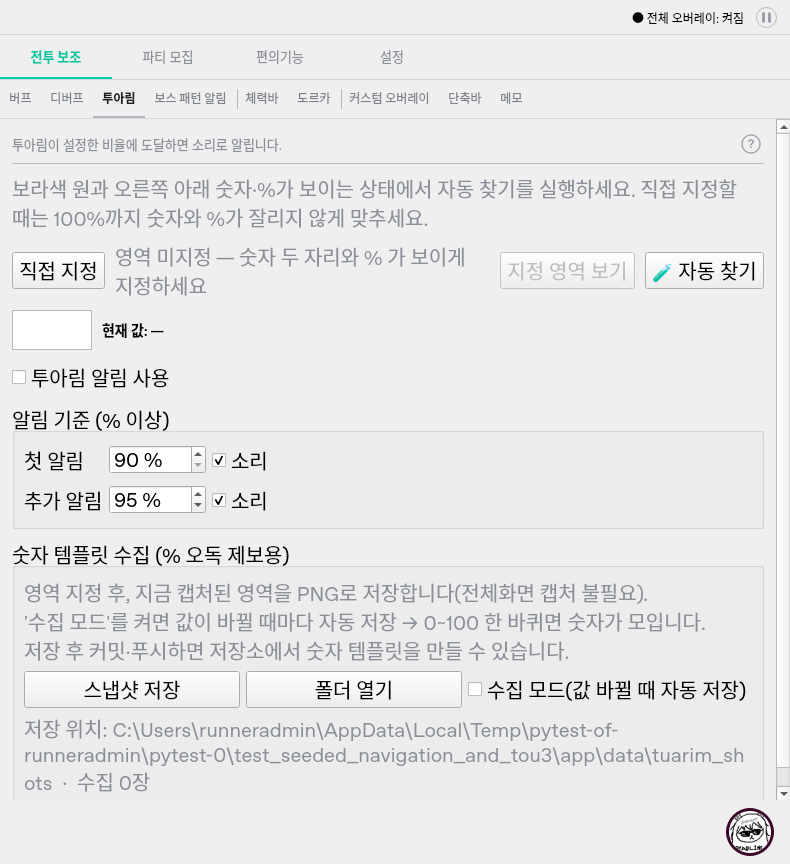

# 투아림 설정 폭 수정 후 독립 QA

- 날짜: 2026-10-17 (Asia/Seoul).
- 제품 `bff2497b69f0034f4b8329eb9b5810828d5fd4c3`를 검증했다.
- 후속 `1b60091101b63f6ceb2d45ff75bb709f1647cb1f`는 ZIP 두 개만 추가했고 제품 소스는 같다.
- 제품 `ui/tuarim_tab.py` blob `994f4e46d47c9ce2a0e5306557b32b715c559805`와 실행 사본의 해시 일치.
- QA에서 제품/기존 테스트/원래 재현을 수정하지 않았으며 커밋 내역과 메시지는 조회하지 않았다.

## 수정 확인

`TUARIM-SETTINGS-WIDTH-QA-01`은 동일한 원본 경로/글꼴/등록 조건에서 수정 확인했다.

```bash
PYTHONPATH=src:. QT_QPA_PLATFORM=offscreen python -m pytest scripts/qa_tuarim_settings_width.py scripts/qa_navigation_tour_layout.py -q --tb=short
```

- 원래 폭 6조건과 투어 12조건: **18 passed (21.88초)**.
- 폭 6조건의 별도 치수 출력 실행: **6 passed (2.86초)**. 원래 기대값을 줄이지 않았다.
- 긴 경로·미등록·20px 조건의 viewport 776px은 같지만 내용 폭은 **798 → 776px**,
  자동 찾기 버튼 오른쪽은 **786 → 764px**, 가로 범위는 **22 → 0**이다.
- 등록 상태의 긴 경로도 가로 범위가 8에서 0이 됐고 버튼 전체가 보인다.
- 원래 투어 겹침도 같은 Linux 행렬에서 재발하지 않았다.



## 소스 및 회귀

- 변경은 수집 경로 표시 전용 `_CapturePathLabel`에 한정됐다. 공통 hint_label이나 판독기는 바뀌지 않았다.
- 가로 정책 Ignored로 긴 경로의 단어 최소 폭이 전체 화면을 밀어내지 않게 한다.
- 실제 표시와 heightForWidth가 같은 QTextLayout/WrapAtWordBoundaryOrAnywhere를 사용한다.
  경로를 자르거나 글꼴을 축소하거나 보이지 않는 문자를 끼워 넣는 방식이 아니다.
- 경로 원문/툴팁/폴더 열기 대상이 유지되고 새 반복 타이머는 없다.
- 진단 fixture는 원래 scrollbar 객체와 반환값을 그대로 사용한다. assertion 삭제/완화/skip은 없다.
- `test_tuarim_settings_width.py`, `test_tour_layout.py`, `test_navigation.py`, `test_setup.py`,
  `test_tracker_layout.py`, `test_creator_dialogue.py`: **270 passed (80.83초)**.
- 한글/공백/깊은 경로, 실제 스크롤 후 버튼 전체 접근, 경로 원문/줄 폭/높이,
  투어 예약/숨김/종료 및 기존 설정/잡담 회귀를 포함한다. 중복 실행을 고유 총계로 합산하지 않는다.

## Windows: 투아림은 개선, 다음 보스 검사 실패

후속 데이터 푸시로 `bff2497` 실행 `38994187720`은 cancelled다. 실패로 세지 않는다.
최신 동일 제품의 자동
[Windows validation 38994257913](https://github.com/StarlineBot/mabinogi_addon/actions/runs/38994257913),
job `117283184451`의 최종 실패 로그를 확인했다.

- **6 failed, 1348 passed, 1 skipped, 5 deselected**, 335.30초.
- 기존 행렬의 큰 글꼴 6조건이 `scripts/qa_navigation_tour_layout.py:80`에서
  이번에는 **`AssertionError: boss`**로 실패한다. 투아림이 아니라 다음 보스 화면이다.
- 기록된 투아림 진단은 큰 화면 viewport/content 790/790, 작은 화면 776/776이며 가로 범위는 모두 **0**이다.
  자동 찾기 버튼 오른쪽은 778/764px로 해당 viewport 안에 들어온다.
- 네이티브 통합과 필수 exe 빌드는 **skipped**다. 통과로 대신하지 않는다.
- 보스의 실제 내용 폭/가로 범위/컨트롤 사각형은 아직 로그에 없다. 범위 불일치만으로
  사용자 버튼이 잘렸다고 확정하지 않는다. 투어 겹침 assertion 전에 실패하므로 Windows 투어 최종 통과도 미확인이다.

개발 전달: Windows에서 9개 화면 전체의 폭/실제 컨트롤 접근을 한 번에 기록해 다음 첫 실패에만
멈추지 않게 검증한다. 큰 글꼴은 실제 조작 접근과 가로 범위를 구분하고, 숨은 가로 스크롤 범위가
왜 생겼는지 확인한 뒤 레이아웃/검사 계약을 바로잡는다. skip이나 글꼴 축소로 녹색 결과를 만들지 않는다.

## 결론

이번 투아림 폭 수정 자체는 원래 재현과 Windows 진단에서 확인됐다. 전체 Windows 게이트는 아직 실패다.
후속 ZIP에서 별도의 도르카/투아림 실제 판독 문제도 발견했다.
[신규 원본 자료 QA](신규_도르카_투아림_원본자료_QA_20261017.md)에 재현과 한계를 분리했다.
제품을 임의로 수정하지 않고 QA 자료만 공유하며 릴리즈 명령은 보류한다.
Linux offscreen/논리 작업 영역 검사는 실제 혼합 DPI/게임 동시 장시간 실행 검증이 아니다.
