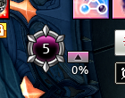

# 투아림 자동 찾기: 오른쪽 구조 검사의 배경 혼입

- 날짜: 2026-10-17 (Asia/Seoul).
- 원격 기준 `710acb7cac242926e9b3abb029c93c061b276e2c`.
- 제품 소스는 이전 검증의 `775e9af`와 동일하다. 새 진단 ZIP/음원과 이전 QA 문서만 추가됐다.
- 제공 자료: `tests/data/autofind_20261016T172504548267Z_2887b867.zip`.
- ZIP Git blob `56d5880c55092ab27cde663b078526ed0b91348e`, 로컬 추출본 해시 일치.
- `input.png` SHA256 `92e10f5989c5e8d63216cfbddc3787890719be895a5c4108a349471053f15990`.
- ZIP 내 모든 PNG의 기록된 SHA256 검증 성공. 제품/원본/템플릿/기존 테스트는 변경하지 않았다.
- 커밋 내역이나 커밋 메시지는 조회하지 않았다.

## Confirmed Bug: TUARIM-RIGHT-MASK-QA-01

- 심각도 **P2**: 정상적으로 보이는 투아림 UI를 자동 등록할 수 없다. 크래시나 알림 중복으로 확대하지 않는다.
- 조건: 제공된 실제 자동 찾기 입력을 저장된 자산 그대로 `run_detector("tuarim", ...)`에 넣는다.
- 기대: `(603,151,42,16)`의 숫자/% 영역을 반환해 승인 단계로 진행한다.
- 실제: None, `anchor_not_found`. 당시 앱도 `failure_stage=detect`, 확인창 `not_offered`다.
- 사용자 영향: UI가 보이고 숫자도 판독할 수 있지만 자동 찾기 실패 안내를 받는다.
- 원인: 공용 장식은 찾았으나, 오른쪽 구조를 검증하는 마스크에 버튼 바깥 배경 픽셀이 남아
  게임 배경 차이에 따라 올바른 후보를 거부한다.



## 실제 실행 및 대조

진단의 `input.png`는 mss 게임 창 캡처 2560x1440이다. UI는 가리지 않았고 도르카 5, 투아림 0%가 보인다.
앱이 실패 후 별도로 찍은 스크린샷이 아니라 **실패 검출기에 실제 들어간 입력**이다.

`autofind_replay.replay()`로 ZIP을 재실행해 `replayed=True`, `matches_recorded=True`, `result=None`을 확인했다.
다섯 자산 `anchor/mask/circle_anchor/circle_mask/circle_anchor_alt`는 현재 제품 로드 결과와 픽셀 단위로 동일하다.
필수 자산 누락, 이미지 저장 실패, 캡처 실패 기록은 없다.

| 확인 항목 | 실행 결과 |
| --- | --- |
| 공용 원형 장식 | 원점 `(569,106)`, 배율 1.0, **0.9949018359** |
| 오른쪽 구조 | **0.9247221947**, 기준 0.97 미달로 거부 |
| 버튼 내부 `(47:71,33:44)` | 원본과 템플릿의 **264픽셀 전부 일치**, 같은 방식의 점수 1.0 |
| 투아림 영역 직접 판독 | `(603,151,42,16)`에서 **0** |
| 같은 원본의 도르카 | `(577,123,28,23)` 검출, **5** 판독 |

여기서 버튼 내부 좌표는 원점 `(569,106)` 기준이며 파이썬 슬라이스의 끝은 미포함이다.

인과 대조군에서는 제품 코드를 바꾸지 않고 원본의 **버튼 밖 마스크 38픽셀만** 모델의 배경값으로 대체했다.
버튼 영역은 그대로이고, % ROI의 첫 배경 행 일부만 영향을 받는다. 그 아래 숫자 픽셀은 모두 그대로이며
대체 전후 모두 **0**으로 판독된다. 이 합성 대조 입력은 `(603,151,42,16)`을 반환하고 구조 점수는
**0.9996889830**으로 바뀐다. 이는 배경 혼입을 분리한 실험이지 화면/배경을 바꾸라는 사용자 해결책이 아니다.
버튼을 지운 별도 음성 대조군에서는 장식이 보여도 투아림 검출은 거부된다.

## 기술적 원인과 코드 위치

- `src/mabinogi_addon/detect/tuarim_anchor.py:37`은 기존 전체 앵커의 마스크를 resize한다.
- `:40`은 왼쪽 45열만 제거한다. **오른쪽 버튼 전용 마스크를 새로 만든 것이 아니므로**
  x=45의 잔여 윤곽/배경과 버튼 아래 y=45의 게임 배경까지 비교 대상으로 남는다.
- 배율 1.0의 오른쪽 비교 영역은 326픽셀이다. 그 중 버튼 주변 바깥 38픽셀의 차이가 이번 실패를 뒤집는다.
- `:43`은 이 마스크로 BGR CCORR_NORMED를 계산하고 `:48`은 0.97 기준으로 거부한다.
- 공용 원형 검출이나 숫자 0의 판독이 실패한 것은 아니다. 이전의 축소 상위 후보 누락과는 다른 단계다.
- 이전 QA는 98% 화면과 기존 원본에서 통과했다. 그 원본들은 이번처럼 검증 영역의 배경 차이를
  충분히 드러내지 못했다. 당시 통과는 사실이지만 전체 라이브 해결 판정 근거로는 부족했다.

## 개발 세션 전달 사항

1. 오른쪽 구조 검증은 실제 불변 버튼 내부/윤곽을 대상으로 정의하고 장식 주변 및 버튼 아래 배경을 배제한다.
   배율 변경 시 마스크의 정렬/반올림도 함께 검증한다.
2. 단순 기준 완화, 버튼 검증 삭제, 도르카 숫자 성공을 필수화하는 수정으로 대체하지 않는다.
   구조가 없거나 잘린 화면/복수 실제 위치를 거부하는 안전 조건은 유지한다.
3. 새 실제 ZIP의 **무변형 원본**으로 기대 좌표를 검증하고, 밝고 어두운 게임 배경 및 1픽셀 이동을 추가한다.
   기존 98% 실패 원본, 0~99/100% 표본, 도르카/단축바 공용 탐색과 진단 ZIP도 회귀 검증한다.
4. QA에서는 구현을 임의로 수정하지 않는다. 개발 후 동일 원본/동일 기대 좌표로 재확인한다.

## 재현 코드와 결과

```bash
PYTHONPATH=src:. QT_QPA_PLATFORM=offscreen python -m pytest scripts/qa_tuarim_right_structure_background.py -q --tb=short
```

- **1 failed, 6 passed (4.41초)**. 실패는 무변형 실제 원본의 기대 좌표 검사다.
- 통과는 저장 기록/자산 일치, 불변 버튼 일치, 38픽셀 인과 대조, 숫자 0 판독,
  같은 원본의 도르카 판독, 버튼 제거 거부다.
- 미해결 재현이 일반 수집을 깨뜨리지 않도록 `scripts/`에 두었다. 기대값을 None으로 낮추지 않는다.
- 원래 축소 후보 누락 재현 10건은 직전 동일 소스 재실행에서도 통과했다. 새 결함이 없다는 의미는 아니다.
- Linux/OpenCV에서 실제 Windows 입력과 자산을 재실행한 검증이다. 새로운 Windows 게임 실행/장시간 자원 검사는 아니다.
- 이번 QA는 문제 보고 및 재현 공유이며, 해결 전 릴리즈 명령을 제공하지 않는다.

## 버전 정보 취급

ZIP 메타데이터에 **0.4.80**, 로그에도 현재 버전 0.4.80 및 새 버전 없음이 기록돼 있다.
이 자료에서는 사용자에게 버전을 별도로 다시 물을 필요가 없었다. 이후 제공 자료의 메타데이터를 먼저 확인한다.
버전 정보는 재현 코드 식별 자료이지 사용자 조작을 원인으로 간주하는 근거가 아니다.
재실행 도구의 `same_app_version=False`는 개발 소스의 `version.py`가 0.0.0이라 생기는 비교값이며,
사용자가 구버전을 실행했다는 뜻이 아니다. 정상 조작으로 실패한 이번 문제는 구현 결함으로 분류한다.
