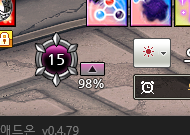

# 투아림 자동 찾기 축소 후보 누락 및 공용 장식 검출 제안

- 날짜: 2026-10-17 (Asia/Seoul).
- 원본 기준 SHA `ecb35b2ff08c88d1a3b9606b54e2ef47e555aab1`, tree `625d680d836d59f5cbacfd5a0c6a709cac15d07e`.
- 직전 QA `c8f3452` 이후 변경은 `tests/data/스크린샷 2026-10-17 012459.png` 한 개다.
  제품 소스는 검증했던 `b65238a`와 같다. 원본은 2560x1440,
  Git blob `84eece069ecae5b9b4bee5b63ff02a6b6ed9e3dd`와 로컬 해시 일치 확인.
- 사용자 제보: 새 화면에서 투아림 자동 찾기가 실패한다.
  추가 제안: 이미 작동하는 도르카 자동 찾기의 장식을 기준으로 오른쪽 아래 % 영역을 찾으면 어떤가?
- QA에서는 원본 PNG·제품 구현·기본 이미지·기존 테스트를 수정하지 않았다. 커밋 이력은 조회하지 않았다.

## Confirmed Bug: TUARIM-COARSE-QA-01

- 심각도 **P2**. 보이는 정상 UI의 자동 등록 실패다. 현재 근거로 앱 크래시나 알림 로직 결함이라고 판단하지 않는다.
- 조건: 새 전체 원본을 실제 `run_detector("tuarim", ...)`에 입력한다.
- 기대: 오른쪽 아래 **98%**의 영역 `(603,151,42,16)`을 반환해 승인 흐름으로 진행한다.
- 실제: 결과 None, rejection=`anchor_not_found`. 같은 화면의 % 영역을 직접 입력하면 **98**로 읽힌다.
- 사용자 영향: 대상이 보이고 판독도 가능하지만 위치를 찾지 못했다는 안내가 나온다.

### 원인과 실행 근거

- `detect/autofind_anchors.py:34`는 전체 화면의 긴 변을 최대 1280으로 축소한다.
  이 입력의 축소 비율은 0.5다. `:51`은 배율마다 축소 점수 상위 **3개**만 원본 해상도로 정밀 확인한다.
- 실제 배율 1.0의 참 위치 주변 축소 최고점은 **0.931386**이다. 1차 기준 0.90보다 높지만
  다른 배경 후보가 더 높은 순위를 차지해 정밀 확인 대상에 들지 못한다.
- 상위 3개 축소 점수는 **0.939442 / 0.937787 / 0.937686**이며, 이들은 원본 정밀 확인에서
  약 **0.890694 / 0.888724 / 0.886663**로 합격 기준 0.97에 미달한다.
  세 후보가 탈락해도 그 아래의 참 후보로 계속 진행하지 않는다.
- 실제 장식 위치 `(569,106,74,57)`를 원본 해상도로 확인하면 **0.988427**로 합격 기준을 넘는다.
  따라서 이번 원본에서 단순히 최종 합격 기준이 너무 높거나 98이라는 숫자를 못 읽는 문제가 아니다.
- `detect/tuarim_anchor.py:8`은 이 후보 결과만 사용한다. 도르카와 달리 장면 전체의
  원본 해상도 대체 탐색 경로가 없다. 후보가 비면 `:20`에서 자동 찾기를 실패시킨다.
- 앱에 가리지 않은 주변 `(535,75,190,135)`만 입력하면 비율 1.0으로 탐색해
  상대 `(68,76,42,16)`을 찾고 98을 읽는다. 이는 분리 대조군이며 사용자에게 수동 지정을 해결책으로 요구하는 것이 아니다.
- 전체 원본을 nearest 방식으로 1픽셀 옮기는 6개 입력은 모두 올바른 좌표와 98을 반환한다.
  원본은 실패하고 같은 UI를 1픽셀 이동한 입력은 성공하는 축소 위상/후보 순위 민감성을 재현했다.



### 최근 도르카 변경과의 관계

- 투아림 전용 검출기와 기존 투아림 앵커/마스크는 도르카 수정 전 소스 스냅샷 `828c224`와 같다.
  공용 함수 변경은 선택적 `cancelled=None` 인자와 취소 확인이며 투아림은 취소 콜백을 전달하지 않는다.
- 해당 수정 전 파일을 그대로 별도 namespace에 로드하고, 현재 함수와 **동일한 원본/자산**으로 실행했다.
  두 함수 모두 수용 후보가 빈 목록이고 정밀 후보 기록도 동일했다.
  이는 특정 파일의 소스 스냅샷 비교이며 커밋 내역/메시지를 조회한 것이 아니다.
- 따라서 이 원본의 실패를 최근 도르카 수정이 투아림을 깨뜨린 회귀라고 결론내리지 않는다.
  기존 후보 제한의 약점이 새 장면에서 확인된 것으로 본다. 이전 실게임에서 잘됐다는 사용자 경험과 모순되지 않는다.

### 실제 재현 및 대조군

```bash
PYTHONPATH=src:. QT_QPA_PLATFORM=offscreen python -m pytest scripts/qa_tuarim_coarse_candidate_miss.py -q --tb=short
```

- **1 failed, 9 passed (4.51초)**. 원본 전체 입력이 실패한다.
- 대조군은 주변 ROI 1건, 전체 입력 1픽셀 이동 6건, 같은 전체 화면의 도르카→% 대응 1건,
  도르카 숫자를 가린 상태에서 투아림 판독 독립성 1건이다.
- 실패 재현은 일반 테스트 수집 밖에 두며 제품 수정 후 같은 기대값으로 재검증한다.
- 기존 투아림/원본 자동 찾기/자동 찾기 MVP/진단 ZIP/도르카 자동 찾기는 **178 passed (46.38초)**다.
  기존 검사 통과와 별개로 새 원본의 누락을 확인했으며, 이 자료만으로 다른 기능까지 불안정하다고 확대하지 않는다.

## 사용자 제안: 장식 위치 검출을 공용화

제안 방향에 동의한다. **같은 UI의 장식 위치/배율을 공용으로 찾고 각 기능의 숫자 영역만 분리**하면,
도르카에만 추가된 탐색 보완을 투아림이 놓치는 경로 차이를 줄일 수 있다.
다만 현재 `locate_dorcha()`의 최종 성공 결과를 그대로 투아림의 필수 조건으로 삼지는 않는다.

### 공용 결과와 영역 계산

- 공용 검출은 게임 화면에서 장식의 원점과 배율을 찾고 여러 위치의 모호한 후보를 구분한다.
- 도르카: 장식 원점에서 `(8,17)` 이동, 크기 `(28,23)`을 배율에 맞춰 계산한다.
- 투아림: 장식 원점에서 `(34,45)` 이동, 크기 `(42,16)`을 배율에 맞춰 계산한다.
- 이번 원본은 배율 1.0, 장식 원점 `(569,106)`, 도르카 `(577,123,28,23)`,
  투아림 `(603,151,42,16)`이며 후자는 실제로 **98**을 읽는다.
- 위 숫자는 현 네이티브 배치의 검증 근거다. 모든 해상도에 절대 좌표를 고정하지 않는다.
  이미 반올림한 도르카 내부 영역에서 배율/원점을 역추정하기보다 공용 장식 좌표와 배율을 직접 사용한다.
- 투아림에는 오른쪽 버튼/% 배치와 영역 잘림 검증도 유지한다. 한 위치가 여러 표본에 걸린 것은 합치되
  실제 여러 위치를 임의로 하나 선택하지 않는다.

### 판독과 설정의 독립성

- 현재 도르카 검출은 0~15 숫자 판독까지 성공해야 한다.
  **도르카 숫자 판독, 기능 ON, 도르카 영역 등록, 도르카 전용 숫자 참조를 투아림 찾기의 필수 조건으로 추가하지 않는다.**
- 이를 실제로 확인하기 위해 주변 ROI의 마스크 내부 숫자만 검게 바꾸었다.
  장식과 98%는 그대로며 투아림은 위치/98 판독 성공, 도르카는 `unreadable_digits`로 실패한다.
  도르카 최종 함수를 직접 호출해 성공을 강제하면 현재 가능한 투아림 사례를 막게 된다.
- 투아림의 100% 입력은 현재 리더가 잘못된 저값/재무장을 막기 위해 None으로 안전 보류하는 경우가 있다.
  `read_percent()`가 None이라는 이유만으로 정상 위치까지 무조건 실패시키면 기존 계약을 깨뜨릴 수 있다.
  위치/구조 확인과 알림에 쓰는 판독값을 분리하고 기존 한 자리·두 자리·100% 검증을 유지한다.
- 공용 탐색/숫자 참조는 진단 ZIP에서도 각각 저장·재실행 가능해야 한다.
- 등록은 기존 승인/취소 방식이며 투아림 임계값·발화 이력·도르카 설정을 덮어쓰지 않는다.
- 이 제안은 **자동 찾기 경로의 공용화**다. 투아림의 상시 추종/주기 재탐색까지 자동 승인한 범위로 확대하지 않는다.

### 개발 후 확인할 범위

- 새 원본과 1픽셀 이동, 기존 0~99/100% 표본, 밝고 어두운 배경에서 검증한다.
- 도르카 숫자 가림/미판독/기능 OFF와 관계없이 투아림 위치를 찾는지 확인한다.
- 도르카 기존 0~15 및 이동 재탐색, 단축바 공용 후보 사용 경로와 진단 ZIP을 회귀 검증한다.
- 후보 수 확장/원본 해상도 대체 탐색의 CPU·메모리·취소/종료 지연을 함께 측정한다.
  최종 임계값을 무작정 낮추거나 매 틱 전체 탐색하도록 바꾸는 방향으로 해결하지 않는다.

## 환경 한계와 별도 관측

- 이 PNG는 실패 안내를 띄운 후 화면이며 당시 자동 찾기 캡처 원본과 동일하다고 단정하지 않는다.
  도르카/투아림 UI는 앱에 가리지 않았고, 앱 영역을 검게 대체한 추가 합성 입력에서도 투아림은 실패했다.
  실제 숨겨진 앱 뒤 게임 화면을 복원한 캡처라고 표현하지 않는다.
- 상위 배경 후보에는 앱 밖 후보도 다수 포함돼 있어 앱 UI의 한 후보만을 단독 원인으로 보지 않는다.
- 스크린샷의 앱 '현재 값 4%'와 실제 게임 98% 차이도 보인다. 현재 UI는 미판독 시 마지막 안정값을
  유지하는 경로가 있어 이 화면만으로 현재 프레임을 4로 오독했다거나 추가 알림이 발생했다고 확정할 수 없다.
  관측값으로 남기되 자동 찾기 누락과 분리한다.
- 실행 환경은 Linux/OpenCV 1스레드다. 실제 Windows 캡처/DPI, 장시간 자원 사용과 라이브 알림은 미검증이다.
- 제품 소스 변경 없이 QA 자료만 공유한다. 새 자동 찾기 결함이 확인돼 릴리즈 명령은 제공하지 않는다.
