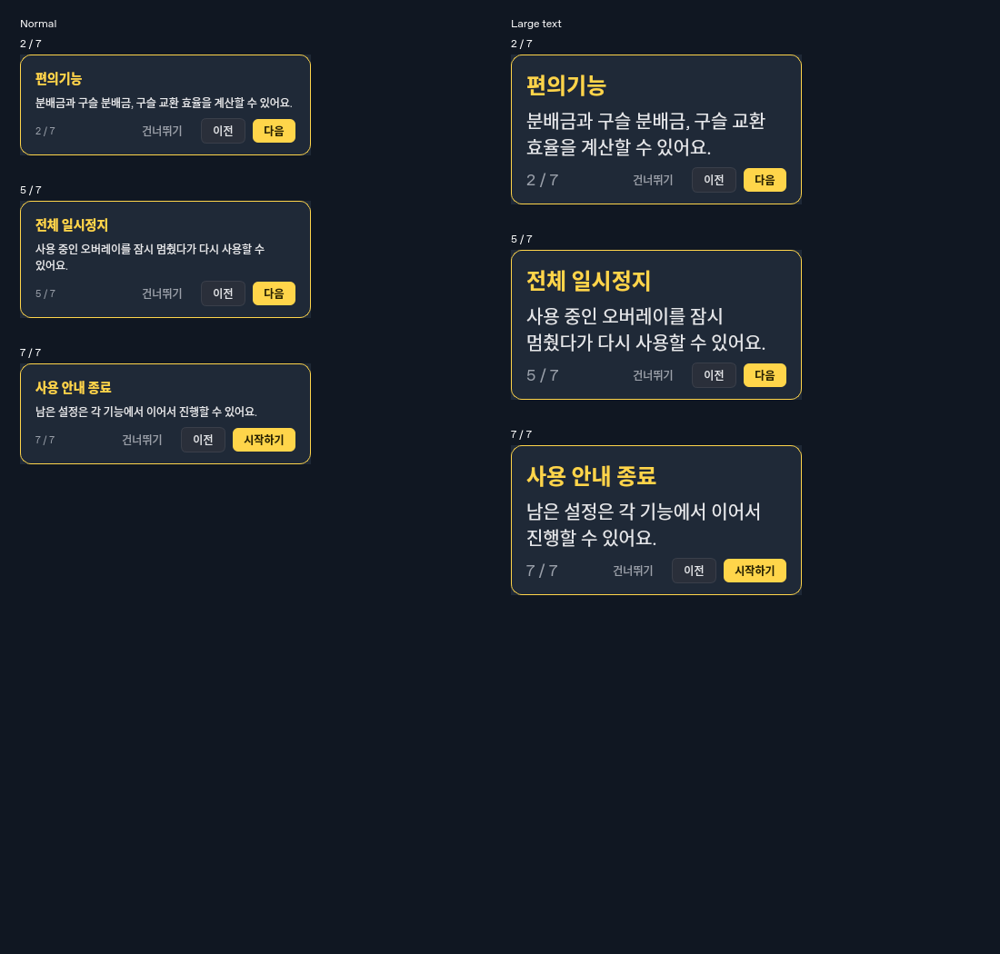

# 투어 글자 잘림 및 잡담 가림 사전 차단 수정

2026-10-20 개발 수정 기록. 기준 소스는 `16386bfd2c24a54b3f277fdc5814965d6d085108`이다.
[최신 통합 QA](qa/헤일로개발과_잡담로그_통합QA_20261020.md)의 라이브 후속을 처리한다.
개발 검증이며 후속 독립 QA나 Windows 네이티브 통과를 의미하지 않는다.

## 투어

- 실제 QA 재현은 수정 전 **4 failed**, 잡담 원인 분리 모델은 **2 passed**였다.
- `TourOverlay`는 최종 카드 폭에서 제목·본문의 word-wrap 높이를 계산해 확보한다.
  footer 전체의 크기 힌트로 버튼/순번 폭을 확보하고, 긴 설명에서 짧은 설명으로 돌아가거나
  글꼴을 줄이면 높이도 다시 줄인다. 0ms 단발 타이머의 이벤트 합치기·idle 무폴링을 유지한다.
- 첫 안내/설정 재실행 모두 현재 투어의 `n / N`만 표시한다. 총 단계는 실제 목록 길이를 사용한다.
  첫 사용 안내 완료/저장·다시 열기·종료 후 원래 화면 복귀 동작은 유지한다.
- 기존 탐색/설정 테스트의 진행 표시 기대만 승인된 요구에 맞췄다. 완료/복귀/설정 보존 검증을 유지했다.
- 정식 회귀는 `tests/test_tour_layout.py`의 첫 안내/설정 × 기본/한국어/큰 글꼴 6조건이다.
  실제 이전/다음 클릭, 정·역방향 전체 단계, label 내부 전체 글자, 버튼 크기/hit-test,
  강조 영역 비겹침·카드 화면 범위, 큰 글꼴에서 원복 및 예약 작업 종료를 확인한다.
  원본 `scripts/qa_tour_text_progress_20261020.py`의 4개 사례는 역사 재현 진입점으로 유지한다.



## 잡담: 사용자 승인한 요구 변경

이 채팅에서 사용자가 **“클릭·자동 모두 표시 시도하고, 실제 가림은 Windows에 맡김”**을 선택했다.
NVIDIA의 실제 픽셀 투명도를 판정하는 데 성공했다고 설명하지 않는다.

- 기본 경로를 `display_available`로 바꿔 다른 프로세스의 Z-order/alpha/region을 검사하지 않는다.
  특정 실행 파일·클래스·PID를 예외로 허용하는 변경이 아니다.
- 얼굴·말풍선은 기존 앱 내부 자식 위젯이다. 외부 창을 넘는 최상위 말풍선을 만들거나
  게임 포커스를 가져오거나 화면을 캡처하지 않는다. 외부 창과의 실제 겹침은 Windows가 합성한다.
- 최소화·숨김·잠금/절전·모니터 밖·설정 OFF·투어/영역 지정 등 제외 화면은 계속 차단한다.
  입력 데스크톱/창/모니터 확인 실패도 표시하지 않는다. 비어 있거나 창 밖인 입력 영역도 거부한다.
- 다른 창에 가려져 있어도 추첨하고 앱 내부 자동 표시 성공을 최근 횟수에 센다.
  겹침만으로 현재 말풍선을 닫지 않고 원래 3초 후 닫는다. 2분 추첨 간격·40/20%·클릭 비집계·
  직전 문장 반복 방지·설정/탭/종료 정리는 유지한다.
- [잡담 명세](creator-dialogue-spec.md)의 조건/횟수/수명/상태표와 acceptance criteria를 함께 갱신했다.
- 기존 `exposed`의 엄격한 가림 검사는 역사 진단/회귀용 진입점으로 보존했다. 이전 재현은 이를
  명시적으로 주입하므로 현재 기본 UI 동작의 증거로 재사용하지 않는다. 새 기본 경로 회귀는
  `tests/test_dialogue_display_policy.py`이며 실제 기본 연결을 검증한다.
- 새 테스트는 외부 창 검사/포그라운드 전환 API 호출을 금지한 모델에서 footer/설정 × 수동/자동을
  검증한다. 별도 Qt 창이 활성인 동안 자동 표시해 활성 창/키보드 포커스 비간섭과 자식 위젯,
  만료/횟수/타이머 수를 확인한다. 잠금·API 실패·화면 밖·최소화·숨김에서는 추첨하지 않는다.
- 실제 Windows HWND 검사에도 불투명 차단 창이 있을 때 `display_available`이 허용하고
  소유 창을 숨기면 거부하는 assertion을 추가했다. 이번 Linux 환경에서는 이 검사를 실행하지 않았다.

Microsoft의 [layered window 설명](https://learn.microsoft.com/en-us/windows/win32/winmsg/window-features)에
따르면 입력 통과 플래그가 있으면 픽셀 모양과 관계없이 마우스를 통과시킬 수 있다.
[GetWindowRgn](https://learn.microsoft.com/en-us/windows/win32/api/winuser/nf-winuser-getwindowrgn)의
ERROR도 region 부재와 오류를 함께 나타낸다. 이를 실제 픽셀 비가림의 증명으로 사용하지 않았다.

## 검증

최종 실행 결과는 아래에 기록한다. Linux Qt offscreen 및 API 모델을 Windows 실행으로 보고하지 않는다.

- 수정 전 재현: 투어 **4 failed**, 잡담 legacy 차단 원인 분리 **2 passed**.
- 투어 최종 원본 재현 + 정식 배치/수명 검사: **27 passed / 31.59초**.
- 잡담 기본 정책 + 기존 region/투명/데스크톱/대사 검사: **126 passed, 1 deselected / 23.73초**.
- 최종 Qt 배율 125/150/200%: 각각 **6 passed / 8.66·8.26·8.49초**. 실제 Windows DPI 검증이 아니다.
- 공개 노트/후보/Unicode 추가 확인: **86 passed / 6.49초**.
- 전체 격리 회귀: **2091 passed, 1 환경 실패, 15 deselected / 629.26초**.
  15개는 `windows_integration`으로 선택하지 않은 실제 네이티브/전송 검사이며 통과로 세지 않는다.
  실패는 기존 Discord 로컬 콜백 테스트의 서버 바인드 제한이었다. 같은 테스트를 제한 환경에서
  다시 실행해 `[Errno 1] Operation not permitted`를 확인했다(**1 failed / 0.27초**).
  제품/테스트를 바꾸지 않고 localhost 통신을 허용한 실행은 **1 passed / 0.19초**다.
  2092개 선택 사례를 이 두 실행 범위로 확인했으며 최초 전체 실행을 단일 녹색 실행으로 표현하지 않는다.

실행 명령(저장소 루트, Python 3.12 가상환경):

```bash
PYTHONPATH=src:.:tests QT_QPA_PLATFORM=offscreen .venv/bin/python -m pytest scripts/qa_tour_text_progress_20261020.py tests/test_tour_layout.py -q
PYTHONPATH=src:.:tests QT_QPA_PLATFORM=offscreen .venv/bin/python -m pytest tests/test_dialogue_display_policy.py tests/test_dialogue_window_region.py tests/test_creator_dialogue.py tests/test_dialogue_transparent_occlusion.py tests/test_dialogue_desktop_failure.py -m 'not windows_integration' -q
PYTHONPATH=src:.:tests QT_QPA_PLATFORM=offscreen .venv/bin/python -m pytest -m 'not windows_integration' -q
# localhost bind/connect이 허용된 동일 환경에서 환경 실패 1건 확인
PYTHONPATH=src:.:tests QT_QPA_PLATFORM=offscreen .venv/bin/python -m pytest tests/test_discord_auth.py::test_login_end_to_end_returns_user -q
```

수정본의 후속 독립 QA와 실제 Windows/NVIDIA 라이브·다중 모니터·혼합 DPI 검증은 남는다.
새 공개 노트는 원격 최신 태그 v0.7.0 다음의 미사용 패치 **0.7.1**로 준비했다.
제품/테스트 입력이 달라졌으므로 이전 0.7.0 후보로 새 수정을 게시할 수 없다.
이번 작업에서는 Windows workflow, 태그, Release 게시를 실행하지 않는다.
