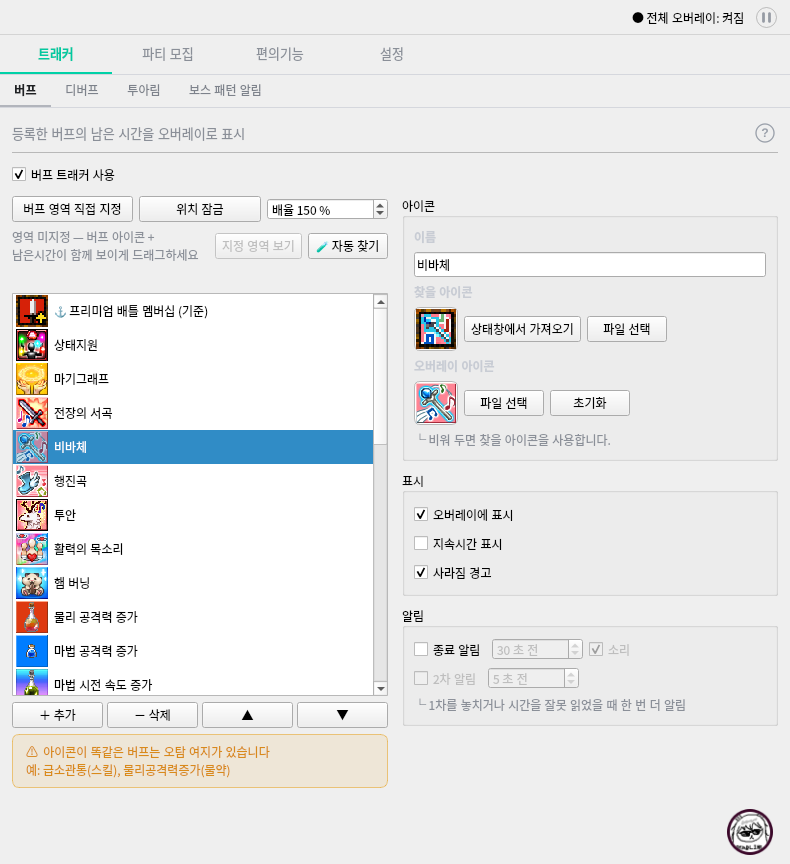
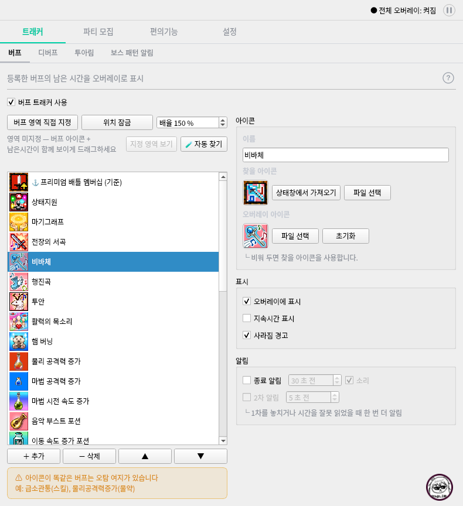

# 제작자 하단 공간을 활용한 트래커 화면 정리

- 작성일: 2026-10-16
- 상태: 사용자와 합의한 배치 방향을 개발·QA 기준으로 정리했다. 제품 반영 후 렌더로 재확인한다.
- 범위: 버프·디버프 탭의 왼쪽 영역 높이 조정. 앱의 전체 화면 재설계가 아니다.
- 관련 명세: [제작자 얼굴 및 랜덤 말풍선](creator-dialogue-spec.md).
- 기준 화면: 최신 원격 소스 `02183f9`를 격리된 임시 경로에서 렌더했다. 사용자 설정·네트워크를 사용하지 않았다.
- 이 문서의 확장 예시는 임시 배치 비교이며, 제품 구현·Windows 검증 완료를 뜻하지 않는다.

## 1. 목적

제작자 얼굴을 위한 본창 높이 증가는 유지한다. 다만 얼굴이 오른쪽 아래에만 있는
버프·디버프 탭에서는 왼쪽까지 하단 공간을 비워 두지 않고 목록 표시 공간으로 활용한다.

하단 얼굴과 기존 기능 조작이 상시 겹치지 않아야 하며, 오른쪽 설정의 위치나 목록의
글자·아이콘 크기를 바꿔 공간을 확보하지 않는다.

## 2. 화면별 적용 범위

| 화면 | 정리 방향 |
|---|---|
| 버프 | 왼쪽 목록 패널을 하단까지 확장. 얼굴은 오른쪽 아래 유지 |
| 디버프 | 버프와 같은 원칙으로 왼쪽 목록 패널을 하단까지 확장 |
| 투아림·보스 패턴 알림 | 현재 콘텐츠와 제작자 공간 배치 유지 |
| 단축바·체력바·분배 계산기·구슬 분배 계산기 | 현재 배치 유지. 빈 곳이 있다는 이유로 컨트롤을 세로로 늘리지 않음 |
| 파티 모집·커스텀 오버레이·메모·환전비율 계산기 | 현재 전용 제작자 하단 공간 유지. 콘텐츠 위에 얼굴을 상시 얹지 않음 |
| 설정 | 기존 제작자 사진 사용. 추가 하단 얼굴 없이 현재 높이 정책 유지 |
| 첫 사용 안내·사용 준비/자동설정·투어·영역 지정/승인 | 기존 배치와 제작자 잡담 제외 정책 유지 |

전체 탭의 공통 하단 공간을 일괄 없애거나 전체 탭 콘텐츠를 일괄 확장하지 않는다.

## 3. 버프 탭 배치

### 왼쪽

- 상단의 영역 지정·위치 잠금·배율, 지정 영역 안내·자동 찾기 및 상태 안내는 현재 순서와 위치를 유지한다.
- 늘어난 높이는 주로 버프 목록이 사용한다. 행 높이·아이콘·글자 크기는 기존과 같다.
- 추가·삭제·순서 이동 버튼은 확장된 목록 바로 아래에 둔다.
- 오탐 주의 안내는 버튼 아래의 기존 순서를 유지하고 왼쪽 패널의 하단으로 내려간다.
- 목록과 버튼·주의 안내를 포함한 왼쪽 전체가 추가 하단의 왼쪽 공간까지 사용한다.
  주의 안내만 기존 위치에 남겨 목록과 큰 간격을 만들지 않는다.
- 목록에 항목이 많으면 기존 목록 내부 스크롤을 유지한다. 이번 변경 때문에 탭 전체에
  불필요한 세로 스크롤을 새로 만들지 않는다.

### 오른쪽

- 아이콘·표시·알림 설정의 상단 위치, 순서와 너비를 유지한다.
- 왼쪽 목록을 확장한다는 이유로 오른쪽 설정을 아래로 밀거나 설정 박스 사이 간격을 크게 늘리지 않는다.
- 제작자 얼굴은 현재 오른쪽 아래 위치와 크기를 유지한다. 얼굴이 기존 설정 컨트롤을 상시 가리지 않는다.

## 4. 디버프 탭 배치

- 왼쪽의 영역 지정·위치 잠금·배율·상태 안내·보스 확인 방식 등 기존 컨트롤의 순서를 유지한다.
- 디버프 목록이 남는 세로 공간을 사용하고 추가·삭제·순서 이동 버튼은 그 아래에 둔다.
- 오른쪽 아이콘·표시 설정과 제작자 얼굴의 위치는 유지한다.
- 기본 보스 확인 방식과 베타 확인 방식, 공유 보스 HP 영역 지정 컨트롤이 노출된 상태를 모두 확인한다.
- 추가 컨트롤이나 여러 줄 안내가 나타나면 목록이 사용할 높이만 조정한다. 버튼·안내가 겹치거나 잘리지 않는다.

## 5. 크기와 반응 조건

- 이 정리를 이유로 본창의 가로 폭이나 세로 높이를 더 늘리지 않는다. 제작자 기능이
  확보한 기존 높이 안에서 왼쪽의 사용 범위만 바꾼다.
- 충분한 작업 영역에서 현재 기준 크기는 일반 화면 `790×864`, 제작자 하단 높이 `64px`이다.
- 비교 렌더에서 버프 목록은 `403px`에서 `467px`로 늘어났으며 약 두 행을 더 볼 수 있었다.
  이 값은 참고 측정치이고 목록 높이를 고정하는 요구가 아니다.
- 실제 확장은 현재 창 크기·DPI·글꼴·안내 줄 수에 맞는 남는 높이를 사용한다.
- 큰 글꼴 등으로 두 열의 최소 필요 폭이 실제 표시 폭을 초과하면 버프·디버프에 한해
  목록 아래로 설정을 이어 배치하고 세로 스크롤로 접근한다. 폭이 충분하면 기존 두 열로
  복귀한다. 이 예외에서는 전용 제작자 하단 공간을 유지한다. 기본 배치의 오른쪽 설정
  위치 유지 기준은 폭이 충분한 두 열 상태에 적용한다. 사용자 렌더 확인 후 승인한 예외다.
- 기존 작은 작업 영역의 창 높이 제한과 스크롤 정책을 유지한다. 모든 환경에서 무조건
  64px을 추가로 늘리거나 필수 조작을 화면 밖으로 보내지 않는다.
- 설정 또는 안내 화면으로 전환했다가 돌아와도 탭별 높이·제작자 위치가 누적 이동하거나
  빈 공간이 추가되지 않는다. 기존 선택 상태나 설정값도 초기화하지 않는다.

## 6. 제작자 얼굴·말풍선과의 관계

- 버프·디버프에서는 얼굴에 필요한 오른쪽 아래 공간을 확보하되, 왼쪽 확장 공간은 실제 목록과 조작에 쓴다.
- 화면에 보이지 않는 제작자 컨테이너나 빈 배경이 왼쪽 목록·버튼의 클릭·휠·툴팁을 가로채지 않는다.
- 얼굴을 누르거나 자동 대사가 나오면 말풍선은 기존처럼 위로 펼쳐질 수 있다.
- 말풍선이 콘텐츠 일부를 잠깐 가리는 것은 허용한다. 이를 막기 위해 왼쪽 확장 공간을 다시 비우지 않는다.
- 3초 표시·클릭 닫기·뒤 컨트롤로 닫는 클릭을 전달하지 않는 동작은 유지한다.
- 얼굴/말풍선의 실제 표시 영역에 대한 가려짐 판정과 포커스 비강탈 조건을 유지한다.
  왼쪽 목록 영역까지 제작자 표시 영역으로 잘못 취급하지 않는다.
- 제작자 잡담 사용 설정 때문에 버프·디버프 목록의 높이를 새롭게 바꾸거나 레이아웃이 튀지 않게 한다.

## 7. 유지할 기존 동작과 범위 밖

- 버프·디버프 등록·삭제·순서 변경·선택·아이콘 설정·알림 설정과 추적 로직은 그대로 유지한다.
- 영역 지정·자동찾기·위치 잠금·게임 오버레이 배율 및 클릭 통과 동작을 변경하지 않는다.
- 베타/로그인 접근 조건과 화면별 설명 문구의 의미를 변경하지 않는다.
- 목록 행 크기 축소, 좌우 비율 재설계, 제작자 얼굴 이동·축소, 말풍선 빈도/대사 변경은 범위 밖이다.
- 특정 Qt 레이아웃·부모 위젯·이벤트 처리 구조는 강제하지 않는다. 임시 렌더의 구현을 제품에 그대로 복사할 필요가 없다.

## 8. 비교 화면

같은 버프를 선택한 상태의 비교이다. 얼굴 위치와 본창 크기를 유지하고 왼쪽 목록과 그 아래 요소만 내려간다.

| 현재 배치 | 왼쪽 확장 예시 |
|---|---|
|  |  |

## 9. Acceptance Criteria

| ID | 검증 가능한 성공 기준 |
|---|---|
| TL-01 | 충분한 작업 영역의 버프 탭에서 왼쪽 패널이 제작자 하단의 왼쪽 공간까지 사용하며, 같은 창 크기·글꼴·행 높이로 기존보다 목록 표시 높이가 늘어난다. |
| TL-02 | 버프 목록 아래 추가·삭제·순서 버튼과 오탐 주의 안내가 기존 순서대로 배치되고 서로 겹치거나 잘리지 않는다. |
| TL-03 | 디버프도 왼쪽 목록이 확장되고 보스 확인 방식별 추가 컨트롤·안내가 나타나도 조작 버튼과 목록이 겹치지 않는다. |
| TL-04 | 버프·디버프 오른쪽 설정의 상단 위치와 너비 및 제작자 얼굴의 위치·크기는 기존 기준 화면과 유지된다. |
| TL-05 | 확장된 왼쪽 공간의 목록 선택·휠·추가·삭제·순서 이동이 가능하며, 투명한 제작자 컨테이너가 입력을 가로채지 않는다. |
| TL-06 | 얼굴 클릭과 자동 대사는 기존 규칙으로 표시되고 말풍선이 닫힐 때 뒤 컨트롤이 실행되지 않는다. 말풍선 때문에 왼쪽 높이가 바뀌지 않는다. |
| TL-07 | 파티·커스텀·메모·환전 계산기는 기존 제작자 전용 공간을 유지하며 얼굴이 콘텐츠를 상시 가리지 않는다. 나머지 비대상 탭의 배치도 바꾸지 않는다. |
| TL-08 | 작은 작업 영역·높은 DPI·긴 안내에서 필수 버튼과 얼굴에 접근할 수 있고, 기존 창 높이 제한을 무시하거나 가로 스크롤을 새로 만들지 않는다. |
| TL-09 | 버프/디버프/다른 탭/설정/안내 화면을 반복 전환해도 높이·여백·얼굴 위치가 누적 변경되지 않고 기존 선택·설정값을 보존한다. |
| TL-10 | 제작자 잡담을 켜고 끄거나 말풍선이 나타났다 사라져도 목록 크기가 튀지 않으며, 실제 표시 영역의 가려짐 판정과 포커스 정책이 유지된다. |

## 10. 개발 전달 및 검증 범위

- 사용자와 합의한 변경 대상은 버프·디버프 왼쪽 영역이다. 일반 화면 전체로 확대 적용하지 않는다.
- 제품 반영 후 버프의 기준 버프/일반 버프 선택, 디버프의 각 보스 확인 방식, 긴 상태 안내,
  정상 크기/작은 작업 영역을 렌더해 사용자에게 보여준다.
- 비교 화면은 Linux 오프스크린의 배치 확인 자료이다. Windows에서 DPI·작업 영역 전환,
  실제 클릭·휠 전달, 말풍선 가려짐과 포커스 동작을 확인한 것으로 대신하지 않는다.
- 개발 착수에 필요한 추가 기능 선택지는 없다. 실제 환경 때문에 요구사항 변경이 필요하면 먼저 협의한다.
